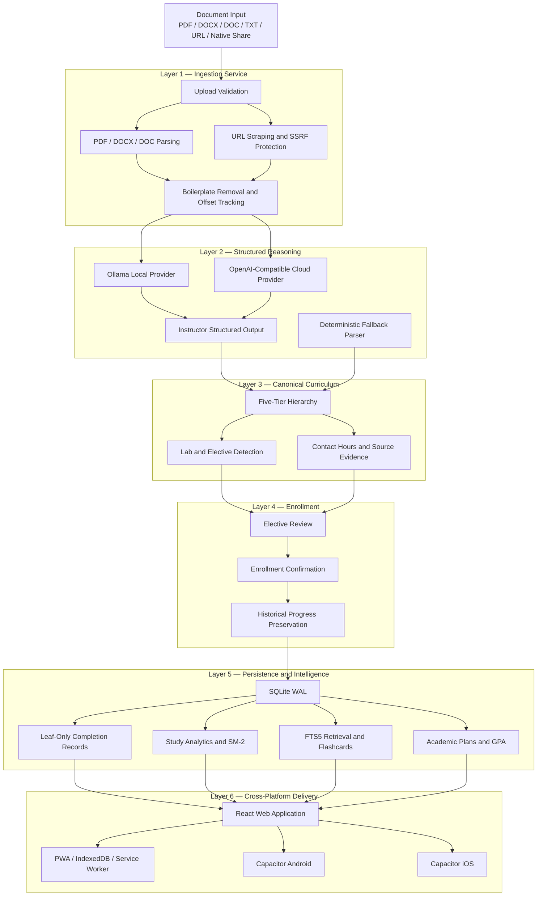

# 📚 Hierarchical Syllabus Checklist & Progress Tracker

### A Local-First Academic Management Platform with AI-Powered Syllabus Extraction, Five-Tier Curriculum Navigation, Progress Analytics, and Cross-Platform Study Tools

[](https://z-syllabus.vercel.app)
[](https://react.dev/)
[](https://fastapi.tiangolo.com/)
[](https://www.sqlite.org/)
[](https://capacitorjs.com/)

**Hierarchical Syllabus Checklist & Progress Tracker** transforms static university syllabus documents into structured, interactive, and trackable academic curricula.

Upload a PDF, DOCX, DOC, or TXT syllabus, or provide a supported university syllabus URL. The application extracts the curriculum, organizes it into a canonical five-tier academic hierarchy, and generates an interactive checklist with evidence-backed topics, automatic progress calculation, elective enrollment, study planning, revision scheduling, and AI-powered study assistance.

Built with a privacy-conscious, local-first architecture, the platform combines deterministic document processing, configurable local/cloud AI providers, SQLite persistence, offline-first synchronization, and a shared-codebase mobile application.

**Live Application:** https://z-syllabus.vercel.app

---

## 🌐 Production Deployment

| Component | Platform | Endpoint | Status |
|---|---|---|---|
| Web Application | Vercel | [z-syllabus.vercel.app](https://z-syllabus.vercel.app) | 🟢 Live |
| Installable PWA | Vercel | [Open Application](https://z-syllabus.vercel.app) | 🟢 Live |
| REST API | Railway | [Production API](https://syllabustrackerchecklist-production.up.railway.app) | 🟢 Live |
| Interactive API Documentation | Railway / FastAPI | [Swagger UI](https://syllabustrackerchecklist-production.up.railway.app/docs) | 🟢 Live |
| API Liveness | Railway | [GET /health](https://syllabustrackerchecklist-production.up.railway.app/health) | 🟢 Live |
| API Readiness | Railway | [GET /ready](https://syllabustrackerchecklist-production.up.railway.app/ready) | 🟢 Live |

> Production availability and endpoint behavior depend on the current hosting environment. The API health and readiness endpoints provide operational diagnostics.

---

## 📑 Table of Contents

- [Overview](#-overview)
- [Core Philosophy](#-core-philosophy)
- [Five-Tier Curriculum Architecture](#-five-tier-curriculum-architecture)
- [Key Features](#-key-features)
- [Application Architecture](#-application-architecture)
- [Technology Stack](#-technology-stack)
- [Getting Started](#-getting-started)
- [Environment Configuration](#-environment-configuration)
- [AI Provider Configuration](#-ai-provider-configuration)
- [Global Windows CLI](#-global-windows-cli)
- [Offline-First Architecture](#-offline-first-architecture)
- [Analytics and Spaced Repetition](#-analytics-and-spaced-repetition)
- [AI Study Assistant and RAG](#-ai-study-assistant-and-rag)
- [Multi-Syllabus Comparison and GPA Planner](#-multi-syllabus-comparison-and-gpa-planner)
- [Mobile Application](#-mobile-application)
- [API and Operational Endpoints](#-api-and-operational-endpoints)
- [Security and Privacy](#-security-and-privacy)
- [Project Structure](#-project-structure)
- [Testing and Quality Assurance](#-testing-and-quality-assurance)
- [Deployment](#-deployment)
- [Troubleshooting](#-troubleshooting)
- [Roadmap](#-roadmap)
- [Contributing](#-contributing)
- [License](#-license)

---

## 🎯 Overview

University syllabi are commonly distributed as static documents containing semesters, subjects, modules, topics, practical courses, electives, and credit information.

Manually converting these documents into actionable study plans is time-consuming and makes it difficult to track academic progress consistently.

This project solves that problem by converting syllabus documents into a structured academic management system.

### What the application provides

- Automated syllabus document ingestion.
- Deterministic document preprocessing and structured extraction.
- Configurable local and cloud AI extraction providers.
- Five-tier hierarchical curriculum organization.
- Evidence-backed topic extraction and source traceability.
- Elective selection and enrollment management.
- Historical progress preservation.
- Cascading completion and real-time academic analytics.
- Module and subject study deadlines.
- Personal Markdown notes and curated learning resources.
- Multi-format export and database backup.
- University syllabus URL ingestion.
- Installable Progressive Web Application.
- Offline-first persistence and synchronization.
- Study analytics and SM-2 spaced repetition.
- Grounded AI study assistance and flashcard generation.
- Multi-syllabus comparison and GPA/credit planning.
- Native Android and iOS packaging through Capacitor.

### Supported syllabus input formats

| Input | Support | Processing |
|---|---|---|
| PDF | ✅ | Text extraction and page-aware evidence |
| DOCX | ✅ | Structured document parsing |
| DOC | ✅ | Headless LibreOffice conversion |
| TXT | ✅ | Plain-text extraction |
| University Portal URL | ✅ | Secure HTML/document discovery |
| Native Shared Files | ✅ | Android/iOS document sharing integration |
| PWA Shared Files | ✅ | Web Share Target integration |

Scanned PDF processing is available through an optional Docling fallback when enabled and appropriately configured.

---

## 🧠 Core Philosophy

The platform follows six engineering principles.

| Principle | Implementation |
|---|---|
| Local-First | SQLite persistence and IndexedDB offline storage |
| Evidence-Based | Verbatim source excerpts and document offsets |
| Deterministic | Rule-based extraction and reproducible progress calculations |
| AI-Assisted | Configurable local and cloud extraction providers |
| History-Preserving | Historical completion records survive elective changes |
| Cross-Platform | Shared React application across Web, PWA, Android, and iOS |

AI is used as an extraction and reasoning assistant, not as an unrestricted source of academic truth.

Every extracted topic should remain traceable to its original syllabus evidence, with uncertain results marked for review.

---

## 🏗️ Five-Tier Curriculum Architecture

The application uses a strict canonical five-tier academic hierarchy.

```text
DOCUMENT ROOT
│
├── ACADEMIC YEAR (Tier 1)
│   │
│   ├── SEMESTER (Tier 2)
│   │   │
│   │   ├── SUBJECT / COURSE (Tier 3)
│   │   │   │
│   │   │   ├── MODULE / UNIT (Tier 4)
│   │   │   │   │
│   │   │   │   ├── SUBTOPIC / TOPIC (Tier 5)
│   │   │   │   ├── SUBTOPIC / TOPIC (Tier 5)
│   │   │   │   └── SUBTOPIC / TOPIC (Tier 5)
│   │   │   │
│   │   │   └── MODULE / UNIT
│   │   │
│   │   └── SUBJECT / COURSE
│   │
│   └── SEMESTER
│
└── ACADEMIC YEAR
```

### Canonical hierarchy

| Tier | Entity | Responsibility |
|---|---|---|
| Root | Document Container | Holds the imported curriculum |
| Tier 1 | Academic Year | Organizes academic years |
| Tier 2 | Semester | Organizes semester-level curricula |
| Tier 3 | Subject / Course | Represents enrolled academic courses |
| Tier 4 | Module / Unit | Organizes course content |
| Tier 5 | Subtopic / Topic | Represents individually trackable learning units |

The hierarchy is preserved throughout extraction, database persistence, UI navigation, analytics, search, export, and AI retrieval.

### Academic year inference

When academic year information is not explicitly available, semester-to-year inference uses integer arithmetic:

\[
\text{Academic Year} =
\left\lceil \frac{\text{Semester Number}}{2} \right\rceil
\]

Explicitly supplied academic-year information takes precedence over inferred values.

---

## ✨ Key Features

### 1. Deterministic Multi-Format Document Ingestion

Convert academic documents into structured curriculum data.

**Capabilities:**

- PDF parsing using `pypdf`.
- DOCX parsing using `python-docx`.
- Legacy DOC conversion through headless LibreOffice.
- Plain-text processing.
- Optional Docling-based scanned-document fallback.
- Header, footer, and page-number noise removal.
- Split-table reconstruction.
- Document offset tracking.
- Secure temporary file handling.
- Bounded extraction time and retry budgets.

**Configured processing limits:**

| Parameter | Default | Purpose |
|---|---:|---|
| `MAX_UPLOAD_SIZE_MB` | 50 MiB | Maximum upload size |
| `MAX_PDF_PAGES` | 1,000 | PDF page-count validation |
| `MAX_EXTRACTED_TEXT_CHARS` | 1,500,000 | Extracted text boundary |
| `EXTRACTION_TIMEOUT_SECONDS` | 180 | Extraction time limit |
| `EXTRACTION_MAX_RETRIES` | 3 | Bounded retry budget |
| `ENABLE_DOCLING_FALLBACK` | False | Optional scanned-document processing |

These are application defaults and should be verified against the active deployment configuration.

### 2. Hot-Switchable Dual-Provider AI Engine

The extraction engine supports two provider categories.

**Local inference**

- Ollama.
- `llama3.1:8b`.
- `qwen2.5:7b`.
- Instructor-based structured output.

**Cloud inference**

- OpenAI-compatible API endpoints.
- OpenAI.
- Groq.
- OpenRouter.
- Configurable compatible models.

Provider selection is controlled through:

```env
EXTRACTION_PROVIDER=ollama
```

or:

```env
EXTRACTION_PROVIDER=openai
```

The extraction pipeline incorporates:

- Structured Pydantic output.
- Bounded retries.
- Deterministic rule-based fallback.
- Untrusted document-content isolation.
- Prompt-injection resistance.
- Evidence-grounded extraction.
- Human-review status for uncertain results.

### 3. Evidence Traceability and Source Verification

Every extracted Tier 5 topic is designed to preserve its relationship with the original syllabus.

| Field | Purpose |
|---|---|
| `source_text` | Exact verbatim source excerpt |
| `source_page` | One-based physical document page |
| `source_start_offset` | Starting position in canonical document text |
| `source_end_offset` | Ending position in canonical document text |
| `grounding_status` | Evidence verification status |

Supported grounding states:

- `verified`
- `needs_review`

This architecture helps users verify extracted content rather than relying entirely on AI-generated interpretations.

### 4. Elective Course Enrollment

The elective onboarding workflow allows students to select their actual academic enrollment before finalizing the checklist.

**Workflow:**

```text
Syllabus Upload
      │
      ▼
Curriculum Extraction
      │
      ▼
Elective Review
      │
      ▼
Student Enrollment Selection
      │
      ▼
Atomic Enrollment Finalization
      │
      ▼
Active Academic Checklist
```

**Key behavior:**

- Interactive elective onboarding modal.
- Mandatory courses remain enrolled.
- Electives can be included or excluded.
- Excluded electives do not contribute to active progress.
- Historical completion records are preserved.
- Re-enrollment restores previously recorded completion history.

Relevant frontend component:

```text
ElectiveOnboardingModal.tsx
```

Relevant API workflow:

```http
GET  /api/syllabus/{id}/review
POST /api/syllabus/{id}/finalize-enrollment
```

### 5. Contextual Laboratory and Practical Course Handling

The extraction engine identifies laboratory and practical subjects through contextual classification.

```json
{
  "is_lab": true
}
```

**Behavior:**

- Laboratory subjects receive a `Lab Course` badge.
- Lab course branches initialize in a collapsed state.
- Laboratory topics remain part of the standard curriculum hierarchy.
- Completion weighting remains uniform.

Laboratory classification is informational and does not independently modify academic progress calculations.

### 6. Module Contact-Hour Metadata

Module-level declared contact hours are extracted and preserved.

```json
{
  "contact_hours": 12
}
```

**Behavior:**

- Optional integer metadata.
- Informational module badge.
- Displayed only when the value is positive.
- Does not change completion weighting.

### 7. Cascading Tri-State Progress Tracking

The application derives parent completion states from enrolled descendant leaves.

| State | Meaning |
|---|---|
| ☑ Checked | All enrolled descendant leaves completed |
| ◐ Indeterminate | Some enrolled descendant leaves completed |
| ☐ Unchecked | No enrolled descendant leaves completed |

Zero-leaf branches display `0/0` and `0%`.

**Important persistence invariant:**

Only valid Tier 5 leaf completion identifiers are persisted.

Parent completion states and percentages are calculated dynamically from the underlying leaf records.

This avoids inconsistent parent-child completion states.

### 8. Dynamic Academic Analytics

Progress is calculated at every hierarchy level:

- Module.
- Subject.
- Semester.
- Academic Year.
- Overall Program.

The interface provides:

- Completion percentages.
- Completed and remaining topic counts.
- Fractional progress.
- Enrolled-course progress.
- Laboratory workload visibility.
- Overall curriculum completion.

### 9. Adaptive Theme System

The application supports:

- Dark theme.
- Light theme.
- System theme.

Implementation includes:

- Centralized semantic design tokens.
- Persistent theme preference.
- First-paint flash prevention.
- Smooth theme transitions.
- Contrast-conscious UI styling.

Theme preference is stored using:

```text
syllabus_tracker_theme
```

### 10. Global Command Palette and Instant Search

A unified keyboard-driven command palette supports navigation across the application.

**Shortcuts:**

| Platform | Shortcut |
|---|---|
| Windows / Linux | `Ctrl + K` |
| macOS | `Cmd + K` |

Searchable entities include:

- Academic years.
- Semesters.
- Subjects.
- Modules.
- Topics.
- Personal notes.
- Bookmarks and resources.

Additional capabilities:

- Fuzzy search.
- Keyboard navigation.
- Deep hierarchy navigation.
- Automatic tree expansion.
- Contextual entity selection.

### 11. Responsive Mobile Experience

The application supports responsive layouts from approximately 360px to 2560px viewport widths.

Mobile-specific functionality includes:

- Slide-over sidebar drawers.
- Touch-friendly interaction targets.
- Viewport-aware bottom sheets.
- Safe-area inset support.
- Topic notes drawer.
- Responsive academic hierarchy navigation.

---

## 📈 Study Analytics and Spaced Repetition

### Study Activity Tracking

The backend maintains historical study activity records using SQLite.

Relevant event tables:

```text
completion_events
revision_events
```

These records support historical analysis independently of the current checklist state.

### Study Analytics API

```http
GET /api/syllabus/{id}/analytics
```

Provides:

- 14-day study velocity.
- Current study streak.
- Longest study streak.
- Completion history.
- Heuristic exam-risk forecasting.

### SM-2 Spaced Repetition Engine

The platform implements a deterministic `sm2-v1` revision scheduler.

The algorithm calculates review intervals using:

- Previous review history.
- Repetition count.
- Easiness factor.
- Recall performance.
- Review interval.

The easiness factor is bounded:

\[
EF \geq 1.3
\]

### Daily Revision Queue

```http
GET /api/syllabus/{id}/revisions/due
```

Review evaluation shortcuts:

| Key | Rating | Meaning |
|---|---|---|
| `1` | Again | Recall failed |
| `2` | Hard | Difficult recall |
| `3` | Good | Successful recall |
| `4` | Easy | Effortless recall |

The revision scheduler connects topic-level learning progress with long-term memory retention.

---

## 🗓️ Study Pacing and Target Deadlines

Students can configure completion deadlines for individual modules and subjects.

The application tracks progress against configured target dates.

Supported visual statuses:

- `on-track`
- `ahead`
- `behind`
- `overdue`

The pacing system uses completion progress and study velocity to provide contextual deadline awareness.

---

## 📝 Personal Notes, Resources, and Export

### Markdown Topic Notes

Students can maintain personal notes against individual syllabus topics.

Capabilities:

- Topic-linked Markdown notes.
- Persistent personal notes.
- Searchable notes.
- Resource bookmarks.
- Curated external reference links.

### Multi-Format Export

Supported export formats:

| Format | Purpose |
|---|---|
| Markdown | Readable academic documentation |
| JSON | Structured curriculum data (Schema 2.2) |
| Encrypted Archive (`.json`) | AES-256-GCM encrypted portable snapshot with PBKDF2-HMAC-SHA256 |
| Printable HTML | Self-contained printable syllabus |
| RFC 5545 iCalendar (`.ics`) | Exam deadlines & SM-2 revision schedules |
| Subscribed Calendar Feed | Live synchronization with Google, Apple & Outlook calendars |
| Full Workspace Backup | Full academic snapshot with notes, resources, plans & flashcards |

For comprehensive calendar specifications, event identity algorithms, elective exclusion invariants, and subscription setup guides, refer to [docs/CALENDAR_INTEGRATION.md](file:///c:/Farhan%20Ahmad/Code%20Languages/Mr.%20Z/Anti%20Gravity/Syllabus_Tracker/docs/CALENDAR_INTEGRATION.md).

### Encrypted Schema 2.2 Backup & Cross-Device Restore

The platform provides full-fidelity Schema 2.2 portable exports and cross-device restoration with optional passphrase encryption.

- **Cryptographic Foundation**: AES-256-GCM encryption with PBKDF2-HMAC-SHA256 key derivation (600,000 iterations, 16-byte random salt, 12-byte random nonce, AAD envelope verification). Constant-time verification prevents side-channel analysis.
- **Export Formats**: Standard unencrypted Schema 2.2 JSON or encrypted `.json` archives. Includes complete academic hierarchy, leaf completions, notes, resources, deadlines, SM-2 revision schedules, GPA academic plans, and flashcard decks.
- **Restoration Modes**:
  - `clone`: Creates a new independent syllabus with newly mapped entity IDs and fresh cryptographic tokens.
  - `replace`: Overwrites all completion state, revision schedules, notes, resources, plans, and flashcards of the current syllabus.
  - `merge`: Non-destructively unions completion records, preserves newer revisions, updates notes with timestamp conflict arbitration, and deduplicates flashcards and resources.
- **Backward Compatibility**: Fully backward-compatible with Schema 2.0 and Schema 2.1 legacy backups.

Relevant endpoints:

```http
POST /api/syllabus/{id}/export/archive
GET  /api/syllabus/{id}/export/json
POST /api/syllabus/restore-backup
```

---

## 🌍 Web URL Syllabus Ingestion

The application can ingest supported web-hosted university syllabi.

Relevant endpoints:

```http
POST /api/scrape/preview
POST /api/scrape/ingest
```

**Capabilities:**

- University portal HTML extraction.
- Syllabus document discovery.
- PDF discovery.
- DOCX discovery.
- Downloadable document processing.
- Preview before ingestion.
- Secure URL validation.

**SSRF defense includes:**

- Private IP address blocking.
- Private subnet restrictions.
- Cloud metadata endpoint blocking.
- URL validation.
- Safe outbound request handling.
- Redirect and destination validation.

Remote URL ingestion is subject to the configured security policy and supported document formats.

---

## 🧮 Multi-Syllabus Comparison and GPA / Credit Planner

**Phase 13 — Cycle A**

Compare two to four academic syllabi and evaluate curriculum differences, workload, credits, and completion progress.

### Curriculum Comparison

The comparison matrix supports:

- Academic years.
- Semesters.
- Subjects.
- Modules.
- Topics.
- Completion percentages.
- Laboratory workload.
- Course credits.
- Weekly lecture hours.
- Weekly tutorial hours.
- Weekly practical hours.

### Intelligent Course Matching

Shared subjects can be identified through:

1. Exact course-code matching.
2. Exact title matching.
3. Fuzzy token-overlap matching.

### Credit Planning

Students can configure:

- Subject credit overrides.
- Target grade points.
- Academic credit projections.
- Completion-based earned credits.

### Strict Credit Invariant

A course awards completed credits only when all enrolled Tier 5 leaves are completed.

In-progress work can contribute to proportional earned-credit estimates.

### Grade Scale Isolation

The planner maintains independent calculations for:

- 10.0 GPA scale.
- 4.0 GPA scale.

These grading systems are never mixed in a single projection.

Excluded electives are omitted from active credit and GPA calculations without deleting historical academic data.

### Offline Support

Academic plan changes are queued using the IndexedDB outbox operation:

```text
SAVE_ACADEMIC_PLAN
```

Queued changes are replayed after network recovery.

---

## 🤖 AI Study Assistant and Local RAG

**Phase 13 — Cycle B**

The application provides a grounded AI study assistant using SQLite FTS5 retrieval.

### Retrieval Architecture

The full-text search index:

```text
syllabus_retrieval_fts
```

Uses:

```text
unicode61
```

Indexed content includes:

- Official enrolled syllabus subtopics.
- Student-authored personal notes.

Content categories:

```text
official_syllabus
personal_note
```

### Grounded Study Assistant

The study assistant provides:

- Context-aware syllabus question answering.
- Source-grounded responses.
- Verbatim quote verification.
- Topic citation references.
- Deep navigation to relevant syllabus nodes.
- Automatic abstention when evidence is insufficient.

The assistant uses explicit untrusted-content fencing:

```text
<untrusted_syllabus_content>
...
</untrusted_syllabus_content>
```

When the retrieved evidence cannot support an answer, the system can return:

```text
insufficient_evidence
```

### Flashcard Generation

The flashcard generator supports:

- Three to five flashcards per Tier 5 topic.
- Configured LLM generation.
- Deterministic offline fallback.
- SHA-256 duplicate detection.
- Active-recall learning.
- Direct SM-2 revision integration.

Evaluation shortcuts:

```text
1 = Again
2 = Hard
3 = Good
4 = Easy
```

Relevant frontend components:

```text
StudyAssistantDrawer.tsx
FlashcardDeckModal.tsx
```

---

## 📱 Mobile Application

**Step 1 / Phase 13 — Cycle C: Capacitor Native Packaging and Cross-Platform Integration**

The project uses a shared-codebase architecture.

The React application contains the primary:

- UI.
- State management.
- Academic business logic.
- Offline persistence.
- Curriculum navigation.
- Study analytics.
- AI assistant integration.

Capacitor wraps the existing web application inside native Android and iOS WebViews.

```text
                SHARED APPLICATION
                        │
             React 19 + TypeScript
                        │
                 Vite Production
                        │
              ┌─────────┼─────────┐
              │         │         │
              ▼         ▼         ▼
             WEB       PWA      CAPACITOR
                                  │
                           ┌──────┴──────┐
                           │             │
                         Android        iOS
                         WebView      WKWebView
```

### Supported Delivery Targets

| Platform | Delivery |
|---|---|
| Desktop Browser | Responsive Web Application |
| Mobile Browser | Responsive Web Application |
| PWA | Installable Progressive Web App |
| Android | APK / AAB |
| iOS | Native iOS application / IPA |

### Native Bridge Capabilities

#### 1. Theme-Aware Status Bar

The native system status bar synchronizes with the active application theme.

Dark mode:

```text
Background: #09090B
Text: Light
```

Light mode:

```text
Background: #FAFAFA
Text: Dark
```

Android-specific status bar background behavior is guarded by platform capability checks.

#### 2. Android Hardware Back Button

The Android hardware back button follows an overlay priority stack.

```text
Command Palette
      ↓
Confirm Delete
      ↓
Study Assistant
      ↓
Flashcard Deck
      ↓
Academic Plan
      ↓
Compare Syllabi
      ↓
Topic Notes Drawer
      ↓
Resources Modal
      ↓
Upload Modal
      ↓
Elective Modal
      ↓
Mobile Sidebar
      ↓
Default Back / Exit
```

The highest-priority active overlay is dismissed first.

#### 3. Native Share-Sheet and Filesystem Export

Native export uses:

```text
@capacitor/filesystem
@capacitor/share
```

Supported exports:

- Markdown.
- Schema 2.1 JSON.
- Printable HTML.

Files are temporarily written to the native cache directory before being passed to the operating system share sheet.

On Web/PWA, browser Blob download fallback is used.

#### 4. Cross-Platform Document Ingestion

Documents can be shared into the application from external applications.

**Android:**

- `ACTION_SEND`
- `ACTION_VIEW`
- `IncomingSharePlugin.java`

**iOS:**

- `CFBundleDocumentTypes`
- `AppDelegate.swift`

**PWA:**

- Web Share Target.
- `POST /share-target`.

Incoming documents are routed through the standard upload validation pipeline rather than bypassing backend validation.

### Capacitor Dependencies

```text
@capacitor/core
@capacitor/cli
@capacitor/app
@capacitor/filesystem
@capacitor/network
@capacitor/share
@capacitor/status-bar
@capacitor/android
@capacitor/ios
```

---

## 🏛️ Application Architecture

The platform is divided into six primary architectural layers.



### Architectural Responsibilities

| Layer | Responsibility |
|---|---|
| Layer 1 | Secure document ingestion and preprocessing |
| Layer 2 | Structured AI reasoning and deterministic fallback |
| Layer 3 | Canonical five-tier curriculum construction |
| Layer 4 | Elective enrollment and history preservation |
| Layer 5 | Persistence, analytics, retrieval, and academic planning |
| Layer 6 | Web, PWA, Android, and iOS delivery |

---

## 🛠️ Technology Stack

### Backend

| Technology | Purpose |
|---|---|
| Python 3.12 | Runtime |
| FastAPI | REST API framework |
| Starlette | ASGI infrastructure |
| SQLModel | Database models |
| SQLAlchemy 2.0 | ORM |
| SQLite | Persistent database |
| SQLite WAL | Transaction and concurrency support |
| SQLite FTS5 | Full-text retrieval |
| Pydantic v2 | Validation and structured data |
| pydantic-settings | Configuration management |

### Document Processing

| Technology | Purpose |
|---|---|
| pypdf | PDF parsing |
| python-docx | DOCX parsing |
| LibreOffice | Legacy DOC conversion |
| Docling | Optional scanned-document fallback |
| BeautifulSoup4 | HTML extraction |

### AI and Structured Extraction

| Technology | Purpose |
|---|---|
| Ollama | Local inference |
| Instructor | Structured LLM output |
| OpenAI-compatible APIs | Cloud inference |
| llama3.1:8b | Local model option |
| qwen2.5:7b | Local model option |
| gpt-4o-mini | Cloud model option |
| Groq | Cloud inference provider |
| OpenRouter | Compatible model routing |

Model availability depends on the selected provider, installed model, and configured API endpoint.

### Frontend

| Technology | Purpose |
|---|---|
| React 19 | UI framework |
| TypeScript | Static typing |
| Vite | Build tooling |
| Tailwind CSS v4 | Styling |
| Radix UI Checkbox | Accessible checkbox primitives |
| Lucide React | Icon system |

### Native Mobile

| Technology | Purpose |
|---|---|
| Capacitor 7 | Native runtime |
| Android WebView | Android application |
| iOS WKWebView | iOS application |
| Capacitor Filesystem | Native file operations |
| Capacitor Share | Native share-sheet integration |
| Capacitor App | Native lifecycle and navigation |
| Capacitor Network | Network state integration |
| Capacitor Status Bar | Native status bar management |

### Offline Storage

| Technology | Purpose |
|---|---|
| IndexedDB | Browser-side persistent storage |
| idb | IndexedDB wrapper |
| Service Worker | PWA asset caching |
| SQLite WAL | Backend persistence |
| FIFO Outbox | Deferred mutation delivery |

### Testing

| Technology | Purpose |
|---|---|
| Pytest | Backend testing |
| pytest-asyncio | Asynchronous backend testing |
| Vitest | Frontend testing |
| React Testing Library | UI component testing |

### Hosting

| Platform | Responsibility |
|---|---|
| Vercel | Frontend and PWA deployment |
| Railway | FastAPI backend hosting |
| Railway Persistent Volume | SQLite database persistence |

---

## 🚀 Getting Started

### Prerequisites

Install the following tools before starting local development.

| Dependency | Recommended Configuration |
|---|---|
| Python | 3.12 |
| Node.js | 18+ |
| npm | Compatible with installed Node.js |
| Git | Latest stable |
| Ollama | Optional, for local AI inference |
| LibreOffice | Optional, for legacy DOC files |
| Android Studio | Optional, for Android builds |
| Xcode | Optional, for iOS builds |

### 1. Clone the Repository

```bash
git clone https://github.com/farhanahmad2106-cpu/Syllabus_Tracker_checklist.git

cd Syllabus_Tracker_checklist
```

### 2. Backend Setup

Create a virtual environment:

**Windows PowerShell**

```powershell
python -m venv .venv

.\.venv\Scripts\Activate.ps1
```

**Linux / macOS**

```bash
python3.12 -m venv .venv

source .venv/bin/activate
```

Install backend dependencies:

```bash
pip install -r requirements.txt
```

Configure the backend environment using the repository's available environment template.

Start the FastAPI server:

```bash
uvicorn app.main:app --reload --host 127.0.0.1 --port 8000
```

> The ASGI import path above assumes the application entry point is `app.main:app`. If the repository uses a different module path, use the actual entry point defined by the project.

Backend documentation:

```text
http://127.0.0.1:8000/docs
```

### 3. Frontend Setup

Open another terminal:

```bash
cd frontend

npm install
```

Configure the frontend environment:

```env
VITE_API_BASE_URL=http://127.0.0.1:8000/api
```

Start the development server:

```bash
npm run dev
```

Open the Vite development URL displayed in the terminal.

### 4. Optional Local AI Setup

Install Ollama:

https://ollama.com/

Download a supported model:

```bash
ollama pull llama3.1:8b
```

Alternatively:

```bash
ollama pull qwen2.5:7b
```

Ensure the Ollama service is running and the configured provider endpoint is reachable.

### 5. Optional Legacy DOC Support

Install LibreOffice:

https://www.libreoffice.org/

Ensure the executable is available to the backend process through the system PATH or the application's configured executable path.

---

## ⚙️ Environment Configuration

### Backend Configuration

The following is a conceptual configuration reference. Use the actual variable names and defaults defined in the repository's settings implementation.

| Variable | Purpose |
|---|---|
| `EXTRACTION_PROVIDER` | Selects `ollama` or `openai` |
| `MAX_UPLOAD_SIZE_MB` | Upload size limit |
| `MAX_PDF_PAGES` | PDF page limit |
| `MAX_EXTRACTED_TEXT_CHARS` | Extracted text limit |
| `EXTRACTION_TIMEOUT_SECONDS` | Extraction timeout |
| `EXTRACTION_MAX_RETRIES` | Retry budget |
| `ENABLE_DOCLING_FALLBACK` | Optional scanned-document fallback |
| `OPENAI_API_KEY` | Cloud API credential, when applicable |
| `OPENAI_BASE_URL` | OpenAI-compatible endpoint, when applicable |
| `OPENAI_MODEL` | Configured cloud model |
| `OLLAMA_BASE_URL` | Local Ollama endpoint |
| `OLLAMA_MODEL` | Configured local model |
| `DATABASE_URL` | Database configuration, if supported |

Do not assume every conceptual variable above is enabled under exactly that name. Confirm the actual settings definitions before configuring deployment.

### Frontend Configuration

File:

```text
frontend/.env.example
```

The primary native and web configuration is:

```env
VITE_API_BASE_URL=
```

**Web / PWA with Vite proxy**

```env
VITE_API_BASE_URL=
```

**Android Emulator**

```env
VITE_API_BASE_URL=http://10.0.2.2:8000/api
```

**iOS Simulator**

```env
VITE_API_BASE_URL=http://127.0.0.1:8000/api
```

**Physical Android / iOS Device**

```env
VITE_API_BASE_URL=http://192.168.1.100:8000/api
```

Replace the example IP with the development machine's actual LAN address.

**Production**

```env
VITE_API_BASE_URL=https://syllabustrackerchecklist-production.up.railway.app/api
```

> Important: `VITE_API_BASE_URL` is embedded into the Vite production bundle at build time. Configure the correct API URL before running the build or Capacitor synchronization commands.

Never place private API keys or backend secrets in `VITE_*` variables. Frontend environment variables are exposed to the client bundle.

---

## 🤖 AI Provider Configuration

The extraction engine supports provider switching without changing the frontend architecture.

### Local Provider

```env
EXTRACTION_PROVIDER=ollama
```

Typical local configuration:

```text
Provider: Ollama
Endpoint: http://localhost:11434
Model: llama3.1:8b
```

Alternative:

```text
Model: qwen2.5:7b
```

### Cloud Provider

```env
EXTRACTION_PROVIDER=openai
```

Configure the required OpenAI-compatible API endpoint, model, and secret credentials using the backend's supported settings.

Potential providers:

- OpenAI.
- Groq.
- OpenRouter.
- Other compatible endpoints.

### Provider Selection Principles

- Local inference can operate without transmitting syllabus content to a cloud AI provider.
- Cloud inference requires network connectivity and valid credentials.
- Provider errors must be handled without silently accepting malformed structured output.
- Extraction retries must remain bounded.
- Deterministic fallback behavior must be preserved.
- Uploaded syllabus content must always be treated as untrusted input.

---

## ⚡ Global Windows CLI

The project includes a Windows global CLI launcher named:

```text
syllabus
```

It provides process supervision, service management, job tracking, and non-destructive port conflict handling.

### One-Time Installation

Run PowerShell inside the repository:

```powershell
.\scripts\setup-global-cli.ps1
```

The setup registers the launcher in the current user's PATH without requiring administrator privileges.

Restart the terminal if required.

### Usage From Any Directory

```powershell
syllabus
```

Starts the managed backend, frontend, and configured Ollama service, then opens the application in the browser.

### Available Commands

| Command | Description |
|---|---|
| `syllabus` | Start application services |
| `syllabus status` | Inspect process IDs, ports, and health |
| `syllabus logs backend -f` | Follow backend logs |
| `syllabus stop` | Stop managed services |
| `syllabus restart` | Restart managed services |
| `syllabus help` | Display available commands and configuration |

The launcher should only terminate processes it owns or has explicitly identified as managed services.

---

## 🔄 Offline-First Architecture

The application uses an offline-first synchronization strategy.

### PWA Components

```text
React Application
       │
       ▼
Service Worker
       │
       ├── Static Asset Cache
       │
       ▼
IndexedDB
       │
       ├── Local Persistence
       │
       └── Offline Outbox
                 │
                 ▼
          Network Recovery
                 │
                 ▼
           Backend API
```

### Main Components

| Component | Responsibility |
|---|---|
| `manifest.webmanifest` | Installable application metadata |
| `sw.js` | Service Worker asset caching |
| `syllabus_tracker_offline_v1` | IndexedDB database |
| `offline_outbox` | Pending offline mutations |
| `useOfflineSync` | Network recovery reconciliation |
| `OfflineStatusBanner.tsx` | Offline connectivity status |

### Synchronization Behavior

- Local mutations are queued while offline.
- Queued operations follow FIFO ordering.
- Network recovery triggers synchronization.
- Conflict detection identifies incompatible updates.
- Pending operations are reconciled with the backend.
- The application provides non-blocking offline status feedback.

Offline functionality depends on the specific feature, cached assets, locally available data, and whether an operation requires remote inference or backend processing.

---

## 🔌 API and Operational Endpoints

The FastAPI backend exposes REST endpoints for curriculum management, extraction, analytics, study planning, and document processing.

### Principal Endpoint Reference

| Endpoint | Method | Purpose |
|---|---|---|
| `/health` | GET | Liveness and operational diagnostics |
| `/ready` | GET | Readiness and database connectivity |
| `/api/syllabus/{id}/review` | GET | Review extracted curriculum and electives |
| `/api/syllabus/{id}/finalize-enrollment` | POST | Finalize elective enrollment |
| `/api/syllabus/{id}/analytics` | GET | Retrieve study analytics |
| `/api/syllabus/{id}/revisions/due` | GET | Retrieve due revision topics |
| `/api/scrape/preview` | POST | Preview a syllabus URL |
| `/api/scrape/ingest` | POST | Ingest a syllabus URL |
| `/api/syllabus/restore-backup` | POST | Restore a compatible backup |

Refer to the live Swagger documentation for the authoritative request schemas, response models, authentication requirements, and complete endpoint inventory.

[Open Production API Documentation](https://syllabustrackerchecklist-production.up.railway.app/docs)

### Health vs Readiness

**Liveness — `/health`**

Indicates whether the API process is alive and reports configured operational diagnostics.

**Readiness — `/ready`**

Checks whether the application is ready to serve requests, including database connectivity.

Operational endpoints must not disclose secrets, credentials, or sensitive database information.

---

## 🔐 Security and Privacy

Security is treated as an architectural requirement rather than a frontend-only feature.

### Document Upload Security

- Server-side upload size enforcement.
- File-format validation.
- PDF page-count limits.
- Document processing timeouts.
- Bounded extraction retries.
- Temporary file handling.
- Magic-byte validation for supported incoming files.

### Web Scraping Security

- SSRF protection.
- Private IP and subnet blocking.
- Cloud metadata endpoint blocking.
- Safe URL validation.
- Destination validation.
- Secure document download handling.

### AI Security

- Explicit untrusted-content delimiters.
- Prompt-injection defense.
- Structured output validation.
- Evidence-based answer verification.
- Automatic abstention when evidence is insufficient.

### Data Security

- SQLite foreign-key enforcement.
- Transactional persistence.
- Historical event records.
- Secret separation between frontend and backend.
- Database readiness checks.
- Validated backup restoration.

### Privacy Considerations

The local AI provider offers a route for processing syllabus content without sending it to an external AI provider.

Cloud AI providers and hosted backend services may process data outside the local device, depending on configuration.

Users deploying the application should review the privacy policies and data-handling requirements of their selected hosting and inference providers.

---

## 📂 Project Structure

The following is a logical architectural overview. Exact filenames and directories should be verified against the current repository.

```text
Syllabus_Tracker_checklist/
│
├── app/
│   ├── main.py
│   ├── api/
│   ├── models/
│   ├── schemas/
│   ├── services/
│   ├── database/
│   ├── extraction/
│   ├── analytics/
│   ├── retrieval/
│   └── security/
│
├── frontend/
│   ├── src/
│   │   ├── components/
│   │   ├── features/
│   │   ├── hooks/
│   │   ├── pages/
│   │   ├── services/
│   │   ├── stores/
│   │   ├── utils/
│   │   └── types/
│   │
│   ├── public/
│   │   ├── manifest.webmanifest
│   │   └── sw.js
│   │
│   ├── android/
│   ├── ios/
│   ├── capacitor.config.ts
│   ├── package.json
│   └── .env.example
│
├── scripts/
│   ├── setup-global-cli.ps1
│   └── ...
│
├── tests/
│   ├── backend/
│   └── ...
│
├── requirements.txt
├── README.md
├── .gitignore
└── ...
```

---

## 🧪 Testing and Quality Assurance

The project uses a multi-layered testing strategy.

### Backend Testing

Frameworks:

```text
pytest
pytest-asyncio
```

Recommended coverage areas:

- Document ingestion.
- File validation.
- PDF page limits.
- Structured extraction.
- Deterministic fallback.
- Five-tier hierarchy validation.
- Elective enrollment.
- Historical progress preservation.
- Leaf-only completion persistence.
- Contact-hour extraction.
- Lab detection.
- SQLite transaction behavior.
- SM-2 revision scheduling.
- FTS5 retrieval.
- Backup and restoration.
- SSRF protection.
- Health and readiness endpoints.

### Frontend Testing

Frameworks:

```text
Vitest
React Testing Library
```

Recommended coverage areas:

- Curriculum tree rendering.
- Tri-state checkbox behavior.
- Progress calculations.
- Elective onboarding.
- Theme switching.
- Command palette navigation.
- Offline outbox behavior.
- Academic plan updates.
- Flashcard evaluation.
- Responsive UI behavior.

### Native Mobile Testing

Validate:

- Android application startup.
- iOS application startup.
- Native back-button behavior.
- Native status bar synchronization.
- Share-sheet export.
- Incoming shared documents.
- File validation.
- API connectivity.
- Offline and recovery behavior.

### Suggested Local Verification Commands

Backend:

```bash
pytest -q
```

Frontend:

```bash
cd frontend

npm run build
```

Frontend tests:

```bash
npm run test
```

> Use the actual scripts defined in `frontend/package.json`. A successful production build does not independently prove native runtime correctness or production integration.

---

## 🚢 Deployment

### Production Architecture

```text
                 USER
                  │
                  ▼
          Vercel Edge CDN
                  │
                  ▼
          React 19 / PWA
                  │
                  │ HTTPS API Requests
                  ▼
             Railway
                  │
                  ▼
           FastAPI Backend
                  │
                  ▼
             SQLModel
                  │
                  ▼
          SQLite WAL Database
                  │
                  ▼
        Persistent Railway Volume
```

### Frontend Deployment

Platform:

```text
Vercel
```

Production URL:

https://z-syllabus.vercel.app

Configure the frontend build environment with the production API URL.

Ensure that Vercel build settings point to the correct frontend root directory and build command.

### Backend Deployment

Platform:

```text
Railway
```

Production API:

https://syllabustrackerchecklist-production.up.railway.app

Ensure:

- Python runtime compatibility.
- Correct ASGI startup command.
- Required environment variables.
- Persistent SQLite storage.
- Correct CORS configuration.
- Database directory permissions.
- Health and readiness probes.
- Database backup strategy.

### SQLite Persistence

The production backend uses persistent volume storage for SQLite data.

The database must not be stored exclusively in an ephemeral container filesystem.

The deployment should preserve:

- Database files.
- WAL-related consistency.
- Backup availability.
- Correct database paths.
- Safe shutdown and restart behavior.

---

## 📦 Capacitor Build and Synchronization

Native build scripts are maintained in:

```text
frontend/package.json
```

### Synchronize Native Projects

```bash
npm run cap:sync
```

Builds the Vite production bundle and synchronizes web assets and Capacitor plugins.

### Open Android Studio

```bash
npm run cap:android
```

Builds frontend assets, synchronizes the Android project, and opens Android Studio.

### Open Xcode

```bash
npm run cap:ios
```

Builds frontend assets, synchronizes the iOS project, and opens the Xcode workspace.

### Android Prerequisites

- Android Studio.
- Android SDK.
- Android API Level 35 target.
- Android Build Tools 35.0.0.
- JDK 17 or JDK 21, as compatible with the configured Gradle toolchain.

### iOS Prerequisites

- macOS.
- Xcode 15 or newer.
- CocoaPods.
- Valid Apple Developer provisioning configuration for physical-device signing.

**Platform limitation:** Native iOS binaries must be compiled and signed on macOS using Xcode. The iOS project can be maintained from Windows, but a Windows machine cannot perform the native Xcode build.

### Release Artifacts

Android:

```text
.apk
.aab
```

iOS:

```text
.ipa
```

Actual output paths depend on the configured Gradle and Xcode build settings.

---

## 🛠️ Troubleshooting

### 1. Frontend Cannot Connect to Backend

Verify:

```env
VITE_API_BASE_URL=http://127.0.0.1:8000/api
```

Check that FastAPI is running and that the configured API base URL is reachable.

For Android Emulator, use:

```env
VITE_API_BASE_URL=http://10.0.2.2:8000/api
```

### 2. Ollama Provider Is Unavailable

Check:

```bash
ollama list
```

Verify that the selected model is installed and the Ollama service is running.

### 3. Legacy DOC Files Fail to Process

Verify LibreOffice installation and executable availability.

### 4. Scanned PDFs Cannot Be Extracted

Check whether Docling fallback is installed and enabled.

```env
ENABLE_DOCLING_FALLBACK=true
```

Docling can require significant memory and additional dependencies. Enable it only when the deployment environment can support it.

### 5. Offline Changes Are Not Synchronizing

Check:

- Browser connectivity.
- IndexedDB availability.
- Outbox persistence.
- Backend readiness.
- Authentication or authorization requirements, if enabled.
- Failed operation and conflict logs.

### 6. Native Mobile API Requests Fail

Verify that the production or local backend URL is configured before the Vite build and Capacitor synchronization.

Remember that native WebViews do not automatically resolve backend-relative `/api` paths to the development machine.

### 7. SQLite Database Appears to Reset After Deployment

Verify that:

- The Railway persistent volume is attached.
- The database path points inside the mounted volume.
- The backend process has write permissions.
- Database initialization does not recreate an existing database.
- Backup and restoration procedures are configured.

---

## 🗺️ Roadmap

The following table summarizes the major development milestones represented by the current project specification.

| Phase | Milestone | Capability |
|---|---|---|
| Core | Curriculum Engine | Five-tier hierarchy and progress tracking |
| Core | AI Extraction | Local/cloud structured extraction |
| Core | Enrollment | Elective onboarding and historical preservation |
| Phase 10 | Interface Modernization | Theme system and global command palette |
| Phase 11 | Offline and Mobile UX | Responsive UI and PWA synchronization |
| Phase 12 | Study Intelligence | Analytics and SM-2 scheduling |
| Phase 13A | Academic Planning | Multi-syllabus comparison and GPA/credit planner |
| Phase 13B | AI Study Assistant | FTS5 retrieval and grounded flashcards |
| Phase 13C | Native Integration | Share-sheet, filesystem, and document ingestion |
| Step 1 | Capacitor Packaging | Android and iOS native application packaging |

---

## 🤝 Contributing

Contributions, suggestions, bug reports, and improvements are welcome.

### Suggested Contribution Workflow

1. Fork the repository.
2. Create a feature branch.
3. Implement the change.
4. Add or update relevant tests.
5. Run backend and frontend verification.
6. Ensure existing hierarchy and persistence invariants remain intact.
7. Submit a pull request with a clear description.

### Engineering Guidelines

- Preserve the canonical five-tier hierarchy.
- Never persist derived parent completion states as independent truth.
- Preserve historical progress when electives change.
- Keep source evidence attached to extracted topics.
- Treat imported documents as untrusted content.
- Keep AI extraction retries bounded.
- Preserve offline synchronization semantics.
- Avoid introducing duplicated academic business logic in native applications.
- Maintain backward compatibility for existing backup schemas.

For bug reports, include:

- Expected behavior.
- Actual behavior.
- Reproduction steps.
- Relevant logs.
- Environment details.
- Screenshots where appropriate.

---

## 📄 License

A license has not been specified in this README.

Until a license file is added to the repository, do not assume that the project is open-source or that unrestricted reuse, modification, or redistribution is permitted.

---

## 👨‍💻 Project

**Hierarchical Syllabus Checklist & Progress Tracker**

Production Application:

https://z-syllabus.vercel.app

Backend API:

https://syllabustrackerchecklist-production.up.railway.app

API Documentation:

https://syllabustrackerchecklist-production.up.railway.app/docs

Repository:

https://github.com/farhanahmad2106-cpu/Syllabus_Tracker_checklist

---

<p align="center">

**Built to transform static academic syllabi into actionable learning journeys.**

📚 Structure Your Curriculum · 🎯 Track Your Progress · 🧠 Learn Smarter

</p>
