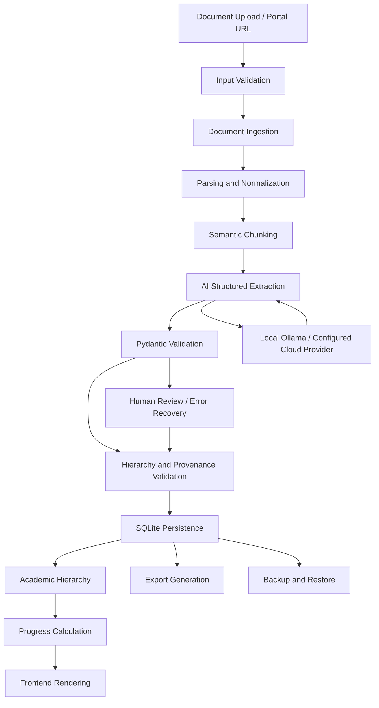
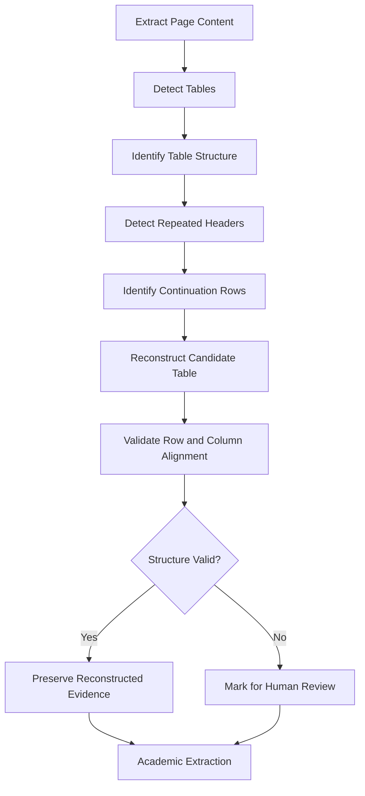
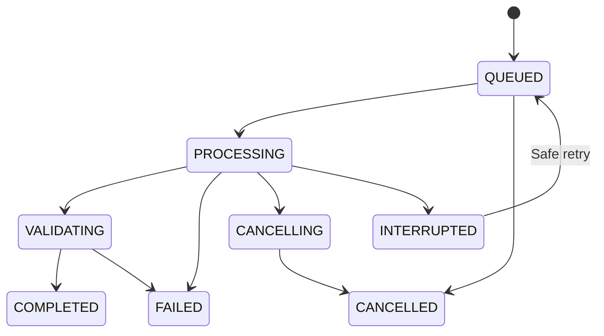

# Technical Requirements Document (TRD)
## Hierarchical Syllabus Checklist & Progress Tracker

| Document Attribute | Value |
|---|---|
| Document ID | TRD-10 |
| Document Name | `10_TRD.md` |
| Project | Hierarchical Syllabus Checklist & Progress Tracker |
| Repository | https://github.com/farhanahmad2106-cpu/Syllabus_Tracker_checklist |
| Version | 1.0.0 |
| Status | Draft — Repository Verification Required |
| Last Updated | 2026-11-17 |
| Document Type | Technical Requirements Document |
| Primary Architecture | Local-first, document-driven application |
| Primary Database | SQLite |
| Target Audience | Architects, developers, QA, security reviewers and maintainers |

---

# 1. Document Control & Technical Scope

## 1.1 Purpose

This Technical Requirements Document defines the measurable technical requirements, engineering constraints, reliability expectations, security boundaries, compatibility requirements, and verification criteria for the Hierarchical Syllabus Checklist & Progress Tracker.

The document establishes an engineering contract for implementing and maintaining the application.

It defines what the system MUST support, the limits it MUST enforce, how failures MUST be handled, and how implementation correctness MUST be verified.

This document is not a replacement for the Software Requirements Specification, architecture documentation, or implementation guide.

## 1.2 Technical scope

The technical scope includes:

- Multi-format academic document ingestion.
- PDF, DOCX, DOC and TXT processing.
- University portal ingestion.
- Structured AI-assisted academic extraction.
- Five-tier academic hierarchy.
- Source-grounded academic information.
- Leaf-only completion persistence.
- Deterministic tri-state progress calculation.
- Elective selection and historical progress preservation.
- Lab identification and contact-hour metadata.
- Study deadlines and pacing calculations.
- Topic-specific notes and resource bookmarks.
- SQLite persistence and backup.
- Markdown, Notion-compatible Markdown, JSON, HTML and PDF exports.
- Local and cloud AI provider integration.
- Background processing and cancellation.
- Network and application security.
- Responsive frontend behavior.
- Offline resilience.
- Automated testing and operational diagnostics.

## 1.3 Out of scope

Unless separately specified and implemented, this TRD does not establish requirements for:

- Multi-user cloud collaboration.
- Institutional student-information-system integration.
- University examination result synchronization.
- Automatic access to authenticated university portals.
- Distributed database infrastructure.
- Mandatory cloud storage.
- Always-on internet connectivity.
- Guaranteed OCR accuracy.
- Guaranteed LLM extraction correctness.
- Native mobile application functionality.
- Centralized enterprise identity management.

Future mobile WebView or Capacitor integration is a compatibility consideration, not a guarantee of native mobile support.

## 1.4 Requirement classification

Every technical requirement uses one of the following classifications.

| Classification | Meaning |
|---|---|
| MUST | Mandatory requirement |
| SHOULD | Strong engineering recommendation |
| MAY | Optional capability |
| TARGET | Quantitative performance objective |
| PROPOSED | Recommended functionality requiring implementation |
| NOT VERIFIED | Repository evidence is insufficient |

A requirement being documented does not mean it has already been implemented.

## 1.5 Implementation evidence policy

The following evidence hierarchy MUST be followed:

1. Actual source-code implementation.
2. Automated tests and CI configuration.
3. Existing architecture and technical documentation.
4. Configuration files and deployment manifests.
5. Supplied project requirements.

Repository implementation status is currently unverified for this document.

Consequently, no source-code path, API endpoint, environment variable, test count, or performance result is claimed as verified.

Implementation status MUST be updated following an actual repository audit.

## 1.6 Assumptions and dependencies

| Dependency | Technical purpose | Verification |
|---|---|---|
| Python backend | Parsing, processing and application services | Required |
| FastAPI | HTTP API framework | Repository verification required |
| SQLite | Local persistence | Required architecture |
| SQLite WAL | Concurrent read/write behavior | Required configuration |
| React/Vite frontend | Academic workspace | Repository verification required |
| Pydantic | Structured data validation | Repository verification required |
| Instructor | Structured LLM extraction | Repository verification required |
| Ollama | Local inference | Repository verification required |
| OpenAI-compatible API | Optional cloud inference | Repository verification required |
| Docling | Document layout extraction | Repository verification required |
| pypdf | Digital PDF text extraction | Repository verification required |

## 1.7 Terminology

| Term | Definition |
|---|---|
| Academic leaf | Individual Tier-5 trackable topic |
| Parent node | Academic node containing descendant nodes |
| Provenance | Information identifying the origin of extracted content |
| Source evidence | Original text supporting an extracted academic entity |
| Semantic chunk | Meaningful document segment supplied to an extraction model |
| WAL | SQLite Write-Ahead Logging |
| ACID | Atomicity, Consistency, Isolation and Durability |
| SSRF | Server-Side Request Forgery |
| OCR | Optical Character Recognition |
| RAG | Retrieval-Augmented Generation |
| Backpressure | Limiting incoming work to available processing capacity |
| Idempotency | Repeating an operation without unintended duplicate effects |

---

# 2. System Technical Context & Architecture Constraints

## 2.1 Architectural principles

The application MUST follow these principles:

1. Local-first operation.
2. Deterministic academic hierarchy.
3. Source-grounded extraction.
4. Persistent leaf-level completion.
5. Separation of business logic and presentation.
6. Bounded resource consumption.
7. Safe background processing.
8. Explicit external-provider boundaries.
9. Recoverable persistence.
10. Observable failure behavior.

The application MUST remain useful when optional AI or internet services are unavailable.

## 2.2 Logical processing architecture

The following represents the intended logical architecture. It is not a verified diagram of existing repository modules.



## 2.3 Component responsibilities

| Component | Responsibility |
|---|---|
| Ingestion | Accept supported documents and portal URLs |
| Parser | Extract text and structural information |
| Normalizer | Remove noise and normalize extracted content |
| Chunker | Produce bounded semantic document segments |
| Extraction provider | Generate structured academic entities |
| Validator | Enforce schemas, hierarchy and provenance |
| Database | Persist academic data and user progress |
| Progress engine | Calculate parent completion dynamically |
| Frontend | Render hierarchy and user interactions |
| Export engine | Generate structured export formats |
| Backup subsystem | Create and restore recoverable data snapshots |

The actual implementation boundaries MUST be mapped to repository files before implementation status is assigned.

## 2.4 Academic hierarchy

The application MUST preserve exactly five academic tiers.

```text
Document Root
└── Academic Year (Tier 1)
    └── Semester (Tier 2)
        └── Subject / Course (Tier 3)
            └── Module / Unit (Tier 4)
                └── Subtopic Leaf (Tier 5)
```

### Hierarchy requirements

| ID | Requirement |
|---|---|
| TRD-ARCH-001 | MUST preserve the five-tier hierarchy. |
| TRD-ARCH-002 | MUST reject orphan academic nodes. |
| TRD-ARCH-003 | MUST validate parent-child tier relationships. |
| TRD-ARCH-004 | MUST maintain stable node identifiers. |
| TRD-ARCH-005 | MUST NOT flatten the academic hierarchy arbitrarily. |
| TRD-ARCH-006 | MUST NOT persist parent completion as authoritative state. |
| TRD-ARCH-007 | MUST derive parent completion from eligible descendant leaves. |
| TRD-ARCH-008 | MUST distinguish document-level metadata from topic progress. |

## 2.5 Local-first operating model

The following functionality MUST NOT depend on an external AI provider:

- Opening existing academic documents.
- Displaying the academic hierarchy.
- Reading stored progress.
- Updating completion status.
- Viewing saved notes.
- Viewing saved bookmarks.
- Local backup creation.
- Local export generation.

External portal ingestion and cloud AI inference remain network-dependent.

---

# 3. System Performance & Latency Budgets

## 3.1 Performance objectives

The following baselines are engineering targets, not verified benchmark results.

| Operation | Target |
|---|---:|
| Optimistic leaf checkbox interaction | Under 16 ms |
| SQLite WAL commit | Under 25 ms |
| Standard 20-page digital PDF parsing using pypdf | Under 100 ms |
| Health/readiness endpoint response | Under 50 ms |
| Bounded external provider health check | Maximum 2.0 seconds |

These targets MUST be measured independently.

AI inference, OCR and network downloading MUST NOT be included in the standard digital PDF parsing benchmark.

## 3.2 Performance requirements

| ID | Requirement |
|---|---|
| TRD-PERF-001 | TARGET: Checkbox interaction SHOULD complete its immediate visual update in under 16 ms. |
| TRD-PERF-002 | TARGET: SQLite WAL commit SHOULD complete in under 25 ms under the defined benchmark workload. |
| TRD-PERF-003 | TARGET: Standard 20-page digital PDF parsing SHOULD complete in under 100 ms using pypdf. |
| TRD-PERF-004 | TARGET: Health/readiness responses SHOULD complete in under 50 ms. |
| TRD-PERF-005 | MUST bound external provider health checks to 2.0 seconds. |
| TRD-PERF-006 | MUST prevent long-running parsing operations from blocking frontend rendering. |
| TRD-PERF-007 | MUST distinguish parsing latency from inference latency. |
| TRD-PERF-008 | MUST measure progress recalculation separately from database persistence. |
| TRD-PERF-009 | SHOULD avoid rendering unnecessary collapsed descendants. |
| TRD-PERF-010 | MUST expose processing failures without freezing the academic workspace. |

## 3.3 Measurement methodology

### Checkbox interaction

Measurement boundary:

- Start: User interaction event.
- End: Browser commits the updated visual state.

Database persistence MUST be measured separately.

If persistence fails, the frontend MUST revert the optimistic state or display an explicit recoverable failure.

### SQLite commit

Measurement boundary:

- Start: Transaction commit invocation.
- End: Successful commit acknowledgement.

Benchmark conditions MUST record:

- Database size.
- WAL size.
- Concurrent readers.
- Write contention.
- Operating system.
- Storage type.
- SQLite version.

### PDF parsing

Benchmark dataset:

- Standard digitally generated PDF.
- Exactly 20 pages.
- Extractable text.
- No OCR requirement.
- No AI inference.

Warm and cold executions MUST be reported separately.

### Health endpoints

Measurements MUST distinguish:

- Local application liveness.
- Database readiness.
- Storage readiness.
- Optional provider availability.

External provider availability MUST NOT be allowed to block basic liveness.

## 3.4 Workload testing

Performance verification SHOULD include:

- Small academic trees.
- Large academic trees.
- Deeply nested content.
- Thousands of academic leaf nodes.
- Large PDF files.
- Multiple concurrent parser requests.
- Slow local LLM inference.
- Interrupted provider requests.
- Simultaneous progress updates.

No universal hardware-independent latency guarantee is permitted.

---

# 4. Capacity, Payload & Concurrency Thresholds

## 4.1 Mandatory baseline limits

| Parameter | Baseline |
|---|---:|
| `MAX_UPLOAD_SIZE_BYTES` | 52,428,800 bytes |
| Default PDF page limit | 300 pages |
| Configurable extended PDF limit | Up to 1,000 pages |
| `MAX_EXTRACTED_TEXT_CHARS` | 1,500,000 |
| `MAX_WEB_DOWNLOAD_BYTES` | 10,485,760 bytes |
| `PARSER_TIMEOUT_SECONDS` | 300 seconds |
| `DOC_CONVERSION_TIMEOUT_SECONDS` | 30 seconds |
| `WEB_FETCH_TIMEOUT_SECONDS` | 15 seconds |
| `MAX_CONCURRENT_PARSING_JOBS` | 2 |
| `SEMANTIC_CHUNK_THRESHOLD` | 15,000 characters |

All numeric baselines MUST be preserved.

The extended PDF mode MUST require explicit configuration.

## 4.2 Capacity requirements

| ID | Requirement |
|---|---|
| TRD-CAP-001 | MUST reject uploads exceeding 52,428,800 bytes. |
| TRD-CAP-002 | MUST enforce a default PDF limit of 300 pages. |
| TRD-CAP-003 | MAY allow an explicitly configured PDF limit up to 1,000 pages. |
| TRD-CAP-004 | MUST enforce a 1,500,000-character extracted-text limit. |
| TRD-CAP-005 | MUST enforce a 10,485,760-byte web download limit. |
| TRD-CAP-006 | MUST enforce a 300-second parser timeout. |
| TRD-CAP-007 | MUST enforce a 30-second document conversion timeout. |
| TRD-CAP-008 | MUST enforce a 15-second web fetch timeout. |
| TRD-CAP-009 | MUST limit concurrent parser jobs to 2. |
| TRD-CAP-010 | MUST support a semantic chunk threshold of 15,000 characters. |
| TRD-CAP-011 | MUST prevent unbounded background-job creation. |
| TRD-CAP-012 | MUST use bounded buffering for large document processing. |
| TRD-CAP-013 | MUST release temporary resources after cancellation and failure. |
| TRD-CAP-014 | MUST validate actual uploaded bytes, not only declared content length. |

## 4.3 Additional resource limits

The following limits require explicit configuration and benchmark validation because no verified repository defaults are available.

| Resource | Proposed configuration | Default status |
|---|---|---|
| ZIP entries | `MAX_ARCHIVE_ENTRIES` | Required baseline: 1,000 |
| ZIP uncompressed size | `MAX_ARCHIVE_UNCOMPRESSED_BYTES` | Required baseline: 52,428,800 |
| Redirects | `MAX_URL_REDIRECTS` | Required baseline: 5 |
| Parser queue | `MAX_PARSER_QUEUE_DEPTH` | Proposed |
| Request body | `MAX_REQUEST_BODY_BYTES` | Proposed |
| Export size | `MAX_EXPORT_SIZE_BYTES` | Proposed |
| Note size | `MAX_NOTE_SIZE_BYTES` | Proposed |
| LLM input tokens | `MAX_LLM_INPUT_TOKENS` | Provider-dependent |
| LLM output tokens | `MAX_LLM_OUTPUT_TOKENS` | Provider-dependent |
| Hierarchy depth | `MAX_HIERARCHY_DEPTH` | Canonical depth: 5 |
| Academic leaf count | `MAX_ACADEMIC_LEAVES` | Benchmark-dependent |
| Database storage | `MAX_DATABASE_SIZE_BYTES` | Deployment-dependent |

These names are recommendations, not claims about existing environment variables.

## 4.4 Backpressure

The system MUST:

1. Limit active parser jobs.
2. Limit pending processing jobs.
3. Reject or defer excess requests.
4. Return an actionable overload response.
5. Avoid accumulating unlimited in-memory document contents.
6. Support cancellation.
7. Release semaphore capacity after every termination path.

HTTP 429 or 503 MAY be used for overload handling depending on whether the limiting resource is request rate or service capacity.

## 4.5 Resource exhaustion

The application MUST account for:

- Memory exhaustion.
- Temporary disk exhaustion.
- ZIP decompression expansion.
- Excessive PDF page counts.
- Large HTML responses.
- LLM context overflow.
- Excessive hierarchy sizes.
- Excessive concurrent jobs.

A failed operation MUST NOT corrupt previously committed academic data.

---

# 5. Database Reliability, ACID & Concurrency Requirements (SQLite WAL)

## 5.1 SQLite configuration

The database MUST use SQLite Write-Ahead Logging.

Required configuration:

```sql
PRAGMA journal_mode = WAL;
PRAGMA foreign_keys = ON;
PRAGMA busy_timeout = 5000;
```

The application MUST verify the effective configuration rather than assuming that issuing a PRAGMA guarantees successful activation.

## 5.2 Database reliability requirements

| ID | Requirement |
|---|---|
| TRD-DB-001 | MUST enable WAL journal mode. |
| TRD-DB-002 | MUST enable foreign-key enforcement on every applicable connection. |
| TRD-DB-003 | MUST configure a 5000 ms busy timeout. |
| TRD-DB-004 | MUST use explicit transaction boundaries. |
| TRD-DB-005 | MUST roll back failed transactions. |
| TRD-DB-006 | MUST prevent partial multi-record academic updates. |
| TRD-DB-007 | MUST coordinate concurrent writes. |
| TRD-DB-008 | MUST preserve committed progress during application restarts. |
| TRD-DB-009 | MUST handle database busy conditions without unbounded retries. |
| TRD-DB-010 | MUST validate foreign-key relationships. |
| TRD-DB-011 | MUST support safe schema migration. |
| TRD-DB-012 | MUST define WAL checkpoint behavior. |
| TRD-DB-013 | MUST detect and report database corruption. |
| TRD-DB-014 | MUST handle disk-full errors without claiming successful persistence. |

## 5.3 Connection lifecycle

Database connections MUST:

- Be opened and closed according to a documented lifecycle.
- Avoid unsafe sharing across unrelated execution contexts.
- Apply required connection-level PRAGMAs.
- Avoid long-running transactions.
- Avoid holding write locks during LLM inference.
- Use parameterized SQL queries.
- Close cursors and release resources reliably.

SQLite connection ownership MUST be explicit when asynchronous processing or thread pools are involved.

## 5.4 Academic data integrity

The database MUST preserve:

- Document identity.
- Academic year identity.
- Semester relationships.
- Subject identity.
- Module relationships.
- Stable Tier-5 leaf identifiers.
- Source provenance.
- Completion history.
- Elective configuration.
- Contact-hour metadata.
- Deadline information.
- Topic notes.
- Resource bookmarks.

### Leaf-only persistence

Only valid Tier-5 leaves MUST have individually persisted completion state.

Parent states MUST be derived.

The following is a conceptual model, not a claim about existing database table names:

```text
AcademicNode
    id
    document_id
    parent_id
    tier
    title
    source_text
    source_page
    source_url

Completion
    leaf_id
    completed_at
    updated_at
```

The actual schema MUST be mapped before implementation.

## 5.5 Tri-state progress calculation

Parent state MUST be calculated from eligible descendant leaves.

| State | Condition |
|---|---|
| Checked | All eligible descendant leaves are completed. |
| Indeterminate | At least one eligible descendant leaf is completed, but not all. |
| Unchecked | No eligible descendant leaf is completed. |

Completion percentage:

```text
Completion Percentage =
(Completed Eligible Leaves / Total Eligible Leaves) × 100
```

Requirements:

- Parent completion MUST NOT be independently persisted.
- Parent percentages MUST NOT be treated as authoritative stored values.
- Empty parent nodes MUST NOT automatically be classified as completed.
- Zero eligible leaves MUST be handled explicitly.
- Elective filtering MUST NOT destroy historical completion records.
- Recalculation MUST be deterministic.

## 5.6 Elective history

Disabling an elective MUST NOT automatically delete its completion records.

Re-enabling a previously disabled course SHOULD restore its previous progress.

Academic identity MUST remain stable across elective configuration changes.

Deletion of a course and exclusion from the active view MUST be treated as separate operations.

## 5.7 Backup and restore

The application MUST support consistent database backups.

Requirements:

| ID | Requirement |
|---|---|
| TRD-DB-015 | MUST create transactionally consistent backups. |
| TRD-DB-016 | SHOULD use SQLite's backup API or an equivalent WAL-safe mechanism. |
| TRD-DB-017 | MUST NOT assume copying the main database file alone always produces a consistent backup. |
| TRD-DB-018 | MUST validate backup integrity before restore. |
| TRD-DB-019 | MUST validate schema compatibility. |
| TRD-DB-020 | MUST prevent partial restore operations. |
| TRD-DB-021 | MUST preserve the previous valid database until replacement succeeds. |
| TRD-DB-022 | MUST define duplicate import behavior. |
| TRD-DB-023 | MUST preserve the versioned JSON Schema 2.1 backup contract. |

### Schema 2.1 compatibility

Schema 2.1 JSON MUST be treated as a versioned interchange contract.

Restore processing MUST:

1. Validate the schema identifier.
2. Validate required fields.
3. Validate data types.
4. Validate academic hierarchy.
5. Validate stable identifiers.
6. Validate completion references.
7. Reject unsupported schema versions.
8. Perform migration only through an explicitly defined migration path.
9. Commit the import atomically.
10. Preserve the previous database if restoration fails.

## 5.8 Concurrency scenarios

| Scenario | Required behavior |
|---|---|
| Rapid topic toggles | Preserve final intended completion state |
| Simultaneous document updates | Coordinate transactions |
| Note save during navigation | Prevent silent loss of pending content |
| Export during update | Produce a consistent snapshot |
| Delete during parsing | Cancel or safely invalidate the job |
| Restore during processing | Quiesce conflicting operations |
| Multiple readers | Allow WAL-compatible reads |
| Concurrent writers | Serialize or coordinate safely |

A database write MUST NOT be considered successful until the transaction has committed.

---

# 6. Document Extraction, Normalization & Data Quality Requirements

## 6.1 General extraction principles

Academic extraction MUST prioritize source fidelity over apparent completeness.

The system MUST NOT invent course names, modules, academic topics, source pages, or syllabus content.

Every persisted academic leaf MUST be supported by source evidence.

## 6.2 Noise suppression

The extraction pipeline MUST prevent non-academic document artifacts from becoming trackable leaves.

### Unwanted content

- Page markers.
- Page numbers.
- Repeated headers.
- Repeated footers.
- University names repeated across pages.
- Institution and program headers.
- Degree titles.
- Academic document titles.
- Table-of-contents entries incorrectly interpreted as topics.
- Decorative text.
- Broken table fragments.
- OCR artifacts.
- Empty strings.
- Duplicate headings.
- Repeated subject names.

Examples:

```text
Bachelor of Science in Computer Science & AI

[Page 2]

[Page 3]
```

These strings MAY remain in raw source evidence but MUST NOT automatically become academic checklist topics.

### Noise suppression requirements

| ID | Requirement |
|---|---|
| TRD-EXT-001 | MUST detect standard page markers. |
| TRD-EXT-002 | MUST identify repeated page headers and footers. |
| TRD-EXT-003 | MUST filter empty and whitespace-only academic entities. |
| TRD-EXT-004 | MUST distinguish academic headings from document metadata. |
| TRD-EXT-005 | MUST detect repeated subject and module headings. |
| TRD-EXT-006 | MUST prevent page numbers from becoming academic leaves. |
| TRD-EXT-007 | MUST preserve original source evidence during normalization. |
| TRD-EXT-008 | MUST support golden-document regression testing. |

## 6.3 Cross-page table reconstruction

Academic syllabi frequently contain tables split across multiple physical pages.

The extraction system MUST handle:

- Rows split between pages.
- Repeated table headers.
- Wrapped course names.
- Split module descriptions.
- Multi-column layouts.
- Missing cells.
- Merged cells.
- Page-boundary continuation.
- Incorrect row-to-column alignment.

### Reconstruction strategy



### Prohibited fallback behavior

The system MUST NOT fabricate entities such as:

- `General Curriculum`
- `Course 2`
- `Unit 2`

merely because table extraction failed.

When reconstruction is uncertain, the system MUST:

1. Preserve raw source text.
2. Attempt deterministic reconstruction.
3. Use surrounding source context.
4. Validate academic hierarchy.
5. Record unresolved ambiguity.
6. Request human review where necessary.

## 6.4 Duplicate detection

Duplicate detection MUST distinguish actual duplicates from academically meaningful similarities.

Potential duplicate categories:

- Exact duplicate topics.
- Normalized duplicate topics.
- Repeated module names.
- Repeated subject headings.
- Repeated page content.
- Table-of-contents duplication.
- Cross-page continuation fragments.

### Requirements

| ID | Requirement |
|---|---|
| TRD-EXT-009 | MUST perform deterministic duplicate checks. |
| TRD-EXT-010 | SHOULD use semantic similarity as a secondary signal. |
| TRD-EXT-011 | MUST NOT automatically merge ambiguous academic topics. |
| TRD-EXT-012 | MUST preserve source provenance when duplicates are identified. |
| TRD-EXT-013 | SHOULD record duplicate-resolution decisions. |

Semantic similarity alone MUST NOT be considered proof of duplication.

## 6.5 Structured extraction validation

AI-generated data MUST pass schema validation before persistence.

Validation MUST cover:

- Required fields.
- Field types.
- Parent-child relationships.
- Allowed hierarchy tiers.
- Academic node identity.
- Source excerpt existence.
- Source page references.
- Duplicate detection.
- Empty entities.
- Unsupported generated names.
- Invalid JSON responses.

### Pydantic validation

Where Pydantic is used, extraction models SHOULD use strict validation where practical.

Invalid output MUST NOT be silently converted into apparently valid academic data.

### Retry policy

The extraction subsystem MUST:

- Use bounded retries.
- Distinguish transient provider failures from invalid output.
- Validate every retry result.
- Avoid unbounded inference loops.
- Preserve the original source.
- Provide a human-review fallback.

## 6.6 Source provenance

Each persisted Tier-5 academic topic MUST retain sufficient provenance.

Required conceptual fields:

| Field | Purpose |
|---|---|
| `source_text` | Original supporting text |
| `source_document_id` | Originating document |
| `source_page` | Physical page where available |
| `source_url` | Originating URL where applicable |
| `normalized_name` | Normalized display name |
| `extraction_metadata` | Extraction method and context |
| `validation_status` | Validation outcome |
| `confidence` | Optional extraction confidence |

These are conceptual data requirements, not verified database columns.

### Source-grounding rules

The system MUST distinguish:

1. Verbatim source evidence.
2. Normalized academic naming.
3. AI-generated interpretation.
4. Unverified extraction.
5. Human-reviewed correction.

An LLM confidence score MUST NOT be treated as proof of correctness.

---

# 7. LLM Provider & AI Extraction Reliability

## 7.1 Provider architecture

The application SHOULD use a provider-neutral extraction interface.

Supported provider categories:

- Local Ollama.
- Configured cloud OpenAI-compatible endpoints.

Candidate local models supplied by the project requirements:

- `llama3.1:8b`
- `qwen2.5:7b`
- `Qwen3-8B`

These model names are configuration candidates, not verified installed models.

The actual provider configuration MUST be inspected before implementation status is assigned.

## 7.2 Provider requirements

| ID | Requirement |
|---|---|
| TRD-AI-001 | MUST isolate provider-specific code from academic validation logic. |
| TRD-AI-002 | MUST validate model availability before inference. |
| TRD-AI-003 | MUST use bounded connection and inference timeouts. |
| TRD-AI-004 | MUST validate structured model responses. |
| TRD-AI-005 | MUST reject invalid hierarchy output. |
| TRD-AI-006 | MUST bound retry attempts. |
| TRD-AI-007 | SHOULD use exponential backoff for transient failures. |
| TRD-AI-008 | SHOULD isolate repeated provider failures using circuit-breaking or equivalent behavior. |
| TRD-AI-009 | MUST support cancellation of long-running jobs. |
| TRD-AI-010 | MUST preserve source documents when inference fails. |
| TRD-AI-011 | MUST prevent provider failures from corrupting existing progress. |
| TRD-AI-012 | MUST respect provider context-window limits. |
| TRD-AI-013 | MUST validate partial extraction before combining results. |

## 7.3 Local-first privacy

Core academic operations MUST remain available without an internet connection.

The application MUST NOT silently upload academic documents to cloud providers.

Cloud inference MUST require explicit configuration and appropriate user disclosure.

The system SHOULD clearly identify which provider processes a document.

Local inference failure MUST NOT automatically trigger cloud upload.

## 7.4 Context management

Large documents MUST be divided into bounded semantic chunks.

The chunking system MUST:

- Preserve source-page associations.
- Avoid splitting important table relationships where possible.
- Preserve subject and module context.
- Avoid duplicate topic creation across chunks.
- Validate reconstructed hierarchy after merging.
- Record incomplete extraction.
- Respect provider-specific token limits.

The 15,000-character semantic chunk threshold MUST be preserved as a baseline configuration value.

Character limits and token limits MUST NOT be treated as interchangeable.

## 7.5 Provider failure handling

| Failure | Required behavior |
|---|---|
| Ollama unavailable | Preserve local application functionality |
| Model missing | Report model availability error |
| Inference timeout | Apply bounded retry or fail safely |
| Invalid JSON | Reject or perform bounded repair |
| Schema mismatch | Reject invalid output |
| Context overflow | Reduce or repartition the chunk |
| Cloud rate limit | Apply bounded backoff |
| Provider unavailable | Preserve job state and source data |
| Cancellation | Stop processing and clean resources |

---

# 8. Network, SSRF & Application Security Requirements

## 8.1 Security objectives

The application processes untrusted files and potentially untrusted university portal URLs.

Its security architecture MUST protect:

- Local filesystem resources.
- Local network services.
- Cloud metadata endpoints.
- SQLite data.
- Temporary files.
- User notes.
- Exported documents.
- Browser-rendered content.
- External provider credentials.

## 8.2 Threat model

| Threat | Potential impact |
|---|---|
| SSRF | Access to private network services |
| DNS rebinding | Bypass destination validation |
| Malicious redirects | Access to prohibited endpoints |
| ZIP bomb | Memory and disk exhaustion |
| Path traversal | Unauthorized file access |
| Markdown XSS | Script execution in rendered content |
| HTML injection | Unsafe exported content |
| Malicious PDF | Parser resource exhaustion |
| Malicious DOCX | Unsafe archive/XML processing |
| Credential leakage | Unauthorized external access |
| Local API exposure | Unauthorized access from other local-network devices |

## 8.3 SSRF protection

The portal ingestion subsystem MUST reject prohibited network destinations.

Required blocked destinations:

- RFC 1918 IPv4 addresses.
- IPv4 loopback.
- IPv4 link-local.
- Cloud metadata address `169.254.169.254`.
- IPv6 loopback.
- IPv6 private ranges.
- IPv6 link-local.
- IPv4-mapped IPv6 representations of prohibited addresses.

### SSRF requirements

| ID | Requirement |
|---|---|
| TRD-SEC-001 | MUST reject private IPv4 destinations. |
| TRD-SEC-002 | MUST reject loopback destinations. |
| TRD-SEC-003 | MUST reject link-local destinations. |
| TRD-SEC-004 | MUST block cloud metadata endpoints. |
| TRD-SEC-005 | MUST reject prohibited IPv6 destinations. |
| TRD-SEC-006 | MUST prevent IPv4-mapped IPv6 bypasses. |
| TRD-SEC-007 | MUST validate DNS resolution results. |
| TRD-SEC-008 | MUST defend against DNS rebinding. |
| TRD-SEC-009 | MUST revalidate every redirect destination. |
| TRD-SEC-010 | MUST limit redirects to 5. |
| TRD-SEC-011 | MUST prohibit HTTPS-to-HTTP downgrade. |
| TRD-SEC-012 | MUST reject unsupported URL schemes. |
| TRD-SEC-013 | MUST reject malformed and ambiguous hostnames. |
| TRD-SEC-014 | MUST prevent access to local filesystem paths through URL handling. |

### DNS rebinding

DNS validation MUST be tied to the actual connection destination wherever the networking stack permits it.

A DNS lookup performed before an independent HTTP request is insufficient.

The implementation SHOULD use a transport strategy that validates the resolved destination and prevents a second unrestricted resolution during connection establishment.

Connection pooling and proxy configuration MUST NOT silently bypass destination validation.

## 8.4 Web download security

Every portal download MUST enforce:

- Streaming downloads.
- Maximum 10 MiB downloaded bytes.
- Content-length validation.
- Actual byte-count validation.
- Connection timeout.
- Read timeout.
- Redirect validation.
- MIME validation.
- File-signature validation.
- Temporary file cleanup.
- Partial-download cleanup.

Declared Content-Length MUST NOT be treated as the sole size control.

## 8.5 DOCX ZIP-bomb protection

Required baseline:

| Parameter | Limit |
|---|---:|
| Maximum ZIP entries | 1,000 |
| Maximum total uncompressed size | 50 MiB |

Additional requirements:

- Detect suspicious compression ratios.
- Reject path traversal inside archive entries.
- Reject malformed ZIP structures.
- Prevent unbounded nested archive processing.
- Enforce decompression resource limits.
- Prevent unsafe XML entity resolution.
- Reject external XML entity processing.
- Clean temporary extraction directories.

DOCX processing MUST NOT extract arbitrary archive paths into unrestricted filesystem locations.

## 8.6 XSS prevention

All imported and user-generated content MUST be treated as untrusted.

Sanitization and output encoding MUST cover:

- Markdown notes.
- Imported syllabus content.
- HTML exports.
- HTML reports.
- External resource titles.
- External URLs.
- User-generated content.

Requirements:

1. Use an established HTML sanitization strategy.
2. Escape text in HTML contexts.
3. Restrict unsafe HTML elements and attributes.
4. Reject unsafe URL schemes.
5. Validate external navigation.
6. Avoid direct insertion of untrusted HTML.
7. Apply appropriate Content Security Policy where applicable.
8. Perform security controls on the backend as well as the frontend.

External links MUST use:

```html
rel="noopener noreferrer"
```

where applicable.

## 8.7 Local application security

The local-first architecture does not automatically provide a trusted network boundary.

The application MUST:

- Bind to loopback by default unless external access is explicitly required.
- Restrict CORS to known origins.
- Validate Host headers where applicable.
- Enforce request-size limits.
- Avoid exposing administrative functionality unnecessarily.
- Avoid accepting arbitrary local filesystem paths from untrusted requests.
- Use safe temporary directories.
- Restrict temporary file permissions.
- Redact sensitive log content.
- Avoid exposing credentials in exception messages.

If network access beyond localhost is supported, an appropriate authentication or access-control mechanism MUST be introduced.

## 8.8 Backup confidentiality

Backups may contain private academic records, notes and completion history.

The application SHOULD:

- Store backups in user-controlled locations.
- Avoid publicly accessible backup paths.
- Protect sensitive backups using platform-appropriate permissions.
- Provide optional encryption where justified.
- Never log backup contents.

Secure deletion MUST be described realistically because filesystem wear-leveling and storage snapshots can prevent guaranteed physical erasure.

---

# 9. API Reliability, Error Codes & Observability Standards

## 9.1 API documentation policy

Only API endpoints verified in the repository may be described as existing.

The following endpoints are examples of possible health and job interfaces, not claims of current implementation:

- `/health`
- `/ready`
- `/api/health`

The actual endpoint inventory MUST be generated from the backend route definitions.

## 9.2 HTTP response requirements

| Status | Meaning |
|---|---|
| 200 | Successful synchronous operation |
| 202 | Accepted asynchronous operation |
| 400 | Malformed request |
| 404 | Resource not found |
| 413 | Payload exceeds configured limits |
| 415 | Unsupported media type |
| 422 | Structurally invalid or semantically unprocessable input |
| 429 | Request rate or processing quota exceeded |
| 503 | Service or provider temporarily unavailable |
| 504 | Upstream or processing timeout |

The response status MUST accurately represent the failure.

## 9.3 API requirements

| ID | Requirement |
|---|---|
| TRD-API-001 | MUST validate incoming request schemas. |
| TRD-API-002 | MUST enforce request-size limits. |
| TRD-API-003 | MUST use consistent error responses. |
| TRD-API-004 | MUST distinguish validation errors from processing failures. |
| TRD-API-005 | MUST document timeout behavior. |
| TRD-API-006 | MUST define idempotency expectations for mutating operations. |
| TRD-API-007 | MUST avoid leaking internal stack traces to clients. |
| TRD-API-008 | MUST validate resource identifiers. |
| TRD-API-009 | MUST handle deleted resources safely. |
| TRD-API-010 | MUST provide actionable processing failure information. |

## 9.4 Error response structure

The following is a proposed response convention:

```json
{
  "success": false,
  "error": {
    "code": "DOCUMENT_PROCESSING_FAILED",
    "message": "The document could not be processed.",
    "details": {},
    "retryable": false
  },
  "correlation_id": "example-correlation-id"
}
```

Sensitive internal details MUST NOT be returned.

## 9.5 Asynchronous job lifecycle

Long-running document ingestion SHOULD use asynchronous job tracking.

Required lifecycle:



A completed job MUST represent validated and committed output, not merely completed model inference.

### Job metadata

The job system SHOULD track:

- Stable `job_id`.
- Current processing stage.
- Progress information.
- Creation timestamp.
- Start timestamp.
- Completion timestamp.
- Error details.
- Cancellation status.
- Retry count.
- Document identity.

Job metadata MUST be treated as operational state rather than academic content.

### Job reliability requirements

| ID | Requirement |
|---|---|
| TRD-API-011 | MUST support stable job identification where asynchronous processing is implemented. |
| TRD-API-012 | MUST distinguish queued, processing, validating and terminal states. |
| TRD-API-013 | MUST support cancellation where safe. |
| TRD-API-014 | MUST detect stale processing jobs. |
| TRD-API-015 | MUST prevent duplicate commits during retries. |
| TRD-API-016 | MUST clean up failed temporary resources. |
| TRD-API-017 | SHOULD expose processing-stage information to the frontend. |

A long-running parser MUST NOT require the frontend to hold a single synchronous HTTP request open until completion.

## 9.6 Health and readiness

Liveness and readiness MUST be separate concepts.

| Check | Required behavior |
|---|---|
| Liveness | Confirms the application process is responsive |
| Database readiness | Confirms SQLite can be accessed |
| Storage readiness | Confirms required storage is usable |
| AI provider availability | Reports optional inference capability |
| External portal connectivity | Reports network-dependent functionality |

An unavailable optional AI provider MUST NOT cause the entire local application to appear dead.

External provider checks MUST remain bounded by 2.0 seconds.

## 9.7 Observability

Structured logs SHOULD contain:

- Timestamp.
- Severity.
- Module or subsystem.
- Operation.
- Correlation ID.
- Job ID where applicable.
- Processing duration.
- Outcome.
- Sanitized error information.

### Metrics

The application SHOULD track:

- Upload rejection count.
- Parser latency.
- Extraction latency.
- AI provider failures.
- Database busy events.
- Failed transactions.
- Background job failures.
- Export failures.
- Timeout frequency.
- Resource exhaustion events.

### Sensitive logging restrictions

The application MUST NOT unnecessarily log:

- Complete private syllabi.
- API keys.
- Authorization headers.
- User notes.
- External credentials.
- Sensitive backup content.

---

# 10. Cross-Device Compatibility & Offline Resilience Requirements

## 10.1 Supported viewport categories

The frontend MUST support responsive layouts.

| Viewport | Width | Expected behavior |
|---|---|---|
| Compact mobile | Below 480 px | Single-column compact workspace |
| Large mobile | 480–767 px | Mobile navigation and flexible actions |
| Tablet | 768–1023 px | Adaptive navigation and content |
| Compact desktop | 1024–1279 px | Reduced desktop layout |
| Full desktop | 1280 px and above | Full academic workspace |

These are design baselines, not verified existing CSS breakpoints.

## 10.2 Responsive requirements

| ID | Requirement |
|---|---|
| TRD-MOB-001 | MUST prevent horizontal page overflow. |
| TRD-MOB-002 | MUST provide accessible mobile navigation. |
| TRD-MOB-003 | MUST ensure all important actions remain accessible. |
| TRD-MOB-004 | MUST prevent clipped dialogs. |
| TRD-MOB-005 | MUST support long academic titles. |
| TRD-MOB-006 | MUST provide responsive action layouts. |
| TRD-MOB-007 | MUST preserve hierarchy visibility. |
| TRD-MOB-008 | MUST support touch interaction. |
| TRD-MOB-009 | SHOULD use touch targets of at least 44 × 44 CSS pixels. |
| TRD-MOB-010 | MUST provide appropriate destructive-action confirmation. |

## 10.3 Required mobile-accessible actions

The following controls MUST remain accessible:

- Evidence.
- Notes.
- Links.
- Target Date.
- Export & Backup.
- Configure Electives.
- Delete Document.

Dense horizontal action rows SHOULD wrap, collapse or move into contextual menus.

Important actions MUST NOT disappear merely because the viewport is narrow.

## 10.4 Accessibility

WCAG 2.2 AA is the accessibility target where applicable.

The frontend MUST address:

- Semantic HTML.
- Keyboard navigation.
- Visible focus indicators.
- Screen-reader labels.
- Accessible tri-state checkboxes.
- Sufficient contrast.
- Reduced-motion preferences.
- Accessible dialogs.
- Accessible dropdowns.
- Appropriate error announcements.
- Dark-theme consistency.

## 10.5 Academic visual hierarchy

The frontend SHOULD provide:

- Clear year, semester, subject and module distinction.
- Consistent typography.
- Readable completion indicators.
- Contextual contact-hour metadata.
- Distinct lab indicators.
- Reduced unnecessary card borders.
- Clear progress summaries.

Contact-hour badges MUST NOT be repeated unnecessarily at every hierarchy level.

## 10.6 Offline operation

The following functionality MUST work without internet connectivity once the required local application resources are available:

| Functionality | Offline requirement |
|---|---|
| Open existing documents | MUST |
| View hierarchy | MUST |
| View completion | MUST |
| Update completion | MUST |
| Edit notes | MUST |
| View bookmarks | MUST |
| Local backup | MUST |
| Local export | MUST |
| Cloud inference | NOT REQUIRED |
| University portal ingestion | NOT REQUIRED |

## 10.7 Offline failure handling

| Failure | Expected behavior |
|---|---|
| Ollama stopped | Existing academic data remains accessible |
| Cloud AI unavailable | No silent cloud fallback |
| Portal inaccessible | Preserve existing documents |
| Network interrupted during ingestion | Fail safely or resume through a validated mechanism |
| Background processing interrupted | Recover or mark stale job |
| Restart during database write | Preserve previously committed data |

---

# 11. Functional Integrity & Academic Workflow Constraints

## 11.1 Elective management

The system MUST support configurable elective subjects.

Requirements:

- Selection before active tree generation.
- Stable subject identity.
- Re-enabling previously disabled courses.
- Historical progress preservation.
- No accidental deletion of completion records.
- Clear distinction between excluded and deleted subjects.

Elective filtering MUST NOT modify the canonical completion history.

## 11.2 Lab classification

Lab classification is informational metadata.

Requirements:

1. Automatic classification MUST be validated.
2. Lab courses MUST retain valid academic hierarchy.
3. Lab metadata MUST NOT change completion mathematics.
4. Collapsed-by-default display MUST NOT hide important progress.
5. Incorrect classification MUST be recoverable.

## 11.3 Contact-hour metadata

Contact hours MUST remain separate from completion state.

Requirements:

- Valid numeric values MUST be preserved.
- Missing values MUST remain distinguishable from zero.
- Invalid values MUST be rejected or flagged.
- Contact hours MUST NOT create completion records.
- Contact hours MUST NOT independently determine academic completion.

## 11.4 Study pacing

The pacing engine MUST provide deterministic calculations.

Supported inputs may include:

- Semester deadlines.
- Subject deadlines.
- Examination dates.
- Remaining eligible topics.
- Contact hours.
- Available study weeks.
- Weekly study capacity.

### Calculation requirements

The system MUST define behavior for:

- Past deadlines.
- Same-day deadlines.
- Zero remaining topics.
- Missing contact hours.
- Zero-duration study periods.
- Invalid dates.
- Time-zone differences.
- Incomplete elective configuration.

A conceptual pacing calculation is:

```text
Topics Per Week =
Remaining Eligible Topics / Remaining Study Weeks
```

Where contact hours are available:

```text
Estimated Study Hours Per Week =
Remaining Contact Hours / Remaining Study Weeks
```

These calculations MUST NOT divide by zero.

If the deadline is already past, the application MUST report an overdue state rather than generate an invalid negative-duration schedule.

All date calculations MUST use a documented time-zone policy.

## 11.5 Notes

Topic notes MUST remain associated with stable academic topic identifiers.

Requirements:

- Topic-specific persistence.
- Debounced auto-save.
- Save-state visibility.
- Navigation-safe pending saves.
- Recoverable write failures.
- Safe Markdown rendering.
- Preservation of user-entered content.

A note MUST NOT silently disappear because the user navigates away during a pending save.

## 11.6 Resource bookmarks

Bookmarks MAY include:

- Lecture URLs.
- YouTube URLs.
- Study resource URLs.
- External academic references.

Requirements:

- URL validation.
- Safe external navigation.
- Topic association.
- Preservation across backup and restore.
- Protection against unsafe URL schemes.

## 11.7 Export requirements

Supported export formats:

| Format | Requirement |
|---|---|
| Markdown | Preserve academic hierarchy |
| Notion-compatible Markdown | Preserve readable nested structure |
| JSON Schema 2.1 | Preserve versioned structured data |
| HTML | Sanitize unsafe content |
| PDF | Preserve hierarchy and readable formatting |

Exports MUST:

1. Preserve academic year and semester relationships.
2. Preserve subjects and modules.
3. Preserve leaf-level completion.
4. Calculate parent progress from descendants.
5. Preserve relevant provenance.
6. Handle empty hierarchy levels.
7. Avoid duplicate academic entities.
8. Report generation failures.

Parent completion MUST NOT be exported as an independently persisted authoritative completion record.

---

# 12. Error Handling, Recovery & Failure Isolation

## 12.1 General principles

All failures MUST be handled without corrupting previously committed academic information.

The application MUST distinguish:

- Permanent input errors.
- Temporary provider failures.
- Resource exhaustion.
- Database failures.
- Security rejection.
- User cancellation.
- Recoverable processing interruptions.

## 12.2 Failure matrix

| Failure | Required system behavior |
|---|---|
| Corrupt PDF | Reject safely with actionable error |
| Scanned PDF | Identify unsupported extraction or use verified OCR capability |
| Oversized upload | Reject with 413 |
| PDF page limit exceeded | Reject with explicit limit |
| Invalid DOCX | Reject without unsafe extraction |
| ZIP bomb | Abort safely |
| Broken cross-page table | Preserve evidence and flag ambiguity |
| LLM timeout | Apply bounded retry or fail gracefully |
| Invalid structured output | Reject or perform bounded retry |
| Ollama unavailable | Preserve local functionality |
| Cloud endpoint unavailable | Preserve source and job state |
| SSRF attempt | Reject prohibited destination |
| Database busy | Apply bounded retry or report conflict |
| Disk full | Roll back transaction |
| Interrupted backup | Preserve previous valid backup |
| Failed restore | Roll back without partial replacement |
| Note save failure | Inform user and preserve recoverable content |
| Interrupted processing | Mark or recover stale job |

## 12.3 Retry requirements

Retries MUST be:

- Bounded.
- Explicitly configured.
- Restricted to retryable errors.
- Safe against duplicate persistence.
- Observable through logs.

The system MUST NOT retry permanent validation failures indefinitely.

## 12.4 Recovery requirements

The application SHOULD support:

- Recovery from interrupted jobs.
- Reprocessing from preserved source documents.
- Database integrity verification.
- Backup restoration.
- Recovery of pending note content.
- Safe cleanup of temporary files.

A failed recovery MUST be reported clearly.

---

# 13. Testing, Verification & Acceptance Criteria

## 13.1 Testing strategy

The application MUST use multiple testing layers.

| Testing category | Primary objective |
|---|---|
| Unit | Verify deterministic business logic |
| Integration | Verify subsystem interactions |
| Security | Verify protection against malicious input |
| Frontend | Verify interaction and responsive behavior |
| Performance | Verify quantitative targets |
| Regression | Prevent previously fixed extraction failures |

## 13.2 Unit tests

The unit-test suite MUST cover:

### Academic hierarchy

- Five-tier hierarchy validation.
- Invalid parent-child relationships.
- Orphan detection.
- Stable identifiers.
- Leaf-only completion persistence.
- Tri-state calculations.
- Completion percentage.
- Empty-parent handling.

### Academic workflows

- Elective preservation.
- Lab classification.
- Contact-hour isolation.
- Study pacing.
- Deadline handling.
- Notes association.
- Bookmark validation.

### Extraction

- Noise suppression.
- Duplicate detection.
- Source provenance.
- Schema validation.
- Page-number validation.
- Invalid structured output.

### Security

- SSRF address classification.
- IPv4-mapped IPv6 detection.
- ZIP-bomb detection.
- Archive path traversal.
- HTML sanitization.
- Unsafe URL rejection.

### Persistence

- Transaction rollback.
- Foreign-key validation.
- Backup schema validation.
- Restore validation.
- Duplicate import handling.

## 13.3 Integration tests

The integration suite MUST cover:

- PDF ingestion.
- DOCX ingestion.
- DOC conversion.
- TXT ingestion.
- University portal ingestion.
- Embedded PDF discovery.
- LLM structured extraction.
- SQLite persistence.
- WAL concurrent access.
- Backup and restore.
- Notes auto-save.
- Export generation.
- Interrupted-job recovery.

Tests involving external services SHOULD use controlled test doubles or isolated test servers.

## 13.4 Security tests

Required security tests:

| Test ID | Security test |
|---|---|
| SEC-001 | Private IPv4 SSRF |
| SEC-002 | Loopback SSRF |
| SEC-003 | IPv6 private destination |
| SEC-004 | IPv4-mapped IPv6 bypass |
| SEC-005 | DNS rebinding |
| SEC-006 | Redirect-based SSRF |
| SEC-007 | HTTPS downgrade |
| SEC-008 | ZIP bomb |
| SEC-009 | ZIP path traversal |
| SEC-010 | HTML injection |
| SEC-011 | Markdown XSS |
| SEC-012 | Unsafe external URLs |
| SEC-013 | Oversized requests |
| SEC-014 | Resource exhaustion |

All network security tests MUST use controlled infrastructure.

No security testing against third-party systems may occur without authorization.

## 13.5 Frontend tests

The frontend test suite MUST verify:

- Mobile navigation.
- Responsive action menus.
- Tree expansion and collapse.
- Tri-state checkbox accessibility.
- Long academic titles.
- Large hierarchy rendering.
- Dialog overflow.
- Keyboard navigation.
- Offline interactions.
- Persistence failure feedback.
- Notes auto-save.
- Destructive-action confirmation.

## 13.6 Performance tests

The performance test suite MUST verify:

| Metric | Acceptance target |
|---|---|
| Leaf visual interaction | Under 16 ms |
| SQLite WAL commit | Under 25 ms |
| Standard 20-page digital PDF parsing | Under 100 ms |
| Health/readiness response | Under 50 ms |
| External provider health check | Maximum 2.0 seconds |

Every result MUST record:

- Hardware.
- Operating system.
- Runtime versions.
- Dataset characteristics.
- Database size.
- Test duration.
- Concurrency.
- Warm/cold execution.
- Measurement methodology.

A target MUST NOT be marked passed without actual benchmark evidence.

## 13.7 Golden-document regression tests

The extraction pipeline MUST maintain representative test documents containing:

- Repeated headers.
- Page markers.
- Repeated footers.
- Multi-page tables.
- Wrapped course names.
- Multi-column layouts.
- Duplicate headings.
- OCR artifacts.
- Missing table cells.
- Ambiguous module boundaries.

Golden-document tests MUST verify that unwanted noise does not become trackable academic content.

## 13.8 Numbered acceptance checklist

The following criteria define objective acceptance conditions.

| ID | Requirement | Verification method | Pass condition |
|---|---|---|---|
| TRD-ACC-001 | Five-tier hierarchy | Unit test | Exactly five canonical tiers |
| TRD-ACC-002 | No orphan nodes | Database integration test | No invalid parent relationships |
| TRD-ACC-003 | Leaf-only completion | Database test | No parent completion records |
| TRD-ACC-004 | Tri-state progress | Unit test | Correct for all defined states |
| TRD-ACC-005 | Empty parent handling | Unit test | Never incorrectly marked complete |
| TRD-ACC-006 | Elective history | Integration test | Historical progress retained |
| TRD-ACC-007 | Contact-hour isolation | Unit test | No impact on completion |
| TRD-ACC-008 | Source provenance | Extraction test | Every persisted leaf has sufficient evidence |
| TRD-ACC-009 | Page-marker suppression | Golden-document test | Markers do not become topic leaves |
| TRD-ACC-010 | Header suppression | Golden-document test | Repeated headers are excluded |
| TRD-ACC-011 | Cross-page reconstruction | Integration test | Valid continuations preserved |
| TRD-ACC-012 | Ambiguous table handling | Extraction test | Unresolved data flagged |
| TRD-ACC-013 | Duplicate handling | Unit test | No destructive ambiguous merges |
| TRD-ACC-014 | PDF size limit | API test | Oversized upload rejected |
| TRD-ACC-015 | PDF page limit | Parser test | More than 300 pages rejected by default |
| TRD-ACC-016 | Extended PDF mode | Configuration test | Explicit configuration required |
| TRD-ACC-017 | ZIP entry limit | Security test | More than 1,000 entries rejected |
| TRD-ACC-018 | ZIP uncompressed limit | Security test | More than 50 MiB rejected |
| TRD-ACC-019 | SSRF private IPv4 | Security test | Prohibited destination rejected |
| TRD-ACC-020 | SSRF IPv6 | Security test | Prohibited destination rejected |
| TRD-ACC-021 | DNS rebinding | Controlled security test | Rebinding cannot bypass validation |
| TRD-ACC-022 | Redirect protection | Security test | Every destination revalidated |
| TRD-ACC-023 | XSS prevention | Frontend/backend test | Malicious content cannot execute |
| TRD-ACC-024 | SQLite WAL | Database test | WAL mode verified |
| TRD-ACC-025 | Foreign-key enforcement | Database test | Invalid relationships rejected |
| TRD-ACC-026 | Transaction rollback | Integration test | Failed transaction leaves no partial changes |
| TRD-ACC-027 | Backup consistency | Backup test | Restored data passes integrity checks |
| TRD-ACC-028 | Restore atomicity | Integration test | Failed restore preserves prior database |
| TRD-ACC-029 | AI provider failure | Integration test | Existing data remains accessible |
| TRD-ACC-030 | AI structured output | Extraction test | Invalid schema is rejected |
| TRD-ACC-031 | Job cancellation | Integration test | Resources are released safely |
| TRD-ACC-032 | Mobile overflow | Responsive UI test | No horizontal page overflow |
| TRD-ACC-033 | Mobile action access | Responsive UI test | All required actions remain accessible |
| TRD-ACC-034 | Accessibility | Automated/manual audit | Applicable WCAG 2.2 AA criteria satisfied |
| TRD-ACC-035 | Offline checklist | Offline integration test | Core local functionality remains usable |
| TRD-ACC-036 | Note persistence | Integration test | Pending notes are not silently lost |
| TRD-ACC-037 | Export hierarchy | Export test | Five-tier structure preserved |
| TRD-ACC-038 | Performance targets | Benchmark suite | All applicable defined targets met |
| TRD-ACC-039 | Observability | Logging test | Required sanitized fields available |
| TRD-ACC-040 | Configuration validation | Configuration test | Invalid values rejected with actionable errors |

Acceptance status MUST remain pending until the corresponding verification evidence is available.

---

# 14. Configuration & Environment Requirements

## 14.1 Configuration principles

Configuration MUST be centralized and validated.

Hard limits MUST NOT be silently overridden by untrusted request parameters.

The application MUST distinguish:

- Mandatory configuration.
- Optional configuration.
- Provider-specific configuration.
- Deployment-specific configuration.
- Recommended but unimplemented configuration.

## 14.2 Required configuration inventory

The following variables are supplied by the project requirements. Their existence and actual names MUST be verified against repository configuration.

| Variable | Type | Baseline | Purpose |
|---|---|---|---|
| `MAX_UPLOAD_SIZE_BYTES` | Integer | 52,428,800 | Upload size |
| `MAX_PDF_PAGES` | Integer | 300 | Default PDF page limit |
| `MAX_EXTRACTED_TEXT_CHARS` | Integer | 1,500,000 | Extracted text limit |
| `MAX_WEB_DOWNLOAD_BYTES` | Integer | 10,485,760 | Web download limit |
| `PARSER_TIMEOUT_SECONDS` | Integer | 300 | Parser timeout |
| `DOC_CONVERSION_TIMEOUT_SECONDS` | Integer | 30 | DOC conversion timeout |
| `WEB_FETCH_TIMEOUT_SECONDS` | Integer | 15 | Web fetch timeout |
| `MAX_CONCURRENT_PARSING_JOBS` | Integer | 2 | Parser concurrency |
| `SEMANTIC_CHUNK_THRESHOLD` | Integer | 15,000 | Semantic chunk threshold |
| `EXTRACTION_PROVIDER` | Enum | `ollama` or `openai` | Provider selection |

These defaults MUST be retained unless repository evidence demonstrates a necessary discrepancy.

## 14.3 Configuration validation

All configuration MUST be validated at startup.

Validation MUST reject:

- Negative limits.
- Zero timeouts where invalid.
- Unsupported provider names.
- Invalid model configurations.
- Invalid URL schemes.
- Out-of-range concurrency values.
- Unsafe directory locations.

The application MUST provide an actionable configuration error.

## 14.4 Provider configuration

Provider configuration SHOULD include:

- Provider identifier.
- Base URL.
- Model name.
- Connection timeout.
- Inference timeout.
- Context-window limit.
- Maximum output tokens.
- Retry limit.
- Retry backoff.
- Explicit cloud authorization.

API credentials MUST be obtained through secure configuration mechanisms and MUST NOT be committed to source control.

## 14.5 Windows compatibility

Windows deployments MUST account for:

- Windows filesystem path handling.
- Long-path behavior.
- Temporary directory cleanup.
- DOC conversion process termination.
- File-locking behavior.
- SQLite WAL sidecar files.
- Antivirus interference.
- Unicode filenames.
- Process interruption.
- Safe shutdown.

Any external document conversion dependency MUST have a bounded process timeout.

## 14.6 Cross-platform compatibility

If additional operating systems are supported, the application MUST validate:

- Path semantics.
- File permissions.
- SQLite behavior.
- Process management.
- Temporary directory handling.
- Browser behavior.
- Dependency availability.

Compatibility MUST be established through actual testing rather than assumed.

---

# 15. Technical Risks, Constraints & Mitigation

## 15.1 Risk register

The following register identifies engineering risks. Likelihood and impact are preliminary assessments, not measured production incident statistics.

| Risk ID | Risk | Likelihood | Impact | Mitigation | Residual risk |
|---|---|---|---|---|---|
| TRD-RISK-001 | Large PDF extraction | High | High | Page and memory limits, streaming, bounded parsing | Medium |
| TRD-RISK-002 | Complex academic tables | High | High | Structural reconstruction and human review | Medium |
| TRD-RISK-003 | LLM hallucinations | Medium | Critical | Source evidence and strict validation | Medium |
| TRD-RISK-004 | Context-window limitations | High | Medium | Semantic chunking and bounded merging | Low–Medium |
| TRD-RISK-005 | Local model unavailable | Medium | Medium | Provider health detection and graceful fallback | Low |
| TRD-RISK-006 | SQLite write contention | Medium | High | WAL, bounded transactions and write coordination | Medium |
| TRD-RISK-007 | Database corruption | Low | Critical | Consistent backups and integrity checks | Medium |
| TRD-RISK-008 | Large browser trees | Medium | High | Efficient rendering and collapsed descendants | Medium |
| TRD-RISK-009 | Mobile WebView differences | Medium | Medium | Responsive testing on representative devices | Medium |
| TRD-RISK-010 | SSRF through portals | Medium | Critical | Destination validation and redirect controls | Low–Medium |
| TRD-RISK-011 | Malicious academic documents | Medium | High | Bounded parsers and archive/XML validation | Medium |
| TRD-RISK-012 | Export fidelity problems | Medium | Medium | Golden export fixtures and hierarchy tests | Low |
| TRD-RISK-013 | Backup schema incompatibility | Medium | High | Versioned schema and migration validation | Low–Medium |
| TRD-RISK-014 | External dependency changes | Medium | Medium | Dependency pinning and regression tests | Medium |
| TRD-RISK-015 | Interrupted background processing | Medium | High | Stable job state and recovery | Medium |
| TRD-RISK-016 | Unsaved note loss | Medium | High | Debounced save and recoverable local state | Low–Medium |
| TRD-RISK-017 | Large academic leaf counts | Medium | High | Benchmarking and efficient tree rendering | Medium |
| TRD-RISK-018 | Sensitive backup exposure | Low–Medium | High | User-controlled storage and access restrictions | Medium |

## 15.2 Engineering constraints

The system MUST respect:

1. SQLite's single-writer concurrency characteristics.
2. Provider-specific inference limits.
3. Document parser resource consumption.
4. Browser rendering limitations.
5. Filesystem storage limits.
6. Network security boundaries.
7. External university portal availability.
8. PDF structural complexity.
9. Cross-platform process differences.

## 15.3 Risk mitigation priorities

The following priorities SHOULD guide implementation:

**Priority 1 — Data integrity**

- Leaf-only completion.
- Stable academic identifiers.
- Atomic transactions.
- Consistent backups.
- Historical elective preservation.

**Priority 2 — Extraction correctness**

- Source provenance.
- Noise suppression.
- Table reconstruction.
- Strict hierarchy validation.
- Human-review fallback.

**Priority 3 — Security**

- SSRF protection.
- ZIP-bomb protection.
- Safe Markdown and HTML rendering.
- Filesystem path protection.
- Credential redaction.

**Priority 4 — Reliability**

- Background-job recovery.
- Provider isolation.
- Bounded retries.
- Cancellation.
- Safe application shutdown.

**Priority 5 — Usability and performance**

- Large-tree rendering.
- Mobile accessibility.
- Responsive actions.
- Offline operation.
- Measured latency improvements.

---

# 16. Requirement Traceability Matrix

## 16.1 Traceability policy

Every major technical requirement MUST map to:

1. A logical architecture area.
2. A real implementation reference.
3. A verification method.
4. An implementation status.

Because the repository could not be independently inspected for this document, implementation paths and test names are intentionally not fabricated.

The following matrix identifies the implementation areas requiring repository verification.

## 16.2 Status definitions

| Status | Definition |
|---|---|
| IMPLEMENTED | Verified implementation exists |
| PARTIALLY_IMPLEMENTED | Some required behavior exists |
| NOT_IMPLEMENTED | Verified absence of implementation |
| PROPOSED | New recommended functionality |
| NOT_VERIFIED | Evidence insufficient to determine status |

## 16.3 Traceability matrix

| Requirement ID | Requirement | Architecture area | Verified implementation reference | Verification test | Status |
|---|---|---|---|---|---|
| TRD-ARCH-001 | Five-tier hierarchy | Academic domain | Repository audit required | Hierarchy unit test | NOT_VERIFIED |
| TRD-ARCH-002 | No orphan nodes | Data validation | Repository audit required | Hierarchy integrity test | NOT_VERIFIED |
| TRD-ARCH-006 | No parent completion persistence | Database | Repository audit required | Database schema test | NOT_VERIFIED |
| TRD-PERF-001 | Under 16 ms checkbox interaction | Frontend | Repository audit required | Performance test | NOT_VERIFIED |
| TRD-PERF-002 | Under 25 ms SQLite commit | Database | Repository audit required | Benchmark test | NOT_VERIFIED |
| TRD-PERF-003 | Under 100 ms digital PDF parsing | Parser | Repository audit required | PDF benchmark | NOT_VERIFIED |
| TRD-PERF-004 | Under 50 ms health response | API | Repository audit required | API benchmark | NOT_VERIFIED |
| TRD-CAP-001 | Upload size enforcement | Ingestion | Repository audit required | Upload limit test | NOT_VERIFIED |
| TRD-CAP-002 | 300-page PDF default | Parser | Repository audit required | PDF page test | NOT_VERIFIED |
| TRD-CAP-009 | Two concurrent parser jobs | Background processing | Repository audit required | Concurrency test | NOT_VERIFIED |
| TRD-DB-001 | SQLite WAL | Database | Repository audit required | PRAGMA verification | NOT_VERIFIED |
| TRD-DB-002 | Foreign-key enforcement | Database | Repository audit required | Referential integrity test | NOT_VERIFIED |
| TRD-DB-015 | Consistent backup | Backup subsystem | Repository audit required | Backup integration test | NOT_VERIFIED |
| TRD-EXT-001 | Page-marker suppression | Normalization | Repository audit required | Golden-document test | NOT_VERIFIED |
| TRD-EXT-009 | Duplicate detection | Extraction | Repository audit required | Duplicate unit test | NOT_VERIFIED |
| TRD-EXT-011 | No ambiguous destructive merging | Extraction | Repository audit required | Extraction regression test | NOT_VERIFIED |
| TRD-EXT-012 | Source provenance preservation | Data model | Repository audit required | Provenance test | NOT_VERIFIED |
| TRD-AI-001 | Provider-neutral extraction | AI integration | Repository audit required | Provider integration test | NOT_VERIFIED |
| TRD-AI-004 | Structured output validation | Extraction | Repository audit required | Pydantic validation test | NOT_VERIFIED |
| TRD-AI-010 | Preserve data on provider failure | AI integration | Repository audit required | Failure injection test | NOT_VERIFIED |
| TRD-SEC-001 | Private IPv4 blocking | Network security | Repository audit required | SSRF security test | NOT_VERIFIED |
| TRD-SEC-005 | IPv6 protection | Network security | Repository audit required | IPv6 security test | NOT_VERIFIED |
| TRD-SEC-008 | DNS rebinding protection | Network security | Repository audit required | Controlled DNS test | NOT_VERIFIED |
| TRD-SEC-010 | Five redirect maximum | Web ingestion | Repository audit required | Redirect security test | NOT_VERIFIED |
| TRD-SEC-011 | HTTPS downgrade prevention | Web ingestion | Repository audit required | Redirect security test | NOT_VERIFIED |
| TRD-SEC-014 | Filesystem path protection | File handling | Repository audit required | Path traversal test | NOT_VERIFIED |
| TRD-API-003 | Consistent error responses | API | Repository audit required | API contract test | NOT_VERIFIED |
| TRD-API-011 | Stable asynchronous job ID | Background processing | Repository audit required | Job integration test | NOT_VERIFIED |
| TRD-API-014 | Stale-job recovery | Background processing | Repository audit required | Recovery test | NOT_VERIFIED |
| TRD-MOB-001 | No horizontal page overflow | Frontend | Repository audit required | Responsive UI test | NOT_VERIFIED |
| TRD-MOB-009 | Minimum touch targets | Frontend | Repository audit required | Accessibility test | NOT_VERIFIED |
| TRD-OFF-001 | Offline hierarchy viewing | Local application | Repository audit required | Offline integration test | NOT_VERIFIED |
| TRD-OFF-002 | Offline completion updates | Database/frontend | Repository audit required | Offline persistence test | NOT_VERIFIED |
| TRD-TEST-001 | Unit test coverage | QA | Repository audit required | Test suite | NOT_VERIFIED |
| TRD-TEST-002 | Integration test coverage | QA | Repository audit required | Integration suite | NOT_VERIFIED |
| TRD-TEST-003 | Security test coverage | QA | Repository audit required | Security suite | NOT_VERIFIED |
| TRD-TEST-004 | Performance verification | QA | Repository audit required | Benchmark suite | NOT_VERIFIED |

## 16.4 Repository verification checklist

Before changing any `NOT_VERIFIED` status, the implementation audit MUST inspect the following areas.

| Audit area | Evidence required |
|---|---|
| Project structure | Actual directory tree |
| Backend | Actual Python modules |
| Frontend | Actual React components |
| API | Registered routes and schemas |
| Database | SQLite initialization and schema |
| Migrations | Actual migration mechanism |
| PDF parser | Parser implementation and tests |
| DOCX parser | ZIP and XML processing |
| DOC conversion | Conversion process and timeout |
| Portal ingestion | URL validation and download handling |
| AI extraction | Provider interface and extraction schemas |
| Job processing | Queue, lifecycle and cancellation |
| Progress engine | Leaf-only persistence and calculations |
| Notes | Persistence and auto-save |
| Bookmarks | URL validation and persistence |
| Backup | SQLite backup and JSON Schema 2.1 |
| Exports | Actual supported output formats |
| Security | SSRF, XSS and archive protections |
| Health | Actual liveness and readiness routes |
| Frontend | Responsive behavior and accessibility |
| Tests | Actual test files and execution results |
| CI | Actual automated quality gates |
| Configuration | Real environment variables and defaults |

---

# 17. Final Technical Compliance Requirements

The following compliance gates summarize the minimum conditions for considering the system technically ready.

## 17.1 Data integrity gate

The system MUST:

- Preserve the canonical five-tier hierarchy.
- Persist completion only for valid Tier-5 leaves.
- Derive parent completion dynamically.
- Preserve elective history.
- Maintain stable identifiers.
- Retain source provenance.
- Protect committed records against partial writes.

## 17.2 Extraction quality gate

The system MUST:

- Suppress non-academic document noise.
- Handle cross-page tables safely.
- Reject unsupported fallback names.
- Validate structured extraction.
- Preserve original source evidence.
- Provide a human-review path for ambiguous extraction.

## 17.3 Security gate

The system MUST:

- Protect against SSRF.
- Prevent DNS rebinding bypasses.
- Revalidate redirects.
- Enforce ZIP archive limits.
- Prevent unsafe XML processing.
- Sanitize rendered content.
- Restrict unsafe external URLs.
- Protect temporary files.
- Avoid sensitive log disclosure.

## 17.4 Reliability gate

The system MUST:

- Use SQLite WAL.
- Enforce foreign keys.
- Use bounded transactions.
- Support consistent backups.
- Validate restores.
- Recover safely from interrupted processing.
- Preserve previously committed academic data.
- Isolate optional provider failures.

## 17.5 Performance gate

The system MUST provide measurable evidence for:

- Checkbox interaction latency.
- SQLite commit latency.
- Standard digital PDF parsing.
- Health endpoint latency.
- Provider health-check timeout.
- Large academic tree rendering.

Unmeasured targets MUST remain identified as targets rather than verified results.

## 17.6 Compatibility gate

The system MUST:

- Support the defined responsive viewport categories.
- Keep critical actions accessible.
- Support keyboard navigation.
- Provide accessible progress controls.
- Maintain core offline functionality.
- Handle provider and network failures gracefully.

## 17.7 Documentation compliance gate

The project documentation MUST:

- Distinguish existing implementation from planned requirements.
- Use consistent requirement identifiers.
- Reference actual implementation paths.
- Reference actual tests.
- Record unresolved implementation gaps.
- Avoid unsupported performance claims.
- Maintain compatibility with the project's existing documentation conventions.

---

# 18. Document Maintenance & Change Control

This TRD is a maintained engineering specification.

Changes to the following areas SHOULD trigger a review:

- Academic hierarchy.
- Database schema.
- Completion persistence.
- Backup format.
- Extraction architecture.
- LLM provider architecture.
- Security boundaries.
- API contracts.
- Processing limits.
- Responsive layout.
- Offline behavior.
- Performance budgets.

Each revision SHOULD include:

- Version number.
- Revision date.
- Author or responsible maintainer.
- Modified requirement identifiers.
- Reason for change.
- Compatibility impact.
- Verification evidence.

Changes to Schema 2.1 JSON MUST follow an explicit versioning and migration policy.

Changes to security limits MUST include a security review.

Changes to performance targets MUST include benchmark evidence.

---

# 19. Final Engineering Declaration

This Technical Requirements Document establishes the engineering requirements for the Hierarchical Syllabus Checklist & Progress Tracker.

The application is expected to operate as a reliable local-first academic planning system with deterministic academic progress, source-grounded extraction, safe document processing, recoverable persistence, controlled external integrations, and responsive user interaction.

The most important engineering guarantees are:

1. Academic hierarchy MUST remain structurally correct.
2. Completion MUST be persisted only at the academic leaf level.
3. Parent progress MUST be derived rather than independently stored.
4. Extracted academic content MUST remain traceable to its source.
5. AI-generated information MUST pass deterministic validation.
6. Malformed documents and malicious URLs MUST be handled safely.
7. External AI provider failures MUST NOT compromise existing local data.
8. SQLite transactions and backups MUST preserve committed information.
9. Core academic functionality MUST remain available offline.
10. Performance and security requirements MUST be supported by reproducible verification evidence.

**Implementation status:** Repository verification required.

**Acceptance status:** Pending implementation audit and automated verification.

**Document status:** Draft — Engineering Requirements Defined.

**End of Technical Requirements Document.**