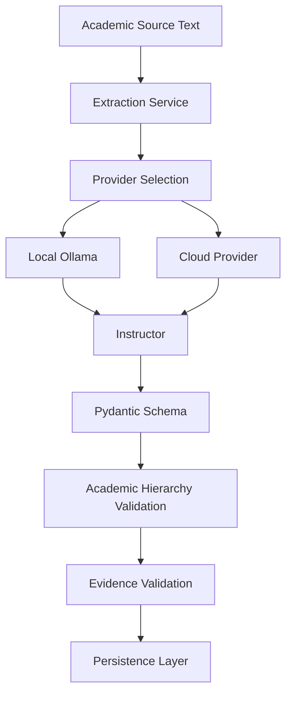
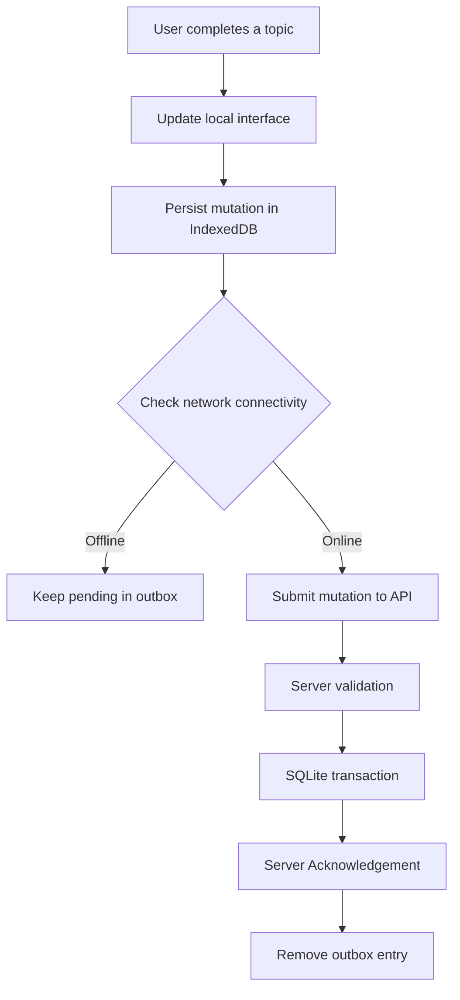

# Technical Stack, Dependency & Runtime Specification
## Hierarchical Syllabus Checklist & Progress Tracker

| Document Attribute | Value |
|---|---|
| **Document ID** | `11_TECH_SPECH.md` |
| **Project** | Hierarchical Syllabus Checklist & Progress Tracker |
| **Repository** | [https://github.com/farhanahmad2106-cpu/Syllabus_Tracker_checklist](https://github.com/farhanahmad2106-cpu/Syllabus_Tracker_checklist) |
| **Document Classification** | Technical Architecture & Dependency Specification |
| **Revision** | 1.0 |
| **Status** | Repository-informed specification; pending complete manifest and source-level verification |
| **Target Phase** | Current implementation with Phase 11 cross-device expansion |

---


# 1. Document Control & Technical Overview


## 1.1 Purpose

This document defines the technical stack, runtime prerequisites, software dependencies, AI inference infrastructure, database technology, build toolchains, security boundaries, testing technologies, and deployment architecture of the Hierarchical Syllabus Checklist & Progress Tracker.
It serves as the authoritative technical reference for understanding how the application's software components interact and which technologies are required to develop, operate, maintain, and extend the system.
The specification is intended to support:
- Backend and frontend engineering.
- AI extraction infrastructure maintenance.
- Dependency management and upgrades.
- Development environment configuration.
- Runtime compatibility verification.
- Security and privacy reviews.
- Production deployment preparation.
- Future PWA and native mobile development.

## 1.2 Scope

The document covers:
- Python backend architecture and dependencies.
- React and TypeScript frontend architecture.
- Document ingestion and structured AI extraction.
- Local Ollama and optional cloud inference.
- SQLite persistence and transaction management.
- Environment configuration.
- Development and production toolchains.
- Cross-device compatibility.
- Security and dependency governance.
- Testing and runtime observability.
- Deployment architecture.
- Phase 11 technology recommendations.
It does not redefine the application's functional requirements or replace its existing architecture.

## 1.3 Relationship to 10_TRD.md

10_TRD.md defines the technical requirements that the application must satisfy.
11_TECH_SPECH.md documents the technologies and implementation mechanisms used to satisfy those requirements.
| Document | Primary responsibility |
| --- | --- |
| 10_TRD.md | What the system must do and the technical constraints it must satisfy |
| 11_TECH_SPECH.md | Which technologies implement those requirements and how they interact |

The Technical Requirements Document remains the source of functional and non-functional requirements. This specification provides their corresponding technology-level implementation context.

## 1.4 Evidence and implementation classification

The following classifications apply throughout this document.
| Status | Meaning |
| --- | --- |
| IMPLEMENTED | Verified by available repository source or configuration evidence |
| CONFIGURED | Configuration exists, but operational behavior is not fully verified |
| OPTIONAL | Available as an optional integration |
| PLANNED — PHASE 11 | Identified as a future implementation target |
| PROPOSED | Recommended but not confirmed as implemented |
| UNVERIFIED | Insufficient evidence to establish implementation status |
| DEPRECATED | Previously used but no longer recommended |

Evidence limitation: The repository's public README and project overview are available for inspection. The complete dependency lockfiles, environment settings, application source files, and CI configuration have not been independently verified in this specification. Consequently, exact dependency versions and undocumented configuration values are deliberately not fabricated.

## 1.5 Architectural baseline

The project is a local-first academic curriculum management system built around:
- Python 3.12-era backend architecture.
- FastAPI and Uvicorn.
- React 19 and TypeScript.
- Vite and Tailwind CSS v4.
- SQLModel / SQLAlchemy 2.0.
- SQLite with WAL mode and foreign-key enforcement.
- Instructor and Pydantic v2.
- Local Ollama and optional OpenAI-compatible inference.
- Evidence-grounded document extraction.
- Five-tier hierarchical academic progress tracking.
The repository documents a deterministic document-ingestion pipeline, elective enrollment workflow, historical progress preservation, leaf-only progress persistence, and operational health endpoints.

# 2. System Architecture & Technology Overview


## 2.1 Architectural classification

| Architectural dimension | Technology or approach | Status |
| --- | --- | --- |
| Application architecture | Client-server | IMPLEMENTED |
| Backend | Python / FastAPI | IMPLEMENTED |
| Frontend | React 19 / TypeScript | IMPLEMENTED |
| Frontend bundler | Vite | IMPLEMENTED |
| Styling | Tailwind CSS v4 | IMPLEMENTED |
| Persistence | SQLite | IMPLEMENTED |
| Database access | SQLModel / SQLAlchemy | IMPLEMENTED |
| Database journal | WAL | IMPLEMENTED |
| Local AI inference | Ollama | IMPLEMENTED |
| Cloud AI integration | OpenAI-compatible provider | IMPLEMENTED |
| Structured extraction | Instructor / Pydantic | IMPLEMENTED |
| Document parsing | pypdf / python-docx | IMPLEMENTED |
| Legacy DOC conversion | Headless LibreOffice | OPTIONAL |
| Scanned-document fallback | Docling | OPTIONAL |
| Browser offline outbox | IndexedDB / idb | PLANNED — PHASE 11 |
| PWA installation | vite-plugin-pwa | PLANNED — PHASE 11 |
| Native mobile bridge | Capacitor | PLANNED — PHASE 11 |


## 2.2 High-level architecture

The application separates the user interface, backend orchestration, document processing, AI inference, academic hierarchy validation, and persistent storage.

## 2.3 Backend/frontend separation

The backend owns:
- File validation and ingestion.
- Document parsing and normalization.
- AI provider selection.
- Structured hierarchy extraction.
- Schema validation.
- Elective enrollment operations.
- SQLite transactions.
- Progress calculations.
- API response generation.
- Health and readiness diagnostics.
The frontend owns:
- Academic hierarchy presentation.
- Interactive checklist controls.
- Elective onboarding.
- Progress visualization.
- User interaction and navigation.
- API communication.
- Responsive layout.
- The frontend must not become the authoritative persistence layer for academic completion records.

## 2.4 Local-first execution model

The application is designed to operate primarily on the local machine.
Its local execution boundaries include:
- Local FastAPI service.
- Local SQLite database.
- Local document processing.
- Local Ollama inference when selected.
- Browser-based React interface.
Cloud inference is an optional external integration rather than a mandatory dependency of the local architecture.
Local inference does not require syllabus content to be transmitted to an external AI provider, provided the application is configured to use only local processing and no other external integrations transmit that content.

## 2.5 Document ingestion pipeline

The documented ingestion sequence is:
- Receive an uploaded academic document.
- Validate file format and size.
- Store the file in controlled temporary storage.
- Extract text using the appropriate parser.
- Normalize extracted text.
- Remove repetitive headers, footers, and page-number noise.
- Preserve source offsets and page references.
- Submit source-grounded content to structured extraction.
- Validate the extracted hierarchy.
- Present detected elective information for review.
- Finalize enrollment.
- Persist hierarchy and valid completion records.
- The pipeline uses deterministic parsing before AI extraction wherever possible.

## 2.6 Five-tier academic hierarchy

The canonical data model is:
```text
Document Root (container; not an academic tier)
└── Academic Year (Tier 1)
    └── Semester (Tier 2)
        └── Subject / Course (Tier 3)
            └── Module / Unit (Tier 4)
                └── Subtopic / Checklist Leaf (Tier 5)
```

Architectural invariants:
- Academic levels must retain their parent-child relationships.
- Tier-5 leaves are the only authoritative completion records.
- Parent completion is calculated dynamically.
- Progress is calculated using enrolled descendant leaves.
- Elective exclusion must not destroy historical completion records.
- Contact hours are informational metadata, not completion weights.
- Source provenance must remain associated with extracted content.

## 2.7 Academic extraction reliability

Each extracted leaf is expected to preserve:
| Field | Purpose |
| --- | --- |
| source_text | Exact source excerpt supporting the extracted item |
| source_page | Original one-based physical PDF page |
| source_start_offset | Starting position in canonical source text |
| source_end_offset | Ending position in canonical source text |
| grounding_status | verified or needs_review |
| Parent identifier | Hierarchical relationship |
| Source document identifier | Document provenance |

The extraction architecture must reject unsupported generative additions instead of silently accepting invented curriculum content.

## 2.8 API architecture

The repository README documents the following API surface.
| Method | Endpoint | Responsibility |
| --- | --- | --- |
| GET | /health | Application liveness and provider diagnostics |
| GET | /ready | Database readiness |
| GET | /api/config | Safe frontend configuration metadata |
| GET | /api/syllabi | List syllabi and progress |
| POST | /api/upload | Start asynchronous document ingestion |
| GET | /api/upload/progress/{id} | SSE progress updates |
| GET | /api/upload/jobs/{id} | Job progress polling |
| POST | /api/upload/jobs/{id}/cancel | Cancel an ingestion job |
| GET | /api/syllabus/{id}/review | Review detected electives |
| POST | /api/syllabus/{id}/finalize-enrollment | Finalize elective enrollment |
| POST | /api/syllabus/{id}/update-enrollment | Update enrollment |
| GET | /api/syllabus/{id} | Retrieve hierarchy and progress |
| PATCH | /api/syllabus/{id}/toggle-leaf | Toggle a completion leaf |
| PATCH | /api/syllabus/{id}/bulk-toggle | Bulk descendant completion |
| PATCH | /api/syllabus/{id} | Rename a syllabus |
| DELETE | /api/syllabus/{id} | Delete syllabus and related records |

The exact endpoint implementation and response schemas should be maintained in the corresponding backend API modules.

# 3. System Runtime & OS Prerequisites


## 3.1 Runtime compatibility matrix

| Runtime / Platform | Minimum documented | Recommended target | Purpose | Mandatory / Optional | Verification |
| --- | --- | --- | --- | --- | --- |
| Python | 3.11+ | 3.12 | Backend execution | Mandatory | IMPLEMENTED |
| Node.js | 18+ | Current compatible LTS | Frontend development/build | Mandatory for development | IMPLEMENTED |
| npm | Compatible with Node.js | Matching supported npm release | Package management | Mandatory for frontend development | UNVERIFIED exact version |
| SQLite | Python-supported SQLite | Current stable compatible release | Persistence | Mandatory | IMPLEMENTED |
| Ollama | Compatible local daemon | Repository-configured release | Local inference | Provider-dependent | IMPLEMENTED |
| LibreOffice | Compatible headless release | Current stable release | Legacy DOC conversion | OPTIONAL | IMPLEMENTED as optional integration |
| Windows | Windows 11 documented | Windows 11 | Primary development environment | Current documented platform | IMPLEMENTED |
| Linux | Not established | To be evaluated | Potential deployment target | UNVERIFIED | UNVERIFIED |
| macOS | Not established | To be evaluated | Potential deployment target | UNVERIFIED | UNVERIFIED |
| Chromium | Modern compatible version | Current stable | Browser execution | Mandatory for browser use | UNVERIFIED |
| Firefox | Modern compatible version | Current stable | Browser execution | Supported target to validate | UNVERIFIED |
| Safari | Modern compatible version | Current stable | Browser execution | Supported target to validate | UNVERIFIED |
| Android | Not established | Supported Capacitor target | Native packaging | PLANNED — PHASE 11 | UNVERIFIED |
| iOS | Not established | Supported Capacitor target | Native packaging | PLANNED — PHASE 11 | UNVERIFIED |
| Java JDK / Android SDK | Not established | Compatible with selected Capacitor release | Android compilation | PLANNED — PHASE 11 | UNVERIFIED |
| Xcode | Not established | Compatible with selected Capacitor release | iOS compilation | PLANNED — PHASE 11 | UNVERIFIED |

The minimum versions above reflect documented project requirements where available. Recommended versions are maintenance targets, not assertions that the repository has already been tested against every release.

## 3.2 Python runtime

The backend uses Python for:
- FastAPI request processing.
- Document parsing.
- AI orchestration.
- Pydantic validation.
- Database access.
- Asynchronous ingestion.
- Background processing.
- Runtime diagnostics.
The repository documents Python 3.12 as its primary development runtime, while the README also describes Python 3.11+ compatibility.
Recommended configuration:
```text
backend/
├── venv/
├── app/
│   ├── main.py
│   ├── config.py
│   ├── database.py
│   ├── models.py
│   ├── schemas.py
│   ├── parser.py
│   ├── extractor.py
│   ├── validation.py
│   └── services/
└── requirements.txt
```

The directory structure illustrates documented module responsibilities; individual paths should be checked against the current repository before being used as an exhaustive inventory.
Environment isolation must be maintained through the backend virtual environment.
Avoid installing project dependencies into the global Python interpreter.

## 3.3 Node.js and npm

Node.js provides the frontend build environment.
npm manages:
- React packages.
- Vite.
- TypeScript.
- Tailwind CSS.
- UI components.
- Testing libraries.
- Linting tools.
The repository's frontend/package.json defines these scripts:
| Script | Command | Purpose |
| --- | --- | --- |
| dev | vite | Development server |
| build | tsc -b && vite build | Type checking and production build |
| typecheck | tsc --noEmit | Type checking |
| lint | oxlint | Static analysis |
| test | vitest run | Frontend tests |
| preview | vite preview | Production build preview |

The exact npm version and Node engine constraints remain unverified because no authoritative .nvmrc, engines declaration, or package-manager version pin has been established here.

## 3.4 SQLite runtime

SQLite is the primary persistence engine.
The Python SQLite runtime is supplied through Python's SQLite integration.
The application should verify the actual SQLite runtime version during diagnostics when compatibility requirements change.
SQLite does not require a separate database server.

## 3.5 Ollama runtime

The local inference service is expected at:
- http://127.0.0.1:11434
The repository's .env.example configures an OpenAI-compatible API base:
- http://127.0.0.1:11434/v1
- The Ollama daemon must be running before requests are routed to the local provider.

## 3.6 Windows-specific considerations

Windows is the primary documented development platform.
Important runtime considerations include:
- Use the correct virtual-environment interpreter.
- Avoid scanning the entire virtual environment with development reload watchers.
- Restrict reload monitoring to backend application source.
- Use isolated temporary directories for uploads.
- Apply bounded parser execution times.
- Avoid concurrent use of fixed temporary filenames.
- Detect LibreOffice executables rather than assuming they exist.
- Handle Windows file-locking and resource-exhaustion errors.
- Avoid terminating unrelated Python processes when managing service ports.
The project documents a Windows 11 upload-reliability correction addressing the previous Docling initialization and WinError 1450 problem.

# 4. Backend Dependency Matrix


## 4.1 Dependency source

The backend dependency manifest is:
- backend/requirements.txt
The repository exposes the following exact declarations:
| Package | Declared version | Resolved version | Category | Status |
| --- | --- | --- | --- | --- |
| fastapi | 0.162.0 | Not verified | Web framework | IMPLEMENTED |
| uvicorn | 0.54.0 | Not verified | ASGI server | IMPLEMENTED |
| pydantic | 2.14.1 | Not verified | Validation | IMPLEMENTED |
| pydantic-settings | 2.16.1 | Not verified | Configuration | IMPLEMENTED |
| SQLAlchemy | 2.1.6 | Not verified | ORM / SQL toolkit | IMPLEMENTED |
| sqlmodel | 0.0.48 | Not verified | ORM / schema integration | IMPLEMENTED |
| instructor | 1.17.0 | Not verified | Structured AI output | IMPLEMENTED |
| openai | 3.3.0 | Not verified | AI API client | IMPLEMENTED |
| python-multipart | 0.0.32 | Not verified | Multipart requests | IMPLEMENTED |
| pytest | 9.1.1 | Not verified | Testing | IMPLEMENTED |
| httpx | 0.28.1 | Not verified | HTTP client / testing | IMPLEMENTED |
| docling | 2.142.1 | Not verified | Document parsing | OPTIONAL integration |
| python-docx | 1.2.0 | Not verified | Word parsing | IMPLEMENTED |
| pypdf | 6.21.2 | Not verified | PDF parsing | IMPLEMENTED |
| python-dotenv | 1.2.4 | Not verified | Environment loading | IMPLEMENTED |
| beautifulsoup4 | 4.12.3 | Not verified | HTML parsing | OPTIONAL / integration |
| lxml | 5.3.0 | Not verified | XML / HTML parsing | OPTIONAL / integration |

Version interpretation: These values are declared constraints from the current public requirements.txt, not independently verified installed or lockfile-resolved versions. The project does not establish a complete resolved Python dependency graph through this manifest alone.

## 4.2 Web framework and ASGI

| Package | Responsibility | Security considerations | Performance considerations |
| --- | --- | --- | --- |
| fastapi | API routes, request validation, dependency injection | Validate all untrusted request data | Keep blocking work off the event loop |
| uvicorn | ASGI server and HTTP execution | Restrict unnecessary network exposure | Configure worker and concurrency limits |
| python-multipart | Multipart document upload handling | Enforce upload size and content validation | Large uploads consume memory and I/O |

FastAPI provides the backend application interface.
Uvicorn executes the asynchronous application.
The ingestion pipeline must not perform long-running synchronous parsing directly on the event loop.

## 4.3 Validation and configuration

| Package | Responsibility | Security considerations | Performance considerations |
| --- | --- | --- | --- |
| pydantic | Typed data validation and schema enforcement | Reject malformed and unexpected input | Validation cost increases with large payloads |
| pydantic-settings | Typed application configuration | Prevent accidental secret exposure | Negligible for normal configuration loading |
| python-dotenv | Load environment configuration | Protect environment files and exclude them from version control | Negligible |

Pydantic models establish the validated data boundary between AI extraction, backend services, database operations, and API responses.
Configuration should be loaded centrally rather than scattered across route handlers.

## 4.4 ORM and database integration

| Package | Responsibility | Security considerations | Performance considerations |
| --- | --- | --- | --- |
| sqlmodel | SQL-oriented models integrated with Pydantic | Parameterized database operations | Avoid unnecessary relationship loading |
| SQLAlchemy | Database engine, SQL execution, sessions, transactions | Prevent unsafe raw SQL construction | Manage sessions and transactions efficiently |

SQLModel builds on SQLAlchemy rather than replacing it.
The architecture should use SQLModel for compatible model definitions and SQLAlchemy for database engine, transaction, connection, and ORM functionality.
Both packages must remain version-compatible.
There is no architectural requirement to maintain two independent ORM layers.

## 4.5 AI and structured extraction

| Package | Responsibility | Security considerations | Performance considerations |
| --- | --- | --- | --- |
| instructor | Structured LLM response extraction | Treat model output as untrusted | Retries and repeated inference increase latency |
| openai | OpenAI-compatible API client | Protect credentials and restrict provider access | Network latency and token usage |

Instructor provides structured response handling.
Pydantic validates the returned academic hierarchy.
The application must reject malformed output, preserve extraction evidence, and prevent unsupported content from becoming authoritative academic data.

## 4.6 Document processing

| Package | Responsibility | Security considerations | Performance considerations |
| --- | --- | --- | --- |
| pypdf | Digital PDF text extraction | Process untrusted documents with resource limits | Large PDFs require bounded extraction |
| python-docx | DOCX structure and paragraph extraction | Avoid trusting document metadata or embedded content | Complex documents may require additional processing |
| docling | Optional scanned-document and advanced parsing fallback | Isolate parser workloads | Can introduce substantial memory and initialization overhead |
| LibreOffice | Legacy DOC conversion | Execute with restricted file access | Conversion may be slow and resource-intensive |

The parser architecture prioritizes deterministic, lightweight extraction.
Docling must remain opt-in for fallback scenarios where simpler parsers cannot extract useful text.
This avoids unnecessarily loading heavyweight machine-learning and computer-vision dependencies for ordinary digital documents.

## 4.7 Networking and HTML parsing

| Package | Responsibility | Security considerations | Performance considerations |
| --- | --- | --- | --- |
| httpx | HTTP requests and API communication | Validate destinations, redirects, and TLS | Configure connection and read timeouts |
| beautifulsoup4 | HTML document parsing | Parse untrusted HTML without executing scripts | Avoid processing unnecessarily large pages |
| lxml | XML and HTML parsing backend | Protect against unsafe XML features | Efficient parsing, but memory usage scales with input |

University portal ingestion must treat URLs and retrieved HTML as untrusted input.
SSRF protection is required before any server-side URL retrieval.

## 4.8 Testing and development

| Package | Responsibility | Classification | Status |
| --- | --- | --- | --- |
| pytest | Backend unit and integration tests | Development / testing | IMPLEMENTED |
| httpx | HTTP client and API test support | Runtime / testing | IMPLEMENTED |
| pytest-asyncio | Async test support | Not present in visible requirements manifest | UNVERIFIED |
| psutil | Process and resource diagnostics | Not present in visible requirements manifest | UNVERIFIED |

The absence of pytest-asyncio and psutil from the current requirements manifest means they must not be treated as confirmed direct dependencies.
If async tests require pytest-asyncio, its installation and configuration must be verified separately.
Likewise, resource monitoring should use an already available mechanism or explicitly add a dependency through a separately approved change.

## 4.9 Dependency grouping

| Dependency group | Core dependencies | Operational requirement |
| --- | --- | --- |
| API execution | FastAPI, Uvicorn | Required |
| Validation | Pydantic, pydantic-settings | Required |
| Persistence | SQLModel, SQLAlchemy | Required |
| AI extraction | Instructor, OpenAI client | Required for LLM extraction |
| File ingestion | pypdf, python-docx | Required for respective formats |
| Legacy conversion | LibreOffice | Optional |
| Advanced document parsing | Docling | Optional |
| Web parsing | BeautifulSoup4, lxml, HTTPX | Integration-dependent |
| Testing | pytest | Development / CI |
| Configuration | python-dotenv | Configuration-dependent |


# 5. Frontend Dependency Matrix


## 5.1 Dependency source

The frontend dependency manifest is:
- frontend/package.json
The declared dependencies are:
| Package | Version constraint | Resolved version | Category | Status |
| --- | --- | --- | --- | --- |
| react | ^19.3.1 | Not verified | UI runtime | IMPLEMENTED |
| react-dom | ^19.3.1 | Not verified | Browser rendering | IMPLEMENTED |
| typescript | ~6.0.3 | Not verified | Type system | IMPLEMENTED |
| vite | ^8.3.4 | Not verified | Build tooling | IMPLEMENTED |
| @vitejs/plugin-react | ^6.1.2 | Not verified | React build integration | IMPLEMENTED |
| tailwindcss | ^4.3.3 | Not verified | Styling | IMPLEMENTED |
| @tailwindcss/vite | ^4.3.3 | Not verified | Styling integration | IMPLEMENTED |
| clsx | ^2.1.1 | Not verified | Class composition | IMPLEMENTED |
| tailwind-merge | ^3.7.0 | Not verified | Utility conflict resolution | IMPLEMENTED |
| @radix-ui/react-checkbox | ^1.4.1 | Not verified | Accessible checkbox primitive | IMPLEMENTED |
| lucide-react | ^1.61.0 | Not verified | Icon library | IMPLEMENTED |
| vitest | ^5.0.5 | Not verified | Testing | IMPLEMENTED |
| jsdom | ^30.1.3 | Not verified | Browser test environment | IMPLEMENTED |
| @testing-library/react | ^16.3.3 | Not verified | Component testing | IMPLEMENTED |
| @testing-library/jest-dom | ^7.0.1 | Not verified | DOM assertions | IMPLEMENTED |
| oxlint | ^1.88.0 | Not verified | Static analysis | IMPLEMENTED |
| @types/node | ^24.19.2 | Not verified | Type definitions | IMPLEMENTED |
| @types/react | ^19.3.0 | Not verified | React type definitions | IMPLEMENTED |
| @types/react-dom | ^19.3.0 | Not verified | React DOM type definitions | IMPLEMENTED |


## 5.2 Core UI dependencies


#### React and React DOM

React implements the interactive user interface.
React DOM handles browser rendering.
The component architecture includes:
- Main application shell.
- Academic hierarchy tree.
- Progress indicators.
- Upload interface.
- Evidence inspection.
- Elective onboarding.
- Error notifications.
- Confirmation dialogs.

#### TypeScript

TypeScript establishes compile-time type checking.
Canonical academic interfaces should remain aligned with backend Pydantic schemas.
The project documents shared academic fields such as:
- evidence_status
- grounding_status
- source_document_id
- source_page
- API responses should be typed instead of relying on unrestricted dynamic objects.

## 5.3 Build and styling dependencies


#### Vite

Vite provides:
- Development server.
- Module transformation.
- Production bundling.
- Static asset handling.
- Build optimization.

#### Tailwind CSS v4

Tailwind provides utility-based styling.
The @tailwindcss/vite plugin integrates the CSS build process with Vite.

#### clsx

Provides conditional class-name construction.

#### tailwind-merge

Resolves conflicting Tailwind utility classes.
These utilities should remain presentation-focused rather than containing academic business logic.

## 5.4 UI primitives and icons


#### Radix UI Checkbox

The project uses Radix UI Checkbox for accessible checklist interactions.
It supports the tri-state presentation model:
| State | Meaning |
| --- | --- |
| Checked | All enrolled descendant leaves completed |
| Unchecked | No enrolled descendant leaves completed |
| Indeterminate | Some enrolled descendant leaves completed |

The backend remains authoritative for persisted completion records.

#### Lucide React

Provides consistent vector icons for interface elements.
Icons should not replace accessible text labels where the meaning of an action is important.

## 5.5 Testing and quality dependencies

| Package | Responsibility |
| --- | --- |
| Vitest | Frontend unit and integration tests |
| jsdom | Browser-like DOM environment |
| React Testing Library | Component behavior testing |
| jest-dom | Readable DOM assertions |
| oxlint | Static analysis |
| TypeScript | Type checking |

The frontend's declared test command runs Vitest.
Its production build performs TypeScript project compilation before Vite bundling.

## 5.6 Frontend build pipeline


## 5.7 Bundle impact and optimization

| Dependency | Bundle consideration | Recommendation |
| --- | --- | --- |
| React | Core runtime | Keep application dependencies controlled |
| React DOM | Core browser renderer | Avoid unnecessary duplicate versions |
| Radix Checkbox | Component-level UI primitive | Import only required components |
| Lucide React | Potential icon bundle growth | Prefer named imports |
| Tailwind CSS | Generated utility CSS | Avoid unnecessary custom utility expansion |
| clsx | Small runtime utility | Retain |
| tailwind-merge | Class normalization | Use where conflict resolution is necessary |

Lazy loading and route-based code splitting are not confirmed by the inspected manifests. They should be considered optimization opportunities rather than documented existing behavior.

## 5.8 Additional frontend dependencies

The current package.json does not list:
- React Router.
- Redux.
- Zustand.
- Axios.
- idb.
- vite-plugin-pwa.
- Capacitor packages.
The application must not be documented as depending on these packages without additional repository evidence.

# 6. AI Models & Inference Provider Specifications


## 6.1 AI architecture overview

The application implements a dual-provider extraction architecture.
IMPLEMENTED
The extraction service supports local Ollama inference and optional OpenAI-compatible cloud inference.
The intended request flow is:



## 6.2 Local Ollama inference

Documented endpoint:
- http://127.0.0.1:11434/v1
Documented models:
- Qwen3-8B:latest
- qwen2.5:7b
- llama3.1:8b
- The project master context identifies Ollama version 1.6.10 as its configured target.
- The actual installed daemon version must be checked on the deployment machine.

### 6.2.1 Model compatibility matrix

| Model | Provider | Intended role | Resource requirements | Context configuration | Status |
| --- | --- | --- | --- | --- | --- |
| Qwen3-8B:latest | Ollama | Alternative structured extraction model | Model-dependent RAM/VRAM | Runtime configuration required | CONFIGURED target |
| qwen2.5:7b | Ollama | Primary local extraction model | Model-dependent RAM/VRAM | Runtime configuration required | IMPLEMENTED integration |
| llama3.1:8b | Ollama | Alternative/fallback local model | Model-dependent RAM/VRAM | Runtime configuration required | IMPLEMENTED integration |
| gpt-4o-mini | Cloud API | Optional cloud extraction | No local model weights required | Provider/API dependent | CONFIGURED integration |

No hardware benchmark is claimed.
The resource requirements depend on:
- Quantization.
- Model artifact size.
- Context length.
- KV cache allocation.
- Ollama configuration.
- GPU availability.
- Concurrent requests.
- The listed models are alternatives, not simultaneous execution requirements.

### 6.2.2 Inference lifecycle

The local inference lifecycle should follow:
- Confirm the selected provider.
- Verify Ollama availability.
- Check model availability.
- Validate model configuration.
- Submit bounded source text.
- Receive structured output.
- Validate the output schema.
- Perform academic hierarchy validation.
- Verify source evidence.
- Persist only accepted data.
If the selected model is unavailable, the application must produce a useful diagnostic instead of hanging indefinitely.

### 6.2.3 Model management

Model pulling and updates are external Ollama responsibilities.
The application should distinguish:
- Model configured.
- Model installed locally.
- Model server reachable.
- Model request successful.
- Model response schema valid.
- A model name in configuration is not proof that its weights are installed.

### 6.2.4 Context-window management

The application should keep model input within a controlled context budget.
For large syllabi, the documented chunking architecture partitions content around academic year and semester boundaries.
The extraction process should preserve source page provenance through every chunk.

### 6.2.5 Structured JSON output

Instructor provides structured response handling.
Pydantic validates the resulting data.
The extraction layer must verify:
- Required hierarchy levels.
- Correct parent-child relationships.
- Valid field types.
- Valid elective metadata.
- Valid source evidence.
- Valid grounding status.
- No unsupported academic additions.

### 6.2.6 Timeouts and retries

The repository master context documents bounded inference and ingestion controls.
These include:
- Extraction timeout.
- Retry budget.
- Bounded parsing concurrency.
- Cancellation checks.
- Worker-thread execution for blocking work.
The actual .env.example currently contains:
```bash
LLM_TIMEOUT_SECONDS=120
EXTRACTION_RETRY_BUDGET=2
```

Other source documentation mentions different timeout and retry settings. The actual authoritative runtime values must be established from the current configuration loader.

### 6.2.7 Resource consumption

Docling can introduce substantial additional memory usage because of its heavier document-processing stack.
The project therefore documents Docling as an opt-in fallback.
The primary PDF parsing path should remain pypdf for digital-text PDFs.

## 6.3 Cloud OpenAI-compatible inference

The project documents cloud inference using the OpenAI-compatible client.
The example model is:
- gpt-4o-mini
- The application must treat the cloud provider as optional.

### 6.3.1 Configuration

Cloud provider configuration must be separated from local Ollama settings.
Recommended configuration responsibilities:
| Setting | Responsibility | Status |
| --- | --- | --- |
| Cloud API key | Authentication | CONFIGURATION-DEPENDENT |
| Cloud endpoint | API base URL | UNVERIFIED |
| Cloud model | Selected model | UNVERIFIED |
| Provider selector | Local/cloud selection | IMPLEMENTED |
| Request timeout | Bounded network execution | PROPOSED unless confirmed |
| Retry budget | Controlled recovery | PROPOSED unless confirmed |

No real API credentials may be stored in frontend source code or committed environment files.

### 6.3.2 Privacy considerations

When cloud inference is selected, syllabus text may leave the local machine.
Users should be informed of the selected provider and the resulting data-processing boundary.
Sensitive documents should remain on local inference unless cloud processing is explicitly permitted.

### 6.3.3 Rate limits and cost control

Recommended protections:
- Bounded request retries.
- Exponential backoff for transient errors.
- Maximum token limits.
- Input chunk limits.
- Request cancellation.
- Per-job cost visibility where practical.
- Clear rate-limit diagnostics.
- Automatic retry must not result in uncontrolled repeated billing.

## 6.4 Provider abstraction and hot switching

The documented provider selector is:
- EXTRACTION_PROVIDER=ollama
- The extraction service must isolate provider-specific details from academic hierarchy logic.
Recommended provider interface:
```python
class ExtractionProvider:
    async def extract(self, source_text: str):
        raise NotImplementedError
    async def health_check(self):
        raise NotImplementedError
```

This is an architectural interface illustration, not a claim that the exact class exists in the repository.
Provider-specific implementations should normalize:
- Authentication failures.
- Network failures.
- Timeout errors.
- Invalid JSON.
- Model-not-found errors.
- Rate limits.
- Structured validation failures.
- Provider selection should be configuration-driven.
Automatic fallback should only occur when explicitly permitted by the configured policy. It must not silently transmit local document content to a cloud provider.

## 6.5 AI extraction reliability

The extraction pipeline must maintain evidence-based academic content.

#### Reliability requirements

| Requirement | Technical mechanism |
| --- | --- |
| Structured output | Instructor |
| Schema validation | Pydantic |
| Hierarchy validation | Backend validation layer |
| Source matching | Evidence validation |
| Prompt injection defense | Untrusted-content delimiters |
| Partial document support | Chunking |
| Invalid response handling | Bounded retry and rejection |
| Missing evidence | needs_review or unverified |
| Historical consistency | Transactional persistence |


#### Prompt-injection boundary

The repository documents delimiters such as:
```xml
<UNTRUSTED_DOCUMENT_CONTENT>
...
</UNTRUSTED_DOCUMENT_CONTENT>
```

Document contents must be treated as data, not instructions.
A syllabus may contain arbitrary text. It must not be permitted to override extraction policies, system instructions, or application security controls.

#### Academic hierarchy preservation

The extraction service must retain the canonical five-tier model.
The academic year inference rule documented in the project context is:

\[ \text{Academic Year} = \left\lceil \frac{\text{Semester Number}}{2} \right\rceil \]

This must only be applied where the semester numbering convention is established.

# 7. Database & Persistence Technology


## 7.1 Database architecture

IMPLEMENTED
The project uses SQLite as its primary persistence engine.
The repository documents:
- WAL journal mode.
- Foreign-key enforcement.
- Busy timeout.
- Transactional persistence.
- Leaf-only completion records.
- Cascading data cleanup.

## 7.2 SQLite configuration

The documented configuration includes:
```sql
PRAGMA journal_mode = WAL;
PRAGMA foreign_keys = ON;
PRAGMA busy_timeout = 5000;
```

These settings serve different purposes.
| Setting | Purpose |
| --- | --- |
| journal_mode = WAL | Supports concurrent database readers while writes are recorded in the WAL |
| foreign_keys = ON | Enforces declared relational constraints |
| busy_timeout = 5000 | Waits up to five seconds for database locks before returning a lock-related failure |

Foreign-key enforcement is connection-specific and must be initialized for every applicable SQLite connection.

## 7.3 SQLModel and SQLAlchemy

SQLModel provides the model integration layer.
SQLAlchemy provides:
- Engine management.
- Connection pooling behavior.
- Sessions.
- Transactions.
- SQL execution.
- ORM persistence.
- The application should use one coherent database access strategy.
- It should not create separate competing ORM abstractions.

## 7.4 Leaf-only progress persistence

The authoritative completion model persists only Tier-5 leaf completion IDs.
```text
Academic Year (Tier 1)
└── Semester (Tier 2)
    └── Subject (Tier 3)
        └── Module (Tier 4)
            └── Subtopic Leaf (Tier 5)
                └── [Completion Record persisted]
```

Parent completion states are calculated dynamically.

## 7.5 Progress calculation

The documented progress formula is:

\[ \text{Progress Percentage} = \frac{\text{Completed Enrolled Leaves}} {\text{Total Enrolled Leaves}} \times 100 \]

The calculation must handle zero-leaf branches without division-by-zero errors.

## 7.6 Tri-state parent calculation

| Condition | Parent state |
| --- | --- |
| All enrolled descendant leaves completed | Checked |
| No enrolled descendant leaves completed | Unchecked |
| Some enrolled descendant leaves completed | Indeterminate |
| No enrolled descendant leaves exist | 0/0 and 0% |

Parent states must never become independent completion records.

## 7.7 Elective history preservation

Elective enrollment affects which leaves participate in active progress calculations.
The system must preserve historical completion records when a course is excluded.
Upon re-enrollment, previously completed leaves must be restored to the active progress calculation.
The project documents this as implemented functionality.

## 7.8 Database transactions

Transactions must protect operations that modify related records.
Examples include:
- Saving an extracted syllabus.
- Finalizing elective enrollment.
- Updating course enrollment.
- Bulk completion changes.
- Deleting a syllabus and related records.
- Processing ingestion cancellation.
- The ingestion architecture documents atomic SQLite writes with rollback on failure or cancellation.

## 7.9 Database concurrency

SQLite is appropriate for the documented local-first single-user application model.
WAL mode improves concurrent reader behavior but does not provide unlimited parallel writes.
Recommended controls:
- Short write transactions.
- Bounded ingestion concurrency.
- Explicit busy timeout.
- Proper session lifecycle.
- Avoid holding write transactions during AI inference.
- Avoid network calls while a database write lock is held.

## 7.10 Backup and recovery

The backup mechanism must account for SQLite WAL files.
Copying only the primary database file while writes are active is not a reliable backup procedure.
Recommended strategy:
- Use SQLite's supported backup functionality.
- Validate the generated backup.
- Store backups outside temporary ingestion directories.
- Apply a retention policy.
- Periodically test restoration.
- Preserve schema compatibility information.
- A complete automated backup scheduler is not confirmed by the available repository evidence.

## 7.11 Actual versus recommended persistence features

| Capability | Status |
| --- | --- |
| SQLite persistence | IMPLEMENTED |
| WAL mode | IMPLEMENTED |
| Foreign-key enforcement | IMPLEMENTED |
| Leaf-only completion persistence | IMPLEMENTED |
| Dynamic progress derivation | IMPLEMENTED |
| Transactional updates | IMPLEMENTED |
| Elective history preservation | IMPLEMENTED |
| Automated scheduled backup | UNVERIFIED |
| Database encryption at rest | UNVERIFIED |
| Cross-device synchronization | PLANNED — PHASE 11 |


# 8. Environment Configuration Reference


## 8.1 Configuration source

The repository's root .env.example contains the following declarations.
| Variable | Component | Type | Declared default | Required | Secret | Status |
| --- | --- | --- | --- | --- | --- | --- |
| DATABASE_URL | Backend / Database | String | sqlite:///./data/syllabus_tracker.db | Operationally required | No | CONFIGURED |
| OLLAMA_BASE_URL | AI | URL | http://127.0.0.1:11434/v1 | For local provider | No | CONFIGURED |
| OLLAMA_MODEL | AI | String | qwen2.5:7b | For local provider | No | CONFIGURED |
| OLLAMA_FALLBACK_MODEL | AI | String | llama3.1:8b | No | No | CONFIGURED |
| LLM_TIMEOUT_SECONDS | AI | Integer | 120 | No, default provided | No | CONFIGURED |
| EXTRACTION_RETRY_BUDGET | AI | Integer | 2 | No, default provided | No | CONFIGURED |
| MAX_UPLOAD_SIZE_BYTES | Upload | Integer | 26214400 | No, default provided | No | CONFIGURED |
| CORS_ORIGINS | Backend security | JSON array | Three localhost origins | Environment-dependent | No | CONFIGURED |
| LOG_LEVEL | Logging | String | INFO | No | No | CONFIGURED |
| VITE_API_BASE_URL | Frontend | URL | http://127.0.0.1:8000/api | Frontend API communication | No | CONFIGURED |


## 8.2 Configuration example

The following reproduces the publicly documented .env.example structure.
```bash
# Backend Configuration
DATABASE_URL=sqlite:///./data/syllabus_tracker.db
OLLAMA_BASE_URL=http://127.0.0.1:11434/v1
OLLAMA_MODEL=qwen2.5:7b
OLLAMA_FALLBACK_MODEL=llama3.1:8b
LLM_TIMEOUT_SECONDS=120
EXTRACTION_RETRY_BUDGET=2
MAX_UPLOAD_SIZE_BYTES=26214400
CORS_ORIGINS=["http://localhost:5173","http://127.0.0.1:5173","http://localhost:3000"]
LOG_LEVEL=INFO

# Frontend Configuration
VITE_API_BASE_URL=http://127.0.0.1:8000/api
```

This is a repository configuration snapshot, not a guarantee that every default currently matches the application settings implementation.

## 8.3 Application environment

| Variable | Purpose | Status |
| --- | --- | --- |
| DATABASE_URL | SQLite location and connection configuration | CONFIGURED |
| LOG_LEVEL | Logging verbosity | CONFIGURED |
| CORS_ORIGINS | Allowed browser origins | CONFIGURED |

An application-wide APP_ENV variable is not confirmed in the visible .env.example.
It must not be treated as an existing setting without verifying the configuration module.

## 8.4 AI provider environment

| Variable | Purpose | Status |
| --- | --- | --- |
| OLLAMA_BASE_URL | Local OpenAI-compatible endpoint | CONFIGURED |
| OLLAMA_MODEL | Main local model | CONFIGURED |
| OLLAMA_FALLBACK_MODEL | Alternative model | CONFIGURED |
| LLM_TIMEOUT_SECONDS | AI request timeout | CONFIGURED |
| EXTRACTION_RETRY_BUDGET | Extraction retry budget | CONFIGURED |
| EXTRACTION_PROVIDER | Provider selection | IMPLEMENTED in project documentation; absent from visible root .env.example |
| OPENAI_API_KEY | Cloud authentication | UNVERIFIED in visible root .env.example |
| OPENAI_BASE_URL | Cloud endpoint | UNVERIFIED |
| OPENAI_MODEL | Cloud model | UNVERIFIED |


## 8.5 Upload and document parsing configuration

The project documentation and configuration history contain multiple operational limit definitions.
| Variable | Documented value | Source / qualification |
| --- | --- | --- |
| MAX_UPLOAD_SIZE_BYTES | 26,214,400 bytes | Root .env.example |
| MAX_UPLOAD_SIZE_BYTES | 52,428,800 bytes | Later Master Context configuration |
| MAX_UPLOAD_SIZE_MB | 50 MiB | README overview |
| MAX_PDF_PAGES | 300 | Master Context Phase 7 |
| MAX_EXTRACTED_TEXT_CHARS | 1,500,000 | Master Context Phase 7 |
| PARSER_TIMEOUT_SECONDS | 300 | Master Context Phase 7 |
| DOC_CONVERSION_TIMEOUT_SECONDS | 30 | Master Context Phase 7 |
| ENABLE_DOCLING_FALLBACK | False | README and project context |

The root .env.example and application settings must be reconciled before treating these values as a single authoritative configuration.
In particular, 25 MiB and 50 MiB upload limits must not be described as simultaneously active defaults.

## 8.6 Frontend environment variables

Vite exposes variables with the VITE_ prefix to frontend code.
The documented variable is:
- VITE_API_BASE_URL=http://127.0.0.1:8000/api
Security rules:
- Never place API secrets in VITE_ variables.
- Never put private cloud API keys in frontend code.
- Assume every exposed Vite variable can be inspected by users.
- Keep authentication credentials and backend-only configuration on the server.

## 8.7 Unverified and proposed variables

The following are useful configuration candidates, not confirmed repository variables.
| Variable | Intended purpose | Status |
| --- | --- | --- |
| MAX_CONCURRENT_PARSING_JOBS | Limit simultaneous ingestion jobs | PROPOSED unless current config confirms |
| MAX_PDF_PAGES | Bound PDF processing | IMPLEMENTED in documented settings |
| MAX_EXTRACTED_TEXT_CHARS | Bound extracted text | IMPLEMENTED in documented settings |
| PARSER_TIMEOUT_SECONDS | Parser deadline | IMPLEMENTED in documented settings |
| DOC_CONVERSION_TIMEOUT_SECONDS | LibreOffice timeout | IMPLEMENTED in documented settings |
| UPLOAD_TEMP_DIR | Configure temporary storage | PROPOSED |
| ENABLE_DOCLING_FALLBACK | Enable heavyweight parser fallback | CONFIGURED |
| DATABASE_BACKUP_DIR | Backup destination | PROPOSED |
| DATABASE_BACKUP_RETENTION | Backup retention | PROPOSED |
| OFFLINE_SYNC_ENABLED | Enable future synchronization | PLANNED — PHASE 11 |
| PWA_ENABLED | Control PWA integration | PLANNED — PHASE 11 |


## 8.8 Environment configuration precedence

The recommended configuration precedence is:
- Explicit deployment environment.
- Local environment file.
- Application-defined defaults.
- The exact precedence must match the actual Pydantic settings configuration.
- Environment files containing secrets must be excluded from version control.

# 9. Build, Bundling & Packaging Toolchains


## 9.1 Backend toolchain

| Technology | Responsibility | Status |
| --- | --- | --- |
| Python | Backend runtime | IMPLEMENTED |
| venv | Environment isolation | IMPLEMENTED |
| pip | Dependency installation | IMPLEMENTED |
| FastAPI | API application | IMPLEMENTED |
| Uvicorn | ASGI execution | IMPLEMENTED |
| Pydantic Settings | Configuration management | IMPLEMENTED |
| LibreOffice | Optional DOC conversion | OPTIONAL |
| SQLite | Local database | IMPLEMENTED |

The backend development workflow uses the project virtual environment.
The repository documents:
```powershell
.\start-backend.ps1 -Mode Development
```

It also documents direct Uvicorn startup:
```powershell
$env:PYTHONPATH="."
.\backend\venv\Scripts\python.exe -m uvicorn backend.app.main:app --host 127.0.0.1 --port 8000 --reload
```

The development reload watcher should remain restricted to application source directories.

## 9.2 Frontend toolchain

| Technology | Responsibility |
| --- | --- |
| Node.js | JavaScript runtime |
| npm | Dependency management |
| TypeScript | Type checking |
| React | User interface |
| Vite | Development and production bundling |
| Tailwind CSS v4 | Styling |
| Vitest | Testing |
| oxlint | Static analysis |

The repository's frontend scripts are defined in frontend/package.json.
Development startup:
```bash
cd frontend
npm install
npm run dev
```

Production build:
```bash
npm run build
```

The build command executes TypeScript project compilation before Vite builds the production assets.

## 9.3 Windows development toolchain

The project documents Windows PowerShell as its primary development environment.
Important components include:
- PowerShell launch scripts.
- Python virtual environment.
- Localhost backend execution.
- Frontend development server.
- Ollama daemon.
- Optional LibreOffice conversion.
- Windows-specific process and port inspection.
- The project also documents a global syllabus command implemented through its scripts directory.
Its intended responsibilities include:
- Starting managed services.
- Checking service status.
- Inspecting logs.
- Restarting services.
- Stopping managed processes.
- Avoiding destructive termination of unrelated processes.
The command's current source implementation should be verified before depending on its behavior in another deployment environment.

## 9.4 PWA toolchain

PLANNED — PHASE 11
The planned PWA stack includes:
| Technology | Responsibility |
| --- | --- |
| vite-plugin-pwa | PWA build integration |
| Service Worker | Background cache and offline request handling |
| Web App Manifest | Installable application metadata |
| IndexedDB | Persistent browser-side application data |
| idb | IndexedDB abstraction |

Required PWA behavior:
- Cache application shell assets.
- Support installation.
- Manage application updates.
- Avoid stale API response corruption.
- Preserve local pending changes.
- Handle offline and online transitions.
- A service worker cache is not a replacement for application-level data synchronization.

## 9.5 Capacitor mobile toolchain

PLANNED — PHASE 11
The planned native integration includes:
- @capacitor/core
- @capacitor/android
- @capacitor/ios
The Capacitor bridge allows the React application to execute within native Android and iOS application containers.

#### Android

Expected build prerequisites include:
- Android Studio.
- Android SDK.
- Compatible JDK.
- Gradle toolchain.
- Android application configuration.

#### iOS

Expected build prerequisites include:
- macOS.
- Xcode.
- Compatible iOS SDK.
- Apple signing configuration.
These are platform requirements for the planned native targets, not evidence that native application builds already exist.

## 9.6 Packaging distinction

| Delivery type | Description | Status |
| --- | --- | --- |
| Web application | React frontend and FastAPI backend | IMPLEMENTED |
| Responsive web | Browser layouts across viewport sizes | IMPLEMENTED target; full compatibility verification UNVERIFIED |
| PWA | Installable browser application | PLANNED — PHASE 11 |
| Android | Capacitor-native application | PLANNED — PHASE 11 |
| iOS | Capacitor-native application | PLANNED — PHASE 11 |


# 10. Cross-Device Compatibility & Offline Technology


## 10.1 Responsive web compatibility

The React frontend should support:
- Desktop browser interaction.
- Tablet-sized layouts.
- Mobile browser layouts.
- Keyboard navigation.
- Touch interaction.
- Long academic hierarchies.
- Scrollable curriculum trees.
- Responsive progress indicators.
- Accessible checkbox interaction.
- The five-tier hierarchy must remain understandable on narrow displays.
- Horizontal overflow must not become necessary for normal checklist operation.
- The actual browser/device compatibility matrix remains subject to testing.

## 10.2 Offline architecture

PLANNED — PHASE 11
The planned client-side persistence architecture introduces IndexedDB.
| Component | Responsibility |
| --- | --- |
| SQLite | Authoritative backend persistence |
| IndexedDB | Browser-side persistent data |
| idb | IndexedDB programming abstraction |
| offlineOutbox | Queue of pending client mutations |
| Service Worker | Application asset caching |
| Synchronization service | Delivery of queued changes |

SQLite and IndexedDB are separate databases.
They do not synchronize automatically.
A synchronization protocol must explicitly transfer changes through backend APIs.

## 10.3 Offline outbox

The proposed outbox should contain:
- Unique mutation identifier.
- Target syllabus identifier.
- Target leaf identifier.
- Operation type.
- Operation payload.
- Creation timestamp.
- Retry count.
- Delivery state.
- Server acknowledgement information.
Example conceptual lifecycle:


This is a proposed synchronization architecture, not a verified existing feature.

## 10.4 Duplicate prevention

Every offline mutation should carry a stable unique identifier.
The server should reject duplicate processing or return the result of an already processed operation.
Repeated network delivery must not produce duplicate completion events.

## 10.5 Conflict detection

Potential conflict situations include:
- A leaf completed on two devices.
- A syllabus deleted while another device is offline.
- An elective disabled on one device.
- A historical completion updated during synchronization.
- Multiple devices changing the same enrollment state.
The synchronization protocol must define:
- Mutation identity.
- Entity identity.
- Version or revision tracking.
- Conflict detection.
- Conflict reporting.
- Safe retry behavior.
- A blind last-write-wins strategy is not recommended for all academic operations.

## 10.6 PWA and native application distinction

| Capability | Browser web | PWA | Capacitor Android | Capacitor iOS |
| --- | --- | --- | --- | --- |
| React interface | Yes | Yes | Yes | Yes |
| Browser installation | No | Yes | Native package | Native package |
| Service Worker | Browser-dependent | Yes | WebView-dependent | WebView-dependent |
| IndexedDB | Browser-dependent | Yes | WebView-dependent | WebView-dependent |
| Native APIs | Limited | Limited | Capacitor bridge | Capacitor bridge |
| Offline outbox | Planned | Planned | Planned | Planned |
| Native packaging | No | No | Planned | Planned |


## 10.7 Data consistency requirements

Recommended synchronization invariants:
- SQLite remains authoritative for accepted server-side state.
- Every client mutation has a unique identity.
- Retried mutations are idempotent.
- Server acknowledgements are persisted before local queue removal.
- Failed mutations remain recoverable.
- Deletion operations must not silently discard unrelated pending updates.
- Enrollment changes must preserve historical completion records.
- Offline state must be distinguishable from synchronized state.

# 11. Security, Privacy & Dependency Governance


## 11.1 Backend security

The backend processes untrusted documents and network requests.
Security controls must cover:
| Security area | Requirement |
| --- | --- |
| Request validation | Pydantic schema validation |
| Upload validation | Extension, MIME and file-content checks |
| Upload limits | Enforce server-side maximum size |
| Path handling | Prevent traversal and arbitrary file writes |
| Temporary storage | Unique isolated temporary directories |
| Cleanup | Remove staging files after completion or cancellation |
| Parser execution | Bounded runtime and resource usage |
| CORS | Explicit allowed origins |
| Database | Parameterized queries and foreign-key enforcement |
| Secrets | Backend-only configuration |
| Errors | Avoid leaking local paths or credentials |

The documented parser architecture uses isolated temporary directories and cleanup.

## 11.2 Document parsing security

PDF, DOCX, DOC, and TXT files must be treated as untrusted input.
Required controls:
- File-size limits.
- Page-count limits.
- Extracted-text limits.
- Parser timeouts.
- Temporary directory isolation.
- Safe filename handling.
- Conversion process timeouts.
- Cancellation handling.
- Resource-exhaustion diagnostics.
- Heavyweight parsers should not execute without controlled resource budgets.

## 11.3 AI security

AI processing introduces risks beyond ordinary input validation.
The following controls are required:
- Treat document text as untrusted.
- Use prompt-injection boundaries.
- Validate every structured response.
- Reject unsupported hierarchy levels.
- Verify source evidence.
- Prevent secrets from entering prompts.
- Avoid leaking local paths in model output.
- Normalize provider exceptions.
- Prevent uncontrolled retries.

## 11.4 Cloud AI privacy

Local Ollama and cloud inference have different data boundaries.
| Property | Ollama | Cloud inference |
| --- | --- | --- |
| Model execution | Local machine | External provider |
| Internet required for inference | No, after model installation | Yes |
| Source document transmission | Not required | May occur |
| API credential | Usually not required | Usually required |
| External provider dependency | No | Yes |
| Cost | Local compute resources | Provider pricing |

The application should make provider selection explicit and avoid unexpected local-to-cloud fallback.

## 11.5 Web scraping and SSRF protection

University portal ingestion creates a server-side request boundary.
The following protections are recommended:
| Threat | Required mitigation |
| --- | --- |
| Localhost SSRF | Block loopback addresses |
| Private-network SSRF | Block private IPv4 and IPv6 |
| DNS rebinding | Validate resolved addresses at connection time |
| Redirect abuse | Revalidate every redirect destination |
| Malicious URLs | Strict URL parsing |
| Large downloads | Enforce byte limits |
| Slow responses | Connection and read timeouts |
| MIME spoofing | Validate content type and actual content |
| Internal service access | Restrict destination ports and networks |

The actual implementation of every SSRF control requires source-level verification.

## 11.6 Frontend security

The frontend must protect against:
- Cross-site scripting.
- Unsafe HTML rendering.
- Malicious Markdown.
- Unvalidated external URLs.
- Unsafe navigation.
- Exposed environment secrets.
- Untrusted API responses.
- Any future Markdown rendering dependency must sanitize untrusted HTML.
- External links should use safe browser navigation attributes when opening new tabs.

## 11.7 Dependency governance

Recommended governance:
- Maintain the Python requirements manifest.
- Maintain the npm lockfile.
- Review dependency upgrades.
- Test major-version compatibility.
- Track transitive dependency changes.
- Review licenses.
- Run vulnerability scanning.
- Remove unused packages.
- Avoid uncontrolled version ranges for production-critical infrastructure.
- Document breaking changes.

## 11.8 Reproducibility

The current visible manifests provide Python exact declarations and frontend semver ranges.
A complete reproducible dependency installation requires lockfile verification.
Recommended artifacts:
| Artifact | Purpose |
| --- | --- |
| requirements.txt | Python dependency declarations |
| Python lockfile | Resolved Python dependency graph |
| package.json | Frontend dependency declarations |
| package-lock.json | Resolved frontend dependency graph |
| .nvmrc | Node runtime selection |
| Python version declaration | Python runtime selection |

A complete Python lockfile and Node version pin have not been established in the inspected evidence.

# 12. Testing, Quality Assurance & Compatibility


## 12.1 Backend testing

The backend uses pytest.
The documented test responsibilities include:
- API behavior.
- Database persistence.
- Hierarchy validation.
- Leaf completion.
- Bulk updates.
- Document parsing.
- AI extraction.
- Ingestion cancellation.
- Evidence validation.
- Upload security.
- The repository also documents async ingestion and job-management testing.
pytest-asyncio is not present in the inspected direct requirements manifest, so its use should be confirmed against the actual test configuration.

## 12.2 Frontend testing

The frontend testing stack consists of:
- Vitest.
- jsdom.
- React Testing Library.
- jest-dom.
- TypeScript.
- oxlint.
The test architecture should cover:
- Component rendering.
- Checkbox state.
- Parent progress calculation.
- File upload validation.
- API error handling.
- Elective onboarding.
- Evidence display.
- Accessible interactions.

## 12.3 Quality gates

The repository defines:
```bash
npm run lint
npm run typecheck
npm run test
npm run build
```

Backend testing is documented through pytest.
The latest available public README reports:
| Test category | Reported result |
| --- | --- |
| Backend pytest | 102 passed, 0 failed |
| Frontend Vitest | 26 passed across 5 files |
| TypeScript | 0 reported errors |
| Production build | Successful |

These are historical repository README results, not newly executed verification results.
The master context also contains later phase-specific test results. Test totals must therefore be associated with the particular revision and phase rather than combined into one fabricated cumulative count.

## 12.4 Cross-platform test matrix

| Platform | Intended coverage | Verification status |
| --- | --- | --- |
| Windows desktop | Full backend and frontend operation | IMPLEMENTED |
| Windows desktop browser | UI and API communication | IMPLEMENTED |
| Linux desktop | Backend compatibility | UNVERIFIED |
| macOS desktop | Backend compatibility | UNVERIFIED |
| Tablet browser | Responsive layout | UNVERIFIED |
| Mobile browser | Responsive layout | UNVERIFIED |
| PWA | Installation and offline lifecycle | PLANNED — PHASE 11 |
| Android | Capacitor integration | PLANNED — PHASE 11 |
| iOS | Capacitor integration | PLANNED — PHASE 11 |
| Offline synchronization | Mutation delivery and recovery | PLANNED — PHASE 11 |


## 12.5 Required regression coverage

Future changes must preserve:
- Five-tier hierarchy.
- Leaf-only completion persistence.
- Dynamic parent progress.
- Elective history.
- Source evidence.
- Upload cancellation.
- Transaction rollback.
- Chunk provenance.
- Bounded parsing.
- Provider selection.
- Safe error reporting.

# 13. Logging, Diagnostics & Runtime Observability


## 13.1 Logging architecture

The repository's root environment template configures:
- LOG_LEVEL=INFO
The logging architecture should provide separate diagnostic information for:
- API requests.
- Upload processing.
- Parser execution.
- AI provider requests.
- Database operations.
- Job management.
- Cancellation.
- Frontend failures.
- Runtime startup and shutdown.

## 13.2 Log severity levels

| Level | Purpose | Example |
| --- | --- | --- |
| DEBUG | Detailed diagnostic information | Parser stage transitions |
| INFO | Normal operational events | Upload job created |
| WARNING | Recoverable abnormal condition | Optional model unavailable |
| ERROR | Failed operation | Invalid structured extraction |
| CRITICAL | Application-level failure | Database unavailable during startup |


## 13.3 Health endpoints

The repository documents operational endpoints.
| Endpoint | Responsibility |
| --- | --- |
| /health | Application liveness and provider diagnostics |
| /ready | Database readiness |
| /api/health | API health alias |
| /api/ready | API readiness alias |

Health responses must not disclose:
- API keys.
- Secret environment values.
- Sensitive local file paths.
- Full internal exception traces.
- Private credentials.

## 13.4 Upload job diagnostics

The ingestion job system documents:
- Job identifiers.
- Current stage.
- Percentage.
- User-facing message.
- Result.
- Error.
- Creation and update timestamps.
- Cancellation state.
The job manager also documents thread-safe updates, monotonic progress, terminal-state immutability, and subscriber notification through asynchronous queues.

## 13.5 Ingestion stages

The documented pipeline includes:
| Stage | Progress |
| --- | --- |
| Queued | 0% |
| Validating | 5% |
| Parsing | 10–30% |
| Chunking | 30–40% |
| Extracting | 40–85% |
| Validating result | 85–95% |
| Persisting | 95–99% |
| Completed | 100% |

The exact progress values are implementation-specific and should remain centralized in the job orchestration service.

## 13.6 Privacy-safe logging

Logs must not contain:
- Raw API keys.
- Authorization headers.
- Full cloud credentials.
- Unnecessary full syllabus content.
- Sensitive personal information.
- Unredacted provider request payloads.
- Prefer job IDs, document identifiers, error categories, and processing-stage information.

# 14. Installation & Deployment Architecture


## 14.1 Development architecture

The documented local development environment consists of:
```text
Windows Development Machine
├── Python Virtual Environment
│   └── FastAPI / Uvicorn (127.0.0.1:8000)
├── Node.js / npm
│   └── Vite / React (localhost:5173)
├── SQLite
│   └── data/syllabus_tracker.db
├── Ollama
│   └── 127.0.0.1:11434
└── LibreOffice
    └── Optional DOC conversion
```


## 14.2 Development installation

The following commands represent the documented development workflow.
They are illustrative documentation and have not been executed as part of this specification.
Backend environment:
```powershell
python -m venv backend\venv
.\backend\venv\Scripts\Activate.ps1
pip install -r backend\requirements.txt
```

Frontend:
```bash
cd frontend
npm install
```


## 14.3 Ollama setup

The documented local model setup includes:
```bash
ollama serve
ollama pull llama3.1:8b
```

The configured model must match the selected application provider configuration.

## 14.4 Backend startup

The documented backend startup command is:
```powershell
.\start-backend.ps1 -Mode Development
```

The alternative direct Uvicorn command is:
```powershell
$env:PYTHONPATH="."
.\backend\venv\Scripts\python.exe -m uvicorn backend.app.main:app --host 127.0.0.1 --port 8000 --reload
```


## 14.5 Frontend startup

```bash
cd frontend
npm run dev
```

The documented development URL is:
- http://localhost:5173

## 14.6 Production deployment architecture

The production deployment should maintain clear separation between the frontend delivery layer and backend processing layer.
The architecture does not require a separate database server.

## 14.7 Production considerations

Before production deployment:
- Disable development reload.
- Bind services to appropriate interfaces.
- Restrict API access.
- Configure CORS explicitly.
- Protect environment secrets.
- Configure persistent database storage.
- Ensure temporary-file cleanup.
- Establish database backup procedures.
- Configure health checks.
- Monitor ingestion failures.
- Bound concurrent parsing.
- Validate cloud provider privacy settings.

## 14.8 PWA deployment

PWA deployment requires a secure browser context for normal service-worker installation.
The deployment must provide:
- Correct manifest metadata.
- Service-worker registration.
- Asset caching.
- Update lifecycle handling.
- HTTPS.
- Offline-state testing.
- Status: PLANNED — PHASE 11.

## 14.9 Capacitor deployment

Native packaging will require separate Android and iOS build configurations.
Android requires the Android build toolchain.
iOS requires macOS and Xcode.
Status: PLANNED — PHASE 11.

# 15. Dependency Compatibility & Risk Matrix


## 15.1 Integration risk assessment

Risk levels represent architectural exposure, not evidence of an existing defect.
| Dependency / Integration | Compatibility risk | Security risk | Performance risk | Operational impact | Mitigation |
| --- | --- | --- | --- | --- | --- |
| Python ↔ FastAPI | Low | Medium | Low | Medium | Maintain supported Python versions |
| Pydantic ↔ SQLModel | Medium | Medium | Low | High | Verify schema and model compatibility |
| SQLModel ↔ SQLAlchemy | Medium | Medium | Medium | High | Maintain compatible versions and one ORM strategy |
| Instructor ↔ OpenAI SDK | Medium | Medium | Medium | High | Test structured output and exception handling |
| OpenAI SDK ↔ Ollama | Medium | Medium | Medium | High | Verify OpenAI-compatible endpoint behavior |
| pypdf ↔ Large PDFs | Low | Medium | High | High | Enforce page and text limits |
| python-docx ↔ Complex documents | Low | Medium | Medium | Medium | Handle unsupported document structures |
| LibreOffice ↔ DOC conversion | Medium | Medium | Medium | Medium | Isolate conversion and enforce timeouts |
| Docling ↔ PyTorch dependencies | Medium | Medium | High | High | Keep optional and resource-bounded |
| React ↔ TypeScript | Low | Low | Low | Medium | Maintain compatible type definitions |
| Vite ↔ Tailwind CSS v4 | Medium | Low | Low | Medium | Verify plugin and build compatibility |
| React ↔ Radix UI | Low | Low | Low | Medium | Preserve accessibility and state behavior |
| React ↔ Capacitor | Medium | Medium | Medium | High | Validate native lifecycle and bridge behavior |
| IndexedDB ↔ SQLite | High | Medium | Medium | High | Define explicit synchronization protocol |
| Ollama ↔ Hardware | Medium | Low | High | High | Benchmark models and limit concurrency |
| Cloud AI ↔ Network | Medium | Medium | Medium | High | Bounded retries and provider diagnostics |
| Browser ↔ FastAPI CORS | Low | Medium | Low | Medium | Maintain explicit allowed origins |


## 15.2 Critical compatibility boundaries

Python dependency compatibility
Python package compatibility must be validated as a complete dependency graph.
A successful installation of individual packages does not prove that the combined FastAPI, SQLModel, SQLAlchemy, Pydantic, Instructor, and OpenAI versions are compatible.
AI SDK compatibility
Ollama's OpenAI-compatible endpoint does not guarantee complete behavioral equivalence with the official OpenAI service.
The application must verify:
- Chat completion compatibility.
- Structured output behavior.
- Streaming behavior, if used.
- Timeout semantics.
- Error formats.
- Model-specific capabilities.
- SQLite compatibility
- SQLite WAL mode improves reader/writer concurrency but does not eliminate write-lock contention.
The ingestion pipeline must avoid holding transactions during model inference or document conversion.
Browser storage compatibility
IndexedDB implementations vary in quota, lifecycle, and eviction behavior.
Offline data must have explicit recovery and export strategies.

## 15.3 Operational risk priorities

| Priority | Risk | Consequence | Required response |
| --- | --- | --- | --- |
| Critical | Unbounded document parsing | Resource exhaustion | Enforce strict resource limits |
| Critical | AI hallucinated hierarchy | Incorrect academic checklist | Evidence validation and rejection |
| Critical | Lost completion records | Historical progress corruption | Transactional persistence and backup |
| High | Provider incompatibility | Failed extraction | Integration tests |
| High | SQLite lock contention | Failed updates | Bounded write concurrency |
| High | Uncontrolled cloud fallback | Privacy violation | Explicit provider switching |
| High | Unsafe portal URL fetching | SSRF | Destination validation |
| Medium | Frontend bundle growth | Slower application startup | Import optimization |
| Medium | Browser storage eviction | Lost pending offline changes | Export and recovery strategy |


# 16. Technical Recommendations & Future Stack Roadmap

The recommendations below preserve the existing architecture.
They do not authorize replacing SQLite, changing the backend framework, or introducing an unrelated application stack.

## 16.1 P0 — Critical reliability and security


### P0.1 Dependency reproducibility

Current situation: Python dependencies have exact declarations, while frontend dependencies use semver ranges.
Identified limitation: A complete resolved dependency graph has not been established.
Proposed improvement:
- Generate and maintain a Python dependency lockfile.
- Preserve package-lock.json.
- Pin the supported Node.js runtime.
- Document Python and SQLite compatibility.
- Record dependency update dates.
Technical justification: Reproducible installations reduce environment-specific failures and improve maintenance reliability.
Status: PROPOSED.

### P0.2 Document ingestion resource protection

Current situation: The project documents upload limits, parser timeouts, isolated temporary storage, and bounded parsing.
Identified limitation: Resource limits must remain synchronized across backend configuration, frontend validation, and documentation.
Proposed improvement:
- Centralize ingestion limits.
- Enforce backend-side validation.
- Apply parser-specific deadlines.
- Bound concurrent parsing.
- Preserve cancellation semantics.
- Test Windows resource-exhaustion scenarios.
Technical justification: Heavy document processing can exhaust memory, file handles, and system resources.
Status: IMPLEMENTED baseline; continued hardening PROPOSED.

### P0.3 AI extraction evidence enforcement

Current situation: Instructor, Pydantic, grounding validation, and source excerpts are documented.
Identified limitation: Model-generated structures can contain unsupported relationships or fabricated content.
Proposed improvement:
- Validate every leaf against source evidence.
- Reject unsupported hierarchy levels.
- Preserve original page references.
- Distinguish verified, needs-review, and unverified states.
- Keep extraction retries bounded.
- Technical justification: Academic progress must reflect actual curriculum content.
- Status: IMPLEMENTED baseline; continued hardening PROPOSED.

### P0.4 Database backup and recovery

Current situation: SQLite persistence and transactional operations are implemented.
Identified limitation: An automated backup and verified restoration lifecycle has not been established.
Proposed improvement:
- Introduce SQLite-supported consistent backups.
- Maintain backup integrity checks.
- Implement configurable retention.
- Test restoration.
- Document recovery procedures.
Technical justification: Historical academic progress is important user data and must remain recoverable.
Status: PROPOSED.

### P0.5 Secure portal ingestion

Current situation: University portal ingestion is part of the wider application scope.
Identified limitation: Every SSRF defense must be verified in source code and security tests.
Proposed improvement:
- Validate DNS results.
- Block private and loopback destinations.
- Validate redirects.
- Restrict download size.
- Enforce timeouts.
- Validate content types.
- Prevent DNS rebinding.
- Technical justification: Server-side URL fetching creates a potentially sensitive network boundary.
- Status: Security verification UNVERIFIED; hardening PROPOSED.

## 16.2 P1 — Production readiness


### P1.1 AI provider resilience

Current situation: Local and cloud provider integrations are documented.
Identified limitation: Different providers can return different errors and structured response behavior.
Proposed improvement:
- Standardize provider exceptions.
- Add provider health diagnostics.
- Enforce retry limits.
- Validate model availability.
- Preserve explicit privacy-aware fallback policies.
- Technical justification: Provider-specific failures should not destabilize the ingestion pipeline.
- Status: IMPLEMENTED baseline; additional resilience PROPOSED.

### P1.2 Centralized configuration validation

Current situation: Environment configuration uses Pydantic Settings and a root environment template.
Identified limitation: Configuration defaults and documented limits have inconsistencies.
Proposed improvement:
- Establish one authoritative settings module.
- Generate documentation from verified settings.
- Validate configuration during startup.
- Reject invalid timeout and size values.
- Separate secrets from public frontend settings.
Technical justification: Configuration drift can produce different behavior between development and production.
Status: PROPOSED.

### P1.3 Structured observability

Current situation: Application logging and health endpoints are documented.
Identified limitation: Centralized operational monitoring and long-term diagnostic retention are not fully verified.
Proposed improvement:
- Standardize structured log fields.
- Add ingestion job correlation IDs.
- Record provider latency.
- Track parser failures.
- Monitor database lock errors.
- Redact sensitive payloads.
- Technical justification: Consistent diagnostics reduce troubleshooting time.
- Status: IMPLEMENTED baseline; additional observability PROPOSED.

### P1.4 Database integrity

Current situation: SQLite WAL, foreign keys, and transactional operations are documented.
Identified limitation: Long-term database integrity and recovery verification need dedicated procedures.
Proposed improvement:
- Run integrity checks during maintenance.
- Validate backup restoration.
- Test cascade deletion behavior.
- Verify foreign-key constraints.
- Document schema versioning and migration strategy.
Technical justification: Database corruption or incompatible schema changes can affect the entire academic progress history.
Status: PROPOSED.

## 16.3 P2 — Cross-device and offline expansion


### P2.1 IndexedDB offline persistence

Current situation: The existing application uses SQLite through its backend.
Identified limitation: Browser-side offline mutations cannot be persisted reliably without an explicit local storage mechanism.
Proposed improvement:
Introduce:
- `idb`
- `IndexedDB`
- `offlineOutbox`
- Synchronization Service

Technical justification: Browser persistence enables offline interaction while preserving SQLite as the backend's authoritative database.
Status: PLANNED — PHASE 11.

### P2.2 PWA integration

Current situation: The frontend uses Vite and React.
Identified limitation: An installable PWA and offline service-worker lifecycle are not confirmed.
Proposed improvement:
Introduce:
- vite-plugin-pwa.
- Web App Manifest.
- Service Worker.
- Application shell caching.
- Update notifications.
- Offline-aware UI.
Technical justification: PWA support enables a more reliable application experience across supported browsers and devices.
Status: PLANNED — PHASE 11.

### P2.3 Capacitor integration

Current situation: The React frontend is browser-based.
Identified limitation: Native Android and iOS packaging is not confirmed.
Proposed improvement:
Introduce:
- `@capacitor/core`
- `@capacitor/android`
- `@capacitor/ios`

Technical justification: Capacitor allows the existing React application to be delivered through native application containers without replacing its frontend architecture.
Status: PLANNED — PHASE 11.

### P2.4 Cross-device synchronization

Current situation: SQLite provides local backend persistence.
Identified limitation: Browser and native clients need a controlled mechanism for delivering offline mutations.
Proposed improvement:
- Stable mutation identifiers.
- Idempotent server operations.
- Conflict detection.
- Retry handling.
- Server acknowledgements.
- Recovery of failed mutations.
Technical justification: Synchronization must preserve academic progress without generating duplicate or conflicting completion records.
Status: PLANNED — PHASE 11.

## 16.4 P3 — Future optimization


### P3.1 AI inference optimization

Current situation: Local model inference can be resource-intensive.
Identified limitation: Different models and document sizes produce different resource requirements.
Proposed improvement:
- Benchmark available models.
- Optimize context length.
- Reduce unnecessary prompt tokens.
- Apply adaptive chunk sizing.
- Limit concurrent model requests.
- Use deterministic parsing before LLM inference.
- Technical justification: Lower resource consumption improves local execution reliability.
- Status: PROPOSED.

### P3.2 Frontend performance

Current situation: React and Vite provide the UI and bundling architecture.
Identified limitation: Large academic hierarchies may increase rendering and interaction costs.
Proposed improvement:
- Profile recursive tree rendering.
- Use memoization where beneficial.
- Introduce virtualization only when justified.
- Optimize large document views.
- Reduce unnecessary icon and component imports.
Technical justification: Large syllabi should remain responsive without changing the academic data model.
Status: PROPOSED.

### P3.3 Advanced diagnostics

Current situation: Health endpoints and job-level diagnostics are documented.
Identified limitation: Hardware and model performance trends may require more detailed operational visibility.
Proposed improvement:
- Record extraction duration.
- Track parsing time.
- Monitor model request latency.
- Record memory-intensive processing events.
- Track failed synchronization attempts.
- Technical justification: Operational measurements enable evidence-based optimization.
- Status: PROPOSED.

# Appendix A — Verified Repository Technology Inventory

The following inventory summarizes the repository information used to construct this specification.
| Repository artifact | Observed responsibility | Evidence status |
| --- | --- | --- |
| README.md | Project overview, stack, APIs, workflow and reported tests | IMPLEMENTED documentation |
| Master_Context.md | Architecture and phase history | IMPLEMENTED documentation |
| backend/requirements.txt | Python dependency declarations | CONFIGURED |
| frontend/package.json | Frontend dependencies and scripts | CONFIGURED |
| .env.example | Environment configuration template | CONFIGURED |
| pyproject.toml | pytest configuration | CONFIGURED |
| start-backend.ps1 | Windows backend startup | IMPLEMENTED documentation |
| scripts/ | Project launcher tooling | IMPLEMENTED documentation |
| backend/app/parser.py | Document parsing | IMPLEMENTED documentation |
| backend/app/extractor.py | AI extraction | IMPLEMENTED documentation |
| backend/app/validation.py | Hierarchy and evidence validation | IMPLEMENTED documentation |
| backend/app/database.py | SQLite configuration | IMPLEMENTED documentation |
| backend/app/services/ingestion.py | Ingestion orchestration | IMPLEMENTED documentation |
| frontend/src/types/syllabus.ts | Frontend academic types | IMPLEMENTED documentation |
| frontend/src/lib/api.ts | API communication | IMPLEMENTED documentation |
| frontend/src/hooks/useSyllabus.ts | Syllabus state management | IMPLEMENTED documentation |

Important: Documentation references establish the existence of documented modules and capabilities but do not substitute for direct inspection of their current source code.

# Appendix B — Known Configuration Discrepancies

The following discrepancies require resolution against the authoritative runtime configuration before the next documentation revision.
| Area | Source A | Source B | Required resolution |
| --- | --- | --- | --- |
| Python minimum | README: 3.11+ | Project context: 3.12 | Confirm supported minimum |
| Node minimum | README: 18+ | Initial target: 22+/24+ | Confirm supported Node runtime |
| Upload size | Root .env.example: 25 MiB | Later project context: 50 MiB | Confirm current active default |
| PDF page limit | Earlier README: 1000 | Phase 7: 300 | Confirm current setting |
| Extraction timeout | Root .env.example: 120 seconds | Earlier README: 180 seconds | Confirm effective configuration |
| Extraction retry budget | Root .env.example: 2 | Earlier README: 3 | Confirm retry implementation |
| Ollama model | .env.example: qwen2.5:7b | Master Context also lists Qwen3 and Llama | Confirm selected default and fallback |
| Docling | Included in requirements | Disabled by default | Retain optional runtime behavior |
| SQLAlchemy | Requirements: 2.1.6 | README: SQLAlchemy 2.0 | Align documentation with actual dependency declaration |
| EXTRACTION_PROVIDER | Documented in README | Missing from visible root .env.example | Verify settings and environment precedence |

These are documentation and configuration reconciliation tasks, not permission to change application code or dependencies.

# Appendix C — Phase 11 Dependency Introduction Plan

| Dependency | Target subsystem | Introduction phase | Current status |
| --- | --- | --- | --- |
| idb | IndexedDB storage | Phase 11 | PLANNED |
| vite-plugin-pwa | PWA build integration | Phase 11 | PLANNED |
| @capacitor/core | Native bridge | Phase 11 | PLANNED |
| @capacitor/android | Android packaging | Phase 11 | PLANNED |
| @capacitor/ios | iOS packaging | Phase 11 | PLANNED |

No Phase 11 dependency should be presented as installed until its manifest declaration, configuration, and actual integration are verified.

# Appendix D — Engineering Documentation Maintenance Policy

This document should be updated whenever a material technology change occurs.
Update triggers include:
- Backend dependency changes.
- Frontend dependency changes.
- Python or Node runtime changes.
- SQLite schema changes.
- AI provider changes.
- Model configuration changes.
- Environment-variable changes.
- Parser architecture changes.
- Security boundary changes.
- PWA implementation.
- Capacitor integration.
- Offline synchronization implementation.
- Build and deployment changes.
- Every revision must distinguish verified implementation from future recommendations.
- The dependency tables must be synchronized with the actual repository manifests.
- Resolved versions must come from lockfiles or equivalent reproducible dependency records.
- Environment-variable documentation must come from actual configuration sources.

# Appendix E — Final Technical Validation Checklist

Architecture
Five-tier academic hierarchy documented.
Leaf-only completion persistence documented.
Dynamic parent completion documented.
Elective history preservation documented.
Local-first architecture documented.
Dual AI provider architecture documented.
Backend
FastAPI documented.
Uvicorn documented.
Pydantic v2 documented.
SQLModel and SQLAlchemy documented.
Instructor and OpenAI client documented.
Document parsers documented.
Optional Docling behavior documented.
SQLite WAL documented.
Frontend
React documented.
TypeScript documented.
Vite documented.
Tailwind CSS v4 documented.
Radix UI documented.
Lucide React documented.
Vitest and testing libraries documented.
oxlint documented.
Runtime and configuration
Runtime compatibility matrix included.
Dependency versions distinguished from resolved versions.
Environment variables documented.
Configuration discrepancies identified.
Frontend secret exposure addressed.
Optional integrations identified.
AI and persistence
Local Ollama documented.
Cloud inference documented.
Provider switching documented.
Extraction validation documented.
Source provenance documented.
SQLite transaction behavior documented.
Backup and recovery recommendations documented.
Cross-device architecture
Browser execution documented.
IndexedDB separated from SQLite.
Offline outbox architecture documented.
PWA distinguished from existing web functionality.
Capacitor Android and iOS targets documented.
Synchronization recommendations included.
Security and operations
Upload security documented.
SSRF considerations documented.
Prompt injection considerations documented.
Dependency governance documented.
Logging and diagnostics documented.
Testing architecture documented.
Compatibility risks documented.
Documentation integrity
No invented resolved dependency versions.
No fabricated security audit results.
No unsupported mobile implementation claims.
No fabricated environment defaults.
Historical test results identified as reported results.
Planned functionality separated from implemented functionality.
Repository evidence limitations disclosed.
Mermaid diagrams provided.
Technical recommendations prioritized.
End of 11_TECH_SPECH.md