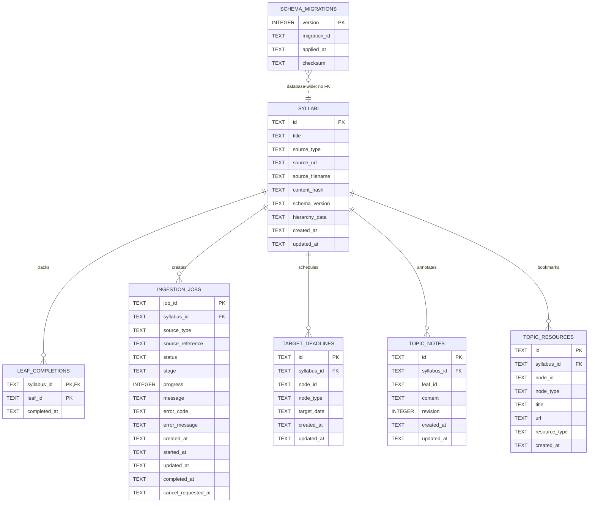

# 13_SCHEMA.md
# Canonical Database, Domain, API, SSE, and Portable Backup Contracts

> **Authority and traceability.** The public repository README and `Master_Context.md` were accessible; backend/frontend source directories could not be fetched through the available repository viewer. This document therefore treats repository-documented features as **IMPLEMENTED-DOC**, explicit project requirements as **SPECIFIED**, and additional contracts as **PROPOSED**. Confirm names and behavior against source before claiming source-level implementation. No tests or terminal commands were run.
>
> Version separation: **SQLite internal schema version = 2** (baseline specified by the project); **portable backup schema version = 2.1**. They are different version spaces.

## 1. Document Purpose and Authority

This file is the canonical data contract for `12_APP_FLOW.md`. It defines SQLite storage, the nested hierarchy JSON, Pydantic v2 models, TypeScript types, REST/SSE contracts, IndexedDB outbox shape, and backup compatibility.

Normative terms: MUST, MUST NOT, SHOULD and MAY are used as engineering requirements.

## 2. Architectural Data Boundaries

| Data | Store | Authority |
|---|---|---|
| Syllabus hierarchy and source metadata | SQLite `syllabi.hierarchy_data` | Server |
| Leaf completion | SQLite `leaf_completions` | Server |
| Ingestion job snapshot | SQLite `ingestion_jobs` recommended | Server |
| Deadlines, notes, resources | Dedicated SQLite tables | Server |
| Migration history | SQLite `schema_migrations` | Server |
| Pending offline mutations | Browser IndexedDB | Client pending queue |
| Temporary upload bytes | Isolated filesystem staging | Ephemeral |
| UI expansion, drawer state, filters | React state/local storage as appropriate | Client presentation |
| Parent progress | Derived from hierarchy + leaf completion + enrollment | Server response; client may optimistically derive |

The hierarchy is stored as nested JSON to preserve the source's tree structure and avoid redundant node tables. Relational tables reference stable node IDs; the service validates those references against the canonical hierarchy before every write.

## 3. Entity Relationship Diagram



`SCHEMA_MIGRATIONS` is database-wide and intentionally has no syllabus foreign key. Enrollment is embedded in each `Subject.is_enrolled`; a separate enrollment history table is not required to preserve current historical completion because excluded subjects remain in hierarchy JSON and completion rows. If audit history of every enrollment change becomes a product requirement, add a dedicated append-only table in a later migration.

## 4. SQLite Configuration and DDL

Execute these pragmas on every connection where applicable; `foreign_keys` is connection-scoped.

```sql
PRAGMA journal_mode = WAL;
PRAGMA foreign_keys = ON;
PRAGMA busy_timeout = 5000;
```

Recommended SQLite baseline DDL (internal schema version 2). Timestamps are UTC ISO-8601 strings with `Z`; target dates are date-only ISO `YYYY-MM-DD`.

```sql
CREATE TABLE IF NOT EXISTS syllabi (
    id              TEXT PRIMARY KEY,
    title           TEXT NOT NULL CHECK(length(trim(title)) BETWEEN 1 AND 300),
    source_type     TEXT NOT NULL CHECK(source_type IN ('upload', 'url')),
    source_url      TEXT,
    source_filename TEXT,
    content_hash    TEXT CHECK(content_hash IS NULL OR
                               (length(content_hash) = 64 AND
                                content_hash NOT GLOB '*[^0-9a-f]*')),
    schema_version  INTEGER NOT NULL DEFAULT 2 CHECK(schema_version >= 1),
    hierarchy_data  TEXT NOT NULL CHECK(json_valid(hierarchy_data)),
    created_at      TEXT NOT NULL,
    updated_at      TEXT NOT NULL,
    CHECK ((source_type = 'url' AND source_url IS NOT NULL) OR
           (source_type = 'upload' AND source_filename IS NOT NULL))
);

CREATE INDEX IF NOT EXISTS idx_syllabi_updated
    ON syllabi(updated_at DESC);

CREATE INDEX IF NOT EXISTS idx_syllabi_content_hash
    ON syllabi(content_hash) WHERE content_hash IS NOT NULL;

CREATE TABLE IF NOT EXISTS leaf_completions (
    syllabus_id TEXT NOT NULL,
    leaf_id     TEXT NOT NULL,
    completed_at TEXT NOT NULL,
    PRIMARY KEY (syllabus_id, leaf_id),
    FOREIGN KEY (syllabus_id) REFERENCES syllabi(id) ON DELETE CASCADE
);

CREATE INDEX IF NOT EXISTS idx_leaf_completions_leaf
    ON leaf_completions(leaf_id);

CREATE TABLE IF NOT EXISTS ingestion_jobs (
    job_id TEXT PRIMARY KEY,
    syllabus_id TEXT,
    source_type TEXT NOT NULL CHECK(source_type IN ('upload', 'url')),
    source_reference TEXT NOT NULL,
    status TEXT NOT NULL CHECK(status IN
      ('queued','running','completed','failed','cancelled','interrupted')),
    stage TEXT NOT NULL,
    progress INTEGER NOT NULL CHECK(progress BETWEEN 0 AND 100),
    message TEXT NOT NULL,
    error_code TEXT,
    error_message TEXT,
    created_at TEXT NOT NULL,
    started_at TEXT,
    updated_at TEXT NOT NULL,
    completed_at TEXT,
    cancel_requested_at TEXT,
    attempt INTEGER NOT NULL DEFAULT 1 CHECK(attempt >= 1),
    FOREIGN KEY (syllabus_id) REFERENCES syllabi(id) ON DELETE SET NULL
);

CREATE INDEX IF NOT EXISTS idx_jobs_status_updated
    ON ingestion_jobs(status, updated_at DESC);

CREATE TABLE IF NOT EXISTS target_deadlines (
    id TEXT PRIMARY KEY,
    syllabus_id TEXT NOT NULL,
    node_id TEXT NOT NULL,
    node_type TEXT NOT NULL CHECK(node_type IN ('subject','semester')),
    target_date TEXT NOT NULL
      CHECK(length(target_date) = 10 AND
            target_date GLOB '[0-9][0-9][0-9][0-9]-[0-9][0-9]-[0-9][0-9]'),
    created_at TEXT NOT NULL,
    updated_at TEXT NOT NULL,
    UNIQUE(syllabus_id, node_id),
    FOREIGN KEY (syllabus_id) REFERENCES syllabi(id) ON DELETE CASCADE
);

CREATE INDEX IF NOT EXISTS idx_deadlines_date
    ON target_deadlines(target_date);

CREATE TABLE IF NOT EXISTS topic_notes (
    id TEXT PRIMARY KEY,
    syllabus_id TEXT NOT NULL,
    leaf_id TEXT NOT NULL,
    content TEXT NOT NULL,
    revision INTEGER NOT NULL DEFAULT 1 CHECK(revision >= 1),
    created_at TEXT NOT NULL,
    updated_at TEXT NOT NULL,
    UNIQUE(syllabus_id, leaf_id),
    FOREIGN KEY (syllabus_id) REFERENCES syllabi(id) ON DELETE CASCADE
);

CREATE TABLE IF NOT EXISTS topic_resources (
    id TEXT PRIMARY KEY,
    syllabus_id TEXT NOT NULL,
    node_id TEXT NOT NULL,
    node_type TEXT NOT NULL CHECK(node_type IN ('subtopic','module')),
    title TEXT NOT NULL CHECK(length(trim(title)) BETWEEN 1 AND 300),
    url TEXT NOT NULL,
    resource_type TEXT NOT NULL CHECK(resource_type IN
      ('youtube','lecture','slides','article','other')),
    created_at TEXT NOT NULL,
    FOREIGN KEY (syllabus_id) REFERENCES syllabi(id) ON DELETE CASCADE
);

CREATE UNIQUE INDEX IF NOT EXISTS uq_resource_syllabus_node_url
    ON topic_resources(syllabus_id, node_id, url);

CREATE INDEX IF NOT EXISTS idx_resources_node
    ON topic_resources(syllabus_id, node_id);

CREATE TABLE IF NOT EXISTS schema_migrations (
    version INTEGER PRIMARY KEY CHECK(version >= 1),
    migration_id TEXT NOT NULL UNIQUE,
    applied_at TEXT NOT NULL,
    checksum TEXT
);
```

### 4.1 Referential integrity for JSON nodes

SQLite foreign keys cannot reference an object nested inside `hierarchy_data`. Before inserting a completion/note/deadline/resource, the service MUST load the syllabus hierarchy and build a validated node index mapping `node_id -> (tier, subject enrollment, parent chain)`. Reject:
- missing IDs;
- duplicate IDs anywhere in one syllabus;
- a completion/note target not at Tier 5;
- deadline target not at Semester or Subject;
- resource target not at Subtopic or Module;
- IDs belonging to another syllabus.

Perform hierarchy validation and dependent-row writes inside the same transaction or use a revision check to prevent a concurrent hierarchy replacement between validation and insert.

### 4.2 Deduplication scope

`content_hash` is indexed but not globally unique. Deduplication is a service-level decision scoped to source type and relevant source identity/configuration. Same bytes may legitimately be imported as separate syllabus records. An explicit “import as new” operation bypasses duplicate reuse but never overwrites existing records.

## 5. Database Indexes, Constraints, and Delete Behavior

- `syllabi.id`, `leaf_completions(syllabus_id,leaf_id)`, and `schema_migrations.version` are primary keys.
- One deadline per syllabus/node; one note per syllabus/leaf; duplicate resource URL on the same node is rejected.
- Deleting a syllabus cascades its completions, deadlines, notes and resources. Job `syllabus_id` is set NULL so the operational history may remain until retention cleanup.
- Deleting a hierarchy node is not an independent relational delete. Hierarchy mutation must reconcile dependent rows in one transaction; the default safer policy is to reject node removal when dependent records exist unless the user explicitly confirms archival/deletion.
- `leaf_id`, `node_id` and job references are opaque stable IDs; clients must not derive IDs from titles or array positions.

## 6. Migration Strategy

The internal schema baseline is integer version `2`. Apply ordered migrations under an exclusive migration transaction where SQLite permits. Each migration has a monotonically increasing version, stable migration ID, and optional checksum. Never mark a migration applied before its DDL/data transformation commits.

Before migration:
1. Stop accepting writes.
2. Create a consistent SQLite backup using the SQLite backup API (not a raw copy of only the main DB while WAL is active).
3. Verify backup readability.
4. Apply migration.
5. Run `PRAGMA foreign_key_check` and `PRAGMA integrity_check`.
6. Resume writes only if checks pass.

SQLite DDL rollback is not universally convenient across all operations; recovery strategy is restore the pre-migration backup when a migration fails. Do not claim automatic down-migrations unless individually implemented and tested.

## 7. Canonical Five-Tier Hierarchy

The root container is `HierarchicalSyllabus`; its `academic_years` are Tier 1.

| Model | Tier | Required fields | Child collection |
|---|---:|---|---|
| `HierarchicalSyllabus` | Root | id, title, schema_version, academic_years, timestamps | academic_years |
| `AcademicYear` | 1 | id, name, semesters | semesters |
| `Semester` | 2 | id, name, subjects | subjects |
| `Subject` | 3 | id, name, enrollment/elective metadata, modules | modules |
| `Module` | 4 | id, name, contact_hours, subtopics | subtopics |
| `Subtopic` | 5 | id, title, grounding/provenance fields | none |

### 7.1 Field catalog

| Field | Type | Required / nullable | Validation / meaning |
|---|---|---|---|
| root `id` | UUID string | Required / non-null | Stable syllabus identifier |
| root `title` | string | Required / non-null | 1–300 trimmed chars |
| root `schema_version` | integer | Required / non-null | Internal hierarchy payload version |
| root `academic_years` | array | Required / non-null | May be empty during review; no fake tiers |
| timestamps | ISO-8601 UTC string | Required / non-null | `Z` normalized |
| node `id` | UUID string | Required / non-null | Stable, unique within syllabus |
| year `name` | string | Required / non-null | Evidence-grounded label |
| year `year_label` | string or null | Optional / nullable | Display label |
| semester `name` | string | Required / non-null | Evidence-grounded label |
| semester `semester_number` | positive integer or null | Optional / nullable | No fabricated number |
| subject `name` | string | Required / non-null | No generic fallback name |
| subject `code` | string or null | Optional / nullable | Source course code |
| subject `is_lab` | boolean | Required / non-null | Contextual lab classification |
| subject `is_elective` | boolean | Required / non-null | Elective classification |
| subject `elective_group` | string or null | Optional / nullable | Required when grouped choice is known |
| subject `is_enrolled` | boolean | Required / non-null | Mandatory courses must be true |
| module `name` | string | Required / non-null | Evidence-grounded label |
| module `module_number` | integer or null | Optional / nullable | Positive if present |
| module `contact_hours` | nonnegative number or null | Optional / nullable | Workload metadata only |
| subtopic `title` | string | Required / non-null | Trackable leaf title |
| `source_text` | string or null | Optional / nullable | Verbatim source excerpt only |
| `source_page` | positive integer or null | Optional / nullable | 1-based physical page |
| `source_location` | string or null | Optional / nullable | Heading/table/URL locator |
| offsets | nonnegative integers or null | Optional / nullable | Half-open `[start,end)` offsets |
| `grounding_status` | enum | Required / non-null | `verified`, `partial`, `unverified`, `rejected` |

No model above Tier 5 has `completed`, `completed_at`, or a stored progress percentage.

### 7.2 Canonical example

```json
{
  "id": "6f28d8e1-7a1e-4f2d-8b5a-1c9c9d71d001",
  "title": "B.Sc. Computer Science Curriculum",
  "schema_version": 2,
  "created_at": "2026-11-17T12:00:00Z",
  "updated_at": "2026-11-17T12:00:00Z",
  "academic_years": [{
    "id": "6f28d8e1-7a1e-4f2d-8b5a-1c9c9d71d010",
    "name": "Academic Year 1",
    "year_label": "First Year",
    "semesters": [{
      "id": "6f28d8e1-7a1e-4f2d-8b5a-1c9c9d71d020",
      "name": "Semester 1",
      "semester_number": 1,
      "subjects": [{
        "id": "6f28d8e1-7a1e-4f2d-8b5a-1c9c9d71d030",
        "name": "Programming Fundamentals",
        "code": "CS101",
        "is_lab": false,
        "is_elective": false,
        "elective_group": null,
        "is_enrolled": true,
        "modules": [{
          "id": "6f28d8e1-7a1e-4f2d-8b5a-1c9c9d71d040",
          "name": "Control Flow",
          "module_number": 2,
          "contact_hours": 8,
          "subtopics": [{
            "id": "6f28d8e1-7a1e-4f2d-8b5a-1c9c9d71d050",
            "title": "Conditional statements",
            "source_text": "Conditional statements and branching.",
            "source_page": 12,
            "source_location": "Unit II / Paragraph 3",
            "source_start_offset": 1450,
            "source_end_offset": 1491,
            "grounding_status": "verified"
          }]
        }]
      }]
    }]
  }]
}
```

## 8. Source Grounding and Provenance

Grounding enum:
- `verified`: title and associated excerpt/location were matched to source evidence.
- `partial`: some provenance exists, but one or more details are incomplete or uncertain.
- `unverified`: candidate extracted without sufficient evidence; requires review.
- `rejected`: candidate failed validation and must not appear as a normal active leaf.

The existing repository context records `verified`, `needs_review`, and `unverified`; `needs_review` is a legacy compatibility value. Normalize it to `partial` in the canonical contract while retaining legacy parsing support during migration. Do not silently reinterpret `rejected` as an active leaf.

### 8.1 Offset semantics

Offsets are zero-based Unicode code-point offsets into a precisely identified canonical extracted-text artifact, measured after deterministic normalization. The artifact must define its normalization version and page separator policy. Offsets are half-open: `start <= position < end`. If normalization changes, offsets must be recomputed or marked unavailable. Never present offsets as byte offsets.

Physical PDF page numbers are 1-based. A page marker is provenance metadata, never a topic. Cross-page evidence may carry a page range or multiple evidence spans; do not fabricate a single page when the excerpt crosses pages.

For URL sources, preserve the canonical page URL, fetched timestamp, content hash, and DOM locator (heading path or stable text locator). Do not claim physical page numbers for HTML.

No fabricated quotations, page numbers, course names, module names, or hierarchy relationships are allowed. Missing source evidence is represented as null/partial/unverified and routed to review. Rejected and unclassified text should remain available in a review artifact when practical.

## 9. Pydantic v2 Backend Models

The following is a canonical reference implementation. It is a target contract, not a claim that the repository currently contains identical class names. It uses Pydantic v2 APIs.

```python
from __future__ import annotations

from datetime import date, datetime, timezone
from enum import StrEnum
from typing import Annotated, Literal
from uuid import UUID

from pydantic import BaseModel, ConfigDict, Field, HttpUrl, model_validator


class ContractModel(BaseModel):
    model_config = ConfigDict(
        extra="forbid",
        str_strip_whitespace=True,
        validate_assignment=True,
        use_enum_values=True,
    )


class SourceType(StrEnum):
    UPLOAD = "upload"
    URL = "url"


class GroundingStatus(StrEnum):
    VERIFIED = "verified"
    PARTIAL = "partial"
    UNVERIFIED = "unverified"
    REJECTED = "rejected"


class JobStatus(StrEnum):
    QUEUED = "queued"
    RUNNING = "running"
    COMPLETED = "completed"
    FAILED = "failed"
    CANCELLED = "cancelled"
    INTERRUPTED = "interrupted"


class JobStage(StrEnum):
    QUEUED = "queued"
    VALIDATING = "validating"
    PARSING = "parsing"
    CHUNKING = "chunking"
    EXTRACTING = "extracting"
    VALIDATING_RESULT = "validating_result"
    PERSISTING = "persisting"
    COMPLETED = "completed"


class ResourceType(StrEnum):
    YOUTUBE = "youtube"
    LECTURE = "lecture"
    SLIDES = "slides"
    ARTICLE = "article"
    OTHER = "other"


StableId = UUID
NonEmptyName = Annotated[str, Field(min_length=1, max_length=300)]
Offset = Annotated[int, Field(ge=0)]


class Subtopic(ContractModel):
    id: StableId
    title: NonEmptyName
    source_text: str | None = None
    source_page: int | None = Field(default=None, ge=1)
    source_location: str | None = Field(default=None, max_length=1000)
    source_start_offset: Offset | None = None
    source_end_offset: Offset | None = None
    grounding_status: GroundingStatus = GroundingStatus.UNVERIFIED

    @model_validator(mode="after")
    def validate_offsets(self):
        if (self.source_start_offset is None) != (self.source_end_offset is None):
            raise ValueError("source offsets must both be present or both be null")
        if self.source_start_offset is not None:
            if self.source_end_offset <= self.source_start_offset:
                raise ValueError("source_end_offset must be greater than start")
        if self.grounding_status == GroundingStatus.VERIFIED:
            if not self.source_text or self.source_page is None and not self.source_location:
                raise ValueError("verified evidence requires excerpt and source locator")
        return self


class Module(ContractModel):
    id: StableId
    name: NonEmptyName
    module_number: int | None = Field(default=None, ge=1)
    contact_hours: float | None = Field(default=None, ge=0)
    subtopics: list[Subtopic] = Field(default_factory=list)


class Subject(ContractModel):
    id: StableId
    name: NonEmptyName
    code: str | None = Field(default=None, max_length=80)
    is_lab: bool = False
    is_elective: bool = False
    elective_group: str | None = Field(default=None, max_length=120)
    is_enrolled: bool = True
    modules: list[Module] = Field(default_factory=list)

    @model_validator(mode="after")
    def validate_enrollment(self):
        if not self.is_elective and not self.is_enrolled:
            raise ValueError("mandatory subjects must remain enrolled")
        if self.elective_group is not None and not self.is_elective:
            raise ValueError("elective_group is valid only for elective subjects")
        return self


class Semester(ContractModel):
    id: StableId
    name: NonEmptyName
    semester_number: int | None = Field(default=None, ge=1)
    subjects: list[Subject] = Field(default_factory=list)


class AcademicYear(ContractModel):
    id: StableId
    name: NonEmptyName
    year_label: str | None = Field(default=None, max_length=120)
    semesters: list[Semester] = Field(default_factory=list)


class HierarchicalSyllabus(ContractModel):
    id: StableId
    title: NonEmptyName
    schema_version: int = Field(default=2, ge=1)
    academic_years: list[AcademicYear] = Field(default_factory=list)
    created_at: datetime
    updated_at: datetime
    source_type: SourceType | None = None
    source_url: HttpUrl | None = None
    source_filename: str | None = None
    content_hash: str | None = Field(default=None, pattern=r"^[0-9a-f]{64}$")

    @model_validator(mode="after")
    def validate_tree_ids(self):
        ids: list[UUID] = [self.id]
        for year in self.academic_years:
            ids.append(year.id)
            for semester in year.semesters:
                ids.append(semester.id)
                for subject in semester.subjects:
                    ids.append(subject.id)
                    for module in subject.modules:
                        ids.append(module.id)
                        ids.extend(leaf.id for leaf in module.subtopics)
        if len(ids) != len(set(ids)):
            raise ValueError("all hierarchy IDs must be unique within the syllabus")
        if self.updated_at < self.created_at:
            raise ValueError("updated_at cannot precede created_at")
        return self


class EnrollmentSelection(ContractModel):
    elective_group: str
    enrolled_subject_ids: list[StableId]


class FinalizeEnrollmentRequest(ContractModel):
    selections: list[EnrollmentSelection]
    expected_revision: int | None = Field(default=None, ge=1)


class ToggleLeafRequest(ContractModel):
    leaf_id: StableId
    completed: bool
    operation_id: StableId


class BulkToggleRequest(ContractModel):
    node_id: StableId
    completed: bool
    operation_id: StableId


class CompletionItem(ContractModel):
    leaf_id: StableId
    completed_at: datetime


class ProgressSummary(ContractModel):
    eligible_leaves: int = Field(ge=0)
    completed_leaves: int = Field(ge=0)
    percentage: float | None = Field(default=None, ge=0, le=100)
    state: Literal["checked", "unchecked", "indeterminate", "not_trackable"]

    @model_validator(mode="after")
    def validate_counts(self):
        if self.completed_leaves > self.eligible_leaves:
            raise ValueError("completed_leaves cannot exceed eligible_leaves")
        if self.eligible_leaves == 0:
            if self.percentage is not None or self.state != "not_trackable":
                raise ValueError("zero-leaf progress must be not_trackable with null percentage")
        return self


class DeadlineUpsert(ContractModel):
    node_id: StableId
    node_type: Literal["subject", "semester"]
    target_date: date


class DeadlineResponse(DeadlineUpsert):
    id: StableId
    created_at: datetime
    updated_at: datetime
    remaining_topics: int = Field(ge=0)
    remaining_contact_hours: float | None = Field(default=None, ge=0)
    topics_per_week: float | None = Field(default=None, ge=0)
    hours_per_week: float | None = Field(default=None, ge=0)
    status: Literal["on_track", "at_risk", "behind", "completed", "deadline_passed"]
    calculation_timezone: str


class NotePutRequest(ContractModel):
    content: str = Field(max_length=200_000)
    expected_revision: int | None = Field(default=None, ge=1)
    operation_id: StableId


class NoteResponse(ContractModel):
    id: StableId
    syllabus_id: StableId
    leaf_id: StableId
    content: str
    revision: int
    created_at: datetime
    updated_at: datetime


class ResourceCreateRequest(ContractModel):
    node_id: StableId
    node_type: Literal["subtopic", "module"]
    title: NonEmptyName
    url: HttpUrl
    resource_type: ResourceType


class ResourceResponse(ResourceCreateRequest):
    id: StableId
    created_at: datetime


class JobProgressEvent(ContractModel):
    job_id: StableId
    status: JobStatus
    stage: JobStage
    progress: int = Field(ge=0, le=100)
    message: str
    timestamp: datetime
    error: dict[str, str] | None = None
    event_sequence: int = Field(ge=1)


class StartUploadResponse(ContractModel):
    job_id: StableId
    status: Literal["queued"]
    progress_url: str
    poll_url: str


class ApiErrorDetail(ContractModel):
    field: str | None = None
    reason: str
    value: str | None = None


class ApiErrorBody(ContractModel):
    code: str
    message: str
    details: list[ApiErrorDetail] = Field(default_factory=list)
    request_id: StableId
    timestamp: datetime


class ApiErrorResponse(ContractModel):
    error: ApiErrorBody


class RestoreRequest(ContractModel):
    mode: Literal["import_as_new", "replace_existing", "merge"] = "import_as_new"
    target_syllabus_id: StableId | None = None
    confirmation_token: str | None = None
    backup: dict

    @model_validator(mode="after")
    def validate_mode(self):
        if self.mode == "replace_existing" and (
            self.target_syllabus_id is None or not self.confirmation_token
        ):
            raise ValueError("replace_existing requires target ID and confirmation token")
        return self
```

The `RestoreRequest.backup` dictionary is only the transport wrapper in this compact reference; production code MUST validate it with the dedicated `PortableBackupV21` model before opening a transaction. A complete backup envelope is defined in §15.

## 10. TypeScript Frontend Contracts

```ts
export type UUID = string;
export type ISODateTime = string;
export type ISODate = string;

export type GroundingStatus =
  | "verified"
  | "partial"
  | "unverified"
  | "rejected";

export interface Subtopic {
  id: UUID;
  title: string;
  source_text: string | null;
  source_page: number | null;
  source_location: string | null;
  source_start_offset: number | null;
  source_end_offset: number | null;
  grounding_status: GroundingStatus;
}

export interface Module {
  id: UUID;
  name: string;
  module_number: number | null;
  contact_hours: number | null;
  subtopics: Subtopic[];
}

export interface Subject {
  id: UUID;
  name: string;
  code: string | null;
  is_lab: boolean;
  is_elective: boolean;
  elective_group: string | null;
  is_enrolled: boolean;
  modules: Module[];
}

export interface Semester {
  id: UUID;
  name: string;
  semester_number: number | null;
  subjects: Subject[];
}

export interface AcademicYear {
  id: UUID;
  name: string;
  year_label: string | null;
  semesters: Semester[];
}

export interface HierarchicalSyllabus {
  id: UUID;
  title: string;
  schema_version: number;
  academic_years: AcademicYear[];
  created_at: ISODateTime;
  updated_at: ISODateTime;
  source_type: "upload" | "url" | null;
  source_url: string | null;
  source_filename: string | null;
  content_hash: string | null;
}

export type TriState =
  | { state: "checked"; eligible_leaves: number; completed_leaves: number; percentage: number }
  | { state: "unchecked"; eligible_leaves: number; completed_leaves: 0; percentage: 0 }
  | { state: "indeterminate"; eligible_leaves: number; completed_leaves: number; percentage: number }
  | { state: "not_trackable"; eligible_leaves: 0; completed_leaves: 0; percentage: null };

export interface ProgressSummary {
  eligible_leaves: number;
  completed_leaves: number;
  percentage: number | null;
  state: TriState["state"];
}

export interface Deadline {
  id: UUID;
  node_id: UUID;
  node_type: "subject" | "semester";
  target_date: ISODate;
  remaining_topics: number;
  remaining_contact_hours: number | null;
  topics_per_week: number | null;
  hours_per_week: number | null;
  status: "on_track" | "at_risk" | "behind" | "completed" | "deadline_passed";
  calculation_timezone: string;
  created_at: ISODateTime;
  updated_at: ISODateTime;
}

export interface TopicNote {
  id: UUID;
  syllabus_id: UUID;
  leaf_id: UUID;
  content: string;
  revision: number;
  created_at: ISODateTime;
  updated_at: ISODateTime;
}

export type ResourceType = "youtube" | "lecture" | "slides" | "article" | "other";

export interface TopicResource {
  id: UUID;
  node_id: UUID;
  node_type: "subtopic" | "module";
  title: string;
  url: string;
  resource_type: ResourceType;
  created_at: ISODateTime;
}

export type JobStatus =
  | "queued" | "running" | "completed" | "failed" | "cancelled" | "interrupted";

export type JobStage =
  | "queued" | "validating" | "parsing" | "chunking"
  | "extracting" | "validating_result" | "persisting" | "completed";

export interface JobProgressEvent {
  job_id: UUID;
  status: JobStatus;
  stage: JobStage;
  progress: number;
  message: string;
  timestamp: ISODateTime;
  error: { code: string; message: string } | null;
  event_sequence: number;
}

export interface StartUploadResponse {
  job_id: UUID;
  status: "queued";
  progress_url: string;
  poll_url: string;
}

export interface ApiErrorDetail {
  field: string | null;
  reason: string;
  value: string | null;
}

export interface ApiErrorResponse {
  error: {
    code: string;
    message: string;
    details: ApiErrorDetail[];
    request_id: UUID;
    timestamp: ISODateTime;
  };
}

export interface ToggleLeafRequest {
  leaf_id: UUID;
  completed: boolean;
  operation_id: UUID;
}

export interface BulkToggleRequest {
  node_id: UUID;
  completed: boolean;
  operation_id: UUID;
}

export interface EnrollmentSelection {
  elective_group: string;
  enrolled_subject_ids: UUID[];
}

export interface EnrollmentRequest {
  selections: EnrollmentSelection[];
  expected_revision: number | null;
}

export interface NotePutRequest {
  content: string;
  expected_revision: number | null;
  operation_id: UUID;
}

export interface DeadlinePutRequest {
  node_id: UUID;
  node_type: "subject" | "semester";
  target_date: ISODate;
}

export interface ResourceCreateRequest {
  node_id: UUID;
  node_type: "subtopic" | "module";
  title: string;
  url: string;
  resource_type: ResourceType;
}

export type OutboxState = "pending" | "in_flight" | "completed" | "failed";
export type OutboxOperation =
  | { type: "toggle_leaf"; payload: ToggleLeafRequest; payload_version: 1 }
  | { type: "bulk_toggle"; payload: BulkToggleRequest; payload_version: 1 }
  | { type: "put_note"; leaf_id: UUID; payload: NotePutRequest; payload_version: 1 }
  | { type: "put_deadline"; payload: DeadlinePutRequest; payload_version: 1 }
  | { type: "enrollment_update"; payload: EnrollmentRequest; payload_version: 1 };

export interface OfflineOutboxItem {
  operation_id: UUID;
  syllabus_id: UUID;
  operation: OutboxOperation;
  created_at: ISODateTime;
  attempt_count: number;
  next_attempt_at: ISODateTime | null;
  state: OutboxState;
  last_error: ApiErrorResponse["error"] | null;
}

export interface PortableBackupV21 {
  format: "syllabus-tracker-backup";
  backup_schema_version: "2.1";
  exported_at: ISODateTime;
  application: { name: "Hierarchical Syllabus Checklist & Progress Tracker"; version?: string };
  syllabus: HierarchicalSyllabus;
  completion: Array<{ leaf_id: UUID; completed_at: ISODateTime }>;
  deadlines: Deadline[];
  notes: TopicNote[];
  resources: TopicResource[];
  metadata: {
    source_database_schema_version: number;
    export_id: UUID;
    extensions?: Record<string, unknown>;
  };
}

export type RestoreMode = "import_as_new" | "replace_existing" | "merge";
export interface RestoreRequest {
  mode: RestoreMode;
  target_syllabus_id: UUID | null;
  confirmation_token: string | null;
  backup: PortableBackupV21;
}
```

The TypeScript types mirror API wire contracts. Server-returned completion IDs and progress are authoritative. Client-derived tri-state values are allowed only for optimistic presentation and must be reconciled with server responses.

## 11. Tri-State Completion Contract

For each branch, eligible leaves are Tier-5 descendants whose owning Subject has `is_enrolled=true`. Let `N` be eligible leaves and `C` completed eligible leaves.

- `N = 0`: `not_trackable`, percentage `null`.
- `N > 0, C = 0`: `unchecked`, percentage `0`.
- `0 < C < N`: `indeterminate`.
- `C = N`: `checked`, percentage `100`.

Global progress uses the same formula across the full enrolled hierarchy. Excluded elective leaves and all parent tiers are excluded from the denominator. Their completion records remain in SQLite.

## 12. Ingestion Job and SSE Contracts

Job status lifecycle: `queued -> running -> completed|failed|cancelled`; `running -> interrupted` is reserved for restart recovery. Terminal statuses are immutable. `interrupted` may be retried only by creating a new attempt/job.

SSE wire format:

```text
id: 17
event: progress
data: {"job_id":"0192f1a2-7c3a-7b11-a1b2-2a2a5a3d9f11","status":"running","stage":"extracting","progress":63,"message":"Extracting chunk 3 of 5","timestamp":"2026-11-17T12:00:00Z","error":null,"event_sequence":17}

: keep-alive

id: 24
event: completed
data: {"job_id":"0192f1a2-7c3a-7b11-a1b2-2a2a5a3d9f11","status":"completed","stage":"completed","progress":100,"message":"Syllabus saved","timestamp":"2026-11-17T12:01:00Z","error":null,"event_sequence":24}
```

Event names: `progress`, `completed`, `failed`, `cancelled`. The JSON body is `JobProgressEvent`. `Last-Event-ID` is supported only if the server retains replayable event history; otherwise the client obtains a current snapshot from `GET /api/upload/jobs/{job_id}` and reconnects for future events. SSE transport itself is not persistence.

The repository context documents a thread-safe in-memory job manager. Durable `ingestion_jobs` storage and restart recovery are proposed until verified in source.

## 13. Deadline and Study Pacing Contracts

A deadline belongs only to a Semester or Subject. Persist `target_date` as `YYYY-MM-DD`; return `calculation_timezone` for local-day calculations. The deadline table does not store derived pacing values; calculate them from current completion, enrollment and contact-hour metadata.

Fields:
- `remaining_topics`: enrolled incomplete Tier-5 leaves.
- `remaining_contact_hours`: estimated remaining workload, nullable if insufficient metadata.
- `topics_per_week`: remaining topics divided by weeks remaining; null if deadline has passed with work remaining.
- `hours_per_week`: remaining hours divided by weeks remaining; null if hours unknown or deadline passed.
- `status`: `on_track|at_risk|behind|completed|deadline_passed`.

Thresholds are configurable proposed policy, not an existing verified rule. A completed target has `completed` regardless of target date. A past date with work remaining is `deadline_passed`.

## 14. Notes and Resource Contracts

Notes:
- Unique `(syllabus_id, leaf_id)`.
- `content` is Markdown text, max 200,000 characters recommended.
- `revision` increments on every accepted update.
- `expected_revision` prevents silent overwrite; mismatch returns 409 and current server note metadata.
- Empty string is valid content; DELETE removes the note.

Resources:
- `node_type` is `subtopic` or `module`.
- `resource_type` is `youtube|lecture|slides|article|other`.
- URL must be absolute HTTP(S), without embedded credentials.
- Validate node membership and tier against hierarchy JSON.
- Unique `(syllabus_id,node_id,url)` prevents duplicate bookmarks on the same node.
- Resource titles are plain text and escaped on HTML output.

## 15. Portable Backup JSON — Schema 2.1

Portable format version `"2.1"` is independent from internal SQLite schema integer `2`. The backup is a logical export, not a database file.

### 15.1 Envelope

| Field | Type | Required | Meaning |
|---|---|---:|---|
| `format` | literal string | Yes | `syllabus-tracker-backup` |
| `backup_schema_version` | string | Yes | `2.1` |
| `exported_at` | ISO timestamp | Yes | UTC export time |
| `application.name` | literal string | Yes | Product identity |
| `application.version` | string | No | Exporting app version |
| `syllabus` | hierarchy object | Yes | Complete five-tier hierarchy |
| `completion` | array | Yes | Leaf completion records |
| `deadlines` | array | Yes | Semester/Subject deadlines |
| `notes` | array | Yes | Topic notes |
| `resources` | array | Yes | Topic/module resources |
| `metadata.source_database_schema_version` | integer | Yes | Source DB schema version |
| `metadata.export_id` | UUID | Yes | Unique export identifier |
| `metadata.extensions` | object | No | Namespaced optional extensions |

### 15.2 Restore modes

- `import_as_new` (default): creates a new syllabus record and copies all associated records. Preserve stable node IDs if unique within the new syllabus namespace; the composite foreign keys are scoped by new syllabus ID.
- `replace_existing`: requires target ID and explicit confirmation token; replace hierarchy and dependent logical records atomically. Reject if target does not exist.
- `merge`: merges only when stable IDs and content semantics are compatible. Conflicts must be returned for resolution; never silently overwrite completion or notes. A minimal first release may reject merge as `501 RESTORE_MODE_UNSUPPORTED` rather than partially implement it.

Unknown fields: preserve namespaced extension fields where possible. Ignore unknown optional fields only when the backup version explicitly allows forward-compatible extension handling. Reject unknown required semantics and all unsupported future major/minor versions. A future version is not safe to import merely because JSON parsing succeeds.

If any completion record references a nonexistent ID, a parent node, or an excluded/invalid node, reject the whole backup. Historical completion for excluded electives is valid and must be preserved.

### 15.3 Complete example

```json
{
  "format": "syllabus-tracker-backup",
  "backup_schema_version": "2.1",
  "exported_at": "2026-11-17T12:30:00Z",
  "application": {
    "name": "Hierarchical Syllabus Checklist & Progress Tracker",
    "version": "1.0.0"
  },
  "syllabus": {
    "id": "6f28d8e1-7a1e-4f2d-8b5a-1c9c9d71d001",
    "title": "B.Sc. Computer Science Curriculum",
    "schema_version": 2,
    "created_at": "2026-11-17T12:00:00Z",
    "updated_at": "2026-11-17T12:20:00Z",
    "source_type": "upload",
    "source_url": null,
    "source_filename": "computer-science-syllabus.pdf",
    "content_hash": "aaaaaaaaaaaaaaaaaaaaaaaaaaaaaaaaaaaaaaaaaaaaaaaaaaaaaaaaaaaaaaaa",
    "academic_years": [{
      "id": "6f28d8e1-7a1e-4f2d-8b5a-1c9c9d71d010",
      "name": "Academic Year 1",
      "year_label": "First Year",
      "semesters": [{
        "id": "6f28d8e1-7a1e-4f2d-8b5a-1c9c9d71d020",
        "name": "Semester 1",
        "semester_number": 1,
        "subjects": [{
          "id": "6f28d8e1-7a1e-4f2d-8b5a-1c9c9d71d030",
          "name": "Programming Fundamentals",
          "code": "CS101",
          "is_lab": false,
          "is_elective": false,
          "elective_group": null,
          "is_enrolled": true,
          "modules": [{
            "id": "6f28d8e1-7a1e-4f2d-8b5a-1c9c9d71d040",
            "name": "Control Flow",
            "module_number": 2,
            "contact_hours": 8,
            "subtopics": [{
              "id": "6f28d8e1-7a1e-4f2d-8b5a-1c9c9d71d050",
              "title": "Conditional statements",
              "source_text": "Conditional statements and branching.",
              "source_page": 12,
              "source_location": "Unit II / Paragraph 3",
              "source_start_offset": 1450,
              "source_end_offset": 1491,
              "grounding_status": "verified"
            }]
          }]
        }]
      }]
    }]
  },
  "completion": [{
    "leaf_id": "6f28d8e1-7a1e-4f2d-8b5a-1c9c9d71d050",
    "completed_at": "2026-11-17T12:15:00Z"
  }],
  "deadlines": [{
    "id": "7f28d8e1-7a1e-4f2d-8b5a-1c9c9d71d101",
    "node_id": "6f28d8e1-7a1e-4f2d-8b5a-1c9c9d71d020",
    "node_type": "semester",
    "target_date": "2027-01-15",
    "remaining_topics": 12,
    "remaining_contact_hours": 24.0,
    "topics_per_week": 2.0,
    "hours_per_week": 4.0,
    "status": "on_track",
    "calculation_timezone": "Asia/Kolkata",
    "created_at": "2026-11-17T12:10:00Z",
    "updated_at": "2026-11-17T12:10:00Z"
  }],
  "notes": [{
    "id": "8f28d8e1-7a1e-4f2d-8b5a-1c9c9d71d201",
    "syllabus_id": "6f28d8e1-7a1e-4f2d-8b5a-1c9c9d71d001",
    "leaf_id": "6f28d8e1-7a1e-4f2d-8b5a-1c9c9d71d050",
    "content": "Revise truth tables and branching examples.",
    "revision": 2,
    "created_at": "2026-11-17T12:05:00Z",
    "updated_at": "2026-11-17T12:18:00Z"
  }],
  "resources": [{
    "id": "9f28d8e1-7a1e-4f2d-8b5a-1c9c9d71d301",
    "node_id": "6f28d8e1-7a1e-4f2d-8b5a-1c9c9d71d050",
    "node_type": "subtopic",
    "title": "Conditional statements lecture",
    "url": "https://www.youtube.com/watch?v=abcdefghijk",
    "resource_type": "youtube",
    "created_at": "2026-11-17T12:19:00Z"
  }],
  "metadata": {
    "source_database_schema_version": 2,
    "export_id": "af28d8e1-7a1e-4f2d-8b5a-1c9c9d71d401",
    "extensions": {}
  }
}
```

Derived pacing fields in the example are illustrative snapshot values. The canonical database stores target dates and source metadata; recompute pacing after restore. A stricter portable contract may omit derived pacing fields from deadline records; if included, mark them as informational snapshots, never authoritative.

## 16. REST API Reference

### 16.1 Common conventions

- Base URL: local API origin, documented development default `http://127.0.0.1:8000`.
- JSON requests use `Content-Type: application/json`; uploads use `multipart/form-data`.
- IDs are UUID strings.
- Timestamps are ISO-8601 UTC; dates are `YYYY-MM-DD`.
- Errors use §17 envelope.
- Local-first does not automatically imply authentication. Do not invent user auth if none exists. Bind local server to loopback by default and apply CORS allowlists.
- Mutating requests SHOULD accept `Idempotency-Key` or an `operation_id` in body. State-setting operations are designed to be idempotent.
- `X-Request-ID` may be supplied by client; server returns generated request ID otherwise.

### 16.2 Operational APIs

| Method/path | Purpose | Success | Errors |
|---|---|---|---|
| GET `/health` | Liveness and process diagnostics | 200 | 500 |
| GET `/ready` | Readiness incl. database `SELECT 1` | 200 | 503 |
| GET `/api/health` | Compatibility health alias/details | 200 | 500 |
| GET `/api/config` | Safe runtime capabilities | 200 | 500 |

`/health` answers whether process is alive; it must not imply dependencies are ready. `/ready` checks required dependencies and returns 503 when unavailable. `/api/config` may expose allowed extensions, upload byte/page/character limits, active provider label and feature flags; never expose keys, filesystem paths, raw provider URLs with credentials, or environment variables.

Example config:
```json
{
  "allowed_extensions": [".pdf", ".docx", ".doc", ".txt"],
  "max_upload_size_bytes": 52428800,
  "max_pdf_pages": 300,
  "max_extracted_text_chars": 1500000,
  "active_extraction_provider": "ollama",
  "features": {"url_preview": false, "offline_outbox": false}
}
```
Feature flags must reflect actual runtime capability; false is safer than claiming an unimplemented feature.

### 16.3 Ingestion and SSE APIs

#### POST `/api/upload`

- Request: multipart `file` (required).
- Headers: multipart boundary; optional `Idempotency-Key`.
- Response: `202 Accepted` after staging and job registration.

```json
{
  "job_id": "0192f1a2-7c3a-7b11-a1b2-2a2a5a3d9f11",
  "status": "queued",
  "progress_url": "/api/upload/progress/0192f1a2-7c3a-7b11-a1b2-2a2a5a3d9f11",
  "poll_url": "/api/upload/jobs/0192f1a2-7c3a-7b11-a1b2-2a2a5a3d9f11"
}
```

Errors: 400 malformed multipart, 413 too large, 415 unsupported extension/media, 422 invalid file, 503 capacity/storage unavailable. Side effect: creates job and staging file. Repeated idempotency key returns same job if retained; otherwise a new job may be created. Clean staged file after terminal completion.

#### GET `/api/upload/progress/{job_id}`

- Response: `200 text/event-stream`.
- Events: `progress`, `completed`, `failed`, `cancelled`.
- Headers: `Cache-Control: no-cache`, `Connection: keep-alive`, optional `X-Accel-Buffering: no`.
- Query: none required; `Last-Event-ID` request header for replay where supported.
- Errors before stream: 404 unknown job, 410 expired job, 503 service unavailable.
- Side effect: subscriber registration only; disconnect does not cancel job.

#### GET `/api/upload/jobs/{job_id}`

Response:
```json
{
  "job_id": "0192f1a2-7c3a-7b11-a1b2-2a2a5a3d9f11",
  "status": "running",
  "stage": "extracting",
  "progress": 63,
  "message": "Extracting chunk 3 of 5",
  "created_at": "2026-11-17T12:00:00Z",
  "updated_at": "2026-11-17T12:00:30Z",
  "completed_at": null,
  "error": null,
  "syllabus_id": null
}
```
Errors: 404 unknown, 410 expired. Read-only.

#### POST `/api/upload/jobs/{job_id}/cancel`

Body may be empty. Response:
```json
{"job_id":"0192f1a2-7c3a-7b11-a1b2-2a2a5a3d9f11","status":"running","cancel_requested":true}
```
Returns 202 when cancellation requested asynchronously, 200 if already terminal. 404 unknown; 409 if cancellation cannot be honored after commit. Idempotent. Cancellation is cooperative.

#### POST `/api/scrape/preview`

Body:
```json
{"url":"https://university.example.edu/academics/syllabus"}
```
Response:
```json
{
  "preview_id":"0192f1a2-7c3a-7b11-a1b2-2a2a5a3d9f12",
  "expires_at":"2026-11-17T12:10:00Z",
  "page":{"url":"https://university.example.edu/academics/syllabus","title":"Academic Syllabus","text_preview":"Course curriculum ..."},
  "sources":[{"source_id":"pdf-1","kind":"pdf","url":"https://university.example.edu/files/cs.pdf","filename":"cs.pdf","size_bytes":245120}]
}
```
Errors: 400 malformed URL, 422 unsafe scheme/host/content, 413 response too large, 429 host rate limit, 502 upstream failure, 504 timeout. No syllabus is persisted. Security: SSRF validation at DNS and connection time, every redirect and final PDF fetch.

#### POST `/api/scrape/ingest`

Body:
```json
{"preview_id":"0192f1a2-7c3a-7b11-a1b2-2a2a5a3d9f12","selected_source_ids":["pdf-1"]}
```
Response 202 uses `StartUploadResponse`. Errors: 404/410 preview missing/expired, 422 invalid selection or unsafe target, 503 worker unavailable. Server re-fetches/revalidates selected content; preview data is not authorization.

### 16.4 Syllabus and enrollment APIs

#### GET `/api/syllabi`

Query: `limit` 1–100 default 20; `cursor` opaque optional; `q` optional search. Response:
```json
{
  "items":[{"id":"6f28d8e1-7a1e-4f2d-8b5a-1c9c9d71d001","title":"B.Sc. Computer Science Curriculum","updated_at":"2026-11-17T12:20:00Z","progress":{"eligible_leaves":20,"completed_leaves":5,"percentage":25.0,"state":"indeterminate"}}],
  "next_cursor":null
}
```
Read-only; 422 invalid pagination.

#### GET `/api/syllabus/{id}`

Returns hierarchy, completion IDs and derived progress. Response:
```json
{
  "syllabus":{"id":"6f28d8e1-7a1e-4f2d-8b5a-1c9c9d71d001","title":"B.Sc. Computer Science Curriculum","schema_version":2,"academic_years":[],"created_at":"2026-11-17T12:00:00Z","updated_at":"2026-11-17T12:20:00Z","source_type":"upload","source_url":null,"source_filename":"syllabus.pdf","content_hash":null},
  "completed_leaf_ids":[],
  "progress":{"eligible_leaves":0,"completed_leaves":0,"percentage":null,"state":"not_trackable"},
  "enrollment_finalized":true
}
```
The empty hierarchy above is a response-shape illustration only; production records contain the full validated hierarchy. 404 unknown.

#### PATCH `/api/syllabus/{id}`

Body `{ "title": "Updated curriculum title" }`. Response returns updated syllabus metadata. 404 unknown, 422 invalid title, 409 stale revision if optimistic concurrency enabled. Idempotent for same title.

#### DELETE `/api/syllabus/{id}`

Requires explicit client confirmation (for example `?confirm=true` or confirmation body); do not delete from an accidental navigation action. Response 204. Cascades completion/deadline/note/resource rows; job rows set `syllabus_id=NULL`. 404 unknown, 409 active ingestion or dependent operation if policy blocks deletion. Irreversible local deletion should be preceded by optional export prompt.

#### GET `/api/syllabus/{id}/review`

Returns extraction review and elective groups:
```json
{
  "syllabus_id":"6f28d8e1-7a1e-4f2d-8b5a-1c9c9d71d001",
  "requires_enrollment_confirmation":true,
  "groups":[{"elective_group":"OPEN_ELECTIVE_A","min_select":1,"max_select":1,"subjects":[{"id":"6f28d8e1-7a1e-4f2d-8b5a-1c9c9d71d031","name":"Data Science","is_enrolled":false}]}],
  "review_warnings":[]
}
```
404 unknown; 409 if already finalized and no review state remains.

#### POST `/api/syllabus/{id}/finalize-enrollment`

Body:
```json
{"selections":[{"elective_group":"OPEN_ELECTIVE_A","enrolled_subject_ids":["6f28d8e1-7a1e-4f2d-8b5a-1c9c9d71d031"]}],"expected_revision":1}
```
Response returns enrollment state and progress. 404 unknown, 409 stale revision/already finalized incompatibly, 422 invalid group/cardinality/mandatory exclusion. Transactional and idempotent for identical selection.

#### POST `/api/syllabus/{id}/update-enrollment`

Same body; applies complete desired selection. Excluded course records and historical data remain. 409 on stale revision; 422 invalid selection. Idempotent for same desired state.

### 16.5 Progress APIs

#### PATCH `/api/syllabus/{id}/toggle-leaf`

Body:
```json
{"leaf_id":"6f28d8e1-7a1e-4f2d-8b5a-1c9c9d71d050","completed":true,"operation_id":"af28d8e1-7a1e-4f2d-8b5a-1c9c9d71d401"}
```
Response:
```json
{"leaf_id":"6f28d8e1-7a1e-4f2d-8b5a-1c9c9d71d050","completed":true,"completed_at":"2026-11-17T12:30:00Z","progress":{"eligible_leaves":20,"completed_leaves":6,"percentage":30.0,"state":"indeterminate"}}
```
404 syllabus/leaf; 422 non-leaf or foreign ID; 409 stale revision if enabled. Desired-state idempotent; operation ledger recommended for duplicate response replay.

#### PATCH `/api/syllabus/{id}/bulk-toggle`

Body:
```json
{"node_id":"6f28d8e1-7a1e-4f2d-8b5a-1c9c9d71d040","completed":true,"operation_id":"bf28d8e1-7a1e-4f2d-8b5a-1c9c9d71d402"}
```
Response:
```json
{"node_id":"6f28d8e1-7a1e-4f2d-8b5a-1c9c9d71d040","changed_count":4,"completed":true,"progress":{"eligible_leaves":20,"completed_leaves":10,"percentage":50.0,"state":"indeterminate"}}
```
Server resolves eligible enrolled descendants. Entire operation is one transaction. 404 unknown branch; 422 invalid node or explicit IDs; 409 revision conflict. Retry-safe desired-state operation.

### 16.6 Deadline APIs

#### GET `/api/syllabus/{id}/deadlines`

Returns list of persisted deadlines plus freshly calculated pacing.

#### PUT `/api/syllabus/{id}/deadlines`

Body:
```json
{"node_id":"6f28d8e1-7a1e-4f2d-8b5a-1c9c9d71d020","node_type":"semester","target_date":"2027-01-15"}
```
Response:
```json
{"id":"7f28d8e1-7a1e-4f2d-8b5a-1c9c9d71d101","node_id":"6f28d8e1-4f2d-8b5a-1c9c9d71d020","node_type":"semester","target_date":"2027-01-15","remaining_topics":12,"remaining_contact_hours":24.0,"topics_per_week":2.0,"hours_per_week":4.0,"status":"on_track","calculation_timezone":"Asia/Kolkata","created_at":"2026-11-17T12:00:00Z","updated_at":"2026-11-17T12:00:00Z"}
```
404 unknown syllabus/node; 422 wrong tier/date. Upsert is idempotent for same node/date. Date is local academic date; timezone is supplied by configured application setting.

#### DELETE `/api/syllabus/{id}/deadlines/{node_id}`

Query `node_type` optional only if node ID is globally unique within syllabus; recommended required for clarity. Response 204. 404 missing deadline; does not delete course data.

### 16.7 Notes APIs

- `GET /api/syllabus/{id}/notes/{leaf_id}`: 200 note or `{ "note": null }` if absent; 404 if syllabus/leaf invalid.
- `PUT` body:
```json
{"content":"Revise truth tables.","expected_revision":2,"operation_id":"cf28d8e1-7a1e-4f2d-8b5a-1c9c9d71d403"}
```
Response is `NoteResponse`; 409 on revision mismatch; 422 invalid leaf/content.
- `DELETE`: 204; 404 if no note; idempotency policy may return 204 for already absent note.

### 16.8 Resource APIs

- `GET /api/syllabus/{id}/resources`: optional `node_id` filter; returns resource list.
- `POST /api/syllabus/{id}/resources` body:
```json
{"node_id":"6f28d8e1-7a1e-4f2d-8b5a-1c9c9d71d050","node_type":"subtopic","title":"Conditional statements lecture","url":"https://www.youtube.com/watch?v=abcdefghijk","resource_type":"youtube"}
```
Response 201 `TopicResource`; 404 invalid syllabus/node; 409 duplicate URL; 422 unsafe URL/type.
- `DELETE /api/syllabus/{id}/resources/{resource_id}`: 204; 404 resource not owned by syllabus.

### 16.9 Export and restore APIs

#### GET `/api/syllabus/{id}/export/markdown`

Returns `text/markdown; charset=utf-8`, `Content-Disposition: attachment; filename="syllabus-<safe-id>.md"`. Preserve hierarchy and include completion/evidence as readable text. Notes and resources may be included with clear labels.

#### GET `/api/syllabus/{id}/export/json`

Returns `application/json`, `Content-Disposition: attachment; filename="syllabus-backup-<safe-id>.json"`. Must conform to Schema 2.1 envelope.

#### GET `/api/syllabus/{id}/export/html`

Returns `text/html; charset=utf-8`, attachment or preview according to explicit query. Escape user/source text, sanitize Markdown, reject dangerous URL schemes and avoid inline executable scripts.

#### POST `/api/syllabus/restore-backup`

Body is `RestoreRequest` with complete `backup` envelope. Recommended maximum JSON payload: 25 MiB configurable; enforce at proxy and application layers. Returns 201 for import-as-new or 200 for replace/merge:
```json
{"syllabus_id":"6f28d8e1-7a1e-4f2d-8b5a-1c9c9d71d001","mode":"import_as_new","restored":{"completion":1,"deadlines":1,"notes":1,"resources":1}}
```
Errors: 413 too large, 415 wrong media type, 422 malformed/invalid schema or dangling references, 409 target conflict, 501 unsupported merge mode. Entire restore is atomic.

## 17. Standard API Error Contract

```json
{
  "error": {
    "code": "VALIDATION_ERROR",
    "message": "The supplied request is invalid.",
    "details": [{"field":"leaf_id","reason":"A Tier-5 leaf ID is required.","value":"parent-123"}],
    "request_id": "af28d8e1-7a1e-4f2d-8b5a-1c9c9d71d401",
    "timestamp": "2026-11-17T12:30:00Z"
  }
}
```

| HTTP | Code examples | Meaning |
|---:|---|---|
| 400 | `BAD_REQUEST`, `MALFORMED_MULTIPART` | Malformed syntax/request |
| 401 | `UNAUTHORIZED` | Only if authentication is configured |
| 403 | `FORBIDDEN` | Authenticated but disallowed |
| 404 | `NOT_FOUND`, `JOB_NOT_FOUND`, `LEAF_NOT_FOUND` | Resource absent |
| 409 | `CONFLICT`, `REVISION_CONFLICT`, `DUPLICATE_RESOURCE` | State conflict |
| 410 | `PREVIEW_EXPIRED`, `JOB_EXPIRED` | Expired temporary resource |
| 413 | `PAYLOAD_TOO_LARGE` | Request/source exceeds limit |
| 415 | `UNSUPPORTED_MEDIA_TYPE` | Unsupported content |
| 422 | `VALIDATION_ERROR`, `URL_NOT_ALLOWED`, `LEAF_REQUIRED` | Semantically invalid |
| 429 | `RATE_LIMITED` | Only if rate limiting is configured |
| 500 | `INTERNAL_ERROR` | Unexpected server failure |
| 501 | `NOT_IMPLEMENTED` | Explicit unsupported capability |
| 503 | `SERVICE_UNAVAILABLE`, `DATABASE_BUSY`, `WORKER_UNAVAILABLE` | Temporary dependency/capacity failure |
| 504 | `PROCESSING_TIMEOUT`, `UPSTREAM_TIMEOUT` | Bounded operation timed out |

Never return stack traces, raw exception messages, absolute local paths, secrets, API keys, or untrusted HTML. Authentication and rate limiting must not be claimed as implemented unless source confirms them.

## 18. Offline Outbox Contract

IndexedDB database: `syllabus-tracker`; object store: `offlineOutbox`; key path: `operation_id`. Recommended indexes: `syllabus_id`, `state`, `created_at`, `next_attempt_at`.

Record:
```json
{
  "operation_id":"af28d8e1-7a1e-4f2d-8b5a-1c9c9d71d401",
  "syllabus_id":"6f28d8e1-7a1e-4f2d-8b5a-1c9c9d71d001",
  "operation":{"type":"toggle_leaf","payload_version":1,"payload":{"leaf_id":"6f28d8e1-7a1e-4f2d-8b5a-1c9c9d71d050","completed":true,"operation_id":"af28d8e1-7a1e-4f2d-8b5a-1c9c9d71d401"}},
  "created_at":"2026-11-17T12:30:00Z",
  "attempt_count":0,
  "next_attempt_at":null,
  "state":"pending",
  "last_error":null
}
```

States: `pending`, `in_flight`, `completed`, `failed`. Persist before showing “Saved locally”. Use FIFO per syllabus for dependent operations. Exponential backoff with jitter for network/5xx errors; do not retry permanent 4xx errors without user action. A server-side operation ledger keyed by operation ID is recommended for exactly-once effects. Without it, only desired-state mutations can be safely described as idempotent.

## 19. Security and Validation Rules

- Upload: extension allowlist, byte limit, signature checks, unique temp path, page/text limits, parser timeout and concurrency bounds.
- Extraction: treat document text and LLM output as untrusted; validate hierarchy depth, names, IDs, source spans and evidence matching.
- URL fetching: strict scheme/port allowlist; resolve A/AAAA; reject private, loopback, link-local, reserved and metadata IPs; bind validation to actual connection; revalidate every redirect and final PDF.
- HTML/export: escape text and sanitize rendered Markdown; never render source content as trusted HTML.
- API: validate all node IDs against syllabus tree and required tier; enforce request size and CORS policy.
- SQLite: foreign keys on every connection, explicit transactions, bounded busy timeout and integrity checks.
- CLI: loopback-only control server with cryptographically random token; verify process ownership.
- Local-first does not equal safe-by-default network exposure. Bind to loopback unless a deliberate authenticated network mode is designed.

## 20. Versioning and Compatibility

| Version space | Current baseline | Purpose |
|---|---:|---|
| SQLite internal schema | `2` | Migration sequence |
| Hierarchy payload `schema_version` | `2` | Nested hierarchy shape |
| Portable backup | `"2.1"` | Cross-install export/import |
| API | Unversioned `/api/...` currently | Wire contract; introduce `/api/v1` only as a deliberate migration |

Do not compare backup version `"2.1"` numerically with database version `2`. Backup import first validates the backup version, then migrates the logical payload to the current hierarchy model, then writes using the current SQLite schema.

Backward compatibility:
- Accept documented legacy grounding `needs_review` and normalize to `partial`.
- Unknown optional extension fields may be preserved.
- Unknown required fields or unsupported future backup versions are rejected.
- Deprecated fields require a documented transition window and explicit migration.
- Never silently drop completion, notes, resources, deadlines or excluded-course history.

## 21. Contract Examples and Acceptance Criteria

### 21.1 Required invariants

1. Exactly five academic tiers beneath the root container.
2. Unique stable UUIDs across every node in one syllabus.
3. No completion field on parent models.
4. Completion rows reference only Tier-5 leaves.
5. Progress denominator includes only enrolled leaves.
6. Excluded elective history remains stored.
7. Contact hours are not completion units.
8. Deadlines attach only to Semester/Subject.
9. Notes attach only to Tier-5 leaves.
10. Resources attach only to Tier-5 Subtopic or Tier-4 Module.
11. Job progress is monotonic within an attempt.
12. Job completion is emitted only after persistence commit.
13. Every API response matches the TypeScript wire contract.
14. Restore rejects dangling references and rolls back completely.
15. Database schema version and backup schema version remain independent.

### 21.2 Cross-document endpoint checklist

| Endpoint | Flow reference |
|---|---|
| `POST /api/upload` | Flow 1 |
| `GET /api/upload/progress/{job_id}` | Flow 1 |
| `GET /api/upload/jobs/{job_id}` | Flow 1 |
| `POST /api/upload/jobs/{job_id}/cancel` | Flow 1 |
| `POST /api/scrape/preview` | Flow 2 |
| `POST /api/scrape/ingest` | Flow 2 |
| `GET /api/syllabus/{id}/review` | Flow 3 |
| `POST /api/syllabus/{id}/finalize-enrollment` | Flow 3 |
| `POST /api/syllabus/{id}/update-enrollment` | Flow 3 |
| `GET /api/syllabus/{id}` | Flow 4 |
| `PATCH /api/syllabus/{id}/toggle-leaf` | Flow 4 |
| `PATCH /api/syllabus/{id}/bulk-toggle` | Flow 4 |
| `GET/PUT /api/syllabus/{id}/deadlines` | Flow 5 |
| `DELETE /api/syllabus/{id}/deadlines/{node_id}` | Flow 5 |
| `GET/PUT/DELETE /api/syllabus/{id}/notes/{leaf_id}` | Flow 6 |
| `GET/POST /api/syllabus/{id}/resources` | Flow 6 |
| `DELETE /api/syllabus/{id}/resources/{resource_id}` | Flow 6 |
| `GET /api/syllabus/{id}/export/{markdown,json,html}` | Flow 6 |
| `POST /api/syllabus/restore-backup` | Flow 6 |
| `GET /health`, `/ready`, `/api/health`, `/api/config` | Flow 7 / operations |

### 21.3 Implementation verification items

Before declaring this contract fully implemented, inspect source for:
- actual SQLAlchemy models and generated SQLite DDL;
- actual field names (`evidence_status` versus `grounding_status`);
- current configured upload/page/text/time limits;
- whether job state is in-memory or durable;
- actual SSE event IDs and replay behavior;
- whether URL scraping, deadlines, notes, resources, exports, restore and IndexedDB outbox exist;
- actual CLI IPC authentication and process supervision;
- API response shapes and error handlers.

The repository's `Master_Context.md` documents the current source naming bridge between `evidence_status` and `grounding_status`; this schema uses `grounding_status` as the canonical wire/domain name and requires an explicit compatibility alias until the legacy field is removed.
