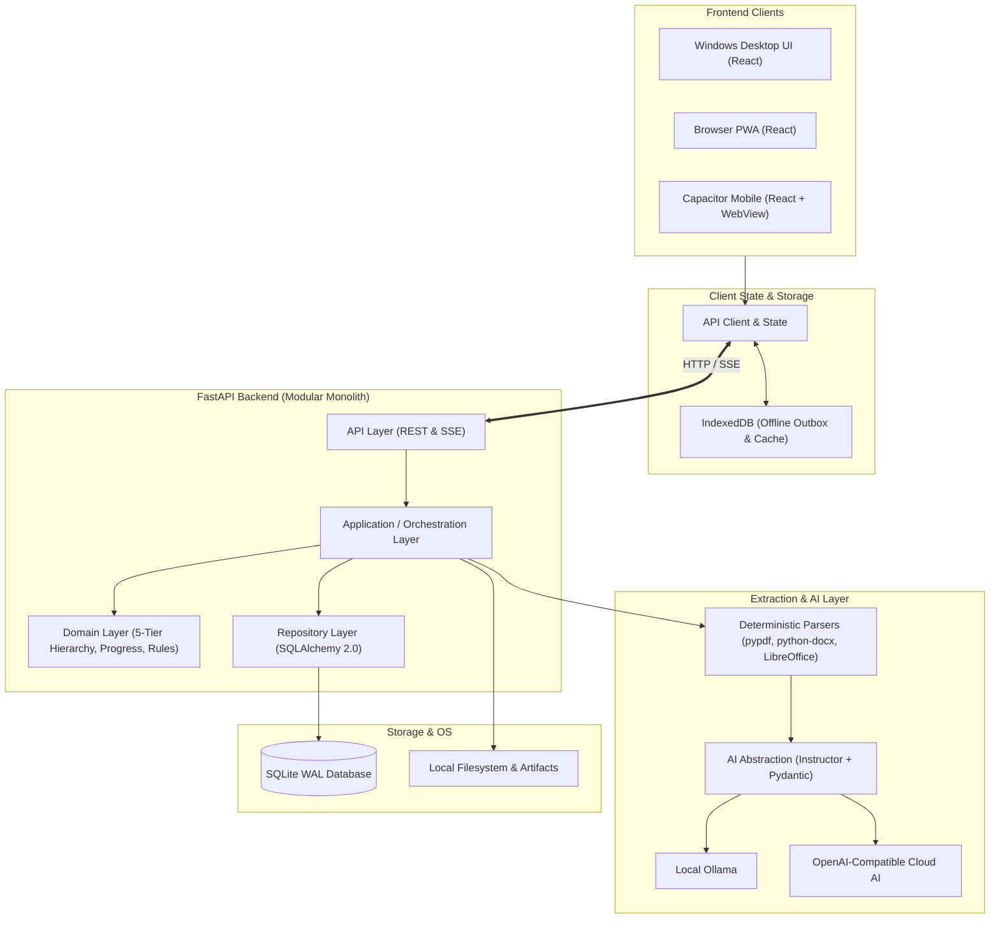
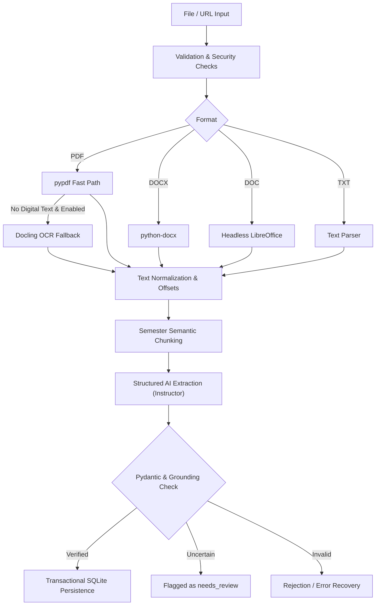
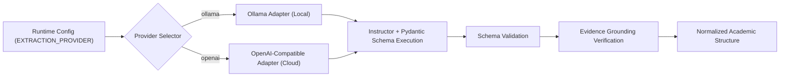
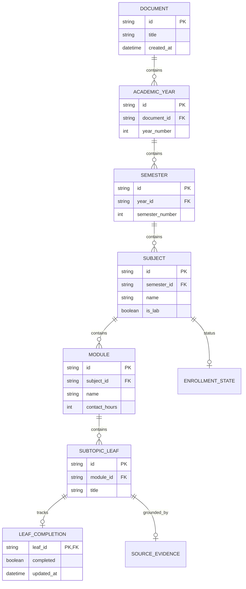
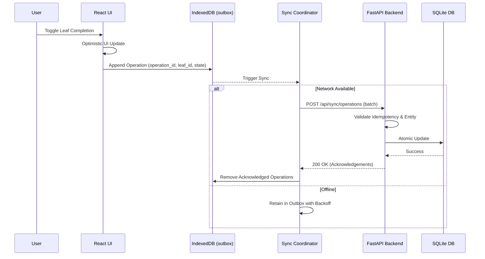

# 2_Architecture.md
# System Architecture, Component Architecture, Infrastructure Design & Architectural Decision Records

- **Project:** Hierarchical Syllabus Checklist & Progress Tracker
- **Repository:** [farhanahmad2106-cpu/Syllabus_Tracker_checklist](https://github.com/farhanahmad2106-cpu/Syllabus_Tracker_checklist?utm_source=chatgpt.com)
- **Document Type:** System Architecture, Component Architecture, Infrastructure Design & Architectural Decision Records
- **Architecture Style:** Local-First Modular Monolith with Hybrid Client Support
- **Status:** Architecture Specification — Current Implementation and Target Architecture Distinguished

---

## Architecture Evidence and Scope
The public repository README identifies an existing Python/FastAPI backend, React/Vite frontend, SQLite persistence, dual-provider AI extraction, a five-tier academic hierarchy, elective enrollment, source provenance, SSE-based ingestion progress, and a Windows `syllabus` launcher. These are documented repository claims, not independent verification of every underlying implementation detail.

The architecture below distinguishes:
- **Documented current baseline:** Capabilities and technologies explicitly described in repository documentation.
- **Proposed target architecture:** Engineering boundaries, security controls, reliability mechanisms, and future deployment capabilities that require implementation verification.
- **Unverified:** Details that cannot be established from the accessible repository documentation.

The specification does not treat PWA synchronization, Capacitor deployment, remote multi-user hosting, or every proposed security control as already implemented.

---

## 1. Executive Summary & Architectural Vision

### 1.1 Product Purpose
The Hierarchical Syllabus Checklist & Progress Tracker is a local-first academic curriculum management platform that converts unstructured university syllabus material into a structured, evidence-backed, five-tier academic hierarchy.

The platform combines:
- Deterministic document ingestion and parsing.
- AI-assisted curriculum interpretation.
- Strict academic hierarchy validation.
- Relational academic persistence.
- Leaf-only completion tracking.
- Enrollment-aware progress aggregation.
- Academic deadline and study pacing.
- Personal study notes and resource management.
- Offline-capable client interaction.
- Portable backup and export.

Its primary architectural responsibility is to preserve the relationship between original academic source material and the checklist generated from it.

The platform is not simply a conventional cloud-hosted checklist application. It is a document-intelligence system with an academic domain model, a local persistence boundary, and optional probabilistic extraction infrastructure.

### 1.2 System Boundaries
The system is divided into seven logical subsystems:

| Subsystem | Responsibility | Primary ownership |
| --- | --- | --- |
| Document ingestion | Validate, stage, and parse source documents | Backend |
| Curriculum intelligence | Detect and construct academic hierarchy | Extraction engine |
| Academic persistence | Store hierarchy, enrollment, and evidence | SQLite |
| Progress engine | Calculate completion and parent states | Domain layer |
| Study planning | Manage deadlines, pacing, and study metadata | Application/domain layers |
| Client presentation | Display academic hierarchy and study workflows | React |
| Synchronization | Exchange supported changes between devices | Future synchronization boundary |

The extraction subsystem proposes structured academic data. The domain validation subsystem determines whether that data is acceptable. The persistence subsystem stores only validated records.

The frontend does not independently establish academic truth or authoritative completion state.

### 1.3 Architectural Philosophy
The architecture follows these principles:
- **Local-first ownership:** Core academic data remains usable without a cloud service.
- **Modular monolith:** Backend capabilities share one application runtime while retaining explicit internal boundaries.
- **Deterministic-first processing:** Conventional document parsing precedes probabilistic interpretation.
- **Evidence-backed extraction:** Every accepted academic leaf must be traceable to source material.
- **Strict domain modeling:** Academic hierarchy is fixed at five tiers.
- **Derived progress:** Parent completion is calculated rather than stored as independent truth.
- **Provider independence:** AI extraction business logic does not depend on one model vendor.
- **Failure isolation:** A failed parser, model, upload, or device connection must not corrupt unrelated academic records.
- **Portable presentation:** Academic business rules remain independent of desktop, browser, and mobile presentation.

### 1.4 Local-First Ownership
In the primary desktop deployment:
- SQLite owns authoritative academic state.
- The local filesystem owns original source files and processing artifacts.
- FastAPI owns application operations and persistence coordination.
- React owns presentation and temporary interaction state.
- Ollama optionally supplies local model inference.
- Cloud AI is an explicitly configured external dependency.

The desktop application must retain its essential academic functionality when the internet, cloud AI, or Ollama is unavailable.

Offline operation does not imply that every document can be interpreted without AI. Deterministic parsing, manual review, academic tree navigation, progress tracking, notes, and supported exports should remain independent of cloud connectivity.

### 1.5 Architectural Quality Objectives

| Quality attribute | Architectural objective |
| --- | --- |
| Correctness | Preserve the five-tier taxonomy and evidence relationships |
| Reliability | Isolate long-running extraction and recover from failures |
| Privacy | Keep local academic information local unless explicitly transmitted |
| Maintainability | Separate API, application, domain, and infrastructure concerns |
| Portability | Reuse the React application across supported clients |
| Performance | Avoid unnecessary model initialization and blocking event-loop work |
| Consistency | Serialize conflicting SQLite writes |
| Recoverability | Support validated backups and transactional restoration |
| Accessibility | Preserve keyboard, screen-reader, and touch accessibility |

### 1.6 Architectural Ownership Rules
The following boundaries are authoritative:
- Only the backend domain/application path may commit canonical academic hierarchy changes.
- Only Tier-5 topic leaves may have independently persisted completion records.
- Parent progress is derived from applicable descendant leaves.
- Source evidence is immutable relative to the extraction version that produced it.
- The client may optimistically display a completion operation but cannot permanently establish it without an authoritative acknowledgement.
- Synchronization must not equate IndexedDB records with SQLite records without a defined protocol.

---

## 2. High-Level Hybrid Architecture Overview

### 2.1 Operational Context A — Local Desktop Mode
*(Documented primary deployment)*

Windows 11 is the primary supported desktop environment.

```
Windows 11 Desktop
│
├── syllabus CLI Supervisor
│   ├── Single-instance lock
│   ├── Process ownership
│   ├── Health monitoring
│   ├── Authenticated local IPC
│   └── Windows Job Object
│
├── React + Vite Frontend
│   └── Browser-based desktop UI
│
├── FastAPI Backend
│   ├── REST API
│   ├── Extraction orchestration
│   ├── Domain services
│   ├── Progress engine
│   └── SQLite repositories
│
├── Local Data Directory
│   ├── SQLite database
│   ├── Original documents
│   ├── Processing artifacts
│   ├── Backups
│   └── Application logs
│
└── Optional AI Infrastructure
    ├── Ollama daemon
    └── OpenAI-compatible cloud provider
```

**Documented configuration:**
- Backend development address: `127.0.0.1:8000`
- Frontend development address: `localhost:5173`
- Ollama default address: `127.0.0.1:11434`
- Windows launcher control server: loopback with an ephemeral port
- Local SQLite with WAL mode and foreign-key enforcement

The repository documents a Windows CLI supervisor, Job Object process management, a single-instance lock, authenticated IPC, and safe port conflict handling.

### 2.2 Operational Context B — PWA Mode
*(Target architecture — implementation unverified)*

The PWA is a browser-based client communicating with a configured backend.

```
Browser
│
├── React Application
│   ├── Responsive UI
│   ├── Domain state
│   ├── API client
│   └── Synchronization coordinator
│
├── Service Worker
│   ├── Application-shell cache
│   └── Static asset cache
│
└── IndexedDB
    ├── Cached academic data
    ├── Pending operations
    └── Sync checkpoints
        │
        ▼
Configured Backend
        │
        ▼
FastAPI + Database
```

PWA operation requires a reachable backend for authoritative persistence unless the application is operating on cached and locally queued data. IndexedDB is not a remote synchronization mechanism. It is a local browser persistence system.

### 2.3 Operational Context C — Capacitor Mobile Mode
*(Future deployment target)*

Capacitor wraps the shared React frontend inside an Android or iOS application shell.
- Native WebView lifecycle integration.
- Platform-aware navigation.
- Network-state detection.
- Native permission handling where needed.
- Offline storage access.
- Backend connectivity.
- Application resume and suspension handling.

Academic business rules remain in the shared domain/API contracts rather than being duplicated in native platform code.

### 2.4 Deployment Comparison

| Dimension | Desktop | PWA | Capacitor |
| --- | --- | --- | --- |
| Client | React desktop browser | Browser | Native WebView |
| Backend | Local FastAPI | Configured backend | Configured backend |
| Database | Local SQLite | Backend-owned | Backend-owned |
| Local persistence | SQLite/filesystem | IndexedDB | IndexedDB/platform storage |
| Local Ollama | Available if installed | Not directly accessible | Not directly accessible |
| Cloud AI | Optional | Backend-configured | Backend-configured |
| Offline UI | Local application | Cached shell | Cached shell |
| Offline mutations | Local SQLite | IndexedDB outbox | IndexedDB outbox |
| Synchronization | Not required for single device | Required for remote persistence | Required for remote persistence |

### 2.5 Deployment Ownership Models
- **Model A — Single-user local deployment:** The desktop backend and database belong to one local installation. The application does not require an account server or cloud database.
- **Model B — Remote backend deployment:** A separately hosted FastAPI instance owns its database and user/workspace boundaries (future target requiring explicit auth/isolation).
- **Model C — Mobile/PWA client deployment:** Clients connect to an explicitly configured backend. They do not directly access desktop SQLite.
- **Model D — Future multi-device synchronization:** A synchronization service coordinates authenticated client operations with a canonical backend.

### 2.6 Hybrid Architecture Rules
1. Desktop local mode must remain independently operable.
2. PWA and mobile clients must not connect directly to SQLite.
3. No client may bypass domain validation by writing directly to backend storage.
4. Offline client operations must remain distinguishable from server-confirmed operations.
5. A remote backend deployment must define its own authentication and data-isolation model.
6. Local Ollama access must remain a backend responsibility.

---

## 3. End-to-End Architecture Diagrams

### 3.1 Complete System Architecture

```text
+----------------------+     +----------------------+     +----------------------+
|  Windows Desktop UI  |     |     Browser PWA      |     |   Capacitor Mobile   |
|        React         |     |        React         |     |   React + WebView    |
+----------+-----------+     +----------+-----------+     +----------+-----------+
           |                            |                            |
           +-------------------------+--+----------------------------+
                                     |
                           +---------v---------+
                           |  Frontend State   |
                           |    API Client     |
                           |   Domain Types    |
                           |  Offline Outbox   |
                           +---------+---------+
                                     |
                           HTTP / SSE Boundary
                                     |
                           +---------v---------+
                           |  FastAPI Backend  |
                           +---------+---------+
                                     |
           +-------------------------+-------------------------+
           |                                                   |
 +---------v--------+                                +---------v--------+
 |    Ingestion     |                                | Domain Services  |
 |   Orchestrator   |                                |  Progress / Auth |
 +---------+--------+                                +---------+--------+
           |                                                   |
 +---------v--------+                                +---------v--------+
 |     Parsers      |                                |   Repositories   |
 | pypdf/docx/libre |                                |    SQLAlchemy    |
 +---------+--------+                                +---------+--------+
           |                                                   |
 +---------v--------+                                          |
 |  AI Abstraction  |                                          |
 | Instructor+Pydnt |                                          |
 +----+--------+----+                                          |
      |        |                                               |
 +----v----+ +-v--------+                            +---------v--------+
 | Ollama  | | Cloud AI |                            |    SQLite WAL    |
 +---------+ +----------+                            +------------------+
```



### 3.2 Document Ingestion Pipeline

```text
File / URL Input
       │
       ▼
Input Validation & Security Checks
       │
       ▼
Format Detection
       ├──► PDF  ──────────────► pypdf (fast digital path)
       ├──► DOCX ──────────────► python-docx
       └──► DOC / TXT ─────────► LibreOffice / Native Text Parser
       │
       ▼
Text Normalization & Offset Tracking
       │
       ▼
Page / Table Reconstruction & Noise Filtering
       │
       ▼
Semester Segmentation (Semantic Chunking)
       │
       ▼
Structured AI Extraction (Instructor + Pydantic)
       │
       ▼
Schema & Grounding Verification
       ├──► Passed ──► Transactional Persistence ──► Syllabus Ready
       └──► Failed ──► Fallback / Flagged for Review
```



#### 3.2.1 Optional OCR Branch
Docling must not be initialized on the normal digital-PDF path. The OCR branch activates only when:
1. Digital PDF extraction produces no usable text.
2. The document is identified as image-based or scanned.
3. `ENABLE_DOCLING_FALLBACK=True`.
4. Resource and processing limits permit the fallback.

If OCR is disabled, the system must report that the document contains unsupported image-based content. OCR output must be treated as extracted evidence with an OCR extraction method, not as perfectly reliable original text.

### 3.3 Dual-Provider AI Architecture



The extraction business layer receives one provider-neutral request and returns one provider-neutral structured result. It must not contain model-specific HTTP requests or provider-specific response parsing.

### 3.4 Database & Leaf-Only Progress Engine



*Note: The diagram is a conceptual target model. The documented baseline implementation uses `SyllabusRecord` and `LeafCompletionRecord` as persistence models and represents the academic hierarchy through nested structures.*

### 3.5 Cross-Device Offline Synchronization



---

## 4. Backend Component Architecture

### 4.1 Architectural Style
The backend follows a modular monolithic architecture with four logical layers:

```
┌───────────────────────────────────────────┐
│              API / PRESENTATION           │
│         FastAPI Routes, REST, SSE         │
├───────────────────────────────────────────┤
│        APPLICATION / ORCHESTRATION        │
│    Ingestion, Jobs, Enrollment, Exports   │
├───────────────────────────────────────────┤
│                  DOMAIN                   │
│   Hierarchy, Evidence, Progress, Planning │
├───────────────────────────────────────────┤
│              INFRASTRUCTURE               │
│    SQLite, Parsers, AI, Files, HTTP, OS   │
└───────────────────────────────────────────┘
```

**Dependency direction:**
$$\text{API} \rightarrow \text{Application} \rightarrow \text{Domain} \leftarrow \text{Infrastructure}$$

The domain must not import FastAPI, SQLAlchemy session objects, HTTP clients, or provider SDKs.

### 4.2 Layer Responsibility Matrix

| Layer | Inputs | Outputs | Dependencies | Failure boundary |
| --- | --- | --- | --- | --- |
| API | HTTP requests | HTTP responses/events | FastAPI, schemas | Request/transport |
| Application | Validated commands | Application results | Domain and ports | Job/transaction |
| Domain | Validated domain values | Domain decisions | Pure Python | Business validation |
| Infrastructure | Repository/provider commands | External data/results | SQLite, files, AI, HTTP | External resource |

### 4.3 API / Presentation Layer
- FastAPI initialization and lifespan management.
- Route registration, request validation, response serialization.
- Normalized error contract:
```json
{
  "error": {
    "code": "EXTRACTION_VALIDATION_FAILED",
    "message": "The extracted academic hierarchy requires review.",
    "request_id": "correlation-id",
    "details": []
  }
}
```
*Never disclose internal paths, provider secrets, SQL statements, or raw stack traces.*

### 4.4 Application / Orchestration Layer

| Service boundary | Responsibility |
| --- | --- |
| Ingestion coordinator | Coordinates parsing, extraction, validation, persistence |
| Extraction job service | Creates and manages background jobs |
| Semester processing service | Coordinates semantic chunks |
| Provider selection service | Resolves configured AI adapter |
| Enrollment service | Applies elective choices |
| Progress query service | Produces derived progress snapshots |
| Planning service | Calculates academic pacing |
| Export service | Coordinates report and backup generation |
| Restore service | Validates and restores backup packages |
| Synchronization service | Applies authorized offline operations |

**Transaction ownership:** Database transactions are kept short. Document parsing, LLM calls, and network downloads happen *outside* SQLite write transactions.

### 4.5 Domain Layer
- **Academic hierarchy domain:** 5 fixed tiers (Year $\rightarrow$ Semester $\rightarrow$ Subject $\rightarrow$ Module $\rightarrow$ Leaf).
- **Enrollment domain:** Mandatory vs. elective courses, unenrollment preservation.
- **Completion domain:** Leaf-only persistence, tri-state derivation, uniform weighting.
- **Planning domain:** Pacing formulas, calendar-date calculations.
- **Evidence domain:** Verbatim quotation matching and provenance offset tracking.

### 4.6 Infrastructure Layer

| Infrastructure adapter | Responsibility |
| --- | --- |
| SQLite repository | Academic persistence |
| SQLAlchemy session manager | Connection/session lifecycle |
| Filesystem storage | Original files and artifacts |
| PDF parser | Digital PDF extraction (`pypdf`) |
| DOCX parser | Paragraph and table extraction (`python-docx`) |
| DOC converter | Legacy format conversion (Headless LibreOffice) |
| Docling adapter | Optional OCR/layout fallback |
| Ollama adapter | Local model access |
| OpenAI-compatible adapter | Cloud model access |
| Portal fetcher | Controlled external document retrieval (`httpx`) |
| Export renderer | Markdown, HTML, PDF |
| Job manager | Job lifecycle and progress |
| Windows supervisor adapter | Native process lifecycle |

### 4.7 Dependency Injection
Dependencies are injected through constructors or application dependency providers. Avoid hidden global mutable sessions or provider clients.

### 4.8 Asynchronous Processing Architecture

| Operation | Execution strategy |
| --- | --- |
| Small metadata lookup | Async request path |
| SQLite query | Short bounded database operation |
| Digital PDF parsing | Worker thread (`asyncio.to_thread`) |
| DOCX parsing | Worker thread |
| LibreOffice conversion | Isolated subprocess with timeout |
| Docling inference | Isolated worker/process where feasible |
| Ollama HTTP request | Async HTTP client |
| CPU-heavy text reconstruction | Worker thread |
| Export generation | Worker thread |
| SSE streaming | Async response generator |

### 4.9 Job Lifecycle and Persistence
Documented stages: `QUEUED` $\rightarrow$ `VALIDATING` $\rightarrow$ `PARSING` $\rightarrow$ `CHUNKING` $\rightarrow$ `EXTRACTING` $\rightarrow$ `VALIDATING_RESULT` $\rightarrow$ `PERSISTING` $\rightarrow$ `COMPLETED` (or `FAILED`/`CANCELLED`).

### 4.10 SSE Progress Publication
Progress events use monotonic sequence numbers. The background job manager runs independently of whether the client remains connected to the SSE stream.

### 4.11 Semantic Semester Chunking
Documents exceeding 15,000 characters are partitioned along academic boundaries (Year $\rightarrow$ Semester $\rightarrow$ Subject) rather than arbitrary byte boundaries. Reconciles duplicate subjects across adjacent chunk borders deterministically.

---

## 5. Document Intelligence & Zero-Hallucination Architecture

### 5.1 Deterministic Parsing First
Native parsing (`pypdf`, `python-docx`, plain text) is executed first. Digital text extraction must not spin up OCR models.

### 5.2 Format-Specific Parsing
- **PDF:** `pypdf` with 1-based physical page tracking.
- **DOCX:** `python-docx` retaining paragraph and table order.
- **DOC:** Isolated headless LibreOffice subprocess with bounded execution timeout.

### 5.3 Extraction Noise Prevention

| Noise category | Detection strategy | Treatment |
| --- | --- | --- |
| `[Page 2]` | Known page marker pattern | Remove from topic candidates |
| Page numbers | Repeated isolated numeric lines | Remove from content |
| University headers | Repeated cross-page text | Boilerplate classification |
| Program names | Header/title context | Metadata |
| Document title | Cover-page/title position | Document metadata |
| Footer text | Repeated bottom-page patterns | Remove |
| Broken table rows | Structural discontinuity | Reconstruct or review |
| Cross-page continuation | Heading and continuation context | Merge |
| Missing subject name | No direct structural evidence | Unresolved/review |
| Synthetic fallback names | Placeholder pattern detection | Reject |

*Forbidden placeholders: `General Curriculum`, `Course 2`, `Unit 2`, `Unknown Subject`, `Miscellaneous Topic`.*

### 5.4 Controlled Unresolved Structures
When structural gaps exist, preserve evidence and mark the node as unresolved. Never invent subject or module names to satisfy a schema.

### 5.5 Academic Structure Validation
Deterministic academic year inference:
$$AcademicYear = \left\lceil \frac{SemesterNumber}{2} \right\rceil$$
Only apply when sequential semester numbering is verified. Explicit source labels take precedence.

### 5.6 Source Evidence & Provenance
Every accepted Tier-5 leaf requires: `document_id`, `source_text` (verbatim excerpt), `source_page`, `source_start_offset`, `source_end_offset`, `grounding_status` (`verified`, `needs_review`, `unverified`).

### 5.7 AI Prompt-Injection Boundary
Isolate syllabus content in `<untrusted_syllabus_content>` tags. Treat all document content as passive data. Never allow document text to alter extraction instructions or invoke system tools.

---

## 6. Database Architecture & Persistence Model

### 6.1 Database Ownership
SQLite is the primary desktop persistence engine with WAL mode and foreign-key enforcement enabled.

### 6.2 Core Academic Entities
```
Document Root (Container)
  └── AcademicYear (Tier 1)
        └── Semester (Tier 2)
              └── Subject (Tier 3)
                    └── Module (Tier 4)
                          └── Topic / Leaf (Tier 5)
                                ├── Completion
                                ├── Notes
                                ├── Bookmarks
                                └── Evidence
```

### 6.3 Supporting Entities
`TopicCompletion`, `StudyNote`, `ResourceBookmark`, `ExamTarget`, `ExtractionJob`, `CurriculumVersion`.

### 6.4 Leaf-Only Persistence
```sql
CREATE TABLE topic_completion (
    topic_id TEXT PRIMARY KEY,
    completed INTEGER NOT NULL CHECK (completed IN (0, 1)),
    updated_at TEXT NOT NULL,
    FOREIGN KEY (topic_id) REFERENCES topic(id)
);
```
Parent states (`AcademicYear.completed`, etc.) MUST NEVER be persisted.

### 6.5 SQLite Reliability
```sql
PRAGMA journal_mode=WAL;
PRAGMA foreign_keys=ON;
PRAGMA busy_timeout=5000;
```
Transactions are kept short. Avoid holding database locks during file conversions or LLM inference.

### 6.6 Historical Progress Preservation
Unenrolling an elective course sets `is_enrolled = False`, excluding its descendant leaves from active progress denominators while retaining all historical completion records, notes, and bookmarks.

---

## 7. Leaf-Only Tri-State Progress Engine

### 7.1 Canonical Mathematical Model
Let:
- $L$ = set of descendant Tier-5 leaves.
- $E(l)$ = leaf $l$ belongs to an actively enrolled course.
- $C(l)$ = leaf $l$ is completed.

Applicable leaves:
$$A = \{l \in L \mid E(l) = \text{true}\}$$

Completed applicable leaves:
$$D = \{l \in A \mid C(l) = \text{true}\}$$

Progress percentage:
$$P = \begin{cases} 0 & |A| = 0 \\ 100 \times \frac{|D|}{|A|} & |A| > 0 \end{cases}$$

### 7.2 Tri-State Semantics

| State | Condition |
| --- | --- |
| Checked | All applicable leaves are complete and $|A| > 0$ |
| Indeterminate | At least one but fewer than all applicable leaves are complete |
| Unchecked | No applicable leaves are complete |
| Empty | No applicable descendant leaves exist ($|A| = 0$) |

### 7.3 Bottom-Up Aggregation Pseudocode
```python
def aggregate_parent(parent, completion_map, enrollment_map):
    leaves = get_descendant_tier5_leaves(parent)
    applicable = [leaf for leaf in leaves if enrollment_map.is_applicable(leaf)]
    total = len(applicable)
    
    if total == 0:
        return {"state": "unchecked", "completed": 0, "total": 0, "percentage": 0.0, "empty": True}
        
    completed = sum(1 for leaf in applicable if completion_map.get(leaf.id, False))
    
    if completed == total:
        state = "checked"
    elif completed > 0:
        state = "indeterminate"
    else:
        state = "unchecked"
        
    return {
        "state": state,
        "completed": completed,
        "total": total,
        "percentage": (completed / total) * 100,
        "empty": False
    }
```

---

## 8. Frontend & Mobile Wrapper Architecture

### 8.1 React Application Architecture
- Built with React 19, TypeScript, Vite, Tailwind CSS v4, Radix UI.
- Organized into feature modules: Curriculum, Upload/Extraction, Enrollment, Progress, Study Planning, Notes, Bookmarks, Export.

### 8.2 Responsive UI Architecture

| Component | Desktop | Tablet | Mobile |
| --- | --- | --- | --- |
| Sidebar | Persistent | Collapsible | Drawer / bottom-sheet |
| Academic tree | Expanded hierarchy | Controlled expansion | Single-branch focus |
| Actions | Inline groups | Context menus | Overflow menus |
| Notes | Side panel | Drawer | Full-screen sheet |
| Progress | Horizontal / compact | Adaptive | Compact stacked |
| Dialogs | Centered modal | Adaptive modal | Full-screen sheet |

### 8.3 State Management & Optimistic UI
Optimistic updates apply locally to the leaf checkbox, immediately cascade derived parent states, and roll back if the server returns an error.

### 8.4 IndexedDB & Offline Outbox (Target Architecture)
Stores pending operations (`SET_LEAF_COMPLETION`, `UPDATE_NOTE`) in an `outbox` store with stable operation UUIDs, replaying them with exponential backoff when network connectivity returns.

### 8.5 Capacitor Bridge
Capacitor serves as a native shell wrapper for Android and iOS without duplicating academic business logic.

---

## 9. Offline Synchronization & Conflict Resolution

### 9.1 Synchronization Model
Future client-server capability coordinating independent client-local stores with a remote backend using idempotent operations.

### 9.2 Conflict Resolution Matrix

| Conflict | Resolution policy |
| --- | --- |
| Two devices complete same topic | Idempotent state assignment |
| Device A completes, Device B unchecks | Version-aware explicit state assignment |
| Duplicate completion operation | Return previous acknowledgement |
| Concurrent note edits | Conflict copy / manual merge |
| Topic deleted with pending update | Reject and retain recoverable local operation |
| Elective excluded during offline completion | Re-evaluate enrollment; preserve historical completion |
| Curriculum regenerated | Reconcile stable IDs and version mappings |
| Interrupted sync | Resume using operation IDs and checkpoints |

---

## 10. Windows 11 Process Orchestration & IPC

### 10.1 Process Topology
Managed via `scripts/launcher.py` and global `syllabus` CLI:
```text
syllabus CLI / Supervisor
       │
       ├── Windows Job Object (JOB_OBJECT_LIMIT_KILL_ON_JOB_CLOSE)
       ├── Backend (Uvicorn / FastAPI on 127.0.0.1:8000)
       ├── Frontend (Vite on localhost:5173)
       └── Optional Ollama Daemon (127.0.0.1:11434)
```

### 10.2 Supervision & Single-Instance Locking
Uses `msvcrt` file locking. Validates process identity, creation timestamp, and loopback health probe before attempting to reuse an existing port.

### 10.3 Authenticated Loopback IPC
Control commands (`status`, `stop`, `restart`) communicate over loopback HTTP using a cryptographically random 256-bit token.

---

## 11. Web Scraping, SSRF & Document Security Architecture

### 11.1 Security Boundary
All external URLs submitted for ingestion are treated as untrusted.

### 11.2 SSRF Protection
- Permitted schemes: `http://`, `https://`.
- Blocked destinations: RFC 1918 private IPv4 (`10.0.0.0/8`, `172.16.0.0/12`, `192.168.0.0/16`), loopback (`127.0.0.0/8`, `::1`), link-local (`169.254.0.0/16`, `fe80::/10`), cloud metadata (`169.254.169.254`), and multicast ranges.

### 11.3 DNS-Rebinding Protection
DNS is resolved at connection time. The connection is pinned to the validated IP address. Every redirect (maximum 5) is re-validated independently.

### 11.4 Download Safety
- Max upload size: 50 MiB.
- Max PDF pages: 300 (per Phase 7 specification baseline).
- Parser timeout: 300 seconds.
- Uploads placed in unique temporary directories and cleaned up on job completion or failure.

---

## 12. API & Event Communication Architecture

### 12.1 Documented API Surface

| Method | Endpoint | Responsibility |
| --- | --- | --- |
| GET | `/health`, `/api/health` | Liveness and diagnostics |
| GET | `/ready`, `/api/ready` | Readiness |
| GET | `/api/config` | Safe runtime configuration |
| GET | `/api/syllabi` | Curriculum listing |
| POST | `/api/upload` | Document upload / job creation |
| GET | `/api/upload/progress/{id}` | SSE progress streaming |
| GET | `/api/upload/jobs/{id}` | Job snapshot |
| POST | `/api/upload/jobs/{id}/cancel` | Job cancellation |
| GET | `/api/syllabus/{id}/review` | Elective review |
| POST | `/api/syllabus/{id}/finalize-enrollment` | Enrollment confirmation |
| POST | `/api/syllabus/{id}/update-enrollment` | Enrollment changes |
| GET | `/api/syllabus/{id}` | Curriculum tree and progress |
| PATCH | `/api/syllabus/{id}/toggle-leaf` | Leaf completion |
| PATCH | `/api/syllabus/{id}/bulk-toggle` | Bulk leaf updates |

### 12.2 SSE Event Contract
```http
id: 17
event: progress
data: {"job_id": "uuid", "sequence": 17, "stage": "extracting", "percent": 65, "message": "Processing semester content", "timestamp": "ISO-8601"}
```

---

## 13. Backup, Restore & Data Portability

### 13.1 Backup Architecture
Exports full academic state conforming to Schema 2.1 JSON:
- Documents, 5-tier hierarchy, stable node IDs.
- Leaf completion records.
- Elective enrollment states.
- Source provenance excerpts, offsets, and pages.
- Notes, resource bookmarks, and exam target dates.

### 13.2 Transactional Restore
Restoration parses and validates the schema, verifies hierarchy and foreign keys, detects conflicts, and executes inside an atomic SQLite transaction. Any failure rolls back completely.

### 13.3 Export Formats
- **Markdown / Notion-compatible:** Nested outline preserving hierarchy and checkboxes (`- [x]`, `- [ ]`).
- **Printable HTML / PDF:** Formatted study progress summary.

---

## 14. Reliability, Performance & Observability

### 14.1 Reliability Architecture
Isolate independent failure domains: parser crashes, Ollama timeouts, or network loss must never corrupt SQLite or prevent access to existing checklists.

### 14.2 Sensitive Log Redaction
Never log API keys, IPC tokens, full source documents, or personal study notes.

---

## 15. Security & Privacy Architecture
- Local-first: all academic data resides on the student's machine by default.
- Cloud AI inference requires explicit configuration and student consent.
- API credentials are stored securely and never transmitted to the frontend.

---

## 16. Architectural Decision Records (ADRs)

| ADR | Title | Status |
| --- | --- | --- |
| ADR-001 | Modular Layered Architecture Over a Monolithic Application | Accepted |
| ADR-002 | Local-First Desktop Runtime | Accepted |
| ADR-003 | Five-Tier Academic Hierarchy | Accepted |
| ADR-004 | Leaf-Only Completion Persistence | Accepted |
| ADR-005 | Deterministic Parsing Before AI Extraction | Accepted |
| ADR-006 | Optional Docling Fallback | Accepted |
| ADR-007 | Dual-Provider AI Abstraction | Accepted |
| ADR-008 | SQLite WAL Persistence | Accepted |
| ADR-009 | Semester-Aware Semantic Chunking | Accepted |
| ADR-010 | SSE for Extraction Progress | Accepted |
| ADR-011 | IndexedDB Offline Outbox | Proposed |
| ADR-012 | Windows Job Objects and Single-Instance Supervision | Accepted |
| ADR-013 | SSRF-Hardened Portal Ingestion | Proposed |
| ADR-014 | Responsive Shared Frontend Architecture | Proposed |
| ADR-015 | Transactional Curriculum Version Promotion | Proposed |
| ADR-016 | Evidence-First Academic Acceptance | Accepted |
| ADR-017 | Durable Extraction Job Lifecycle | Proposed |
| ADR-018 | Explicit Offline Conflict Resolution | Proposed |
| ADR-019 | Modular Monolith Over Microservices | Accepted |

---

## 17. Architecture Constraints & Non-Negotiable Invariants

| ID | Invariant | Enforcement boundary |
| --- | --- | --- |
| ARCH-001 | Exactly five academic tiers beneath Document Root | Domain validation |
| ARCH-002 | Only Tier-5 leaves are independently completion-trackable | Domain/repository |
| ARCH-003 | Parent progress is dynamically derived | Progress engine |
| ARCH-004 | Accepted leaves preserve source evidence | Evidence validator |
| ARCH-005 | AI output passes structured validation | Extraction layer |
| ARCH-006 | Unsupported extraction never becomes fabricated curriculum content | Acceptance validator |
| ARCH-007 | Deterministic parsing precedes optional OCR/AI fallback | Parser orchestrator |
| ARCH-008 | Contact hours never affect completion calculations | Progress engine |
| ARCH-009 | Elective exclusions preserve historical progress | Enrollment service |
| ARCH-010 | Core local functionality does not require cloud availability | Deployment architecture |
| ARCH-011 | Blocking operations never run directly on the FastAPI event loop | API/application boundary |
| ARCH-012 | SQLite foreign keys remain enabled | Database connection setup |
| ARCH-013 | Offline operations require durable queuing | Client storage |
| ARCH-014 | Synchronization operations are idempotent | Sync service |
| ARCH-015 | Parent completion is never independently persisted | Database/domain |
| ARCH-016 | External URL ingestion enforces SSRF protection | Secure fetcher |
| ARCH-017 | Local administrative IPC is authenticated | Windows supervisor |
| ARCH-018 | Desktop process reuse verifies ownership | Supervisor |
| ARCH-019 | Mobile layouts do not depend on desktop-only navigation | Frontend |
| ARCH-020 | Extraction failures never silently corrupt existing progress | Ingestion/persistence |
| ARCH-021 | No unverified leaf is silently promoted as verified | Evidence validator |
| ARCH-022 | No synthetic fallback hierarchy names are accepted | Domain validation |
| ARCH-023 | Document Root is not counted as an academic tier | Hierarchy validator |
| ARCH-024 | Empty parents do not produce division-by-zero | Progress engine |
| ARCH-025 | Laboratory classification does not change progress weighting | Domain/progress |
| ARCH-026 | Historical completion survives elective exclusion | Persistence |
| ARCH-027 | Long-running model calls do not hold SQLite write transactions | Application layer |
| ARCH-028 | Browser disconnection does not implicitly cancel an ingestion job | Job manager |
| ARCH-029 | Job terminal states cannot transition back to active | Job manager |
| ARCH-030 | Progress percentages cannot move backward within a job sequence | Job event manager |
| ARCH-031 | SQLite writes are transactionally bounded | Repository |
| ARCH-032 | SQLite WAL is not treated as multi-writer concurrency | Persistence |
| ARCH-033 | Original source documents remain distinct from extracted academic data | Storage |
| ARCH-034 | Curriculum regeneration is staged before promotion | Ingestion |
| ARCH-035 | Topic identity cannot depend exclusively on title text | Domain |
| ARCH-036 | A duplicate operation cannot cause a duplicate mutation | Sync service |
| ARCH-037 | Note conflicts do not silently overwrite newer versions | Notes service |
| ARCH-038 | Service-worker updates preserve offline outbox data | Frontend |
| ARCH-039 | Local API listeners use loopback by default | Deployment |
| ARCH-040 | Port occupancy does not establish process ownership | Supervisor |
| ARCH-041 | PID existence alone does not establish instance identity | Supervisor |
| ARCH-042 | External redirects undergo full destination validation | Secure fetcher |
| ARCH-043 | DNS validation is enforced at connection time | Secure transport |
| ARCH-044 | Uploaded filenames are never trusted as storage paths | File storage |
| ARCH-045 | Cloud provider credentials never enter frontend code | Configuration |
| ARCH-046 | Secrets never appear in normal application logs | Observability |
| ARCH-047 | Backup restoration validates data before mutation | Restore service |
| ARCH-048 | Backup procedures account for SQLite WAL consistency | Persistence |
| ARCH-049 | Optional AI failure does not prevent existing checklist access | Application |
| ARCH-050 | Remote deployment enforces server-side ownership authorization | Remote API |

---

## 18. Deployment & Evolution Strategy

### 18.1 Deployment Philosophy
The preferred progression:
1. Local Windows Desktop
2. Responsive Browser Client
3. Durable PWA Offline Support
4. Capacitor Android / iOS
5. Optional Remote Backend
6. Multi-Device Synchronization

### 18.2 Technologies Explicitly Not Required
No Kubernetes, distributed microservices, Kafka/RabbitMQ, mandatory cloud object storage, or distributed cache infrastructure.

---

## Appendix A — Repository Evidence and Verification Boundaries

### A.1 Documented Existing Components

| Component | Documented location |
| --- | --- |
| FastAPI application | `backend/app/main.py` |
| Configuration | `backend/app/config.py` |
| Academic schemas | `backend/app/schemas.py` |
| Persistence models | `backend/app/models.py` |
| Database integration | `backend/app/database.py` |
| Document parser | `backend/app/parser.py` |
| AI extraction | `backend/app/extractor.py` |
| Evidence validation | `backend/app/validation.py` |
| Progress engine | `backend/app/progress.py` |
| Ingestion orchestration | `backend/app/services/ingestion.py` |
| Background job management | `backend/app/services/job_manager.py` |
| Semantic chunking | `backend/app/services/chunking.py` |
| Windows supervisor | `scripts/launcher.py` |
| Frontend API client | `frontend/src/lib/api.ts` |
| Frontend syllabus hook | `frontend/src/hooks/useSyllabus.ts` |
| Frontend domain types | `frontend/src/types/syllabus.ts` |
| Academic tree | `frontend/src/components/SyllabusTree.tsx` |
| Evidence presentation | `frontend/src/components/SourceEvidence.tsx` |

---

**End of `2_Architecture.md`**
