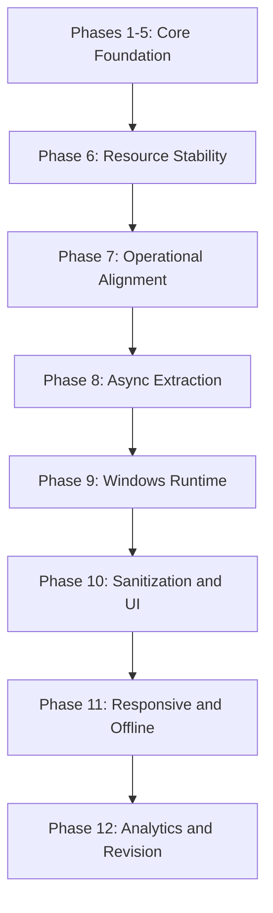

# 4_PHASES.md
# Project Delivery History, Engineering Milestones & Future Roadmap

**Project:** Hierarchical Syllabus Checklist & Progress Tracker  
**Repository:** https://github.com/farhanahmad2106-cpu/Syllabus_Tracker_checklist  
**Document Type:** Authoritative Delivery Roadmap and Implementation History  
**Status:** Historical Baseline + Forward Engineering Roadmap  
**Companion Specification:** `3_RULES.md`

---

# 1. PURPOSE AND PROJECT DELIVERY STRATEGY

This document records the verified project development history, independently delivered feature extensions, current technical priorities and planned future implementation phases.

It is the authoritative delivery roadmap for developers, technical contributors and AI coding agents.

The project evolves through three broad stages:

1. **Core foundation:** Build a reliable, locally operated academic checklist with deterministic hierarchy, source-grounded extraction and persistent completion.
2. **Product reliability and usability:** Improve extraction quality, productivity, responsive interactions and offline capabilities.
3. **Academic intelligence:** Add measurable study analytics, explainable revision scheduling and privacy-respecting planning tools.

The project MUST retain its canonical five-tier hierarchy and leaf-only completion architecture throughout all future phases.

## 1.1 Implementation status terminology

| Status | Meaning |
|---|---|
| `COMPLETED` | Supported by recorded implementation evidence in authoritative project documentation |
| `PARTIALLY COMPLETED` | Core implementation exists, but the complete milestone or verification requirements are not established |
| `IN PROGRESS` | Work is actively being developed, supported by current evidence |
| `PLANNED` | Future work explicitly defined but not established as implemented |
| `NEEDS VERIFICATION` | Insufficient evidence to establish actual implementation status |

Important distinctions:

- Historical documentation is evidence of reported delivery, not proof of the current runtime.
- Repository documentation is not equivalent to a newly executed test.
- An implemented component is not necessarily a complete feature.
- A planned acceptance criterion MUST NOT be reported as passed.
- Absence of implementation evidence MUST NOT be interpreted as proof that a feature does not exist.

## 1.2 Project architecture baseline

| Layer | Established technology |
|---|---|
| Backend | Python 3.12, FastAPI |
| Domain validation | Pydantic v2 |
| Database | SQLite, WAL, foreign keys |
| ORM | SQLAlchemy 2.0 |
| Structured extraction | Instructor |
| Local inference | Ollama |
| Cloud inference | OpenAI-compatible endpoints |
| PDF parsing | pypdf |
| DOCX parsing | python-docx |
| Legacy DOC | Headless LibreOffice |
| Optional scanned-document processing | Docling |
| Frontend | React 19, TypeScript, Vite |
| Styling | Tailwind CSS v4 |
| Components | Radix UI |
| Desktop runtime | Windows 11 |
| Process supervision | Python launcher and Windows Job Objects |

---

# 2. DELIVERY TIMELINE OVERVIEW

The following matrix distinguishes the original implementation sequence, independently delivered extensions and future roadmap.

| Phase | Status | Primary Objective | Key Deliverables | Verification Gate |
|---|---|---|---|---|
| 1 | COMPLETED | Repository and environment foundation | Git, Python environment, Vite frontend, configuration | Recorded bootstrap and environment verification |
| 2 | COMPLETED | Domain models and persistence | Five-tier schemas, SQLite WAL, foreign keys, repositories | Database and domain implementation evidence |
| 3 | COMPLETED | Document parsing and extraction | Multi-format parsers, Instructor, Ollama, grounding | Extraction and validation implementation evidence |
| 4 | COMPLETED | Progress engine and REST API | Leaf-only progress, tri-state logic, API | Recorded progress and API verification |
| 5 | COMPLETED | React frontend | Typed interfaces, tree, evidence, progress UI | Recorded typecheck and production build |
| 6 | COMPLETED | Windows resource stability | pypdf-first parsing, Docling opt-in, timeout handling | Recorded Windows resource-failure remediation |
| 7 | COMPLETED | Operational limits and configuration alignment | 50 MiB, 300 pages, 1.5M characters, grounding states | Recorded backend/frontend verification |
| 8 | COMPLETED | Asynchronous extraction and SSE | Job manager, chunking, SSE, cancellation | Recorded ingestion and streaming verification |
| 9 | COMPLETED | Global Windows CLI and runtime supervision | `syllabus`, Job Objects, authenticated IPC | Recorded launcher implementation and test evidence |
| Elective Onboarding | COMPLETED — CORE EVIDENCE | Elective enrollment and historical preservation | Review workflow, enrollment, completion restoration | README and API documentation |
| Option-A | NEEDS VERIFICATION | Study pacing and deadline engine | Semester/Subject deadlines, workload estimates | Model, API, persistence and UI inspection |
| Option-B | NEEDS VERIFICATION | Notes, bookmarks and exports | Markdown notes, links, JSON, HTML, PDF | End-to-end persistence and export inspection |
| Option-C | NEEDS VERIFICATION | Secure university portal ingestion | SSRF protection, URL extraction, provenance | Connection-time security audit |
| Phase 10 | PLANNED | Extraction sanitization and UI modernization | Artifact classification, improved academic workspace | Extraction regression and UI acceptance |
| Phase 11 | PLANNED | Responsive application, PWA and native packaging | Offline outbox, PWA, Capacitor | Device, offline and synchronization acceptance |
| Phase 12 | PLANNED | Study analytics and spaced repetition | Analytics, review scheduling, reminders | Data integrity and scheduling acceptance |

**Status note:** The repository README confirms the five-tier architecture, elective workflow, grounding and core extraction capabilities. `Master_Context.md` records Phases 1–9 as completed. The current repository snapshot has not been independently built or tested during preparation of this document.

---

# 3. COMPLETED CORE IMPLEMENTATION HISTORY

## Phase 1 — Repository and Environment Setup

<Status>COMPLETED</Status>

### Objective

Establish the foundational development environment and repository structure.

### Recorded deliverables

- Git repository initialized.
- Python 3.12 environment established.
- Backend dependencies configured.
- React, TypeScript, Vite and Tailwind frontend scaffolded.
- Environment example files created.
- Python, Node and SQLite generated artifacts covered by `.gitignore`.

### Recorded architecture

```text
Repository Root
├── backend/
├── frontend/
├── data/
├── scripts/
├── Master_Context.md
├── README.md
├── pyproject.toml
└── configuration files
```

### Engineering outcome

The project established a local development foundation without requiring a cloud-hosted database or remote application server.

### Verification

`Master_Context.md` records Phase 1 as completed.

---

## Phase 2 — Domain Models and SQLite Persistence

<Status>COMPLETED</Status>

### Objective

Create the canonical academic domain model and persistent local database architecture.

### Recorded deliverables

- Five-tier academic schema.
- Pydantic domain validation.
- SQLAlchemy persistence models.
- SQLite database engine.
- WAL mode.
- Foreign-key enforcement.
- Transactional repository methods.

### Recorded implementation references

```text
backend/app/schemas.py
backend/app/models.py
backend/app/database.py
```

Documented database models include:

- `SyllabusRecord`.
- `LeafCompletionRecord`.

### Database configuration

The master context documents:

```sql
PRAGMA foreign_keys=ON;
PRAGMA busy_timeout=5000;
```

WAL mode is enabled.

### Persistence behavior

Recorded operations include:

- Saving syllabus structures.
- Atomic leaf completion toggles.
- Bulk branch updates.
- Syllabus renaming.
- Cascade deletion.

### Architectural outcome

The database became the persistent source of truth for academic structures and completion records.

Parent progress remained derived rather than independently persisted.

### Verification

`Master_Context.md` records Phase 2 as completed.

---

## Phase 3 — Document Parsing and Structured Extraction

<Status>COMPLETED</Status>

### Objective

Convert heterogeneous academic source documents into structured, evidence-grounded curriculum data.

### Recorded supported formats

| Format | Processing method |
|---|---|
| PDF | pypdf and optional Docling |
| DOCX | python-docx |
| DOC | Headless LibreOffice conversion |
| TXT | Structured text ingestion |

### Recorded implementation references

```text
backend/app/parser.py
backend/app/extractor.py
backend/app/validation.py
backend/app/services/ingestion.py
```

### Recorded capabilities

- Multi-format parsing.
- Secure temporary file handling.
- Legacy DOC conversion.
- Instructor-based extraction.
- Local Ollama integration.
- Prompt injection delimiters.
- Heuristic outline fallback.
- Evidence matching.
- Grounding validation.
- `verified` and `needs_review` evidence states.

### Extraction architecture

```text
Source Document
      |
      v
Format Validation
      |
      v
Document Parsing
      |
      v
Text Normalization
      |
      v
Structured AI Extraction
      |
      v
Pydantic Validation
      |
      v
Evidence Grounding
      |
      v
Canonical Academic Structure
```

### Architectural outcome

The application established a source-grounded extraction pipeline rather than relying on unvalidated free-form model responses.

### Verification

`Master_Context.md` records Phase 3 as completed.

---

## Phase 4 — Progress Engine and REST API

<Status>COMPLETED</Status>

### Objective

Implement deterministic progress calculation and expose academic operations through FastAPI.

### Recorded implementation references

```text
backend/app/progress.py
backend/app/main.py
```

### Recorded capabilities

- Pure progress calculation.
- Leaf-only completion persistence.
- Dynamic parent tri-state calculation.
- Branch completion operations.
- Syllabus listing.
- Upload initiation.
- Syllabus retrieval.
- Health and configuration endpoints.
- Safe API error handling.

### Canonical progress calculation

```text
Progress (%) =
    Completed Eligible Leaves
    /
    Total Eligible Leaves
    × 100
```

### Tri-state behavior

- Checked: All eligible descendants completed.
- Unchecked: No eligible descendants completed.
- Indeterminate: Some, but not all, eligible descendants completed.

### Architectural outcome

The backend became authoritative for completion persistence and domain-level progress calculations.

### Verification

The master context records the progress engine and REST API as completed.

---

## Phase 5 — React and TypeScript Frontend

<Status>COMPLETED</Status>

### Objective

Build the primary student-facing academic tracking interface.

### Recorded implementation references

```text
frontend/src/types/syllabus.ts
frontend/src/lib/progress.ts
frontend/src/lib/errors.ts
frontend/src/lib/api.ts
frontend/src/hooks/useSyllabus.ts
```

### Recorded components

- `FileUpload.tsx`
- `SyllabusTree.tsx`
- `ProgressBar.tsx`
- `SourceEvidence.tsx`
- `ConfirmDelete.tsx`
- `EmptyState.tsx`
- `ErrorMessage.tsx`
- `App.tsx`

### Recorded capabilities

- Typed API integration.
- Recursive five-tier tree rendering.
- Radix UI tri-state checkboxes.
- Source evidence modal.
- Progress visualization.
- File upload.
- Accessible deletion confirmation.
- Sidebar and document navigation.
- Error normalization.

### Verification history

The master context records successful frontend typechecking and production builds.

### Architectural outcome

The application obtained its primary interactive academic workspace.

---

## Phase 6 — Windows 11 Resource Stability and WinError 1450 Remediation

<Status>COMPLETED</Status>

### Objective

Resolve document-upload freezes and Windows resource exhaustion caused by heavy parsing initialization and development process monitoring.

### 6.1 Recorded root cause

The previous parsing order prioritized Docling.

Docling could initialize PyTorch and computer-vision dependencies for ordinary PDF uploads, even when PDFs contained extractable digital text.

The development reload watcher also monitored unnecessarily large directories.

The combination contributed to:

- Windows kernel resource exhaustion.
- Excessive file-handle usage.
- Paged-pool pressure.
- Upload hangs.
- Unresponsive frontend requests.

The previous synchronous parsing behavior also lacked adequate worker isolation and timeout handling.

### 6.2 Parser priority inversion

The documented remediation changed the parsing strategy:

```text
Digital PDF
    |
    v
pypdf first
    |
    +-- Extracted text available
    |       |
    |       v
    |   Continue ingestion
    |
    +-- No usable text
            |
            v
       Optional Docling fallback
```

Configuration:

```python
ENABLE_DOCLING_FALLBACK = False
```

Docling became an opt-in fallback rather than the default parser.

### 6.3 Temporary file isolation

The previous fixed staging filename was replaced with unique upload filenames.

This reduces collision risk during concurrent uploads.

### 6.4 Backend request isolation

Recorded improvements:

- `asyncio.to_thread`.
- Bounded parsing concurrency.
- Processing deadlines.
- Structured error responses.
- Explicit resource-exhaustion handling.

### 6.5 Windows reload optimization

The backend development launcher restricts Uvicorn reload monitoring to:

```text
backend/app
```

The virtual environment, frontend dependencies and temporary directories are excluded from reload scanning.

Stable execution mode is also documented.

### 6.6 Frontend recovery

Recorded improvements:

- `AbortController`.
- Client-side upload deadlines.
- Retry functionality.
- Explicit cancellation.
- Guaranteed loading-state cleanup.
- Accessible error announcements.

### Engineering rationale

Ordinary digital PDFs should not incur the resource cost of heavyweight OCR or document-understanding models.

The fallback parser SHOULD only be used when the fast-path parser cannot provide usable text.

### Limitations

- Disabling Docling by default does not solve every scanned-document extraction problem.
- A thread timeout does not necessarily terminate a native library operation already running inside that thread.
- Resource recovery still requires bounded concurrency and reliable process lifecycle management.
- The application MUST continue to expose actionable failures rather than silently hanging.

### Recorded verification

`Master_Context.md` reports:

- 47 backend tests passed.
- 9 frontend tests passed.
- Typecheck passed.
- Production build passed.

These are historical recorded results, not tests executed for this documentation task.

---

## Phase 7 — Operational Limits and Engineering Alignment

<Status>COMPLETED</Status>

### Objective

Align application limits, extraction schemas and grounding states with the engineering specification.

### 7.1 Recorded upload limits

| Parameter | Recorded value |
|---|---:|
| Maximum upload size | 50 MiB |
| Maximum PDF pages | 300 |
| Maximum extracted text | 1,500,000 characters |
| Parser timeout | 300 seconds |
| DOC conversion timeout | 30 seconds |
| Client upload timeout | 300 seconds |

### 7.2 Extraction grounding changes

The documented grounding values became:

```text
verified
needs_review
unverified
```

A bidirectional compatibility alias between `grounding_status` and `evidence_status` was also recorded.

### 7.3 Academic-year inference

The project documented deterministic academic-year inference:

```python
academic_year = (semester_number + 1) // 2
```

### 7.4 IDE configuration

The phase also recorded:

- Python interpreter configuration.
- Language server path configuration.
- Defensive optional-parser imports.
- Import diagnostic improvements.

### 7.5 Verification history

`Master_Context.md` reports:

- 47 backend tests passed.
- 10 frontend tests passed.
- TypeScript check passed.
- Production build passed.

### Outstanding configuration reconciliation

The current README describes a 1,000-page PDF limit, while the master context documents 300 pages.

Before any operational limit change:

1. Inspect backend configuration.
2. Inspect frontend validation.
3. Inspect API response configuration.
4. Inspect tests and documentation.
5. Reconcile all values.
6. Update the master context and README consistently.

Do not change the limit based on a documentation-only assumption.

---

## Phase 8 — Real-Time Extraction Progress and Asynchronous Job Tracking

<Status>COMPLETED</Status>

### Objective

Prevent lengthy extraction jobs from blocking ordinary application interactions and provide reliable progress reporting.

### 8.1 Job manager

Recorded implementation:

```text
backend/app/services/job_manager.py
```

Documented job information includes:

- `job_id`.
- `stage`.
- `percent`.
- `message`.
- `result`.
- `error`.
- `created_at`.
- `updated_at`.
- `cancel_requested`.

### 8.2 Job lifecycle

```text
QUEUED
  |
  v
VALIDATING
  |
  v
PARSING
  |
  v
CHUNKING
  |
  v
EXTRACTING
  |
  v
VALIDATING RESULT
  |
  v
PERSISTING
  |
  v
COMPLETED
```

Alternative terminal states:

```text
FAILED
CANCELLED
```

Terminal states MUST NOT transition back to active states.

### 8.3 Thread safety

The documented manager uses:

- `threading.RLock`.
- Atomic updates.
- Immutable progress snapshots.
- Subscriber queues.
- Monotonic progress enforcement.
- Bounded progress values.

### 8.4 Semantic chunking

Recorded implementation:

```text
backend/app/services/chunking.py
```

Documents exceeding 15,000 characters are partitioned using semantic boundaries.

Preferred boundaries include:

- Academic year.
- Semester.
- Course headings.
- Paragraph boundaries.

The pipeline retains source-page provenance per chunk.

### 8.5 Multi-chunk extraction

The recorded extraction architecture supports:

- Sequential chunk extraction.
- Deterministic curriculum merging.
- Duplicate course detection.
- Metadata reconciliation.
- Cooperative cancellation.
- Source provenance preservation.

### 8.6 SSE endpoints

The master context documents:

```text
POST /api/upload
GET  /api/upload/progress/{job_id}
GET  /api/upload/jobs/{job_id}
POST /api/upload/jobs/{job_id}/cancel
```

The upload endpoint returns an asynchronous job response.

SSE reports progress, while polling provides a fallback when streaming is interrupted.

### 8.7 Progress stages

Recorded progression:

| Stage | Progress |
|---|---:|
| Queued | 0% |
| Validating | 5% |
| Parsing | 10–30% |
| Chunking | 30–40% |
| Extracting | 40–85% |
| Validating result | 85–95% |
| Persisting | 95–99% |
| Completed | 100% |

These stages describe workflow progress, not a guarantee of proportional elapsed time.

### 8.8 Frontend capabilities

The recorded frontend includes:

- Upload job initiation.
- SSE subscription.
- Polling fallback.
- Progress display.
- Stage messages.
- Cancellation controls.
- Accessible progress announcements.

### Architectural outcome

Long-running extraction became an independently tracked background operation rather than a synchronous request that monopolizes the application interaction flow.

### Verification history

`Master_Context.md` records:

- 60 backend tests passed.
- 12 frontend tests passed.
- Typecheck passed.
- Production build passed.
- Large multi-page chunked ingestion integration scenario passed.

---

## Phase 9 — Global Windows CLI and Five-Tier Runtime

<Status>COMPLETED — CORE RUNTIME EVIDENCE</Status>

### Objective

Provide a reliable global Windows command-line launcher and supervised application lifecycle.

### 9.1 Launcher

Recorded implementation:

```text
scripts/launcher.py
```

The documented command surface includes:

```powershell
syllabus
syllabus start
syllabus stop
syllabus status
syllabus logs
syllabus restart
syllabus help
```

### 9.2 Windows Job Objects

The launcher uses Windows Job Objects through `ctypes`.

The recorded process-lifecycle policy includes:

```text
JOB_OBJECT_LIMIT_KILL_ON_JOB_CLOSE
```

The objective is to prevent orphaned application child processes after supervisor termination.

### 9.3 Non-destructive process management

The launcher:

- Inspects port conflicts.
- Probes existing services.
- Reuses verified healthy instances where appropriate.
- Avoids indiscriminate process termination.
- Preserves unrelated user processes.

### 9.4 Ollama lifecycle

The launcher checks the local Ollama service.

The documented behavior preserves pre-existing Ollama daemons and supports degraded operation when Ollama is unavailable.

### 9.5 Authenticated loopback IPC

The master context records:

- Loopback-only control server.
- Ephemeral port.
- Cryptographically random 256-bit token.
- Cross-terminal control.
- Graceful stop.
- Status inspection.
- Single-instance lock.
- Stale PID recovery.

### 9.6 Logging

The recorded log directory is:

```text
%LOCALAPPDATA%\SyllabusTracker\logs\
```

Documented logs:

- `launcher.log`
- `backend.log`
- `frontend.log`
- `ollama.log`

### 9.7 Installer and uninstaller

Recorded scripts:

```text
scripts/setup-global-cli.ps1
scripts/uninstall-global-cli.ps1
scripts/README-launcher.md
```

The installer registers user-level command wrappers without requiring administrator privileges.

The uninstaller removes application-owned wrappers without deleting unrelated project data.

### 9.8 Academic tree and visual layer

The project documentation describes a five-tier academic tree and responsive collapsible presentation.

However, the detailed CSS animation, sidebar deduplication and complete UI modernization requirements in the original delivery brief are not fully established by the master-context history.

Those specific presentation details MUST be verified independently and MUST NOT be treated as fully delivered solely because the launcher phase is complete.

### Verification history

`Master_Context.md` reports:

- 17 launcher unit tests passed.
- 77 backend tests passed.
- 12 frontend tests passed.
- TypeScript typecheck passed.

### Phase 9 outcome

The project established a Windows-native global runtime with process supervision, controlled service lifecycle and authenticated local control.

---

# 4. COMPLETED FEATURE EXTENSIONS

Feature extensions are tracked separately from the original numbered phases because their implementation may have occurred independently or across multiple phases.

Their statuses MUST be updated only when implementation evidence is available.

## 4.1 Elective Onboarding and Historical Progress Preservation

<Status>COMPLETED — CORE CAPABILITY DOCUMENTED</Status>

### Objective

Allow students to select applicable elective courses without deleting academic structures or historical progress.

### Recorded capabilities

The README documents:

- `ElectiveOnboardingModal.tsx`.
- Post-extraction elective review.
- Mandatory courses locked as enrolled.
- Enrollment state.
- Excluded elective handling.
- Historical completion preservation.
- Re-enrollment restoration.
- Active progress denominator recalculation.

### Documented API operations

```text
GET  /api/syllabus/{id}/review

POST /api/syllabus/{id}/finalize-enrollment

POST /api/syllabus/{id}/update-enrollment
```

### Required behavior

```text
is_enrolled = True
    Include eligible descendant leaves.

is_enrolled = False
    Exclude eligible descendant leaves.
    Preserve historical completion records.
```

### Data integrity requirements

Unenrollment MUST NOT delete:

- Course nodes.
- Module nodes.
- Topic nodes.
- Historical completion records.

Re-enrollment MUST restore the previous completion state.

### Acceptance criteria

- [ ] Elective choices persist.
- [ ] Mandatory courses remain enrolled.
- [ ] Excluded courses disappear from active progress calculations.
- [ ] Historical completion records remain intact.
- [ ] Re-enrollment restores completion.
- [ ] Repeated enrollment updates are idempotent.
- [ ] Parent tri-state calculations exclude unenrolled courses.
- [ ] Progress denominators are recalculated correctly.

The README documents the workflow, but the current implementation should still be inspected before any schema or behavior changes.

---

## 4.2 Option-A — Study Pacing and Exam Deadline Engine

<Status>NEEDS VERIFICATION</Status>

### Objective

Provide calculated study recommendations based on remaining academic topics, declared contact hours and target deadlines.

### Expected domain components

```text
TargetDeadline
    ├── Document / Academic Scope
    ├── Target Date
    ├── Deadline Type
    └── Scope Metadata
```

The exact current schema and persistence location require verification.

### Required functionality

- Semester-level deadlines.
- Subject-level deadlines.
- Remaining eligible topic calculation.
- Remaining contact-hour calculation.
- Topics per week.
- Hours per week.
- Overdue indicators.
- Due-today indicators.
- Completed-scope behavior.
- Invalid deadline handling.

### Required calculations

```text
Remaining Topics =
    Eligible Leaves - Completed Eligible Leaves
```

```text
Topics / Week =
    Remaining Topics / Remaining Weeks
```

```text
Hours / Week =
    Remaining Contact Hours / Remaining Weeks
```

### Engineering constraints

- Unenrolled courses MUST be excluded.
- Unknown contact hours MUST remain unknown.
- Contact hours MUST NOT affect completion weighting.
- Zero remaining weeks MUST be handled safely.
- Completed scopes MUST NOT display unfinished workloads.
- Recommendations MUST NOT be represented as guaranteed academic outcomes.

### Acceptance criteria

- [ ] Semester deadlines persist.
- [ ] Subject deadlines persist.
- [ ] Deadline calculations use eligible leaves only.
- [ ] Remaining topic counts match the canonical progress engine.
- [ ] Contact-hour calculations use the correct metadata scope.
- [ ] Missing hours display as unavailable.
- [ ] Overdue conditions are deterministic.
- [ ] No negative or infinite recommendations are produced.
- [ ] Frontend and backend deadline state remain consistent.

Until the relevant implementation is inspected, Option-A MUST NOT be described as a verified completed milestone.

---

## 4.3 Option-B — Student Utilities, Notes, Bookmarks and Exports

<Status>NEEDS VERIFICATION</Status>

### Objective

Provide contextual student productivity tools without compromising academic data integrity.

### Expected capabilities

#### Per-topic notes

- Markdown notes.
- Contextual notes drawer.
- Debounced auto-save.
- Persistent storage.
- Unsaved-change protection.
- Safe note restoration.

#### Resource bookmarking

- Lecture links.
- YouTube links.
- Topic-associated resources.
- Safe URL validation.
- Resource deletion and editing.

#### Export formats

| Format | Purpose |
|---|---|
| Markdown | Human-readable academic outline |
| Notion-compatible Markdown | External note-taking workflow |
| JSON Schema 2.1 | Structured backup and restoration |
| Printable HTML | Browser printing |
| PDF | Portable academic report |

### Export integrity

Exports MUST preserve:

- Academic hierarchy.
- Stable identifiers where appropriate.
- Course enrollment state.
- Completion state.
- Source provenance.
- Relevant metadata.
- Notes and bookmarks where included.

### Import integrity

Import MUST validate:

- Schema version.
- Document structure.
- Academic hierarchy.
- Stable identifier relationships.
- Completion records.
- Enrollment metadata.
- Data types.

Import MUST NOT silently overwrite an existing student's data.

A version-aware conflict or restore policy MUST be documented.

### Acceptance criteria

- [ ] Notes survive reload.
- [ ] Auto-save does not overwrite newer edits.
- [ ] Bookmarks remain associated with the correct topic.
- [ ] Invalid resource URLs are rejected.
- [ ] Markdown export preserves academic nesting.
- [ ] JSON backup is schema-validated.
- [ ] HTML output is safely rendered.
- [ ] PDF export is readable.
- [ ] Export and import preserve completion history.
- [ ] Restore behavior is non-destructive.

The current repository evidence is insufficient to certify the complete Option-B feature set.

---

## 4.4 Option-C — SSRF-Safe University Portal Scraper

<Status>NEEDS VERIFICATION</Status>

### Objective

Enable direct ingestion of university portal URLs and remotely hosted syllabus documents.

### Expected architecture

```text
University Portal URL
        |
        v
URL Validation
        |
        v
DNS Resolution
        |
        v
Public Destination Validation
        |
        v
Connection-Time Validation
        |
        v
HTTP/HTTPS Fetch
        |
        v
Redirect Validation
        |
        v
HTML / PDF Discovery
        |
        v
Document Validation
        |
        v
Existing Extraction Pipeline
        |
        v
Grounded Academic Structure
```

### Expected components

- Dual-tab ingestion interface.
- Direct portal URL input.
- HTTP/HTTPS allowlisting.
- Safe fetching.
- DNS rebinding protection.
- Redirect validation.
- Embedded PDF discovery.
- File validation.
- Source URL provenance.
- Integration with asynchronous extraction jobs.

`SafeAnyIOBackend` is a documented architectural component in the supplied project specification. Its actual presence and connection-time enforcement require source inspection.

### Security requirements

The scraper MUST:

- Reject private and internal destinations.
- Reject loopback and link-local destinations.
- Block cloud metadata access.
- Validate every redirect.
- Bind DNS validation to the outgoing connection.
- Enforce response-size and timeout limits.
- Validate downloaded PDF content.
- Treat fetched HTML as untrusted.
- Preserve source URLs.
- Never expose local credentials or private files.

### Acceptance criteria

- [ ] Public university pages can be ingested.
- [ ] Embedded syllabus PDFs can be discovered safely.
- [ ] Private IP targets are blocked.
- [ ] Redirect-based SSRF is blocked.
- [ ] DNS rebinding is mitigated at connection time.
- [ ] Oversized downloads are rejected.
- [ ] Unsupported schemes are rejected.
- [ ] Source provenance survives extraction.
- [ ] Remote content cannot override extraction instructions.
- [ ] Existing upload workflows remain functional.

The feature MUST NOT be marked secure merely because URL validation exists.

---

# 5. CURRENT TECHNICAL PRIORITIES

The next implementation work should follow this dependency-aware order:

| Priority | Work | Reason |
|---|---|---|
| P0 | Reconcile current implementation and documentation | Prevent incorrect assumptions |
| P0 | Validate extraction hierarchy and source provenance | Protect academic data integrity |
| P0 | Verify sanitizer and review behavior | Prevent unsupported academic content |
| P1 | Complete extraction artifact sanitization | Improve curriculum quality |
| P1 | Improve desktop productivity UI | Improve everyday usability |
| P1 | Complete or verify Option-A and Option-B | Establish reliable student utilities |
| P1 | Audit Option-C security | Prevent remote ingestion vulnerabilities |
| P2 | Responsive frontend | Enable mobile usability |
| P2 | PWA and offline persistence | Improve local-first operation |
| P2 | Capacitor packaging | Enable native distribution |
| P3 | Study analytics | Introduce trustworthy activity insights |
| P3 | Spaced repetition | Introduce revision planning |

The P0 and P1 work MUST preserve all rules in `3_RULES.md`.

---

# 6. PHASE 10 — EXTRACTION SANITIZATION AND PRODUCTIVITY UI MODERNIZATION

<Status>PLANNED</Status>

## 6.1 Objective

Eliminate structural extraction artifacts, improve academic hierarchy readability and transform the desktop application into a polished academic workspace.

Phase 10 addresses two interconnected problems:

1. Curriculum data must contain only supported academic content.
2. The frontend must present complex academic structures without excessive visual complexity.

Extraction integrity takes priority over visual presentation.

## 6.2 Workstream A — Extraction Artifact Sanitization

### A.1 Problem statement

Document parsers and OCR pipelines can expose structural noise as ordinary text.

Examples include:

```text
[Page 1]
University Name
Bachelor of Science in Computer Science & AI
General Curriculum
Course 2
Module 1
```

Some of these strings may be legitimate source content in particular contexts.

The sanitizer MUST therefore use contextual classification instead of indiscriminate string deletion.

### A.2 Required architecture

Introduce or formalize a deterministic normalization and sanitization pipeline.

```text
Original Document
       |
       v
Parser Output
       |
       v
Canonical Text + Provenance
       |
       v
Header / Footer Detection
       |
       v
Structural Noise Classification
       |
       v
Table Boundary Reconstruction
       |
       v
Academic Content Classification
       |
       v
Hierarchy Validation
       |
       v
Duplicate Detection
       |
       v
Grounding Validation
       |
       v
Review / Verified Output
```

### A.3 Required deliverables

**1. Deterministic artifact normalization**

- Normalize whitespace.
- Preserve original evidence.
- Maintain source-offset mappings.
- Detect pagination artifacts.
- Remove only confidently identified noise.

**2. Header/footer detection**

- Detect repeated page regions.
- Identify recurring institutional headers.
- Identify recurring footers.
- Distinguish running headers from actual curriculum headings.

**3. Structural academic classification**

Classify extracted segments into appropriate categories:

- Academic year.
- Semester.
- Course.
- Module.
- Subtopic.
- Program metadata.
- Document metadata.
- Table heading.
- Pagination.
- Unresolved content.

**4. Cross-page table reconstruction**

- Detect continuing table structures.
- Preserve column alignment where possible.
- Handle repeated table headers.
- Avoid merging unrelated rows.
- Preserve original page references.

**5. Duplicate detection**

Use normalized text, academic context, parent identity and provenance.

Do not merge different topics solely because their titles are identical.

**6. Hierarchy validation**

Reject or flag:

- Orphan academic nodes.
- Invalid parent tiers.
- Missing required parent relationships.
- Duplicate structural identifiers.
- Unsupported module placeholders.
- Invalid leaf placement.

**7. Provenance preservation**

Every transformation MUST retain source evidence.

A sanitizer MUST NOT destroy evidence simply because a segment has been normalized.

**8. Review mechanism**

Ambiguous nodes MUST enter an explicit review state.

The review interface SHOULD show:

- Extracted content.
- Original source excerpt.
- Physical page.
- Proposed hierarchy.
- Reason for uncertainty.
- Available correction action.

**9. Missing academic information**

Do not invent missing module names or semester labels.

**10. Regression scenarios**

Create regression fixtures using actual problematic syllabus patterns, with sensitive or unrelated data removed where necessary.

### A.4 Sanitization acceptance criteria

- [ ] No parser pagination marker becomes a verified academic leaf.
- [ ] Repeated headers are classified correctly.
- [ ] Program titles are not automatically promoted to leaves.
- [ ] Unsupported generic fallback titles are rejected or reviewed.
- [ ] Legitimate short academic titles survive.
- [ ] Cross-page tables preserve meaningful row relationships.
- [ ] Duplicate topics are handled deterministically.
- [ ] No invalid parent-child hierarchy is persisted.
- [ ] Every verified leaf has supporting source evidence.
- [ ] Ambiguous content enters review.
- [ ] Existing completion history remains intact after reconciliation.
- [ ] Identical source and configuration produce deterministic normalization output.

## 6.3 Workstream B — Linear/Notion-Inspired Desktop UI

### Objective

Improve information density and navigation without compromising the five-tier academic hierarchy.

### Required changes

**Academic tree**

- Improve indentation and hierarchy cues.
- Use progressive disclosure.
- Improve collapsed and expanded states.
- Make leaf actions contextual.
- Preserve parent progress indicators.
- Reduce repetitive nested card borders.

**Typography**

- Establish a clear type scale.
- Improve title readability.
- Distinguish academic content from metadata.
- Preserve long course names.

**Metadata**

- Show contact hours only when available.
- Eliminate repetitive `Contact Hours Not Specified` badges.
- Display lab classification contextually.
- Reduce unnecessary metadata badges.

**Navigation**

- Improve document switching.
- Improve semester and course navigation.
- Maintain consistent active states.
- Prevent duplicate sidebar entries.

**Application states**

Provide polished:

- Initial loading.
- Extraction progress.
- Empty syllabus.
- Extraction review.
- Failed extraction.
- Offline mode.
- Success feedback.
- No-search-results states.

### UI acceptance criteria

- [ ] Academic nesting remains understandable.
- [ ] All five tiers remain represented.
- [ ] Long titles remain readable.
- [ ] Repetitive metadata badges are removed.
- [ ] Lab indicators remain contextual.
- [ ] No unintended horizontal overflow at supported desktop sizes.
- [ ] Loading and error states are accessible.
- [ ] No existing academic action is lost.

## 6.4 Workstream C — Productivity Navigation

### Command Palette

Implement:

```text
Ctrl + K
Cmd + K
```

Expected capabilities:

- Search commands.
- Navigate documents.
- Navigate academic scopes.
- Open relevant utilities.
- Execute supported actions.

The command palette MUST NOT expose unauthorized destructive actions.

### Keyboard shortcuts

Provide a discoverable shortcut reference.

Keyboard shortcuts MUST:

- Respect operating-system conventions.
- Avoid unnecessary browser shortcut interception.
- Work with accessible focus management.
- Avoid interfering with text inputs.

### Theme management

Plan adaptive Dark/Light theme support.

Requirements:

- Persistent preference.
- System-theme detection where appropriate.
- Sufficient contrast.
- Consistent semantic colors.
- Accessible focus states.

### Contextual menus

Introduce menus for appropriate document, subject, module and topic operations.

Destructive actions MUST require explicit confirmation.

## 6.5 Workstream D — Document Navigation and Tree Performance

Implement or refine:

- Efficient tree expansion.
- Controlled subtree rendering.
- Stable node keys.
- Memoized expensive calculations where justified.
- Targeted state updates.
- Search and navigation.
- Contextual action placement.

Tree collapse MUST NOT affect progress calculations.

## 6.6 Phase 10 Dependencies

- Phases 1–9.
- Stable academic identifiers.
- Source provenance.
- Existing grounding validation.
- Existing completion persistence.
- Existing frontend component architecture.

Option-C implementation evidence SHOULD be audited before integrating any remote-content sanitizer with the existing portal ingestion flow.

## 6.7 Phase 10 Risks and Mitigations

| Risk | Mitigation |
|---|---|
| Valid topics removed as noise | Contextual classification and review |
| Provenance lost during normalization | Preserve original text and offsets |
| Table rows incorrectly merged | Page-aware structural reconstruction |
| Re-import resets progress | Stable identity and reconciliation |
| UI modernization hides academic tiers | Canonical hierarchy acceptance tests |
| Command palette interferes with browser | Platform-aware shortcut handling |
| UI state diverges from database | Server-authoritative reconciliation |

## 6.8 Phase 10 Definition of Done

Phase 10 is complete only when:

1. Sanitization is integrated into the actual ingestion pipeline.
2. Academic content remains source-grounded.
3. Invalid structures are rejected or reviewed.
4. Re-import preserves valid historical student data.
5. The desktop UI implements the approved design changes.
6. Productivity navigation is functional.
7. Keyboard accessibility is verified.
8. Extraction regression scenarios are documented and verified.
9. Relevant automated tests pass when explicitly authorized.
10. `README.md`, `Master_Context.md`, `3_RULES.md` and `4_PHASES.md` are reconciled.

---

# 7. PHASE 11 — RESPONSIVE APPLICATION, PWA, OFFLINE SYNCHRONIZATION AND NATIVE PACKAGING

<Status>PLANNED</Status>

## 7.1 Objective

Extend the existing React application to reliable mobile, tablet and offline operation while preserving the local-first architecture.

The existing React frontend MUST remain the primary interface.

Capacitor MUST be used as a packaging layer rather than a reason to introduce a second independent frontend.

## 7.2 Workstream A — Responsive Frontend

### Supported viewports

| Device class | Reference width |
|---|---:|
| Small mobile | 360px |
| Standard mobile | 390–430px |
| Tablet | 768px |
| Laptop | 1024px |
| Desktop | 1440px |
| Large desktop | 1920px |
| Wide desktop | 2560px |

### Required components

**Responsive navigation**

- Desktop sidebar.
- Mobile navigation drawer.
- Accessible navigation toggle.
- Document switching.
- Clear active document state.

**Academic hierarchy**

- Mobile-friendly academic cards.
- Collapsible semester sections.
- Accessible subject and module navigation.
- Touch-friendly leaf controls.
- Clear completion indicators.

**Contextual actions**

Adapt:

- Evidence.
- Notes.
- Links.
- Deadlines.
- Elective configuration.
- Export and backup.
- Document deletion.

**Productivity utilities**

- Responsive notes drawer.
- Responsive deadline interface.
- Accessible elective modal.
- Mobile-friendly export controls.

### Acceptance criteria

- [ ] 360px mobile layouts are usable.
- [ ] 390–430px layouts retain all essential actions.
- [ ] Tablet navigation is functional.
- [ ] Desktop layout remains stable.
- [ ] No unintended horizontal overflow.
- [ ] Touch targets are usable.
- [ ] Keyboard interaction remains available.
- [ ] Screen-reader labels remain meaningful.
- [ ] No mobile-only action becomes inaccessible.

## 7.3 Workstream B — Progressive Web App

### Objective

Enable installation and reliable offline access to the application shell.

### Required components

**Web App Manifest**

Include:

- Application name.
- Short name.
- Start URL.
- Display mode.
- Theme color.
- Background color.
- Application icons.

**Service Worker**

Implement:

- Application shell caching.
- Static asset caching.
- Cache versioning.
- Cache invalidation.
- Controlled updates.
- Offline detection.
- Recovery behavior.

### Cache policy

Separate:

1. Public application assets.
2. Versioned application resources.
3. Private academic data.

Sensitive academic records MUST NOT be cached indiscriminately in shared caches.

Student data SHOULD be persisted through the designated local data layer, not treated as generic static cache content.

### Update lifecycle

The PWA MUST:

- Detect available application updates.
- Avoid corrupting an active offline session.
- Notify users when an update requires reload.
- Recover from incomplete or stale caches.

### Acceptance criteria

- [ ] Manifest is valid.
- [ ] Installation works on supported platforms.
- [ ] Offline application shell loads.
- [ ] Static asset caching works.
- [ ] Cache invalidation works.
- [ ] Application updates are recoverable.
- [ ] Private data is not indiscriminately cached.
- [ ] Offline status is visible.

## 7.4 Workstream C — IndexedDB Offline Synchronization

### Objective

Provide reliable local academic updates while the backend or network is unavailable.

### Proposed core component

```text
offlineOutbox
```

This component is a planned architectural addition and MUST NOT be assumed to exist already.

### Proposed architecture

```text
React Application
       |
       v
Local Persistence Layer
       |
       +----------------------+
       |                      |
       v                      v
IndexedDB Records       offlineOutbox
                              |
                              v
                       Sync Coordinator
                              |
                       Network Available?
                         /          \
                       No            Yes
                       |              |
                       v              v
                  Keep Pending   Submit Operations
                                      |
                                      v
                               Backend Validation
                                      |
                                      v
                               Acknowledgement
                                      |
                                      v
                              Update Local State
```

### Operation structure

Each queued operation SHOULD include:

```text
operation_id
entity_type
entity_id
operation_type
payload
base_version
created_at
retry_count
sync_status
last_error
```

Actual field names MUST be reconciled with the chosen implementation.

### Idempotency

Every offline operation MUST have a stable unique operation identifier.

The server MUST prevent repeated submission from applying the same logical operation multiple times.

### Retry policy

Use bounded exponential backoff with jitter.

The system MUST distinguish:

- Temporary network failure.
- Server unavailability.
- Validation failure.
- Authentication failure.
- Conflict.
- Permanent operation rejection.

Permanent failures MUST NOT retry indefinitely.

### Completion conflict resolution

Syllabus completion records are independent leaf states.

A concurrent update to different leaf identifiers MUST preserve both updates.

For the same leaf, the application MUST use an explicit conflict policy with server acknowledgement and operation versioning.

Do not silently overwrite a newer acknowledged state with an older pending operation.

A possible policy is deterministic last-accepted-operation ordering with explicit synchronization metadata.

### Notes conflict resolution

Notes require version-aware handling.

When both local and remote versions change from the same base version:

- Detect the conflict.
- Preserve both versions.
- Present a merge or conflict-resolution experience.
- Never silently overwrite the newer note.

### Synchronization recovery

The system MUST support:

- Pending operation inspection.
- Retry.
- Permanent failure reporting.
- Duplicate prevention.
- Interrupted synchronization recovery.
- Local state restoration.
- Explicit conflict resolution.

### Acceptance criteria

- [ ] Offline leaf completion persists locally.
- [ ] Offline notes persist locally.
- [ ] Operations receive stable IDs.
- [ ] Replayed operations are idempotent.
- [ ] Different leaf updates are preserved.
- [ ] Same-leaf conflicts follow the documented policy.
- [ ] Note conflicts preserve both versions.
- [ ] Interrupted synchronization resumes safely.
- [ ] Failed operations remain recoverable.
- [ ] No local academic data is silently discarded.

## 7.5 Workstream D — Capacitor Android and iOS Packaging

### Objective

Package the existing React application for supported native environments.

### Architecture

```text
Existing React + TypeScript Application
                  |
                  v
             Vite Build
                  |
                  v
              Capacitor
               /     \
              v       v
          Android     iOS
```

Do not introduce a second native UI implementation for existing academic workflows.

### Android requirements

- Capacitor Android configuration.
- Application identifier.
- Application icon.
- Splash screen.
- Android lifecycle integration.
- Network connectivity monitoring.
- Local storage verification.
- File import.
- PDF viewing and export.
- Permission management.
- Build documentation.
- Signing documentation.

### iOS requirements

- Capacitor iOS configuration.
- Application identifier.
- Application icons.
- Lifecycle handling.
- Local storage verification.
- File import and export.
- Network connectivity monitoring.
- Permission handling.
- Build documentation.
- Signing and distribution documentation.

### Native-only functionality

Clearly distinguish:

| Feature | Web | Native |
|---|---|---|
| Academic tree | Yes | Yes |
| Progress tracking | Yes | Yes |
| Notes | Yes | Yes |
| Offline synchronization | Planned | Planned |
| File import | Browser-supported | Native picker integration |
| PDF export | Browser-supported | Native file sharing where supported |
| Native notifications | Browser-dependent | Platform integration |
| Application packaging | PWA | Android/iOS |

### Security requirements

- Request only necessary permissions.
- Keep API secrets out of bundled frontend code.
- Protect local data.
- Use secure storage only where appropriate.
- Handle interrupted file operations.
- Validate imported files.

### Acceptance criteria

- [ ] Android package builds.
- [ ] iOS package builds.
- [ ] Existing React workflows operate in native containers.
- [ ] File import works.
- [ ] PDF export works.
- [ ] Application lifecycle does not corrupt local data.
- [ ] Offline mode remains functional.
- [ ] Connectivity changes are handled.
- [ ] Permission denial is handled gracefully.
- [ ] Build and signing documentation exists.
- [ ] Native functionality is verified on actual supported devices.

A Capacitor configuration file alone MUST NOT constitute completion.

## 7.6 Phase 11 Dependencies

- Phase 10 responsive component architecture.
- Stable academic identifiers.
- Defined local persistence interface.
- Version-aware server data model.
- Documented API contracts.
- Conflict-resolution policy.
- File import/export abstractions.

## 7.7 Phase 11 Risks and Mitigations

| Risk | Mitigation |
|---|---|
| Duplicate offline operations | Idempotency keys |
| Lost completion changes | Operation tracking and acknowledgement |
| Note overwrite conflicts | Version-aware merge |
| Stale service-worker cache | Cache versioning |
| Private data leakage | Separate private persistence |
| Platform behavior differences | Device-specific verification |
| Native architecture duplication | Reuse existing React frontend |
| Storage exhaustion | Quotas and safe recovery |
| Interrupted synchronization | Persistent outbox |

## 7.8 Phase 11 Definition of Done

Phase 11 is complete only when:

1. The responsive frontend works across supported viewports.
2. PWA installation works.
3. Offline application shell is reliable.
4. Private data uses the intended local persistence layer.
5. IndexedDB outbox operations survive reload.
6. Synchronization is idempotent.
7. Completion conflicts are handled deterministically.
8. Notes conflicts preserve user content.
9. Android packaging is built and verified.
10. iOS packaging is built and verified.
11. File import/export works on supported platforms.
12. No academic data is lost during connectivity transitions.
13. Documentation and recovery procedures are complete.

---

# 8. PHASE 12 — STUDY ANALYTICS AND SPACED-REPETITION REVISION SCHEDULER

<Status>PLANNED</Status>

## 8.1 Objective

Evolve the application from a curriculum completion tracker into a trustworthy academic planning and revision platform.

Phase 12 introduces two independent but related capabilities:

1. Study analytics derived from actual student activity.
2. Explainable revision scheduling associated with stable Tier-5 topic identifiers.

Neither feature may modify the canonical academic hierarchy or redefine syllabus completion.

## 8.2 Workstream A — Study Analytics Dashboard

### Objective

Provide accurate visibility into academic progress and recorded study activity.

### Planned dashboard sections

**Overall academic progress**

- Overall syllabus completion.
- Completed eligible leaves.
- Remaining eligible leaves.
- Total eligible leaves.

**Hierarchical progress**

- Academic-year completion.
- Semester completion.
- Subject completion.
- Module completion.

**Historical progress**

- Weekly completion changes.
- Daily completion activity.
- Historical snapshots where available.
- Completion velocity.

**Deadline analytics**

- Upcoming deadlines.
- Overdue subjects.
- Completed targets.
- Remaining topics.

**Workload analytics**

- Remaining declared contact hours.
- Workload distribution.
- Topics per week.
- Hours per week.

### Data integrity

Analytics MUST derive from actual persisted records.

The system MUST NOT fabricate:

- Study hours.
- Attendance.
- Learning scores.
- Topic mastery.
- Historical completion dates.
- Daily activity.
- Revision history.

Where historical records do not exist, the dashboard MUST clearly indicate unavailable history rather than generating artificial trends.

### Actual versus estimated data

| Metric | Data source | Interpretation |
|---|---|---|
| Completed topics | Completion records | Actual persisted state |
| Total topics | Eligible academic leaves | Actual curriculum structure |
| Progress percentage | Progress engine | Calculated |
| Topics per week | Deadline calculations | Estimated recommendation |
| Declared contact hours | Source metadata | Academic workload metadata |
| Actual study hours | Explicit activity records | Actual only when recorded |
| Completion velocity | Timestamped history | Calculated from available events |

### Analytics architecture

The analytics layer SHOULD consume existing domain records through read-only aggregation services.

It MUST NOT become a second completion authority.

### Acceptance criteria

- [ ] Overall progress matches the canonical progress engine.
- [ ] Year and semester totals are consistent.
- [ ] Subject and module aggregation use eligible leaves.
- [ ] Elective exclusions are respected.
- [ ] Historical trends use real records.
- [ ] Missing history is represented honestly.
- [ ] Actual and estimated values are visually distinct.
- [ ] No artificial study hours are generated.
- [ ] Deadline analytics match the deadline engine.

## 8.3 Workstream B — Spaced-Repetition Revision Scheduler

### Objective

Provide a deterministic, explainable revision schedule for individual Tier-5 academic leaves.

### Canonical relationship

Revision scheduling MUST reference existing academic topic identifiers.

```text
Academic Hierarchy
        |
        v
Tier-5 Subtopic Leaf
        |
        +----------------------+
        |                      |
        v                      v
Syllabus Completion      Revision History
        |                      |
        v                      v
Progress Engine           Scheduler
        |                      |
        v                      v
Academic Progress       Next Review Date
```

There MUST NOT be a second competing academic hierarchy.

### Proposed conceptual entities

```text
RevisionSchedule
    ├── revision_id
    ├── leaf_id
    ├── next_review_at
    ├── interval_days
    ├── ease_factor
    ├── repetition_count
    └── schedule_version

RevisionReview
    ├── review_id
    ├── revision_id
    ├── reviewed_at
    ├── recall_rating
    ├── difficulty_feedback
    └── resulting_schedule
```

These are proposed domain concepts, not verified existing database tables.

### Revision lifecycle

```text
Topic Eligible for Revision
          |
          v
Initial Review Scheduled
          |
          v
Review Due
          |
          v
Student Performs Review
          |
          v
Student Rates Recall
          |
          v
Scheduling Algorithm
          |
          v
Next Review Date
```

### Scheduling algorithm

A configurable SM-2-inspired algorithm MAY be introduced.

The initial implementation MUST be deterministic and documented.

An illustrative policy:

| Recall rating | Interpretation | Scheduling behavior |
|---:|---|---|
| 0 | Complete blackout | Reset interval |
| 1 | Incorrect, very difficult | Reset or strongly shorten |
| 2 | Incorrect, difficult | Short interval |
| 3 | Correct with difficulty | Moderate interval |
| 4 | Correct with effort | Extend interval |
| 5 | Correct and easy | Extend interval more substantially |

The final numerical interval and ease-factor equations MUST be specified in an approved algorithm document before implementation.

The algorithm MUST define:

- Initial interval.
- Minimum interval.
- Maximum interval, if applicable.
- Ease-factor bounds.
- Failure behavior.
- Successful review behavior.
- Overdue behavior.
- Manual rescheduling.
- Algorithm versioning.

The application MUST NOT allow an opaque AI model to silently decide revision intervals.

### Review history

Each review MUST be retained as a historical event.

Changing the next review date MUST NOT erase earlier review records.

### Independence from syllabus completion

Revision completion MUST NOT automatically mark a topic complete.

Similarly:

Syllabus completion MUST NOT imply topic mastery.

The two states represent different academic activities.

### Acceptance criteria

- [ ] Every revision schedule references a valid Tier-5 leaf.
- [ ] Initial review dates are deterministic.
- [ ] Recall ratings are validated.
- [ ] Review history persists.
- [ ] Repeated submissions are handled safely.
- [ ] Failed recall updates the schedule according to documented rules.
- [ ] Successful recall extends intervals according to documented rules.
- [ ] Overdue status is calculated correctly.
- [ ] Manual rescheduling is supported.
- [ ] Historical reviews remain preserved.
- [ ] Revision completion does not modify syllabus completion.
- [ ] Algorithm versions remain identifiable.

## 8.4 Workstream C — Integration With Existing Academic Hierarchy

### Objective

Make revision scheduling available throughout the existing academic workspace.

### Required integration points

- Topic-level revision actions.
- Subject-level revision overview.
- Module-level revision summaries.
- Semester revision overview.
- Upcoming review list.
- Overdue review list.

All views MUST aggregate through existing academic node relationships.

### Data integrity requirements

- Revision records MUST reference stable leaf identifiers.
- Unenrolled courses MUST follow an explicitly documented revision eligibility policy.
- Deleted or replaced topics MUST have a defined historical-record preservation strategy.
- Re-import MUST NOT create duplicate revision schedules.
- Revision history MUST remain separate from completion history.

### Acceptance criteria

- [ ] Revision references remain valid after ordinary re-import.
- [ ] Revision summaries match their descendant leaf records.
- [ ] Enrollment changes follow the approved eligibility policy.
- [ ] Historical review records are preserved.
- [ ] No second academic hierarchy is introduced.

## 8.5 Workstream D — Notifications and Study Planning

### Objective

Provide optional, respectful reminders based on actual deadlines and revision schedules.

### Planned capabilities

- Upcoming revision reminders.
- Overdue revision reminders.
- Examination deadline reminders.
- Daily study plan.
- Weekly revision summary.
- Configurable reminder preferences.

### Privacy requirements

Notifications MUST:

- Be opt-in where appropriate.
- Respect user preferences.
- Avoid exposing private notes in notification previews by default.
- Remain configurable.
- Avoid excessive repetition.
- Support disabling.

### Local-first strategy

The notification architecture SHOULD prioritize local scheduling when the runtime supports it.

Remote notification infrastructure MUST NOT be introduced without explicit architectural approval and privacy documentation.

### Acceptance criteria

- [ ] Reminder preferences persist.
- [ ] Disabled reminders remain disabled.
- [ ] Duplicate notifications are prevented.
- [ ] Overdue notifications are rate-limited.
- [ ] Reminder content is accurate.
- [ ] Privacy-sensitive content is not exposed unnecessarily.
- [ ] Notifications do not interfere with normal application operation.

## 8.6 Phase 12 Dependencies

- Stable academic identifiers.
- Reliable leaf completion history.
- Timestamped activity records where historical analytics are required.
- Completed or sufficiently stable deadline engine.
- Local persistence architecture.
- Revision history model.
- Approved scheduling algorithm.
- Notification preference model.

## 8.7 Phase 12 Risks and Mitigations

| Risk | Mitigation |
|---|---|
| Fabricated historical analytics | Derive only from persisted records |
| Confusing progress with mastery | Independent domain models |
| Opaque revision decisions | Deterministic documented algorithm |
| Duplicate schedules after re-import | Stable leaf identity |
| Lost review history | Append-preserving event records |
| Excessive notifications | User-controlled preferences |
| Incorrect workload recommendations | Distinguish declared hours from actual activity |
| Algorithm changes corrupting history | Schedule versioning |

## 8.8 Phase 12 Definition of Done

Phase 12 is complete only when:

1. Analytics match canonical progress calculations.
2. Historical metrics are based on actual records.
3. Actual and estimated values are distinguished.
4. Revision schedules use existing Tier-5 identifiers.
5. The scheduling algorithm is deterministic and documented.
6. Review history persists.
7. Rescheduling preserves historical events.
8. Revision and syllabus completion remain independent.
9. Enrollment changes follow an approved policy.
10. Reminder preferences are respected.
11. No fabricated academic activity is introduced.
12. Relevant verification evidence is recorded.

---

# 9. CROSS-PHASE IMPLEMENTATION DEPENDENCIES

The following dependency sequence is recommended.



Independent feature extensions can be verified and completed alongside the appropriate phase:

```text
Elective Onboarding
    └── Core academic progress architecture

Option-A: Study Pacing
    └── Deadline and analytics dependencies

Option-B: Notes and Exports
    └── Persistence and stable node identity

Option-C: Portal Scraper
    └── Secure ingestion and provenance
```

### Dependency rules

1. Phase 10 MUST preserve the Phase 1–9 domain model.
2. Phase 10 MUST establish reliable extraction reconciliation before Phase 11 offline synchronization depends on stable node identity.
3. Phase 11 MUST define version-aware persistence before Phase 12 depends on historical event accuracy.
4. Phase 12 MUST consume existing academic identifiers.
5. Revision scheduling MUST NOT replace syllabus completion.
6. No phase may introduce a competing hierarchy.
7. No phase may change uniform completion weighting without explicit approval.

---

# 10. CROSS-PHASE QUALITY AND RELEASE GATES

Every future phase MUST pass the following categories of review before being declared complete.

## 10.1 Domain integrity

- Five-tier hierarchy preserved.
- Valid parent-child relationships.
- Stable academic identifiers.
- Leaf-only completion.
- Uniform weighting.
- Elective historical preservation.

## 10.2 Extraction integrity

- Source evidence preserved.
- No unsupported verified academic content.
- Invalid structures rejected or reviewed.
- Provider-independent schema.
- Prompt injection isolation.

## 10.3 Security

- Safe file ingestion.
- SSRF protection where applicable.
- Connection-time DNS validation.
- Local data privacy.
- Authenticated IPC.
- Safe process management.

## 10.4 Frontend quality

- Responsive layouts.
- Accessible controls.
- Keyboard support.
- Touch support.
- Consistent progress.
- Recoverable error states.

## 10.5 Persistence

- Transactional updates.
- Referential integrity.
- Safe re-import.
- Non-destructive recovery.
- Backward compatibility where required.

## 10.6 Verification

Each release MUST record:

- What was implemented.
- What was inspected.
- Which verification procedures were authorized.
- Which checks passed.
- Which checks failed.
- Which checks were not executed.
- Remaining limitations.

No automated suite may be executed without explicit user authorization.

---

# 11. PROJECT RISKS AND LONG-TERM MITIGATION

| Risk | Impact | Mitigation |
|---|---|---|
| AI-generated academic hallucinations | Incorrect student curriculum | Evidence grounding and review |
| Parser artifacts | Invalid checklist entries | Deterministic sanitization |
| Re-import duplication | Data corruption | Stable identity and reconciliation |
| Elective history deletion | Loss of student progress | Preserve historical records |
| SQLite concurrency problems | Persistence failures | Transactions, WAL and bounded writers |
| Long-running extraction | Unresponsive application | Asynchronous jobs and cancellation |
| Windows resource exhaustion | Upload failures | Parser priority and process isolation |
| SSRF through university URLs | Local network compromise | Connection-time destination validation |
| Offline synchronization conflicts | Lost student changes | Idempotency and version-aware reconciliation |
| Revision/progress confusion | Incorrect academic interpretation | Independent state models |
| Unverified feature claims | Incorrect engineering decisions | Explicit status classification |
| Framework proliferation | Maintenance complexity | Preserve existing architecture |

---

# 12. DOCUMENTATION AND IMPLEMENTATION GOVERNANCE

## 12.1 Required documentation updates

Whenever an architectural decision changes, update the relevant documents consistently.

| Document | Update responsibility |
|---|---|
| `Master_Context.md` | Consolidated project status and architecture |
| `3_RULES.md` | Changes to non-negotiable invariants |
| `4_PHASES.md` | Delivery history and future roadmap |
| `README.md` | Setup, operation and user-facing capabilities |
| Subsystem specifications | Detailed technical implementation |

## 12.2 Phase status transition policy

A future phase may transition through:

```text
PLANNED
   |
   v
IN PROGRESS
   |
   v
IMPLEMENTATION COMPLETE
   |
   v
VERIFICATION PENDING
   |
   v
COMPLETED
```

A phase MUST NOT move to `COMPLETED` solely because code has been written.

Completion requires:

- All mandatory deliverables implemented.
- Domain invariants preserved.
- Relevant acceptance criteria satisfied.
- Authorized verification evidence recorded.
- Known limitations documented.
- Required documentation updated.

If automated verification has not been authorized, the phase MUST remain appropriately qualified rather than claiming that tests passed.

## 12.3 AI coding agent execution contract

Before implementing any phase, an AI agent MUST:

1. Read `Master_Context.md`.
2. Read `3_RULES.md`.
3. Read `4_PHASES.md`.
4. Inspect the relevant source files.
5. Identify existing implementations.
6. Identify missing functionality.
7. Identify architectural conflicts.
8. Prepare a scoped implementation plan.
9. Preserve existing data and stable identifiers.
10. Obtain authorization before destructive or architectural changes.

After implementation, the agent MUST report:

- Changed files.
- Implemented functionality.
- Database changes.
- API changes.
- Security implications.
- Verification performed.
- Tests not executed.
- Remaining limitations.
- Documentation updated.

---

# 13. MASTER PROJECT COMPLETION CHECKLIST

## Core foundation

- [x] Phase 1 — Repository foundation documented as completed.
- [x] Phase 2 — Domain models and persistence documented as completed.
- [x] Phase 3 — Parsing and extraction documented as completed.
- [x] Phase 4 — Progress engine and API documented as completed.
- [x] Phase 5 — React frontend documented as completed.
- [x] Phase 6 — Windows resource stability documented as completed.
- [x] Phase 7 — Operational limits documented as completed.
- [x] Phase 8 — SSE and asynchronous ingestion documented as completed.
- [x] Phase 9 — Global Windows CLI documented as completed.

These checkmarks represent the historical status recorded in the repository's master context, not a fresh verification performed for this document.

## Feature extensions

- [x] Elective onboarding — documented in repository README.
- [ ] Option-A — study pacing and deadline engine requires verification.
- [ ] Option-B — notes, bookmarks and exports require verification.
- [ ] Option-C — SSRF-safe portal ingestion requires verification.

## Future roadmap

- [ ] Phase 10 — Extraction sanitization and UI modernization.
- [ ] Phase 11 — Responsive frontend, PWA and offline synchronization.
- [ ] Phase 11 — Capacitor Android packaging.
- [ ] Phase 11 — Capacitor iOS packaging.
- [ ] Phase 12 — Study analytics.
- [ ] Phase 12 — Spaced-repetition scheduler.
- [ ] Phase 12 — Notifications and study planning.

---

# 14. FINAL PROJECT DIRECTION

The long-term goal is to build a dependable, local-first academic operating environment that helps students understand their curriculum, track completion, preserve their academic work, plan deadlines and revise intelligently.

The project MUST evolve without compromising its foundational principles:

1. Academic hierarchy must remain structurally correct.
2. AI extraction must remain source-grounded.
3. Student completion data must remain trustworthy.
4. Historical academic work must never be silently discarded.
5. Local-first privacy must remain central.
6. Security must be enforced at actual system boundaries.
7. Desktop, mobile and offline experiences must share consistent domain semantics.
8. Analytics must reflect real information.
9. Revision scheduling must remain separate from syllabus completion.
10. All implementation claims must be supported by evidence.

**Phase 10 is the next major engineering priority.** Extraction correctness and academic data integrity should be established before expanding offline synchronization and advanced academic intelligence.

**Final architectural principle:**

> The application must never sacrifice academic correctness, student data integrity or local-first privacy for visual simplicity, automation convenience or feature expansion.

---

**End of `4_PHASES.md`**
