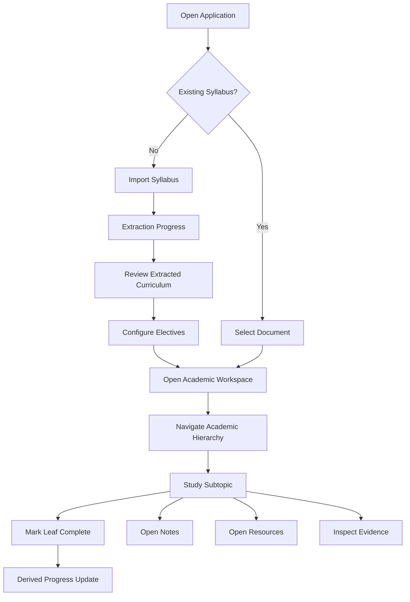
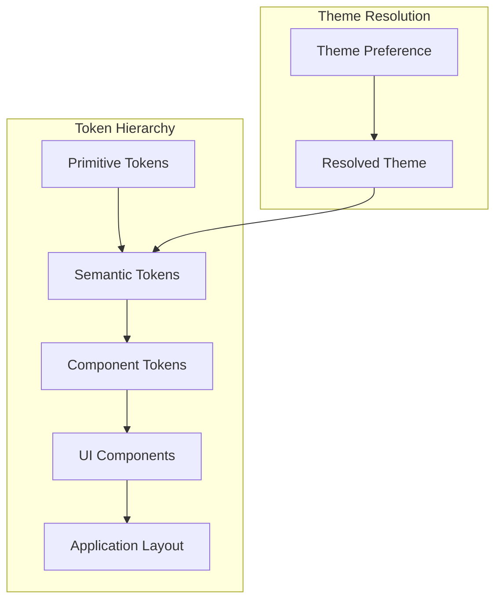
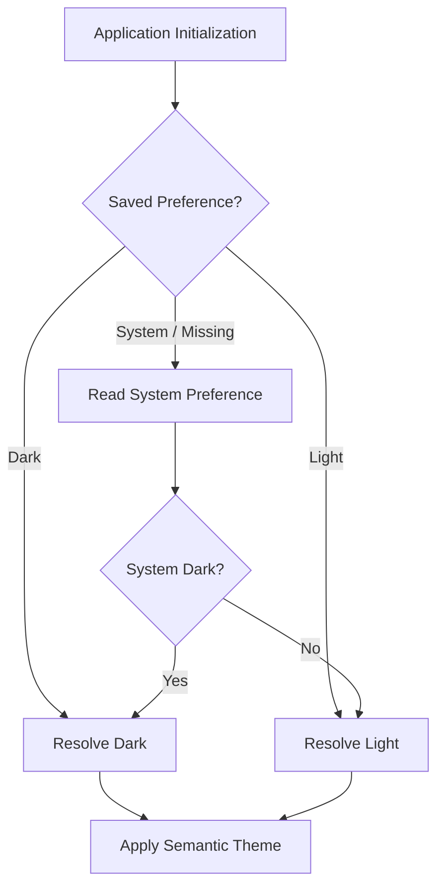
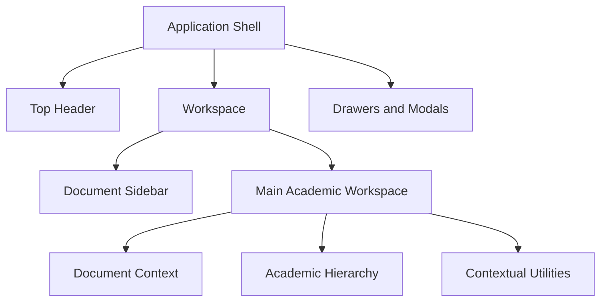
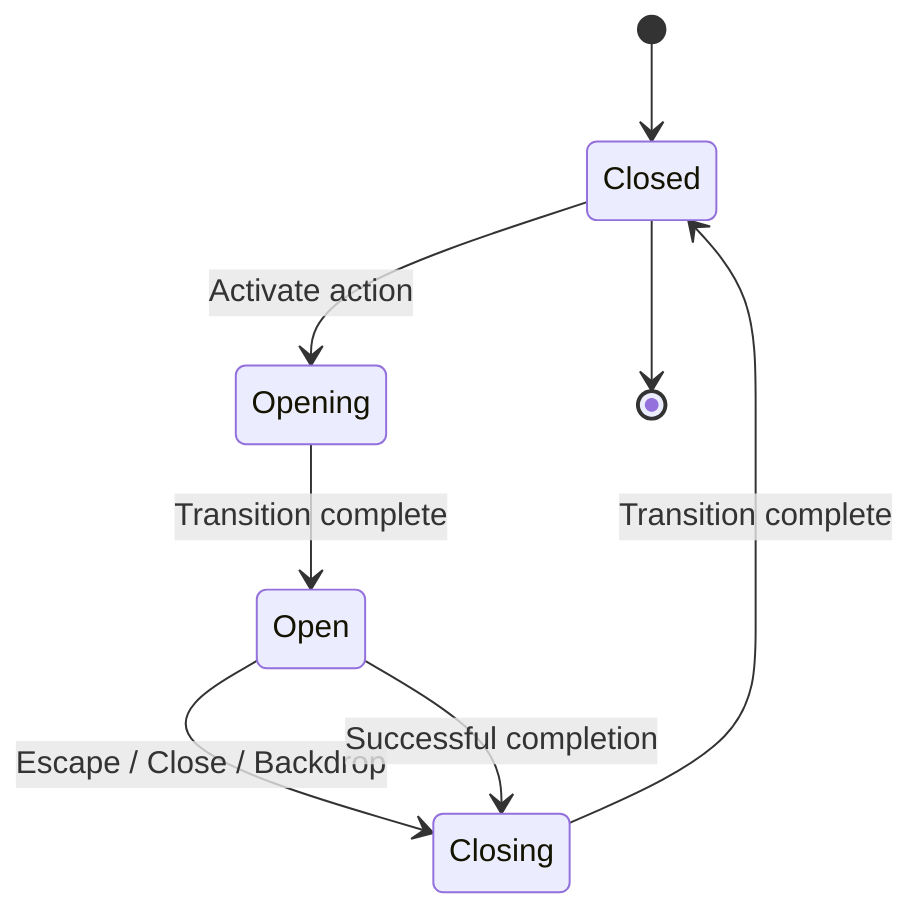

# 5. UI Design System, Component Architecture & Cross-Device UX Specification

**Document**: `5_UI_DSIGN.md`  
**Product**: Hierarchical Syllabus Checklist & Progress Tracker  
**Repository**: [Syllabus_Tracker_checklist](https://github.com/farhanahmad2106-cpu/Syllabus_Tracker_checklist?utm_source=chatgpt.com)  
**Branch Audited**: `main`  
**Document Type**: UI/UX and Design-System Specification  
**Authority**: Product Invariants, Architecture, Schema and This Document  
**Frontend**: React 19, TypeScript, Vite  
**Styling**: Tailwind CSS v4  
**Iconography**: Lucide React  
**Checkbox Primitives**: Radix UI Checkbox  
**Persistence**: Local SQLite through FastAPI  
**Design Themes**: Dark, Light, System  

---

> **Audit status: The supplied repository must be treated as the authoritative implementation source. I will distinguish verified implementation facts from proposed design decisions rather than assume that the requested React 19, Tailwind CSS v4, or component architecture is already present.**

# 1. Document Metadata & Design-System Authority

| Property | Specification |
| --- | --- |
| Document | 5_UI_DSIGN.md |
| Product | Hierarchical Syllabus Checklist & Progress Tracker |
| Repository | [Syllabus_Tracker_checklist](https://github.com/farhanahmad2106-cpu/Syllabus_Tracker_checklist?utm_source=chatgpt.com) |
| Branch audited | main |
| Document type | UI/UX and design-system specification |
| Authority | Product invariants, architecture, schema and this document |
| Frontend | React 19, TypeScript, Vite |
| Styling | Tailwind CSS v4 |
| Iconography | Lucide React |
| Checkbox primitives | Radix UI Checkbox |
| Persistence | Local SQLite through FastAPI |
| Design themes | Dark, Light, System |

## 1.1 Purpose

This document defines the authoritative visual, interaction, responsive, and accessibility contract for the application.
It governs how existing capabilities are presented, not how their underlying business logic works.
Future implementations MUST preserve the following:
Canonical five-tier academic hierarchy.
Document Root as a container rather than an academic tier.
Tier-5-only persisted completion.
Dynamically derived parent completion.
Enrollment-aware progress aggregation.
Historical progress preservation across elective enrollment changes.
Source-backed evidence and provenance.
Local-first operation.
Existing FastAPI and SQLite contracts.
Existing extraction and validation responsibilities.

## 1.2 Requirement Classification

The following terminology is normative:

| Term | Meaning |
| --- | --- |
| MUST | Mandatory design or compatibility requirement |
| MUST NOT | Prohibited behavior |
| SHOULD | Strong recommendation unless a documented constraint prevents it |
| SHOULD NOT | Discouraged implementation |
| MAY | Optional enhancement compatible with the architecture |
| VERIFIED | Supported by inspected repository evidence |
| PROPOSED | A design decision established by this specification |
| UNVERIFIED | Requires inspection or confirmation before implementation |

## 1.3 Authority and Conflict Resolution

Resolve conflicts in this order:
Explicit business invariants and security requirements.
Authoritative backend schemas and database constraints.
Current frontend domain models and API contracts.
Verified application behavior.
This design specification.
Individual implementation preferences.
A visual improvement MUST NOT weaken a higher-priority requirement.

# 2. Project Context & Product UX Principles

## 2.1 Product Definition

The application is a local-first academic productivity workspace that converts unstructured university syllabus material into a verifiable, interactive curriculum.
It combines document ingestion, AI-assisted extraction, academic hierarchy navigation, study progress, deadlines, and source evidence into one workspace.
The interface is not intended to resemble a generic analytics dashboard.
Its primary purpose is to help students answer four questions:
What must I study?
What have I completed?
What should I study next?
Can I verify where this topic came from?

## 2.2 Primary User Journey



The visual hierarchy MUST support this journey without requiring students to understand internal extraction or database terminology.

## 2.3 Product Experience Principles

| Principle | Required implementation |
| --- | --- |
| Academic clarity | Topic names dominate secondary metadata |
| Verifiability | Evidence remains directly accessible |
| Predictability | Identical interactions behave consistently |
| Low cognitive load | Secondary information uses progressive disclosure |
| Functional density | Relevant information is visible without excessive scrolling |
| Responsive continuity | Core actions remain accessible on every device |
| Local-first reliability | Core workspace rendering does not require cloud availability |
| Accessibility | Keyboard, screen reader, pointer and touch interactions |
| Visual restraint | Minimal decoration and controlled tonal separation |
| State correctness | Presentation never becomes an independent source of business truth |

## 2.4 Core Interaction Priority

The interface MUST prioritize content in this order:
Academic hierarchy and topic names.
Completion interaction.
Progress and deadlines.
Evidence, notes and resources.
Secondary document management actions.

# 3. Repository Audit & Existing UI Assessment

## 3.1 Audit Methodology

The public main branch was inspected through its repository README, Master_Context.md, frontend package manifest and accessible frontend source files.
The repository documentation identifies a React 19, TypeScript, Vite and Tailwind CSS v4 frontend using Radix UI Checkbox and Lucide React.
The inspected files include:
frontend/src/App.tsx
frontend/src/components/SyllabusTree.tsx
frontend/package.json
Master_Context.md
README.md
The separately referenced 16-document architecture collection and four screenshot files were not established as available repository artifacts during this audit. Their contents MUST NOT be assumed.

## 3.2 Verified Frontend Architecture

The frontend has the following documented responsibilities:

| Component / module | Verified responsibility |
| --- | --- |
| App.tsx | Main application shell, document sidebar, header, upload modal orchestration, document selection and deletion |
| SyllabusTree.tsx | Recursive five-tier academic presentation, expansion state, branch aggregation and leaf interaction |
| ProgressBar.tsx | Progress fraction and percentage presentation |
| FileUpload.tsx | Syllabus file upload, validation, progress and cancellation |
| ElectiveOnboardingModal.tsx | Elective review and enrollment onboarding |
| SourceEvidence.tsx | Evidence inspection and grounding status |
| TopicNotesDrawer.tsx | Topic notes interaction |
| TopicResourcesModal.tsx | Topic resource bookmarks |
| ConfirmDelete.tsx | Destructive confirmation dialog |
| ExportMenu.tsx | Existing export entry point |
| EmptyState.tsx | Reusable empty state |
| ErrorMessage.tsx | Error presentation |
| PacingBadge.tsx | Study pacing metadata |
| useSyllabus.ts | Syllabus state and application operations |
| types/syllabus.ts | Frontend domain types |
| lib/progress.ts | Progress calculation helpers |
| lib/api.ts | Typed backend communication |
| The component inventory above is based on repository documentation and source references; the precise implementation of every listed component is not independently established. | 3.3 Existing Visual Architecture |

The inspected App.tsx currently establishes:
Dark gray application surfaces.
Emerald interaction accents.
A persistent top header.
A collapsible document sidebar.
A mobile sidebar backdrop.
A local AI-provider diagnostic indicator.
An import action.
Document selection and deletion controls.
A separately scrollable document list.
The current shell uses a full-height viewport layout and a fixed-width sidebar pattern.
The inspected SyllabusTree.tsx establishes:
Five academic presentation levels.
Radix-based branch checkbox primitives.
Local expansion state.
Initially expanded non-lab courses.
Initially collapsed lab courses.
Derived branch checkbox states.
Fractional and percentage progress.
Notes and resource access callbacks.
Deadline callbacks.
Animated collapsible content.

## 3.4 Existing Design Strengths

Reusable component architecture.
Explicit TypeScript academic domain types.
Existing Radix accessibility primitives.
Consistent Lucide iconography.
Dark emerald visual identity.
Responsive sidebar foundation.
Separate document and academic navigation.
Existing reduced-motion transition handling.
Existing loading and error presentation components.
Separation between UI state and backend operations.

## 3.5 Identified Design-System Gaps

| Area | Observed condition | Required direction |
| --- | --- | --- |
| Color | Many direct gray and emerald utility classes | Central semantic tokens |
| Surface hierarchy | Nested bordered academic cards | Tonal elevation |
| Sidebar | Existing collapse and mobile drawer behavior | Formalize breakpoints and focus management |
| Academic rows | Repeated card-like treatment | Distinct five-tier visual language |
| Action density | Secondary actions require more deliberate organization | Contextual action groups |
| Header | Multiple actions share limited horizontal space | Responsive action prioritization |
| Typography | Existing utility-based typography | Centralized type scale |
| Progress | Existing fraction and percentage patterns | Unified semantic presentation |
| Theme | Complete theme switching not verified | Specify dark, light and system architecture |
| Search | Global command palette not verified | Proposed optional navigation enhancement |
| Responsive tree | Existing responsive behavior needs validation | Define explicit mobile and tablet contracts |

## 3.6 Important Audit Qualification

The current SyllabusTree.tsx includes branch-selection callbacks as well as leaf callbacks. The specification MUST preserve their existing enrolled-descendant bulk-action behavior where supported by the backend.
This does not authorize persisting parent completion states.
The application MUST distinguish between:
A derived parent checkbox state.
A user action requesting a bulk operation on descendant leaves.
The persisted completion records of individual Tier-5 leaves.

## 3.7 Repository Documentation Reconciliation

The repository's Master_Context.md documents the existing React frontend, local-first architecture, five-tier hierarchy, leaf-only persistence and evidence grounding.
The README independently confirms the canonical hierarchy and enrollment-aware completion model.
The implementation specification MUST NOT treat the absence of a particular feature in the inspected source as proof that its backend capability does not exist.
Features such as advanced export formats, a global command palette, a complete light theme, and every deadline or utility-panel interaction require source-level verification before being labeled implemented.

# 4. Design Philosophy & Aesthetic Direction

## 4.1 Visual Identity

Academic workspace · Dark emerald · Restrained productivity UIThe application SHOULD combine:
Linear's restrained visual precision.
Notion's content-oriented hierarchy.
Raycast's keyboard-oriented interaction philosophy.
Developer workspace information density.
These references establish principles, not copied layouts.

## 4.2 Visual Composition

The default workspace should consist of:
A compact application header.
A document navigation sidebar.
A central academic workspace.
Contextual utility surfaces.
Modal or drawer overlays when necessary.

## 4.3 Design Restrictions

The application MUST NOT use:
Large decorative gradients as the dominant surface.
Repetitive borders around every hierarchy node.
Excessive glass effects.
Unnecessary card nesting.
Multiple competing accent colors.
Oversized metadata badges.
Constantly visible secondary action bars.
Emoji as functional interface icons.
Excessive animation.
Dashboard-style decorative charts that do not support study decisions.

## 4.4 Density Modes

Two density modes MAY be provided in the future, but the default specification defines one consistent density.

| Property | Default |
| --- | --- |
| Academic row minimum height | 44px |
| Primary row vertical padding | 10px |
| Compact metadata height | 20px |
| Standard icon button | 36px desktop |
| Touch icon button | 44px minimum |
| Hierarchy gap | 4–8px |
| Section gap | 16–24px |

Density changes MUST NOT alter hierarchy semantics or make touch controls inaccessible.

# 5. Design-System Architecture

## 5.1 Token Architecture

The design system MUST follow this hierarchy:



Primitive tokens define raw values such as colors, spacing and radii.
Semantic tokens define meaning, such as surface-primary, text-muted and status-warning.
Component tokens define component-specific dimensions and visual behavior.
Components MUST consume semantic tokens rather than arbitrary hardcoded colors.

## 5.2 Token Naming Convention

Use lowercase semantic CSS custom properties:
--color-canvas --color-surface-primary --color-surface-secondary --color-text-primary --color-text-secondary --color-border-default --color-accent-primary --color-status-success --spacing-1 --spacing-2 --radius-control --radius-panel --motion-fast --motion-normal --motion-easing-standard

## 5.3 Token Ownership

| Token family | Responsibility |
| --- | --- |
| Color | Theme-dependent visual meaning |
| Typography | Text scale and readability |
| Spacing | Consistent geometric rhythm |
| Radius | Component corner treatment |
| Elevation | Surface separation |
| Motion | Animation behavior |
| Focus | Keyboard interaction visibility |
| Layout | Shell and content dimensions |
| Z-index | Layer ordering |
| No component should define its own competing semantic color system. | 6. Color System & Semantic Tokens |

## 6.1 Dark Theme Primitive Values

The following values establish the proposed default dark palette.

| Token | Value | Purpose |
| --- | --- | --- |
| Canvas | #09090B | Application background |
| Surface primary | #18181B | Main workspace surfaces |
| Surface secondary | #1F1F23 | Secondary content |
| Surface tertiary | #27272A | Hover and selected surfaces |
| Border subtle | rgba(255,255,255,0.06) | Quiet separators |
| Border default | rgba(255,255,255,0.10) | Standard boundaries |
| Text primary | #FAFAFA | Main content |
| Text secondary | #A1A1AA | Supporting content |
| Text muted | #71717A | Nonessential metadata |
| Accent primary | #10B981 | Primary interaction |
| Accent hover | #059669 | Hover interaction |
| Accent subtle | rgba(16,185,129,0.12) | Selected surfaces |

## 6.2 Light Theme Primitive Values

| Token | Value | Purpose |
| --- | --- | --- |
| Canvas | #F8FAFC | Application background |
| Surface primary | #FFFFFF | Main surfaces |
| Surface secondary | #F8FAFC | Secondary content |
| Surface tertiary | #F1F5F9 | Hover surfaces |
| Border subtle | #E2E8F0 | Quiet separators |
| Border default | #CBD5E1 | Standard boundaries |
| Text primary | #0F172A | Main content |
| Text secondary | #475569 | Supporting content |
| Text muted | #64748B | Metadata |
| Accent primary | #059669 | Primary interaction |
| Accent hover | #047857 | Hover interaction |
| Accent subtle | #ECFDF5 | Selected surfaces |

## 6.3 Semantic Color Families

The semantic values below are proposed starting points. Each pairing MUST pass automated and manual contrast validation before release.

| Semantic role | Dark | Light |
| --- | --- | --- |
| Success | #34D399 | #047857 |
| Warning | #FBBF24 | #92400E |
| Error | #FB7185 | #BE123C |
| Information | #60A5FA | #1D4ED8 |
| Progress complete | #34D399 | #059669 |
| Progress remaining | #3F3F46 | #E2E8F0 |
| Indeterminate | #A78BFA | #6D28D9 |
| At risk | #FBBF24 | #92400E |
| Overdue | #FB7185 | #BE123C |
| Verified evidence | #34D399 | #047857 |
| Review evidence | #FBBF24 | #92400E |
| Unverified evidence | #FB7185 | #BE123C |
| Lab indicator | #A78BFA | #6D28D9 |

## 6.4 Semantic State Rules

Success MUST include a textual or icon-based confirmation.
Warning MUST identify the reason for concern.
Error MUST explain the failure and available recovery action.
Overdue deadlines MUST display an explicit overdue label.
Indeterminate progress MUST be distinguishable by its checkbox state and accessible description.
Verified evidence MUST NOT be represented solely by green.
Lab designation MUST remain secondary to the course title.

## 6.5 Focus and Selection Tokens

| Token | Dark theme | Light theme |
| --- | --- | --- |
| Focus ring | #34D399 | #059669 |
| Focus offset | Canvas | Surface primary |
| Selected background | Emerald 12% | #ECFDF5 |
| Selected border | #10B981 | #059669 |
| Disabled opacity | 45% | 50% |
| Focus indicators MUST remain clearly visible on every interactive surface. | 7. Dark Mode & Light Mode Specifications | 7.1 Supported Preferences |

The theme preference MUST support:
dark
light
system
The resolved visual theme MUST be distinct from the saved preference.
Example:
Saved preference: system OS preference: dark Resolved theme: dark

## 7.2 Theme Resolution



## 7.3 Persistence

The existing persistence architecture MUST be inspected before selecting a storage mechanism for theme preference.
Proposed preference storage:
Browser-local preference storage where appropriate.
Existing application settings persistence if already available.
Theme preference MUST NOT be added to academic completion records or the syllabus domain schema.

## 7.4 Initial Rendering

The interface SHOULD avoid a visible theme flash during initialization.
Theme resolution MUST occur before the main visual workspace is displayed whenever the current bootstrap architecture permits.

## 7.5 Theme Switching

Theme changes MUST:
Preserve the current route or workspace state.
Preserve academic expansion state.
Preserve unsaved editor content.
Avoid resetting completion data.
Update semantic colors consistently.
Maintain accessible focus indicators.

## 7.6 System Theme Changes

When preference is system, operating-system theme changes SHOULD update the resolved theme without requiring a page reload.
When preference is explicitly dark or light, system changes MUST NOT override it.

## 7.7 Theme QA

Validate:
Normal text contrast.
Large text contrast.
Button contrast.
Input boundaries.
Checkbox states.
Progress indicators.
Dialog backdrops.
Tooltips.
Disabled controls.
Error and warning states.
Focus indicators.

# 8. Typography Scale & Numeric Typography Rules

## 8.1 Font Families

| Role | Font stack |
| --- | --- |
| Primary | Inter, ui-sans-serif, system-ui, sans-serif |
| Monospace | JetBrains Mono, ui-monospace, SFMono-Regular, monospace |

Fonts MUST have system fallbacks. The application MUST remain readable when external font delivery is unavailable.
No mandatory external font service is permitted.

## 8.2 Typography Tokens

| Token | Size | Line height | Weight | Usage |
| --- | --- | --- | --- | --- |
| Display | 32px | 40px | 700 | Rare onboarding headings |
| Page title | 24px | 32px | 650 | Main workspace title |
| Section heading | 20px | 28px | 600 | Major sections |
| Component heading | 16px | 24px | 600 | Academic groups |
| Body large | 16px | 24px | 400 | Important descriptions |
| Body default | 14px | 21px | 400 | Academic content |
| Body small | 13px | 19px | 400 | Supporting text |
| Caption | 12px | 16px | 400 | Secondary information |
| Metadata | 11px | 16px | 500 | Compact metadata |
| Numeric metric | 13px | 20px | 500 | Progress and statistics |

Font weight values MUST use available font weights or browser-supported synthesized weights. The specification does not require downloading additional font files.

## 8.3 Responsive Typography

Mobile page titles SHOULD use 20–22px.
Main academic content MUST remain at least 14px where practical.
Metadata MUST NOT be reduced excessively to accommodate crowded layouts.
Dialog titles SHOULD retain a clear hierarchy.
Long titles MUST wrap or truncate with an accessible full-name alternative.

## 8.4 Numeric Typography

Use monospace numerals with tabular alignment for:
PC-CS401 12/16 75.0% 4.2 topics/wk 8.5 hrs/wk 24 contact hours 17 Nov 2026
Recommended CSS:

```css
.metric {
  font-family: var(--font-mono);
  font-variant-numeric: tabular-nums;
}
```

Numeric metrics MUST reserve enough width to prevent layout shifts when values change.
Do not force monospace typography on ordinary academic descriptions.

# 9. Spacing, Radius & Surface Elevation

## 9.1 Four-Pixel Spacing Foundation

| Token | Value |
| --- | --- |
| space-1 | 4px |
| space-2 | 8px |
| space-3 | 12px |
| space-4 | 16px |
| space-5 | 20px |
| space-6 | 24px |
| space-8 | 32px |
| space-10 | 40px |
| space-12 | 48px |
| space-16 | 64px |

## 9.2 Layout Dimensions

| Element | Proposed dimension |
| --- | --- |
| Desktop sidebar | 272px |
| Compact desktop sidebar | 240px |
| Mobile sidebar drawer | min(320px, 88vw) |
| Header height | 64px |
| Desktop content maximum width | 1120px |
| Optional secondary panel | 320px |
| Standard dialog | 480px |
| Large dialog | 640px |
| Wide evidence viewer | 760px |
| Desktop drawer | 420px |
| Mobile drawer | 100vw |
| Main content padding | 24px |
| Mobile content padding | 16px |

These are proposed design dimensions, not claims about current measured dimensions.

## 9.3 Hierarchy Indentation

Indentation MUST communicate parent-child relationships without consuming excessive horizontal space.

| Tier | Desktop indentation | Mobile indentation |
| --- | --- | --- |
| Tier 1 | 0px | 0px |
| Tier 2 | 16px | 10px |
| Tier 3 | 32px | 20px |
| Tier 4 | 48px | 28px |
| Tier 5 | 64px | 36px |

At narrow widths, indentation MUST be reduced before academic content becomes clipped.
The hierarchy MUST remain understandable through typography, labels, disclosure controls and grouping, not indentation alone.

## 9.4 Border Radius

| Token | Value | Usage |
| --- | --- | --- |
| Radius XS | 4px | Small indicators |
| Radius SM | 6px | Badges |
| Radius MD | 8px | Buttons and inputs |
| Radius LG | 12px | Academic surfaces |
| Radius XL | 16px | Modals |
| Radius 2XL | 20px | Large floating surfaces |
| Radius Full | 9999px | Pills and status indicators |
| Avoid using the largest radius on every component. | 9.5 Tonal Elevation | Level |

Surface
Intended usage
E0
Canvas
Main background
E1
Primary surface
Main workspace
E2
Secondary surface
Nested content groups
E3
Tertiary surface
Hover and selected states
E4
Floating surface
Popovers and dropdowns
E5
Modal surface
Dialogs and overlays
Borders SHOULD be used only when a structural boundary is genuinely useful.

## 9.6 Shadow Policy

Shadows are permitted for:
Floating menus.
Dialogs.
Drawers.
Command palette.
Overlapping sticky elements.
Ordinary academic hierarchy rows SHOULD NOT have individual shadows.

# 10. Application Shell & Navigation Architecture

## 10.1 Overall Structure

The application MUST maintain three primary layout regions:



## 10.2 Desktop Shell

The desktop workspace SHOULD use:
Fixed-height application header.
Persistent collapsible document sidebar.
Independently scrollable sidebar content.
Independently scrollable academic workspace.
Contextual dialogs and drawers.
The academic workspace MUST NOT scroll horizontally merely because secondary actions are visible.

## 10.3 Header

The header MUST prioritize:
Sidebar toggle.
Application identity.
Active document identity where space permits.
Import or primary document action.
Local AI diagnostic information.
Refresh and secondary utilities.
The header MUST NOT attempt to display every available document-management action simultaneously.

## 10.4 Sidebar

The existing document sidebar SHOULD retain its document-selection responsibilities.
Expanded state
Document list.
Active document indicator.
Document title or filename.
Compact progress summary.
Document-specific contextual actions.
Collapsed state
Narrow navigation rail where supported.
Accessible tooltip labels.
Clear active-document indicator.
No loss of selected-document state.
Mobile state
Slide-over drawer.
Backdrop.
Close button.
Escape dismissal.
Focus management.
Scroll locking.

## 10.5 Navigation Semantics

The sidebar MUST use semantic navigation markup.
Each document selection control MUST be keyboard operable.
A clickable <div> MUST NOT be used as a substitute for a semantic button.

## 10.6 Sticky and Scrollable Regions

| Region | Behavior |
| --- | --- |
| Application header | Sticky or fixed |
| Document sidebar | Independently scrollable |
| Academic content | Main scrolling region |
| Modal body | Independently scrollable |
| Drawer body | Independently scrollable |
| Modal footer | Sticky within dialog where useful |

# 11. Five-Tier Academic Hierarchy Components

## 11.1 Canonical Structure

```text
Document Root (container; not an academic tier)
└── Academic Year (Tier 1)
    └── Semester (Tier 2)
        └── Subject / Course (Tier 3)
            └── Module / Unit (Tier 4)
                └── Subtopic Leaf (Tier 5)
```

The Document Root is a container, not a sixth tier.

## 11.2 Document Root

Visual specification
Compact title and document metadata.
Overall completion summary.
Import and extraction state where applicable.
Primary document action.
Clear document identity.
Interaction specification
Rename when the existing capability permits.
Open document management actions.
Access export and backup controls.
Navigate to document-level utilities.
Responsive specification
On mobile, document metadata MUST collapse into a compact title region.
Secondary actions MUST move into an overflow menu or dedicated utility surface.
Business constraints
Document-level completion MUST be derived from enrolled descendant leaves.
The root MUST NOT gain its own persisted completion checkbox.

## 11.3 Tier 1 — Academic Year

Visual specification
Strongest academic grouping heading.
Approximately 16px semibold typography.
Distinct calendar or academic-year icon.
Compact derived progress summary.
Tonal background rather than a heavily bordered card.
Interaction specification
Expand and collapse its descendants.
Display derived completion.
Display year-level fraction.
Support existing bulk descendant actions only where implemented.
Responsive specification
Progress labels MAY become compact on mobile, but the academic-year heading MUST remain visible.

## 11.4 Tier 2 — Semester

Visual specification
15px semibold heading.
Visually subordinate to Academic Year.
Compact deadline and pacing metadata.
Clear semester identification.
Interaction specification
Expand and collapse subjects.
Display derived semester progress.
Open existing target-date controls.
Expose deadline status.
Responsive specification
Deadline and pacing metadata SHOULD wrap onto a secondary line instead of forcing horizontal overflow.

## 11.5 Tier 3 — Subject / Course

Visual specification
14px semibold title.
Course code displayed in monospace.
Enrollment state where meaningful.
Restrained elective or lab designation.
Derived subject completion.
Optional subject deadline.
Metadata ordering
Course title.
Course code.
Enrollment state.
Lab designation.
Contact-hour metadata, if applicable.
Completion summary.
Not every item must appear on every row.
Interaction specification
Expand and collapse modules.
Display enrollment information.
Expose applicable subject-level actions.
Preserve existing elective configuration semantics.
Lab behavior
Lab courses MUST retain their existing collapsed-by-default initialization.
The design MUST NOT change this behavior simply to make the tree appear more uniform.

## 11.6 Tier 4 — Module / Unit

Visual specification
14px medium-weight title.
Subtle grouping surface.
No mandatory independent card border.
Compact sequence metadata when available.
Contact-hour indicator only when valid.
Interaction specification
Expand and collapse Tier-5 descendants.
Display derived progress.
Provide existing module-level resource access where supported.
Preserve existing bulk branch action behavior.
Contact-hour rule
contact_hours === null means no badge is rendered.
The presentation layer MUST NOT substitute placeholder metadata.

## 11.7 Tier 5 — Subtopic Leaf

Visual specification
Primary study-content row.
14px regular title.
Interactive checkbox.
Compact contextual actions.
Completion distinction through checkbox and restrained text styling.
Interaction specification
Toggle completion.
Open notes.
Open resource bookmarks.
Inspect evidence.
Show optional metadata.
Expose accessible keyboard focus.
Completed state
Checked checkbox.
Subtle completion accent.
Optional muted title treatment.
No aggressive opacity reduction.
No removal from the academic hierarchy.
Mobile state
Minimum 44px touch targets.
Contextual actions must remain accessible.
Long titles may wrap.
No forced horizontal action strip.

## 11.8 Five-Tier Visual Comparison

| Property | Tier 1 | Tier 2 | Tier 3 | Tier 4 | Tier 5 |
| --- | --- | --- | --- | --- | --- |
| Name | Academic Year | Semester | Subject | Module | Subtopic |
| Typography | 16px/600 | 15px/600 | 14px/600 | 14px/500 | 14px/400 |
| Indentation | 0 | 16px | 32px | 48px | 64px |
| Progress | Derived | Derived | Derived | Derived | Checkbox |
| Expand/collapse | Yes | Yes | Yes | Yes | No |
| Persisted completion | No | No | No | No | Yes |
| Surface | Tonal group | Tonal group | Subtle group | Minimal | Flat row |
| Metadata | Year summary | Deadline | Code/lab | Contact hours | Notes/resources |
| Mobile indentation | 0 | 10px | 20px | 28px | 36px |

## 11.9 Hierarchy Consistency Rules

Every node MUST retain its canonical tier.
No component may silently flatten a hierarchy level.
Parent rows MUST be visually distinguishable from leaves.
Leaf rows MUST remain the primary study interaction.
Progress MUST represent enrolled descendant leaves.
Excluded electives MUST NOT contribute to active completion denominators.
Empty branches MUST not be presented as 100% completed.
The existing legacy-data normalization MUST remain compatible.

# 12. Tri-State Progress & Completion Visualization

## 12.1 Progress Model

For a parent node:

\[ P = \frac{C}{T}\times100 \]

Where:
\(C\) = completed enrolled descendant leaves.
\(T\) = total applicable enrolled descendant leaves.
If \(T=0\), display 0/0 and 0% according to the existing domain contract.

## 12.2 Parent State Mapping

| Condition | State |
| --- | --- |
| \(T=0\) | Empty / not applicable |
| \(C=0\), \(T>0\) | Unchecked |
| \(0<C<T\) | Indeterminate |
| \(C=T\), \(T>0\) | Checked |

## 12.3 Leaf Completion

Only Tier-5 leaves MUST expose ordinary individual completion controls.
Visual states:

| State | Presentation |
| --- | --- |
| Unchecked | Empty outline |
| Checked | Filled emerald checkbox with check |
| Hover | Subtle surface and border change |
| Focus | Visible focus ring |
| Disabled | Muted and non-interactive |
| Updating | Temporary pending feedback |
| Error | Preserve recoverable state and announce failure |

## 12.4 Parent Indicators

Parent checkbox visuals MUST use the same semantic state mapping.
However, the design MUST clearly communicate that the state is derived.
A parent-level interaction, if supported, MUST be interpreted as a bulk descendant operation rather than an independent completion update.

## 12.5 Progress Bar

The standard progress bar MUST display:
Completed fraction.
Percentage.

```text
Database Management 12 / 16 completed 75.0% [██████████████░░░░░░]
```

Visually distinguishable remaining track.
Example:
Database Management 12 / 16 completed 75.0% ██████████████░░░░░░

## 12.6 Visualization Selection

| Context | Recommended visualization |
| --- | --- |
| Overall document | Progress bar + fraction |
| Academic year | Compact progress bar |
| Semester | Compact progress bar or fraction |
| Subject | Fraction and percentage |
| Module | Compact fraction |
| Leaf | Checkbox only |
| Circular progress indicators SHOULD NOT be introduced into every hierarchy row. | 12.7 Accessibility |

Checkbox labels MUST identify their academic context.
Example:
Database Management: 12 of 16 topics completed, 75 percent.
Radix Checkbox MUST expose its appropriate checked, unchecked or indeterminate accessibility state.
Use aria-checked="mixed" where a custom checkbox implementation requires it.
Screen-reader announcements MUST NOT repeatedly announce the entire hierarchy after every single leaf update.

## 12.8 Bulk Operation Feedback

When an existing parent bulk action is invoked:
Identify the affected academic branch.
Display pending feedback where necessary.
Perform the existing descendant-leaf operation.
Recompute derived progress.
Announce the result.
Preserve the existing failure recovery behavior.

# 13. Progressive Disclosure & Metadata Hygiene

## 13.1 Secondary Action Architecture

The secondary leaf actions are:
Notes.
Resources.
Evidence.
They MUST remain visually subordinate to academic content.

## 13.2 Desktop Visibility

On pointer devices:
Secondary controls SHOULD appear on hover or focus.
Active controls MUST remain visibly identifiable.
Existing notes or resource counts MAY be shown.
Tooltips MUST provide action descriptions.
Essential functionality MUST NOT depend exclusively on hover.

## 13.3 Mobile Visibility

Mobile users MUST have access to all secondary actions without hover.
Use either:
Compact inline icon controls.
A contextual overflow menu.
A compact secondary action row.
The chosen pattern MUST remain consistent across academic rows.

## 13.4 Action Semantics

| Action | Icon concept | Accessible label |
| --- | --- | --- |
| Notes | Notebook/Pencil | Open notes for topic |
| Resources | Link | Open topic resources |
| Evidence | File text | Inspect source evidence |
| Use Lucide icons rather than emoji. | 13.5 Metadata Visibility | Metadata MUST be rendered only when meaningful. |

| Metadata | Rendering rule |
| --- | --- |
| Course code | Hide if absent |
| Contact hours | Hide if null |
| Deadline | Hide if absent |
| Resource count | Hide or show empty affordance according to existing behavior |
| Notes count | Hide when no count is available |
| Evidence status | Show when grounding metadata exists |
| Lab designation | Show only for detected lab courses |
| Enrollment state | Show when relevant |

## 13.6 Contact-Hour Contract

This is a mandatory rule:

```tsx
{contact_hours !== null && contact_hours !== undefined && (
  <ContactHoursIndicator value={contact_hours} />
)}
```

If the application distinguishes an invalid or negative value from an unavailable value, the existing validation contract takes precedence.
The interface MUST NOT display:
Contact Hours Not Specified.
Contact Hours Unknown.
0 hours as a substitute for null.
Any fabricated contact-hour estimate.
Contact hours are informational metadata, not completion progress.

## 13.7 Lab Indicator

The Lab Course indicator SHOULD be compact, preferably text with a restrained icon.
It MUST NOT:
Replace the subject title.
Change completion weighting.
Make the course appear disabled.
Suggest that lab progress is excluded.
The existing uniform completion weighting MUST remain intact.

## 13.8 Extraction Quality Indicators

Use the existing grounding statuses:

| Status | Presentation | Meaning |
| --- | --- | --- |
| verified | Emerald + verified icon | Source-backed content |
| needs_review | Amber + review icon | Requires human review |
| unverified | Rose + warning icon | Grounding not established |

## 13.9 Suspicious Extraction Output

Suspicious examples include:
[Page 2] [Page 3] Department of Computer Science General Curriculum Course 2 Unit 2
The interface MUST NOT automatically classify every unfamiliar title as invalid.
Instead, it SHOULD support a review-oriented presentation when the upstream data provides a reliable warning or validation status.
Rules:
Suspicious extraction metadata MUST NOT look like an ordinary verified subtopic.
Source evidence MUST remain accessible.
The student MUST be able to distinguish a review warning from an academic topic.
The frontend MUST NOT independently rewrite extracted academic titles.
Extraction correction MUST remain an ingestion or validation responsibility.
A visual warning MUST NOT replace backend validation.

# 14. Component Specifications

## 14.1 Global Component Contract

Every major interactive component MUST define:
Default state.
Hover state.
Focus state.
Active state.
Selected state.
Disabled state.
Loading state.
Empty state where applicable.
Error state where applicable.
Responsive behavior.
Accessible name and semantics.

## 14.2 Button System

| Variant | Purpose |
| --- | --- |
| Primary | Main action |
| Secondary | Supporting action |
| Ghost | Low-emphasis utility |
| Outline | Alternative action |
| Destructive | Irreversible or dangerous action |
| Icon-only | Compact contextual action |

Button dimensions:

| Size | Height |
| --- | --- |
| Small | 32px |
| Default | 40px |
| Large | 44px |
| Touch | 44px minimum |

Icon-only controls MUST include accessible names.
Disabled controls MUST communicate why the operation is unavailable when that reason is not obvious.

## 14.3 Input Components

Inputs MUST include:
Visible labels.
Consistent border treatment.
Clear focus state.
Error messaging.
Disabled state.
Appropriate input type.
Accessible descriptions.
Placeholder text MUST NOT replace a persistent label.

## 14.4 Academic Row Component

The academic row MUST provide:
Disclosure affordance where applicable.
Correct hierarchy identity.
Title.
Completion indicator appropriate to its tier.
Optional metadata.
Contextual action access.
Rows MUST use stable identity from existing domain IDs.

## 14.5 Progress Component

Progress bars MUST use a shared visual contract.
Recommended semantic structure:

```html
<div
  role="progressbar"
  aria-valuemin={0}
  aria-valuemax={100}
  aria-valuenow={progress}
  aria-label="Document completion"
>
  {/* Visual track */}
</div>
```

The accessible implementation MUST expose meaningful progress information.
For unknown progress, omit aria-valuenow rather than fabricate a value.

## 14.6 Empty State Component

Empty states MUST explain:
What is missing.
Why the state matters.
The next available action.
Examples:

| Situation | Suggested message |
| --- | --- |
| No syllabus | Import a syllabus to begin tracking your curriculum. |
| No documents | Your academic workspace is empty. |
| No notes | No notes have been added to this topic. |
| No resources | No bookmarks are available for this topic. |
| No evidence | Source evidence is not available for this item. |
| No search results | No matching academic content was found. |

## 14.7 Error Component

Error messages MUST be actionable.
They SHOULD identify:
Operation that failed.
Whether data was preserved.
Whether retry is available.
What the user can do next.
Do not expose stack traces, internal paths, API keys or implementation details.

## 14.8 Loading Component

Use:
Skeletons for predictable content structures.
Progress bars for measurable operations.
Indeterminate progress for unknown-duration operations.
Small inline indicators for short mutations.
Avoid displaying a full-page blocking spinner for operations that can be handled locally.

## 14.9 Resource Presentation

Resource items SHOULD display:
Resource title.
Resource type.
External-link indicator.
Optional domain.
Open action.
Remove action where existing functionality permits.
Long titles MUST wrap.
URLs MUST break safely without forcing horizontal scrolling.

## 14.10 Deadline Presentation

Deadline indicators MUST distinguish:

| State | Presentation |
| --- | --- |
| No deadline | No status indicator |
| Upcoming | Neutral date |
| Approaching | Warning |
| At risk | Warning + explanatory text |
| Overdue | Error + explicit overdue label |
| Completed | Neutral or success according to context |
| The visual design MUST NOT independently calculate or change deadline business rules. | 15. Command Palette & Keyboard Interaction |

## 15.1 Scope

Proposed UX enhancement
A global command palette is a proposed design decision. Its implementation is not established by the inspected repository evidence.
It MAY be introduced using existing frontend capabilities, provided it does not introduce unnecessary dependencies or alter application architecture.

## 15.2 Activation

| Platform | Shortcut |
| --- | --- |
| Windows | Ctrl + K |
| Linux | Ctrl + K |
| macOS | Cmd + K |
| All | Escape to close |
| The shortcut MUST NOT interfere with text inputs or editable content. | 15.3 Search Scope |

If implemented, search SHOULD cover the currently loaded local academic data:
Academic years.
Semesters.
Subjects.
Modules.
Subtopics.
Notes, if accessible from the existing client state.
No new cloud search dependency is permitted.

## 15.4 Command Categories

Navigation
Open selected document.
Jump to academic year.
Jump to semester.
Open subject.
Jump to module.
Open subtopic.
Academic filters
Show incomplete items.
Show completed items.
Show items requiring review.
Show at-risk items, if deadline data supports this.
Workspace
Expand all.
Collapse all.
Toggle theme.
Open notes.
Open exports.
Only commands compatible with existing capabilities MUST be exposed.

## 15.5 Search Ranking

Proposed ranking:
Exact title match.
Prefix match.
Token match.
Partial substring.
Fuzzy match.
Results MUST show their academic location.
Example:
Database Management Year 2 / Semester 4 / Module 3 Database Normalization Year 2 / Semester 4 / Database Management / Module 2

## 15.6 Keyboard Behavior

| Key | Action |
| --- | --- |
| Arrow Down | Next result |
| Arrow Up | Previous result |
| Enter | Activate selected result |
| Escape | Close palette |
| Tab | Follow accessible focus behavior |
| Ctrl/Cmd + K | Toggle palette |
| Focus MUST return to the original triggering element after closing. | 15.7 Command Palette States |

Initial.
Typing.
Results.
Grouped results.
Empty.
Loading, if asynchronous data is actually required.
Selected result.
Disabled command.
Execution success.
Execution failure.

## 15.8 Performance

The command palette MUST use already loaded local data where possible.
It MUST NOT require a remote service merely to navigate the academic hierarchy.

# 16. Drawers, Modals & Utility Panels

## 16.1 Shared Overlay Architecture

All overlays MUST use consistent interaction behavior.



## 16.2 Shared Accessibility Contract

Every modal or drawer MUST:
Have an accessible title.
Move focus appropriately when opened.
Keep keyboard focus within modal dialogs.
Restore focus on close.
Support Escape where safe.
Prevent unintended background interaction.
Manage body scroll.
Provide an explicit close control.
Announce important errors and success states.
Respect reduced motion.

## 16.3 Notes Drawer

Purpose: View and edit notes attached to a Tier-5 topic.
Desktop: Right-side drawer, proposed width 420px.
Mobile: Full-width drawer or full-screen panel.
Content:
Topic title.
Markdown editor.
Readable preview.
Save status.
Unsaved changes indication.
Save states:

| State | Feedback |
| --- | --- |
| Clean | Saved |
| Editing | Unsaved changes |
| Saving | Saving… |
| Saved | All changes saved |
| Failed | Could not save; retry available |

The existing notes persistence and debounced auto-save behavior MUST remain unchanged.
Closing with unsaved changes MUST follow the existing data-preservation contract.

## 16.4 Resource Drawer

Purpose: Access bookmarks associated with an academic item.
Must support:
YouTube links.
Lecture links.
External references.
Long resource titles.
Long URLs.
Empty state.
Loading state.
Error state.
Opening an external link MUST be clearly distinguishable from an internal navigation action.

## 16.5 Evidence Viewer

Purpose: Verify academic content against its original source.
Required information:
Topic title.
Exact source excerpt.
Original page number.
Source document identity.
Original URL, where applicable.
Grounding status.
Relevant provenance metadata.
Evidence MUST remain verbatim.
The viewer MUST NOT silently alter, summarize or fabricate source excerpts.
Proposed desktop width: 760px maximum.
Mobile presentation: Full-screen or near-full-screen.

## 16.6 Configure Electives Modal

The modal MUST preserve existing onboarding and enrollment behavior.
Required presentation:
Modal heading.
Academic context.
Mandatory course designation.
Selectable elective courses.
Selected state.
Pending or excluded state.
Confirmation action.
Cancel action.
Mandatory subjects MUST appear locked.
The interface MUST explain that elective exclusion affects active progress.
Historical progress preservation MUST remain intact.

## 16.7 Target Date Modal

The target-date interface MUST:
Identify the academic item.
Display the existing deadline, if present.
Allow valid date selection.
Provide save and cancel controls.
Provide clear-date action where supported.
Display validation errors.
Display save feedback.
The interface MUST NOT independently change deadline calculations.

## 16.8 Export & Backup Modal

The interface MUST organize existing export capabilities into clearly identifiable actions.
Potential existing formats must be verified against the implementation before being presented.
The design MAY group them into:
Structured backup.
Markdown export.
External destination export.
Printable report.
The specification does not authorize implementing a new export format.
Destructive import or restore operations, where present, MUST display their consequences before confirmation.

## 16.9 Delete Confirmation

Deletion MUST use an explicit confirmation interaction.
The confirmation MUST identify the selected document.
It MUST explain that the operation affects the corresponding stored syllabus and associated records according to the existing deletion contract.
Destructive buttons MUST use the error/destructive semantic color family.
Keyboard focus MUST NOT accidentally activate the destructive action.

## 16.10 Mobile Navigation Drawer

Maximum width: 320px or 88vw.
Backdrop dismissal.
Close button.
Escape support.
Focus management.
Safe-area handling.
Independently scrollable document list.

# 17. Responsive Breakpoint Strategy

## 17.1 Breakpoint Foundation

Use mobile-first CSS.
The following values are proposed and MUST be reconciled with the actual Tailwind v4 theme and existing responsive utilities.

| Category | Width | Layout strategy |
| --- | --- | --- |
| Small mobile | 360–479px | Single-column workspace |
| Mobile | 480–767px | Compact workspace |
| Tablet | 768–1023px | Adaptive sidebar |
| Desktop | 1024–1439px | Full shell |
| Large desktop | 1440–1919px | Spacious workspace |
| Ultrawide | 1920–2560px | Centered content |

## 17.2 Breakpoint Rules

Breakpoints MUST be used when content requires a structural change, not merely because a conventional device width has been reached.
The responsive design MUST preserve the same academic hierarchy across every viewport.

## 17.3 Responsive Matrix

| Element | Mobile | Tablet | Desktop |
| --- | --- | --- | --- |
| Sidebar | Drawer | Collapsible | Persistent |
| Header | Compact | Compact | Full |
| Document actions | Overflow menu | Grouped | Contextual |
| Academic tree | Single column | Single column | Main workspace |
| Notes | Full-screen/drawer | Drawer | Drawer |
| Evidence | Full-screen | Wide dialog | Modal |
| Electives | Full-screen modal | Centered modal | Centered modal |
| Progress | Compact | Compact | Full summary |
| Command palette | Near-full-screen | Centered | Centered |

# 18. Mobile & Tablet UX

## 18.1 Mobile Layout

Mandatory responsive requirement
The application MUST provide a functional workspace at 360px width.

## 18.2 Mobile Header

The header SHOULD contain:
Navigation toggle.
Compact application identity.
Active document identity when space permits.
Primary import or document action.
Secondary controls MUST NOT force horizontal scrolling.

## 18.3 Mobile Academic Hierarchy

The hierarchy MUST:
Retain all five levels.
Reduce indentation progressively.
Allow long titles to wrap.
Preserve expand/collapse affordances.
Keep completion controls accessible.
Provide secondary actions without hover.
Prevent text from colliding with metadata.

## 18.4 Touch Target Requirements

Every primary interactive control MUST have a minimum 44×44 CSS pixel hit area.
This includes:
Checkboxes.
Expand/collapse buttons.
Menu buttons.
Drawer close buttons.
Primary actions.
Date controls.
Resource actions.
Visual icons may be smaller inside the larger hit area.

## 18.5 Mobile Action Organization

| Action | Mobile placement |
| --- | --- |
| Import syllabus | Header or prominent action |
| Configure electives | Document overflow menu |
| Target date | Academic contextual menu |
| Notes | Leaf contextual action |
| Resources | Leaf contextual action |
| Evidence | Leaf contextual action |
| Export & Backup | Document utility menu |
| Delete Document | Document overflow menu |
| No mandatory action may become inaccessible simply because a sidebar or toolbar is hidden. | 18.6 Safe-Area Support |

The application MUST respect:
env(safe-area-inset-top) env(safe-area-inset-bottom) env(safe-area-inset-left) env(safe-area-inset-right)
Safe-area padding MUST be applied to fixed or edge-aligned UI surfaces where needed.

## 18.7 Bottom Action Area

A fixed bottom bar SHOULD NOT be introduced merely to imitate a mobile application.
If an existing or future interaction genuinely requires one:
Reserve corresponding scroll padding.
Respect the bottom safe area.
Do not obscure the last academic row.
Account for virtual keyboard appearance.
Avoid covering modal actions.
Avoid competing with browser navigation.

## 18.8 Virtual Keyboard

Inputs in notes and date controls MUST remain visible when the mobile keyboard opens.
Do not assume a fixed viewport height remains valid after keyboard resizing.
Avoid unnecessary 100vh dependence; use dynamic viewport units where supported and provide a safe fallback.

## 18.9 Tablet Layout

Tablet layouts SHOULD retain the academic workspace as the primary region.
The sidebar MAY collapse into a rail or drawer.
Toolbars MUST wrap or regroup before they overflow.
Touch-friendly controls MUST be maintained even when the pointer is available.

# 19. Desktop & Ultrawide UX

## 19.1 Desktop

Desktop MUST prioritize efficient academic navigation.
The sidebar SHOULD remain persistent where sufficient horizontal space exists.
Academic content MUST use controlled width rather than expand indefinitely.

## 19.2 Desktop Content Width

Proposed maximum academic content width:
1120px
This prevents excessively long text lines and widely separated academic actions.

## 19.3 Ultrawide

At widths above 1920px:
Center the academic workspace.
Retain consistent content width.
Use additional space for optional contextual information only when justified.
Avoid stretching individual academic rows.
Preserve consistent alignment.

## 19.4 Optional Secondary Panel

A future secondary panel MAY display contextual study information if the existing application state supports it.
It MUST NOT become a prerequisite for understanding academic progress.

## 19.5 Horizontal Overflow

Horizontal scrolling MUST NOT be used to compensate for poor toolbar organization.
Tables, resource lists and evidence metadata MUST wrap or use controlled internal scrolling when necessary.

# 20. Capacitor / WebView Compatibility

## 20.1 Compatibility Objective

The UI MUST remain compatible with future mobile WebView wrappers without introducing native dependencies into the existing web application.

## 20.2 Viewport

Recommended viewport configuration:

```html
<meta name="viewport" content="width=device-width, initial-scale=1, viewport-fit=cover" />
```

The application MUST NOT disable user zoom without an accessibility justification.

## 20.3 Compatibility Requirements

| Area | Requirement |
| --- | --- |
| Safe areas | Respect all applicable inset values |
| Touch | Use accessible hit areas |
| Scroll | Avoid nested scroll conflicts |
| Sticky elements | Test in actual WebView engines |
| Keyboard | Support viewport resizing |
| Inputs | Avoid fixed-position overlap |
| External links | Use existing browser behavior |
| Local state | Preserve current persistence architecture |
| Offline rendering | Core interface must not depend on remote fonts or images |

## 20.4 Browser Assumptions to Avoid

Do not assume:
Hover always exists.
Browser viewport height is constant.
Fixed elements always remain visible above the keyboard.
External font loading succeeds.
Every device uses a physical keyboard.
Scrollbar dimensions are consistent across engines.

# 21. Motion & Micro-Interactions

## 21.1 Motion Philosophy

Motion MUST communicate state changes rather than decorate the interface.
The application SHOULD feel responsive and calm.
Avoid animations that delay access to academic content.

## 21.2 Motion Tokens

| Token | Duration | Easing | Purpose |
| --- | --- | --- | --- |
| Instant | 0ms | None | Immediate state updates |
| Fast | 120ms | Ease-out | Hover and button feedback |
| Normal | 180ms | Ease-out | Surface transitions |
| Standard | 220ms | Standard easing | Selection feedback |
| Expand | 300ms | cubic-bezier(0.16, 1, 0.3, 1) | Accordion |
| Overlay | 220ms | Ease-out | Drawer and modal |

## 21.3 Accordion Animation

The existing grid-based collapse approach SHOULD be retained.

```css
.academic-collapse {
  display: grid;
  grid-template-rows: 0fr;
  opacity: 0;
  transition: grid-template-rows 300ms cubic-bezier(0.16, 1, 0.3, 1), opacity 180ms ease-out;
}
.academic-collapse[data-expanded="true"] {
  grid-template-rows: 1fr;
  opacity: 1;
}
.academic-collapse-inner {
  min-height: 0;
  overflow: hidden;
}
```

.academic-collapse { display: grid; grid-template-rows: 0fr; opacity: 0; transition: grid-template-rows 300ms cubic-bezier(0.16, 1, 0.3, 1), opacity 180ms ease-out; } .academic-collapse[data-expanded="true"] { grid-template-rows: 1fr; opacity: 1; } .academic-collapse-inner { min-height: 0; overflow: hidden; }
The implementation MUST preserve accessibility and avoid leaving collapsed interactive content in the keyboard tab order.

## 21.4 Interaction Feedback

| Interaction | Feedback |
| --- | --- |
| Button click | Brief active-state response |
| Checkbox toggle | Immediate visual update |
| Progress change | Smooth short transition |
| Accordion | Controlled expansion |
| Drawer | Horizontal entrance |
| Modal | Subtle opacity and scale |
| Tooltip | Short fade |
| Save operation | Textual status update |

## 21.5 Reduced Motion

Respect:

```css
@media (prefers-reduced-motion: reduce) {
  *,
  *::before,
  *::after {
    scroll-behavior: auto !important;
    animation-duration: 0.01ms !important;
    animation-iteration-count: 1 !important;
    transition-duration: 0.01ms !important;
  }
}
```

This is a starting pattern. Essential state changes MUST remain perceivable.

## 21.6 Performance Restrictions

Avoid:
Animating large blur filters.
Continuously animating progress indicators without a real operation.
Animating every academic row simultaneously.
Layout-changing transitions on large trees.
Excessive backdrop filters.
Animations that block interaction.

# 22. Scrollbar Architecture

## 22.1 Scrollbar Design

Scrollbars SHOULD be subtle but discoverable.
Proposed dimensions:

| Property | Value |
| --- | --- |
| Desktop scrollbar width | 8px |
| Minimum visible thumb | 24px |
| Thumb radius | 999px |
| Track | Transparent or surface-secondary |

## 22.2 Dark Theme

Thumb: #52525B
Hover thumb: #71717A
Track: Transparent

## 22.3 Light Theme

Thumb: #CBD5E1
Hover thumb: #94A3B8
Track: Transparent

## 22.4 Browser Compatibility

WebKit:

```css
.custom-scrollbar::-webkit-scrollbar {
  width: 8px;
  height: 8px;
}
.custom-scrollbar::-webkit-scrollbar-thumb {
  border-radius: 999px;
  background: var(--color-scrollbar-thumb);
}
.custom-scrollbar::-webkit-scrollbar-thumb:hover {
  background: var(--color-scrollbar-hover);
}
```

Firefox:

```css
.custom-scrollbar {
  scrollbar-width: thin;
  scrollbar-color: var(--color-scrollbar-thumb) transparent;
}
```

## 22.5 Scroll Regions

The main workspace, sidebar, drawers and modal bodies MAY use separate scroll containers.
Avoid unnecessary nested scroll regions.
Horizontal scrolling MUST remain limited to content that genuinely requires it.
Scrollbars MUST NOT be hidden in a way that makes content discovery or operation difficult.

# 23. Accessibility & WCAG 2.2 AA

## 23.1 Accessibility Standard

The application MUST target WCAG 2.2 AA.
This applies to both themes and every responsive layout.

## 23.2 Contrast

| Element | Minimum contrast |
| --- | --- |
| Normal text | 4.5:1 |
| Large text | 3:1 |
| Relevant non-text UI elements | 3:1 |
| Focus indicators | Clearly distinguishable and sufficiently contrasting |
| Contrast MUST be measured against the actual rendered surface, including selected and hover states. | 23.3 Keyboard Navigation |

The following MUST be keyboard accessible:
Header navigation.
Document sidebar.
Academic disclosures.
Leaf completion.
Parent bulk controls.
Notes.
Resources.
Evidence.
Elective configuration.
Target dates.
Export controls.
Delete confirmation.
Drawers.
Modals.
Any implemented command palette.

## 23.4 Academic Tree Keyboard Contract

| Key | Expected behavior |
| --- | --- |
| Tab | Move between interactive controls |
| Shift + Tab | Move backwards |
| Enter | Activate focused disclosure or action |
| Space | Toggle focused checkbox |
| Escape | Close active overlay |
| Arrow keys | Follow the appropriate native checkbox or disclosure behavior |
| A custom treeview pattern SHOULD NOT be introduced unless it is implemented fully according to the relevant ARIA treeview interaction model. | The existing nested disclosure structure MAY retain native button and checkbox semantics. |

## 23.5 Screen Reader Support

Use:
Semantic headings.
Semantic navigation.
Native buttons.
Native inputs.
Accessible checkbox labels.
Dialog roles and labels.
Progress semantics.
Status announcements.
Appropriate live regions.

## 23.6 Tri-State Semantics

The parent checkbox MUST expose its mixed state to assistive technology.
Example conceptual output:
Computer Science Mixed checkbox 8 of 12 topics completed
Do not announce a parent as independently completed merely because all descendant leaves are checked.

## 23.7 Focus Management

Focus MUST:
Remain visible.
Have a logical sequence.
Move into modal dialogs.
Remain within modal dialogs where required.
Return to the triggering element after closure.
Avoid disappearing behind sticky headers.
Remain visible in both themes.

## 23.8 Touch Accessibility

At least 44×44 CSS pixels MUST be used for primary touch targets.
Interactive controls MUST have sufficient spacing to avoid accidental activation.
Hover MUST NOT be the only means of discovering or activating an essential action.

## 23.9 Accessible Tooltips

Tooltips MUST:
Provide supplementary descriptions.
Be available through keyboard focus.
Avoid obscuring essential information.
Remain dismissible where applicable.
Not contain the only accessible label for an action.

## 23.10 Error Accessibility

Validation and operation errors MUST:
Be associated with relevant fields.
Use appropriate live announcements.
Preserve entered values where possible.
Explain how to recover.

## 23.11 Text Scaling

The application MUST remain usable when text is enlarged.
Do not rely on fixed-height academic rows that clip enlarged text.

## 23.12 Non-Color Communication

Status information MUST use at least one additional indicator:
Text.
Icon.
Checkbox state.
Shape.
Explicit label.

# 24. Component States & Feedback

## 24.1 Standard State Matrix

| State | Visual behavior | Interaction |
| --- | --- | --- |
| Default | Normal surface | Standard operation |
| Hover | Subtle surface change | Pointer feedback |
| Focus | Visible focus ring | Keyboard operation |
| Active | Pressed appearance | Immediate feedback |
| Selected | Persistent selection surface | Current selection |
| Disabled | Muted appearance | No operation |
| Loading | Progress indication | Operation pending |
| Empty | Contextual explanation | Suggested next step |
| Error | Error indicator and explanation | Recovery action |
| Success | Success feedback | Continue |
| Read-only | Clear non-editable treatment | Inspection only |

## 24.2 Buttons

Buttons MUST have visible hover, focus, active, disabled and loading states.
A loading button MUST prevent accidental duplicate activation.

## 24.3 Inputs

Inputs MUST show:
Normal state.
Focus state.
Validation error.
Disabled state.
Read-only state.

## 24.4 Academic Rows

Academic rows MUST show:
Default.
Hover.
Focus.
Expanded.
Collapsed.
Selected, where applicable.
Completed leaf.
Incomplete leaf.
Derived mixed parent.
Loading mutation.
Review-required evidence.

## 24.5 Drawers and Modals

Overlay states MUST include:
Closed.
Opening.
Open.
Submitting.
Loading.
Error.
Closing.

## 24.6 Save Feedback

The interface MUST distinguish:
Local edits.
Save in progress.
Save success.
Save failure.
Unsaved changes.
Do not show a success notification before the relevant persistence operation reports success.

## 24.7 Export Feedback

Export operations SHOULD communicate:
Requested format.
Processing state.
Completion.
Failure.
Retry availability.

## 24.8 Import Feedback

The existing ingestion progress pipeline MUST remain distinguishable from generic loading.
Where supported, present the actual stages:

| Stage | Suggested label |
| --- | --- |
| queued | Waiting to process |
| validating | Validating document |
| parsing | Extracting document text |
| chunking | Organizing document sections |
| extracting | Identifying academic curriculum |
| validating_result | Verifying extracted content |
| persisting | Saving curriculum |
| completed | Import completed |
| The stage label MUST reflect the backend-provided state, not a frontend guess. | 24.9 Deadline Feedback |

Deadline warnings MUST include meaningful text.
A red indicator without an explicit explanation is insufficient.

## 24.10 Notification Architecture

Use the existing error and notification mechanisms wherever possible.
Do not add another notification dependency solely to implement this specification.
Notifications MUST NOT disappear before users can reasonably perceive important errors.

# 25. Tailwind CSS v4 Implementation Conventions

## 25.1 Compatibility

The repository uses Tailwind CSS v4 and its Vite integration.
Future styling MUST follow Tailwind CSS v4 conventions.
Do not introduce obsolete Tailwind v3 configuration patterns.

## 25.2 Semantic CSS Variables

The application SHOULD define semantic design variables centrally.

```css
@import "tailwindcss";

:root {
  color-scheme: light;
  --color-canvas: #f8fafc;
  --color-surface-primary: #ffffff;
  --color-surface-secondary: #f8fafc;
  --color-surface-tertiary: #f1f5f9;
  --color-text-primary: #0f172a;
  --color-text-secondary: #475569;
  --color-text-muted: #64748b;
  --color-border-subtle: #e2e8f0;
  --color-border-default: #cbd5e1;
  --color-accent-primary: #059669;
  --color-accent-hover: #047857;
  --color-status-success: #047857;
  --color-status-warning: #92400e;
  --color-status-error: #be123c;
  --font-sans: Inter, ui-sans-serif, system-ui, sans-serif;
  --font-mono: "JetBrains Mono", ui-monospace, monospace;
  --radius-control: 8px;
  --radius-panel: 12px;
}

[data-theme="dark"] {
  color-scheme: dark;
  --color-canvas: #09090b;
  --color-surface-primary: #18181b;
  --color-surface-secondary: #1f1f23;
  --color-surface-tertiary: #27272a;
  --color-text-primary: #fafafa;
  --color-text-secondary: #a1a1aa;
  --color-text-muted: #71717a;
  --color-border-subtle: rgb(255 255 255 / 6%);
  --color-border-default: rgb(255 255 255 / 10%);
  --color-accent-primary: #10b981;
  --color-accent-hover: #059669;
  --color-status-success: #34d399;
  --color-status-warning: #fbbf24;
  --color-status-error: #fb7185;
}
```

@import "tailwindcss"; :root { color-scheme: light; --color-canvas: #f8fafc; --color-surface-primary: #ffffff; --color-surface-secondary: #f8fafc; --color-surface-tertiary: #f1f5f9; --color-text-primary: #0f172a; --color-text-secondary: #475569; --color-text-muted: #64748b; --color-border-subtle: #e2e8f0; --color-border-default: #cbd5e1; --color-accent-primary: #059669; --color-accent-hover: #047857; --color-status-success: #047857; --color-status-warning: #92400e; --color-status-error: #be123c; --font-sans: Inter, ui-sans-serif, system-ui, sans-serif; --font-mono: "JetBrains Mono", ui-monospace, monospace; --radius-control: 8px; --radius-panel: 12px; } [data-theme="dark"] { color-scheme: dark; --color-canvas: #09090b; --color-surface-primary: #18181b; --color-surface-secondary: #1f1f23; --color-surface-tertiary: #27272a; --color-text-primary: #fafafa; --color-text-secondary: #a1a1aa; --color-text-muted: #71717a; --color-border-subtle: rgb(255 255 255 / 6%); --color-border-default: rgb(255 255 255 / 10%); --color-accent-primary: #10b981; --color-accent-hover: #059669; --color-status-success: #34d399; --color-status-warning: #fbbf24; --color-status-error: #fb7185; }
This is a proposed token architecture, not a claim that these exact variables already exist.

## 25.3 Tailwind Theme Mapping

The implementation SHOULD expose semantic variables through Tailwind v4's CSS-first theme system where appropriate.

```css
@theme inline {
  --color-canvas: var(--color-canvas);
  --color-surface-primary: var(--color-surface-primary);
  --color-surface-secondary: var(--color-surface-secondary);
  --color-text-primary: var(--color-text-primary);
  --color-text-secondary: var(--color-text-secondary);
  --color-accent-primary: var(--color-accent-primary);
  --color-accent-hover: var(--color-accent-hover);
}
```

@theme inline { --color-canvas: var(--color-canvas); --color-surface-primary: var(--color-surface-primary); --color-surface-secondary: var(--color-surface-secondary); --color-text-primary: var(--color-text-primary); --color-text-secondary: var(--color-text-secondary); --color-accent-primary: var(--color-accent-primary); --color-accent-hover: var(--color-accent-hover); }
The actual variable mapping MUST be validated against the Tailwind v4 compiler and naming conventions before adoption.

## 25.4 Component Styling

Components SHOULD use:
Semantic tokens.
Reusable style variants.
Consistent icon dimensions.
Shared interaction states.
Centralized responsive conventions.

```html
<div className="bg-[#18181b] text-[#fafafa] border-[#333333]">
```

<div className="bg-[#18181b] text-[#fafafa] border-[#333333]">
Prefer semantic classes mapped to design tokens.

## 25.5 Reusable Variants

Where the existing component architecture supports it, reusable variants SHOULD be defined for:
Buttons.
Badges.
Academic rows.
Progress bars.
Dialogs.
Inputs.
Icon buttons.
Status indicators.
Do not introduce a large component framework solely for styling convenience.

## 25.6 Focus Styling

Use :focus-visible for keyboard-visible interaction.
Avoid globally suppressing outlines without providing an equivalent visible indicator.

## 25.7 Reduced Motion

Motion preferences MUST be handled centrally and consistently.

## 25.8 Safe-Area Utilities

Safe-area values SHOULD be mapped through reusable CSS variables or utilities.
Do not duplicate slightly different inset calculations across multiple components.

## 25.9 Iconography

The repository already uses Lucide React.
Maintain this icon library.

| Usage | Size |
| --- | --- |
| Compact metadata | 12–14px |
| Standard actions | 16px |
| Primary navigation | 18px |
| Header identity | 20px |
| Decorative section icon | 20–24px |

Use consistent stroke width, preferably the Lucide default.
Icon-only buttons MUST have accessible labels.

## 25.10 Implementation Restrictions

Do not mix Tailwind v3 and v4 configuration approaches.
Do not scatter arbitrary colors.
Do not replace existing Radix Checkbox functionality unnecessarily.
Do not introduce an unnecessary CSS-in-JS dependency.
Do not change frontend state ownership for purely visual reasons.
Do not move domain calculations into styling utilities.

# 26. UX Performance & Visual Stability

## 26.1 Performance Objectives

The application MUST remain usable with large academic syllabi.
The design system MUST NOT assume that every academic tree is small.

## 26.2 Rendering Rules

Render only the expanded hierarchy content required by the current interaction model.
Preserve stable keys.
Avoid unnecessary state duplication.
Avoid recomputing expensive derived presentation values repeatedly.
Keep collapsed content out of active keyboard navigation.
Avoid rendering large numbers of unnecessary decorative elements.
Avoid expensive shadows and blur filters.
Preserve scroll position where reasonable.

## 26.3 Virtualization

Virtualization MUST NOT be introduced automatically.
It MAY be considered only when:
Actual syllabus sizes justify it.
Rendering measurements identify a problem.
Accessibility remains intact.
Expand/collapse semantics remain correct.
Scroll behavior remains predictable.

## 26.4 Stable Dimensions

The following MUST NOT cause unnecessary layout shifts:
Progress percentages.
Course codes.
Contact-hour metadata.
Deadline labels.
Resource counts.
Loading indicators.
Reserve space where numeric updates would otherwise shift neighboring content.

## 26.5 Local-First Performance

The core academic workspace MUST remain renderable without internet access.
The interface MUST NOT require:
Remote font availability.
External icon CDNs.
Cloud analytics.
Remote image services.
Cloud search services.
The existing local API and persistence architecture MUST remain unchanged.

## 26.6 Interaction Performance

High-frequency actions such as checkbox toggles and expand/collapse MUST feel immediate.
Optimistic updates MAY be used only where compatible with the existing mutation and error-recovery architecture.

## 26.7 Large Syllabus Behavior

Test with:
Many academic years.
Multiple semesters.
Large subject collections.
Deep module collections.
Hundreds of subtopics.
Long academic titles.
Large evidence excerpts.
The application MUST remain navigable and must not create horizontal overflow.

## 26.8 Performance Measurement

Visual improvements SHOULD be evaluated using:
Initial workspace rendering time.
Academic tree interaction latency.
Scroll responsiveness.
Expand/collapse responsiveness.
Checkbox update responsiveness.
Memory usage during large syllabus navigation.
Do not establish arbitrary performance claims without measurement.

# 27. Design QA & Acceptance Criteria

## 27.1 Visual Acceptance

Dark theme uses semantic tokens.
Light theme has equivalent semantic coverage.
System theme preference is supported.
Five academic tiers are visually distinguishable.
Document Root is not treated as a sixth tier.
Repetitive nested borders are minimized.
Academic titles remain the primary visual content.
Contact-hour badges disappear when the value is null.
Missing metadata does not generate placeholder badges.
Numeric metrics use tabular alignment.
Lab indicators remain restrained.
Verified, review-required and unverified evidence are distinguishable.
Extraction warnings do not masquerade as ordinary academic content.
Buttons, inputs, dialogs and academic rows share consistent visual tokens.
Icons use the existing Lucide library.

## 27.2 Responsive Acceptance

Validate at minimum:

| Viewport | Required verification |
| --- | --- |
| 360 × 800 | Small mobile |
| 390 × 844 | Standard mobile |
| 768 × 1024 | Tablet |
| 1024 × 768 | Compact desktop |
| 1440 × 900 | Desktop |
| 1920 × 1080 | Large desktop |
| 2560 × 1440 | Ultrawide |

Checklist:
No unintended horizontal overflow.
Sidebar becomes a functional drawer on mobile.
Backdrop dismissal works.
Escape dismissal works.
All document actions remain accessible.
Academic hierarchy remains understandable.
Long titles wrap safely.
Touch targets satisfy 44×44px.
No fixed action bar obscures the final academic row.
Safe-area insets are respected.
Virtual keyboards do not obscure editing controls.
Dialogs remain usable on narrow screens.

## 27.3 Functional UX Acceptance

Leaf-only completion persistence remains intact.
Parent states are derived from enrolled descendant leaves.
Parent bulk operations preserve their existing behavior.
Empty branches display correct zero progress.
Excluded electives do not affect active progress.
Historical completion is preserved across elective enrollment changes.
Lab courses remain collapsed by default.
Contact hours do not affect completion calculations.
Evidence remains verbatim and source-backed.
Notes persistence behavior is unchanged.
Resource bookmarks remain accessible.
Target-date functionality remains intact.
Export and backup actions remain discoverable.
Delete confirmation remains accessible.
Existing upload progress and cancellation behavior remain intact.

## 27.4 Accessibility Acceptance

WCAG 2.2 AA contrast requirements are addressed.
Keyboard navigation covers all essential actions.
Focus indicators remain visible in both themes.
Parent checkbox mixed state is accessible.
Screen-reader labels identify academic context.
Progress indicators expose meaningful values.
Dialogs have accessible names.
Focus is restored after modal closure.
Tooltips are keyboard accessible.
Reduced motion is respected.
Color is not the sole status indicator.
Text enlargement does not clip academic content.
Error feedback is accessible.
Touch targets satisfy the minimum dimensions.

## 27.5 Design Regression Testing

Every significant visual update SHOULD be checked against representative states:
Empty application.
Single imported document.
Multiple documents.
Expanded academic hierarchy.
Collapsed academic hierarchy.
Completed leaf.
Incomplete leaf.
Mixed parent.
Lab course.
Excluded elective.
Missing contact hours.
Verified evidence.
Review-required evidence.
Unverified evidence.
Upload processing.
Upload failure.
Notes editing.
Resource list.
Deadline warning.
Delete confirmation.

## 27.6 Business Invariant Regression

The design QA MUST explicitly confirm that no visual implementation changes:
SQLite persistence.
API contracts.
Academic node identities.
Completion semantics.
Enrollment semantics.
Historical progress.
Source provenance.
Extraction validation.
Local-first behavior.

## 27.7 Release Gate

A design-system modernization MUST NOT be considered complete merely because it looks visually consistent.
It must also pass:
TypeScript type checking.
Existing frontend tests.
Production build.
Accessibility review.
Responsive viewport review.
Business-invariant regression tests.
The existing project instruction to avoid executing tests without explicit authorization remains applicable to engineering agents working in this repository.

# 28. Known Constraints, Assumptions & Deferred Decisions

## 28.1 Verified Architectural Constraints

The following constraints are established by the inspected repository documentation and source:

| Constraint | Authority |
| --- | --- |
| React 19 frontend | Frontend package and project documentation |
| TypeScript | Frontend architecture |
| Vite | Frontend build architecture |
| Tailwind CSS v4 | Frontend dependencies |
| Lucide React | Existing icon dependency |
| Radix UI Checkbox | Existing checkbox dependency |
| FastAPI backend | Backend architecture |
| SQLite WAL persistence | Database architecture |
| Five-tier academic hierarchy | Domain schema and documentation |
| Leaf-only completion persistence | Progress and persistence architecture |
| Dynamic parent aggregation | Progress engine |
| Enrollment-aware progress | Academic business rules |
| Evidence grounding statuses | Domain schema |
| Local-first operation | Product architecture |

## 28.2 Non-Negotiable Business Constraints

Future design implementations MUST preserve:
Document Root is a container, not a sixth academic tier.
Academic Year remains Tier 1.
Semester remains Tier 2.
Subject/Course remains Tier 3.
Module/Unit remains Tier 4.
Subtopic remains Tier 5.
Only valid Tier-5 leaves own persisted completion records.
Parent completion is dynamically derived.
Parent bulk actions operate on descendant leaves where supported.
Excluded electives are omitted from active progress calculations.
Historical completion survives elective unenrollment and re-enrollment.
Lab courses retain uniform completion weighting.
Lab courses initialize collapsed.
Contact hours remain informational metadata.
Null contact hours produce no badge.
Source evidence remains verbatim.
Grounding statuses retain their existing semantics.
Local-first operation remains intact.
Existing API contracts remain unchanged.
Existing persistence behavior remains unchanged.

## 28.3 Proposed Decisions Requiring Implementation Verification

| Decision | Status | Required verification |
| --- | --- | --- |
| Full light theme | Proposed | Inspect existing theme implementation |
| System theme switching | Proposed | Inspect application initialization |
| Persistent theme preference | Proposed | Confirm settings architecture |
| Global command palette | Proposed | Confirm navigation and search state |
| Keyboard tree navigation | Proposed enhancement | Confirm current disclosure semantics |
| Responsive action overflow menu | Proposed | Inspect current action organization |
| Unified semantic tokens | Proposed | Inspect global CSS |
| Two density modes | Deferred | Measure actual usability |
| Optional secondary information panel | Deferred | Validate user need |
| Advanced fuzzy search | Deferred | Measure local dataset requirements |
| Additional notification system | Not recommended | Reuse existing architecture |

## 28.4 Documentation Gaps

The following documents were referenced in the project requirements but were not independently verified as available repository files during this audit:
1_PRD.md
2_Architecture.md
3_RULES.md
4_ROADMAP.md
6_SKILLS_MANIFEST.md
12_APP_FLOW.md
13_SCHEMA.md
The repository's README.md and Master_Context.md provide the verified project context used in this specification.
Future maintainers SHOULD reconcile this document with those authoritative documents if they become available.

## 28.5 Screenshot Limitations

The following screenshot references were supplied:
image_8a053c.png
image_8a04df.png
image_8a0158.png
image_8a0ca3.png
Their actual image contents were not available for independent inspection during this audit.
No claims about their precise visual appearance are made.

## 28.6 Deferred Enhancements

The following MAY be considered in future design iterations, subject to product approval:
Customizable academic density.
Advanced academic search.
Additional keyboard shortcuts.
Enhanced progress visualization.
Optional study-focused distraction-free mode.
Improved printable report presentation.
Additional theme customization.
These enhancements MUST NOT introduce new business functionality implicitly or alter the canonical academic model.

## 28.7 Final Design-System Authority

This document establishes the visual and interaction contract for the Hierarchical Syllabus Checklist & Progress Tracker.
All future UI modernization work MUST use it alongside the authoritative product requirements, architecture, engineering rules, application flow, and database schema.
When implementation and presentation appear to conflict, preserve domain correctness and redesign the presentation rather than changing the business rules.

# Appendix A — Master Design Tokens Reference

The following consolidated reference is the proposed implementation baseline.

| Category | Token | Value |
| --- | --- | --- |
| Color | Canvas dark | #09090B |
| Color | Surface dark | #18181B |
| Color | Surface secondary dark | #1F1F23 |
| Color | Canvas light | #F8FAFC |
| Color | Surface light | #FFFFFF |
| Color | Accent dark | #10B981 |
| Color | Accent light | #059669 |
| Typography | Primary | Inter |
| Typography | Monospace | JetBrains Mono |
| Spacing | Foundation | 4px |
| Layout | Desktop sidebar | 272px |
| Layout | Header | 64px |
| Layout | Maximum workspace | 1120px |
| Layout | Mobile drawer | min(320px, 88vw) |
| Radius | Controls | 8px |
| Radius | Panels | 12px |
| Radius | Modals | 16px |
| Motion | Fast | 120ms |
| Motion | Normal | 180ms |
| Motion | Expand | 300ms |
| Accessibility | Touch target | 44×44px |
| Accessibility | Normal text contrast | 4.5:1 |
| Accessibility | Large text contrast | 3:1 |

# Appendix B — Master Component Inventory

| Component | Responsibility | Design priority |
| --- | --- | --- |
| Application Shell | Global layout | Critical |
| Application Header | Navigation and primary actions | Critical |
| Document Sidebar | Document selection | Critical |
| Document Header | Document identity and metadata | High |
| Academic Year Row | Tier 1 | Critical |
| Semester Row | Tier 2 | Critical |
| Subject Row | Tier 3 | Critical |
| Module Row | Tier 4 | Critical |
| Subtopic Row | Tier 5 | Critical |
| Branch Checkbox | Derived parent state and supported bulk operation | Critical |
| Leaf Checkbox | Persisted completion interaction | Critical |
| Progress Bar | Completion visualization | High |
| File Upload | Document ingestion | Critical |
| Upload Progress | Ingestion feedback | Critical |
| Elective Modal | Enrollment configuration | Critical |
| Notes Drawer | Topic notes | High |
| Resource Drawer | Bookmarks | High |
| Evidence Viewer | Source verification | Critical |
| Deadline Control | Academic scheduling | High |
| Export Menu | Document output | High |
| Delete Confirmation | Destructive operation | Critical |
| Empty State | No-content guidance | Medium |
| Error Message | Failure feedback | High |
| Pacing Badge | Workload information | Medium |
| Command Palette | Proposed navigation enhancement | Deferred |
| Theme Switcher | Proposed theme control | High |

# Appendix C — Final Engineering Design Rules

These rules are mandatory for any future AI coding agent or frontend engineer implementing this specification.
Inspect existing component implementations before changing their appearance.
Reuse existing components wherever possible.
Preserve React 19 and TypeScript conventions.
Use Tailwind CSS v4 conventions.
Use semantic CSS variables.
Reuse Radix UI Checkbox.
Reuse Lucide React.
Preserve the existing frontend API client.
Preserve the existing academic domain types.
Preserve the existing local progress calculation architecture.
Preserve leaf-only completion persistence.
Preserve derived parent tri-state behavior.
Preserve enrolled-descendant aggregation.
Preserve elective history.
Preserve lab initialization behavior.
Hide null contact-hour metadata.
Preserve source evidence and provenance.
Do not transform suspicious extraction content into verified academic content.
Never make essential functionality hover-only.
Never introduce horizontal overflow to accommodate crowded controls.
Never make desktop-only interactions mandatory.
Never hide essential mobile actions.
Never use color as the only status indicator.
Respect reduced-motion preferences.
Maintain WCAG 2.2 AA accessibility.
Do not introduce unnecessary dependencies.
Do not introduce mandatory cloud services.
Do not change backend or database behavior to accommodate visual preferences.
Do not claim proposed features already exist.
Do not consider visual polish a substitute for functional correctness.

# Appendix D — Definition of Done

The design-system specification is ready for implementation when all the following are satisfied:
All 28 required sections are documented.
Existing frontend architecture is identified from available repository evidence.
Five-tier academic hierarchy is preserved.
Document Root is explicitly excluded from academic tier numbering.
Leaf-only completion semantics are preserved.
Parent tri-state behavior is specified.
Elective enrollment semantics are preserved.
Lab-course behavior is preserved.
Contact-hour metadata hygiene is specified.
Dark and light semantic token systems are established.
Typography, spacing, radius and elevation systems are specified.
Desktop, tablet, mobile and ultrawide behavior is covered.
Drawers and modals have interaction contracts.
Command palette is explicitly identified as proposed.
Accessibility requirements are documented.
Reduced-motion requirements are documented.
Tailwind CSS v4 compatibility is addressed.
Local-first architectural compatibility is preserved.
Extraction-quality presentation is addressed.
Design QA and acceptance criteria are measurable.
Unverified repository details are not represented as established facts.
Business logic changes are explicitly prohibited.
Document authority: 5_UI_DSIGN.md
Final principle:
The academic curriculum is the product. The interface exists to make that curriculum understandable, navigable, verifiable and actionable. Every design decision must strengthen that purpose without compromising the integrity of academic hierarchy, completion state, source provenance, accessibility or local-first operation.