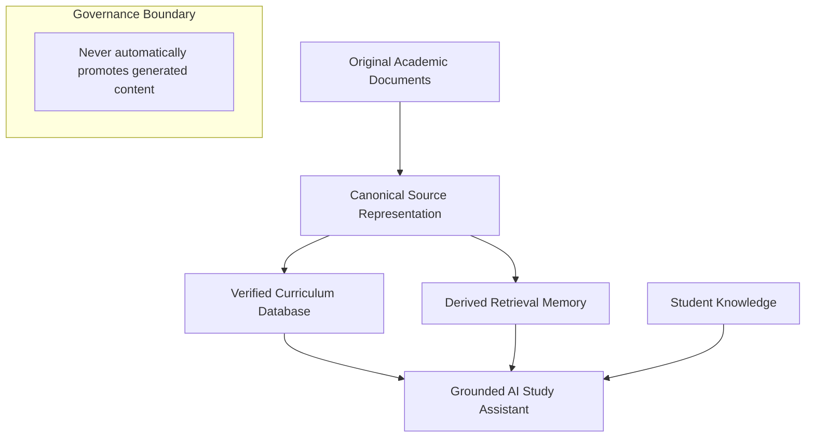
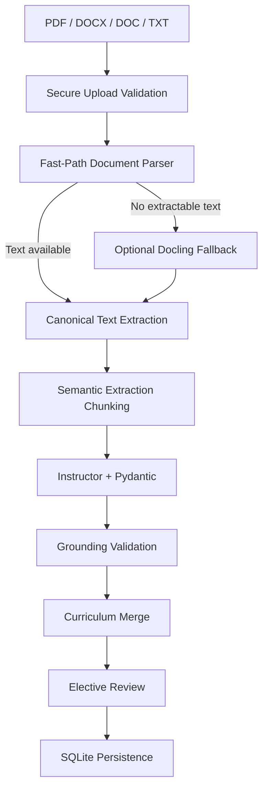
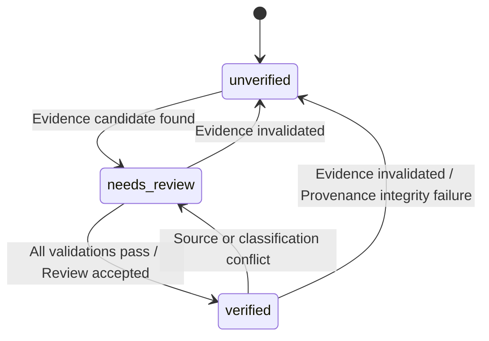
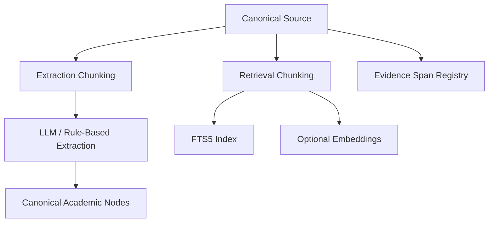
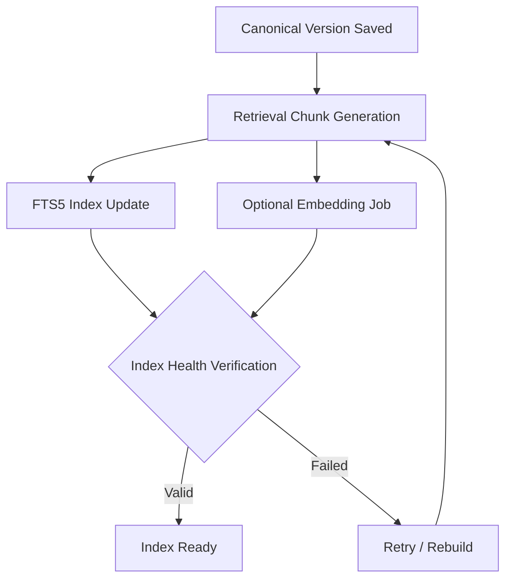
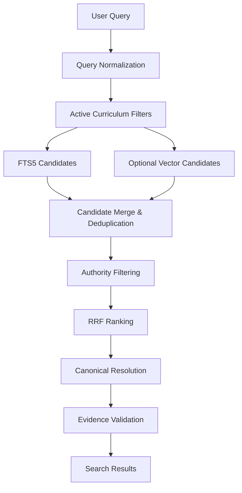
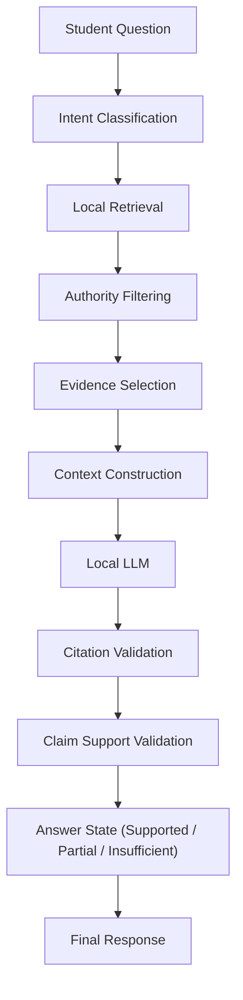
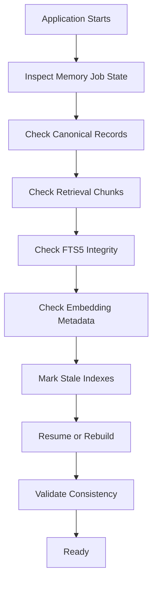
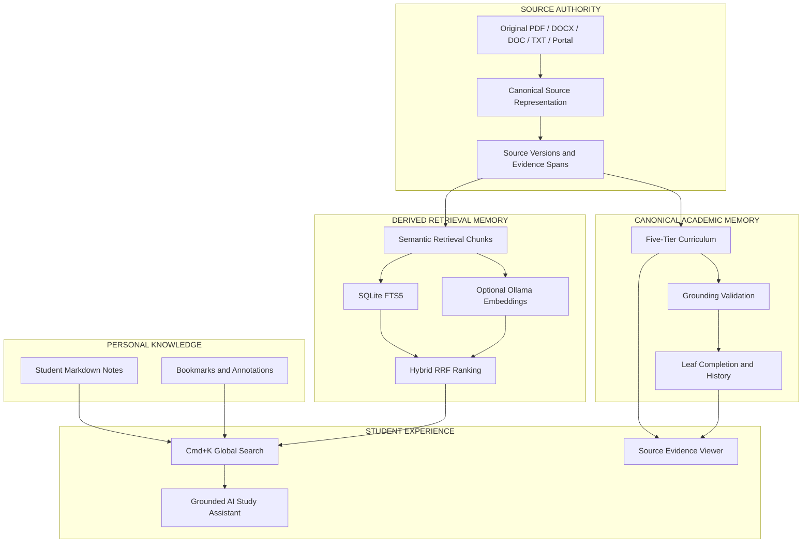

# 7_MEMORY_RAG.md
## Memory, Provenance and Retrieval Architecture Specification

- **Project:** Hierarchical Syllabus Checklist & Progress Tracker
- **Document:** `7_MEMORY_RAG.md`
- **Document Status:** Active architectural specification & Implementation Record
- **Architecture Style:** Local-first · SQLite · FTS5 · Instructor Structured Outputs · Local Ollama
- **Authority Model:** Source-grounded academic knowledge with reproducible provenance
- **Implementation Status:** Fully Implemented in Phase 13 Cycle B (FTS5 retrieval virtual table `syllabus_retrieval_fts`, `StudyFlashcard` SQLModel, `study_assistant.py` with zero-hallucination abstention and exact verbatim quote verification, deterministic fallback, SM-2 spaced repetition integration, `StudyAssistantDrawer.tsx`, `FlashcardDeckModal.tsx`, REST API endpoints).
- **Repository Validation Limitation:** The supplied repository URL could not be independently inspected through the available public search results. Consequently, existing table names, migration versions, source-code paths, dependency versions, and implemented features are explicitly treated as unverified. This specification preserves the supplied project constraints and defines repository inspection as a mandatory implementation prerequisite rather than inventing repository facts.

---

## 1. Document Metadata and Status
Attribute
Value
Document
7_MEMORY_RAG.md
Project
Hierarchical Syllabus Checklist & Progress Tracker
Repository
[Syllabus_Tracker_checklist](https://github.com/farhanahmad2106-cpu/Syllabus_Tracker_checklist?utm_source=chatgpt.com)
Branch inspected
main
Architecture category
Memory, Provenance and Retrieval
Primary database
SQLite (WAL)
Mandatory retrieval
SQLite FTS5
Optional semantic engine
Ollama embeddings
Default embedding candidate
nomic-embed-text
Extraction framework
Instructor + Pydantic
Canonical source authority
Original imported document and verified source representation
Implementation status
Proposed extension to existing architecture
Test status
Acceptance criteria defined; not executed for this specification
### 1.1 Repository evidence and compatibility baseline
The publicly accessible repository README and Master_Context.md were inspected.
The following existing architecture is documented:
Area
Repository-documented capability
Backend
FastAPI, Python 3.12
Persistence
SQLAlchemy 2.0 / SQLModel, SQLite WAL
Foreign keys
Enabled
Curriculum schemas
backend/app/schemas.py
Persistence models
backend/app/models.py
Database engine
backend/app/database.py
Document parsing
backend/app/parser.py
Structured extraction
backend/app/extractor.py
Grounding validation
backend/app/validation.py
Ingestion coordination
backend/app/services/ingestion.py
Chunking
backend/app/services/chunking.py
Job management
backend/app/services/job_manager.py
REST API
backend/app/main.py
Frontend
React 19, TypeScript, Vite, Tailwind CSS v4
Source evidence UI
SourceEvidence.tsx
Academic hierarchy UI
SyllabusTree.tsx
Existing extraction providers
Local Ollama and optional OpenAI-compatible provider
Repository references:
[README.md](https://github.com/farhanahmad2106-cpu/Syllabus_Tracker_checklist/blob/main/README.md?utm_source=chatgpt.com)
[Master_Context.md](https://github.com/farhanahmad2106-cpu/Syllabus_Tracker_checklist/blob/main/Master_Context.md?utm_source=chatgpt.com)
[pyproject.toml](https://github.com/farhanahmad2106-cpu/Syllabus_Tracker_checklist/blob/main/pyproject.toml?utm_source=chatgpt.com)
The backend source directory could not be independently opened through the available repository browser. The above implementation inventory is based on published repository documentation, not a source-code audit.
### 1.2 Existing architecture versus proposed additions
Capability
Classification
Five-tier curriculum extraction
Documented existing
SQLite WAL persistence
Documented existing
Leaf-only completion persistence
Documented existing
Grounding status and source evidence
Documented existing
SHA-256-based version identity
Requires source verification
Extraction semantic chunking
Documented existing
Resumable SSE ingestion jobs
Documented existing
SQLite FTS5 knowledge retrieval
Proposed
Persistent retrieval chunks
Proposed
Global Cmd+K search
Proposed
Student-note indexing
Proposed integration
Bookmark indexing
Proposed integration
Local vector retrieval
Proposed optional extension
Hybrid RRF ranking
Proposed
Grounded AI Study Assistant
Future extension
Important compatibility decision: Existing extraction chunking must be extended rather than replaced. Retrieval indexing is a separate pipeline with separate persistence and lifecycle rules.
### 1.3 Repository-specific discrepancies requiring reconciliation
The public README and project context describe different operational limits:
Configuration
README
Master Context
Upload size
50 MiB
50 MiB
Maximum PDF pages
1,000
300
Extracted text
1,500,000 characters
1,500,000 characters
Processing timeout
180 seconds
300 seconds
The latest documented Phase 7 configuration specifies 300 PDF pages and a 300-second parser timeout.
The implementation must inspect the actual configuration and tests before changing these values. This specification does not silently replace them.
There is also a taxonomy naming discrepancy:
The product-level hierarchy uses Academic Year → Semester → Subject → Module → Subtopic.
Master_Context.md describes Degree/Program → Academic Year → Semester → Topic/Course → Subtopic.
The retrieval architecture must reference existing canonical entity IDs and types. It must not introduce duplicate academic levels to resolve this naming difference.
## 2. Executive Summary
### 2.1 Purpose
This specification defines a persistent, explainable, local-first academic knowledge architecture.
Its purpose is to extend the existing syllabus tracker from a structured curriculum checklist into a searchable academic memory system without compromising the integrity of existing academic records.
The system must provide:
Reproducible source evidence.
Stable source-document and version identity.
Semantic extraction chunking.
Independent retrieval chunking.
Deterministic keyword search.
Optional local semantic search.
Academic hierarchy-aware retrieval.
Personal knowledge integration.
Evidence-grounded AI study assistance.
Safe recovery and historical preservation.
### 2.2 Architectural separation
The architecture has four logically separate data domains.

Domain
Responsibility
Source memory
Preserve imported documents and their canonical text
Curriculum memory
Preserve verified academic hierarchy and progress relationships
Retrieval memory
Provide searchable, rebuildable indexes
Personal memory
Preserve notes, bookmarks and student annotations
These domains may share identifiers and relationships but must not share authority.
### 2.3 Primary architectural invariant
The canonical academic database is authoritative. Retrieval infrastructure is disposable.
Deleting every retrieval chunk, FTS5 index and embedding must not delete:
Curriculum nodes.
Source evidence.
Student completion records.
Elective decisions.
Notes.
Bookmarks.
Historical curriculum versions.
## 3. Scope and Non-Goals
### 3.1 In scope
Source-document identity.
Source-version management.
Canonical text representation.
Provenance and offset validation.
Academic grounding status.
Extraction and retrieval chunk separation.
FTS5 indexing.
Optional local embeddings.
Hybrid retrieval.
Personal knowledge retrieval.
Evidence validation.
Processing lifecycle.
Index consistency.
Local privacy and security.
Future grounded AI assistant integration.
### 3.2 Non-goals
This architecture does not:
Replace the existing curriculum extraction engine.
Replace the existing academic database.
Replace the existing elective onboarding workflow.
Change the leaf-only completion model.
Automatically generate new official syllabus topics.
Require ChromaDB or another external vector database.
Require cloud embedding services.
Introduce a mandatory chatbot.
Automatically crawl bookmarked resources.
Convert generated answers into official academic records.
Require a cloud-hosted database.
Change existing UI design or progress calculations.
## 4. Existing Architecture and Compatibility
### 4.1 Existing ingestion pipeline
The documented ingestion flow is:

The memory architecture integrates after canonical source extraction and alongside existing curriculum persistence.
It must not cause a second full-document extraction merely to create searchable chunks.
### 4.2 Integration boundaries
Existing component
Memory integration
parser.py
Exposes canonical extracted text and source boundaries
schemas.py
Preserves evidence and academic classification
models.py
Existing curriculum entities remain authoritative
database.py
Supplies SQLite connections and transaction configuration
validation.py
Supplies grounding validation
chunking.py
Supplies extraction chunks; does not own retrieval chunks
ingestion.py
Coordinates retrieval-index lifecycle
job_manager.py
Exposes progress and cancellation for indexing jobs
main.py
Hosts future search and indexing endpoints
SourceEvidence.tsx
Displays evidence and source navigation
SyllabusTree.tsx
Displays canonical academic hierarchy
### 4.3 Compatibility requirements
Reuse existing database configuration.
Preserve existing SQLAlchemy conventions.
Reuse existing canonical curriculum IDs.
Preserve existing grounding_status / evidence_status compatibility.
Preserve the current source-evidence display contract.
Do not introduce another database connection manager.
Do not add blocking embedding calls to FastAPI request handlers.
Maintain the existing asynchronous job architecture.
Do not modify completion calculations.
Do not execute tests automatically during architectural documentation work.
## 5. Architectural Principles
### 5.1 Source authority
Authority is determined by provenance and verification, not similarity score.
### 5.2 Immutable source versions
Imported versions must remain identifiable even when newer documents are uploaded.
### 5.3 Independent academic and retrieval structures
The academic hierarchy and retrieval chunk hierarchy are separate.
### 5.4 Deterministic indexing
Identical canonical inputs processed using the same indexing configuration must produce equivalent retrieval content and metadata.
### 5.5 Optional intelligence
The application must remain fully usable for keyword search without Ollama or an embedding model.
### 5.6 Local-first operation
No external network service is necessary for local document search.
### 5.7 Auditable uncertainty
Uncertain extraction must remain visibly uncertain.
### 5.8 Rebuildability
All derived indexes must be reproducible from canonical data.
## 6. Zero-Hallucination Grounding Philosophy
### 6.1 Generative RAG versus strict academic retrieval
Conventional generative RAG typically retrieves semantically similar documents and asks an LLM to produce an answer.
This project requires stronger guarantees.
Semantic similarity only indicates possible relevance. It does not prove:
The source is official.
The source is current.
The academic classification is correct.
The extracted hierarchy is correct.
The cited excerpt supports the generated claim.
Consequently, retrieval and verification must remain separate operations.
### 6.2 Knowledge classification
Knowledge type
Authority
Permitted use
Verified syllabus evidence
Authoritative within its source version
Official curriculum answers
Needs-review extraction
Provisional
Review and candidate search
Unverified extraction
Non-authoritative
Review only
Student notes
Student-authored
Personal study context
Bookmarks
External supplemental material
Supplemental learning
Generated AI content
Derived
Explanations with validated evidence
### 6.3 Grounding status semantics
The canonical status vocabulary is:
verified
needs_review
unverified
Definitions:
verified
All required checks for the relevant evidence and academic classification have passed.
Minimum requirements:
Source document exists.
Source version exists.
Evidence span is valid.
Reconstructed text matches stored evidence.
Academic classification has been validated.
Parent-child relationships are valid.
Provenance is internally consistent.
needs_review
Evidence exists, but at least one classification or structural decision remains uncertain.
Examples:
Ambiguous topic/module classification.
Conflicting headings.
Multiple possible parent subjects.
Incomplete numbering.
Suspected table extraction error.
unverified
Evidence is missing, invalid, unreproducible or insufficient to support the extracted claim.
### 6.4 Independent validation dimensions
Do not collapse the following dimensions into one arbitrary confidence score.
Dimension
Validation
Evidence validity
Can the original excerpt be reconstructed?
Classification validity
Is the academic entity type justified?
Hierarchy validity
Are parent-child relationships valid?
Provenance integrity
Does the evidence point to the correct version and location?
A record can have valid evidence but an invalid academic classification.
Such a record cannot be marked verified.
### 6.5 Status transitions

All status changes must be auditable.
A manual review decision should record reviewer action, timestamp and reason.
### 6.6 Academic conflict resolution
When two syllabus versions disagree:
Preserve both source versions.
Preserve both sets of extracted records.
Preserve existing student progress.
Mark the active version through explicit user selection.
Display the document's issue date and import date separately.
Never assume that the newest upload is authoritative.
Three distinct concepts must remain separate:
Concept
Meaning
Official authority
Institutionally recognized source
Recency
Document publication or effective date
Active curriculum
User-selected curriculum for current study
A document may be newer without being officially authoritative.
### 6.7 Evidence filtering rules
Content
Default retrieval
Verified active syllabus
Include
Needs-review active syllabus
Include only as provisional
Unverified syllabus
Exclude from authoritative results
Verified historical syllabus
Include only when appropriate
Student notes
Include in separate personal category
Bookmarks
Include in supplemental category
Generated content
Never present as original evidence
## 7. Canonical Source Representation
### 7.1 Source representation requirements
Every imported document version must have one authoritative canonical text representation.
All evidence offsets must refer to this representation.
The canonical representation must not be regenerated independently by:
FTS5.
Embedding generation.
UI rendering.
Citation generation.
LLM prompt construction.
### 7.2 Text encoding
Use Unicode UTF-8 as the canonical serialization encoding.
Character offsets must count Unicode code points in the canonical Python string, not UTF-8 bytes.
This distinction matters for:
Hindi text.
Bengali text.
Mathematical symbols.
Accented characters.
Emoji.
Other multilingual content.
Store the canonical text and its SHA-256 hash.
The hash must be calculated from the precisely specified canonical serialization, not from an implementation-dependent object representation.
### 7.3 Normalization policy
Apply deterministic transformations in a documented order.
Transformation
Policy
Encoding
UTF-8
Unicode
NFC
Line endings
LF
Null bytes
Reject or preserve in a separately audited binary extraction representation
Meaningful punctuation
Preserve
Academic numbering
Preserve
Internal whitespace
Preserve in canonical evidence
Search whitespace
Normalize separately
Headers and footers
Mark as classified extraction regions
Page boundaries
Preserve explicit metadata
Tables
Preserve row/cell ordering and locations
NFKC must not be applied destructively to canonical evidence because compatibility normalization can change meaningful mathematical or typographic distinctions.
### 7.4 Canonical and normalized representations
Maintain two distinct representations:
canonical_text: authoritative extracted text.
search_text: deterministic search-oriented derivative.
Search normalization may:
Case-fold.
Collapse repeated whitespace.
Normalize selected punctuation for matching.
Remove search-only formatting artifacts.
However, it must never overwrite canonical text.
If search text uses transformed positions, a mapping must be maintained to canonical offsets.
### 7.5 Page boundaries
Represent page boundaries as metadata rather than relying on printed page numbers.
For PDF documents:
Physical page indexing begins at 1.
Printed page numbering is separate.
Each page has canonical start and end positions.
Pages with no extractable text remain represented as empty or extraction-failed page records.
Evidence spanning pages references all affected page segments.
### 7.6 Extraction ordering
Recommended reading order:
Page order.
Top-to-bottom structural order.
Left-to-right column order.
Table row order.
Cell order.
For multi-column documents, the parser must preserve the detected layout order when available.
A reading-order ambiguity must be recorded rather than silently treated as verified.
### 7.7 Tables
Represent tables with stable logical boundaries.
A table extraction should preserve:
Table identifier.
Page.
Row index.
Column index.
Cell content.
Header association.
Original cell location.
Do not flatten unrelated cells into one string if doing so destroys their meaning.
### 7.8 Source serialization
The canonical representation should include a deterministic serialization format for:
Text blocks.
Page boundaries.
Table blocks.
Section boundaries.
Extraction metadata.
The exact serialization format must be versioned.
Changing serialization rules requires a new canonicalization version.
## 8. Source Provenance and Offset Architecture
### 8.1 Provenance model
Every academic evidence reference must identify:
Source document.
Source version.
Canonical representation.
Start offset.
End offset.
Physical page.
Source location.
Verbatim excerpt.
Grounding status.
### 8.2 Offset semantics
All source ranges use half-open intervals:
\[ [start,end) \]
Therefore:
\[ evidence = canonical\_text[start:end] \]
The following must always hold:
\[ 0 \leq start < end \leq len(canonical\_text) \]
The stored source_text must equal the reconstructed excerpt.
### 8.3 Provenance field definitions
Field
Definition
source_document_id
Stable logical source identity
source_version_id
Specific imported version
content_hash
SHA-256 of canonical serialized content
source_text
Exact extracted evidence
source_page
1-based physical PDF page
source_url
Original submitted URL
resolved_url
Final URL after permitted redirects
source_location
Heading, table, section or DOM location
source_start_offset
Inclusive canonical offset
source_end_offset
Exclusive canonical offset
grounding_status
Verification state
canonicalization_version
Canonical serialization version
### 8.4 Multiple evidence spans
A single academic topic may require several excerpts.
For example:
One excerpt establishes the module title.
Another establishes the topic.
A third establishes contact hours.
Do not force all evidence into a single continuous range.
Use a one-to-many relationship between academic entities and evidence spans.
### 8.5 PDF provenance
A source span can cross page boundaries.
In this situation:
Preserve the full canonical range.
Store the page intersections.
Retain the primary page for convenient UI navigation.
Display all affected pages when necessary.
Do not calculate printed page numbers from physical indexes.
### 8.6 Web provenance
For supported university portals:
Preserve the originally submitted URL.
Validate the destination against the existing SSRF-hardened policy.
Record permitted redirects.
Record retrieval time in UTC.
Store a reproducible content snapshot.
Preserve relevant section or DOM locations.
Hash the snapshot.
Associate evidence with the snapshot version.
Do not depend on live webpages remaining unchanged.
### 8.7 Extraction noise
Classify extraction candidates into:
Original source content.
Structural content.
Presentation metadata.
Rejected candidates.
Common noise:
Repeated institutional headers.
Footer page numbers.
[Page 2] markers.
Program titles.
Document cover information.
Broken table boundaries.
Duplicate headings.
Generic fallback labels.
Rejected candidates must remain auditable.
A rejected heading must not be permanently deleted from the source representation.
### 8.8 Provenance validation pseudocode
```python
def validate_evidence(source, evidence):
    if evidence.source_version_id != source.version_id:
        return "unverified"
    start = evidence.start_offset
    end = evidence.end_offset
    if start < 0 or end <= start:
        return "unverified"
    if end > len(source.canonical_text):
        return "unverified"
    reconstructed = source.canonical_text[start:end]
    if reconstructed != evidence.source_text:
        return "unverified"
    if not validate_page_mapping(source, evidence):
        return "needs_review"
    if not validate_academic_classification(evidence):
        return "needs_review"
    return "verified"
```
## 9. Semantic Chunking Architecture
### 9.1 Three independent chunk types

Layer A — Extraction chunks
Temporary processing units for extracting structured academic content.
The existing chunking.py implementation remains responsible for this stage.
Layer B — Retrieval chunks
Persistent or rebuildable text units optimized for search.
These chunks can contain multiple academic topics.
Layer C — Evidence spans
Exact source ranges associated with curriculum entities and search results.
A retrieval chunk is not an academic entity.
### 9.2 Existing extraction chunking compatibility
The project documents semantic extraction chunking based on:
Academic year boundaries.
Semester boundaries.
Course headings.
Paragraph boundaries.
Page provenance.
Sequential extraction.
Cancellation checks.
Deterministic curriculum merging.
This is retained.
The proposed retrieval chunker consumes canonical source segments independently.
It must not re-run LLM extraction simply to create search chunks.
### 9.3 Boundary priority
Use the following order:
Document section.
Academic year.
Semester.
Subject/course.
Module/unit.
Subtopic.
Paragraph.
Sentence.
Character fallback.
A boundary is a preference, not permission to invent an academic classification.
### 9.4 Initial retrieval chunk configuration
These are configurable engineering starting points, not measured benchmarks.
Parameter
Initial target
Target chunk size
400–700 tokens
Maximum chunk size
900 tokens
Overlap
60–100 tokens
Minimum useful chunk
80 tokens
Maximum retrieved chunks
8–12
Extraction chunking
Existing configuration
Retrieval batch size
16–32 chunks
Token counts should be calculated using a deterministic local tokenizer or a documented approximation.
Do not treat character count as universally equivalent to token count.
### 9.5 Chunk metadata
Each retrieval chunk requires:
Field
Purpose
chunk_id
Stable chunk identity
source_document_id
Source identity
source_version_id
Source version
chunk_index
Ordering within version
chunk_type
Section, paragraph, topic-context, note, bookmark
parent_section_id
Optional source section
academic_year_id
Optional academic reference
semester_id
Optional academic reference
subject_id
Optional academic reference
module_id
Optional academic reference
source_start_offset
Canonical start
source_end_offset
Canonical end
source_page_start
First physical page
source_page_end
Last physical page
token_count
Estimated or measured tokens
content_hash
Chunk content identity
overlap_metadata
Overlap description
created_at
Creation timestamp
All academic references are nullable.
Never fabricate parent IDs.
### 9.6 Chunk identity
Use deterministic identity derived from:
Source version.
Canonical start and end offsets.
Chunking algorithm version.
Chunk content hash.
A possible logical identity is:
SHA256( source_version_id + start_offset + end_offset + chunker_version + content_hash )
Use unambiguous serialization or length-prefix encoding when constructing hash inputs.
### 9.7 Overlap policy
Overlap must:
Preserve sentence boundaries where possible.
Avoid cutting headings away from their content.
Preserve source offsets.
Identify repeated regions.
Avoid creating duplicate curriculum entities.
Deduplicate repeated evidence during retrieval.
Overlapping chunks are independent search units, not independent source evidence.
### 9.8 Large-document handling
The system must support the documented 1.5-million-character extraction workload through bounded processing.
Recommended pipeline:
Read canonical source in bounded sections.
Identify structural boundaries.
Generate one retrieval chunk at a time.
Persist chunk metadata in batches.
Update FTS5 transactionally.
Generate optional embeddings separately.
Record completed checkpoints.
Resume from the last consistent checkpoint.
Do not load an entire large document into an LLM context.
### 9.9 Failure recovery
Each chunking operation must be idempotent.
The job manager must distinguish:
Pending.
Processing.
Persisted.
Indexed.
Failed.
Cancelled.
A crash must not leave the document falsely marked as fully indexed.
## 10. Context Window and Token Budget Management
### 10.1 Model configuration
The supplied architecture identifies an extraction context configuration of:
num_ctx = 16384
This is a model configuration, not a guaranteed document-text allowance.
### 10.2 Budget calculation
Define:
\[ B_{document} = B_{context} - B_{system} - B_{schema} - B_{hierarchy} - B_{output} - B_{safety} \]
An initial configurable allocation:
Budget
Example tokens
System instructions
1,000
Extraction schema
1,500
Existing hierarchy
2,000
Output reservation
3,000
Safety margin
1,500
Available source text
7,384
Total
16,384
These are planning allocations only. Actual prompt tokenization must be measured before inference.
### 10.3 Context assembly rules
Include only relevant parent context.
Avoid repeating complete document sections.
Preserve headings.
Preserve numbering.
Include relevant preceding context when required.
Never split a citation span without retaining its provenance.
Use bounded output schemas.
Retry only within a defined budget.
### 10.4 Retrieval context budget
The future Study Assistant must have a separate retrieval budget.
Do not reuse the extraction budget blindly.
Prioritize:
Verified active syllabus evidence.
Relevant academic hierarchy.
Additional verified excerpts.
Student notes.
Supplemental bookmarks.
Historical evidence when requested.
## 11. Content-Addressable Memory and Deduplication
### 11.1 Six identity levels
Identity
Meaning
Physical file identity
Imported file bytes
Canonical content identity
Normalized extracted representation
Source document identity
Logical source across versions
Source version identity
One immutable version
Retrieval chunk identity
One derived searchable unit
Curriculum entity identity
One canonical academic record
These identities must not be interchangeable.
### 11.2 Hash strategy
Use SHA-256.
Maintain separate hashes for:
Original file bytes.
Canonical serialized text.
Individual chunks.
Notes.
Bookmark metadata where appropriate.
Example:
```python
import hashlib

def sha256_bytes(data: bytes) -> str:
    return hashlib.sha256(data).hexdigest()

def sha256_text(text: str) -> str:
    return hashlib.sha256(text.encode("utf-8")).hexdigest()
```
The canonicalization version must accompany the canonical hash.
### 11.3 Duplicate scenarios
Scenario
Required behavior
Exact re-upload
Reuse matching content/version
Renamed duplicate
Detect through content identity
Different filenames, same content
Deduplicate canonical version
Modified PDF, same extracted text
Same canonical content, distinct physical file
Same text, changed page layout
Preserve separate layout provenance when page mapping differs
Changed academic content
Create new source version
Minor whitespace change
Preserve physical identity difference; compare canonical identity
Duplicate portal snapshot
Deduplicate only when canonical snapshot identity matches
### 11.4 Safe curriculum reconciliation
Never match topics using title equality alone.
Candidate matching may consider:
Existing source lineage.
Parent hierarchy.
Course code.
Module position.
Source evidence.
Academic year.
Structural similarity.
Explicit user confirmation.
Ambiguous matches must create review candidates, not automatic merges.
### 11.5 Historical preservation
A source update must not delete:
Completed leaf IDs.
Notes.
Bookmarks.
Deadlines.
Elective decisions.
Historical completion history.
Use explicit reconciliation between old and new academic entities.
If a new topic matches an old topic with sufficient evidence, offer or record a controlled mapping.
If no reliable mapping exists, preserve both.
### 11.6 Index lifecycle

Index deletion must never cascade into canonical academic records.
## 12. Historical Curriculum Preservation
### 12.1 Version authority
Each syllabus version must remain separately addressable.
An active curriculum is a user-selected view, not a destructive replacement.
### 12.2 Version relationships
Recommended logical relationships:
```text
Source Document
├── Version 1
│   ├── Curriculum snapshot
│   ├── Completion history
│   └── Evidence
├── Version 2
│   ├── Curriculum snapshot
│   └── Evidence
└── Active version selection
```
### 12.3 Progress reconciliation
When curriculum versions change:
Preserve previous completion records.
Compare old and new academic entities.
Identify candidate matches.
Validate hierarchy compatibility.
Preserve ambiguous mappings for review.
Never transfer completion automatically to an unrelated topic.
Preserve elective enrollment history.
### 12.4 Historical search
Historical search must be explicit.
Default active-curriculum search must not mix obsolete records into official current study results.
Historical results must display their version and status.
## 13. SQLite Memory and Retrieval Schema
### 13.1 Schema integration strategy
The following names describe logical responsibilities, not instructions to duplicate existing models.
Before implementation:
Inspect backend/app/models.py.
Inspect existing database migrations or schema creation logic.
Inspect backend/app/database.py.
Identify existing source document and source version fields.
Reuse canonical curriculum tables.
Add only genuinely missing persistence responsibilities.
### 13.2 Proposed logical entities
Logical entity
Responsibility
source_documents
Logical document identity
source_versions
Immutable document versions
source_text_segments
Canonical source representation and boundaries
retrieval_chunks
Derived searchable text
retrieval_chunk_sources
Chunk-to-source evidence relationships
search_index_metadata
FTS5 synchronization
embedding_metadata
Embedding model and vector metadata
student_notes
Existing or future user notes
bookmarks
Existing or future resource bookmarks
memory_processing_jobs
Persistent processing lifecycle
### 13.3 Proposed source-document fields
Field
Type
Constraint
id
TEXT
Primary key
logical_key
TEXT
Unique logical identity
display_name
TEXT
Required
created_at
TEXT
UTC timestamp
### 13.4 Proposed source-version fields
Field
Type
Constraint
id
TEXT
Primary key
source_document_id
TEXT
Foreign key
original_filename
TEXT
Optional
file_sha256
TEXT
Indexed
content_hash
TEXT
Indexed
canonicalization_version
TEXT
Required
canonical_text
TEXT or external managed source
Required logical content
source_url
TEXT
Nullable
resolved_url
TEXT
Nullable
retrieved_at
TEXT
Nullable
is_active
INTEGER
Explicit selection
created_at
TEXT
UTC timestamp
Large canonical text may be stored using an existing document-storage abstraction if one exists. Do not introduce an external database solely to store text.
### 13.5 Proposed retrieval-chunk fields
Field
Type
id
TEXT PRIMARY KEY
source_document_id
TEXT
source_version_id
TEXT
chunk_index
INTEGER
chunk_type
TEXT
content
TEXT
content_hash
TEXT
source_start_offset
INTEGER
source_end_offset
INTEGER
source_page_start
INTEGER
source_page_end
INTEGER
token_count
INTEGER
chunker_version
TEXT
index_status
TEXT
created_at
TEXT
Use foreign keys to the existing canonical source records.
### 13.6 Evidence relationship
A chunk can reference multiple evidence spans.
An academic topic can also reference multiple evidence spans.
Use a junction relationship rather than duplicating source evidence inside each chunk.
### 13.7 FTS5 virtual table
Conceptual structure:
```sql
CREATE VIRTUAL TABLE IF NOT EXISTS memory_fts USING fts5(
    entity_id UNINDEXED,
    entity_type UNINDEXED,
    source_version_id UNINDEXED,
    title,
    content,
    tokenize = 'unicode61 remove_diacritics 0'
);
```
The exact schema must be aligned with actual FTS5 capabilities and the project's installed SQLite build.
Do not assume FTS5 is available without checking the runtime SQLite library.
### 13.8 Recommended indexes
For ordinary relational tables, evaluate:
```sql
CREATE INDEX IF NOT EXISTS idx_retrieval_source_version ON retrieval_chunks(source_version_id);
CREATE INDEX IF NOT EXISTS idx_retrieval_content_hash ON retrieval_chunks(content_hash);
CREATE INDEX IF NOT EXISTS idx_retrieval_index_status ON retrieval_chunks(index_status);
```
Additional hierarchy indexes must use actual existing foreign-key columns.
### 13.9 Foreign-key behavior
Enable foreign keys on every relevant connection.
Use restrictive deletion for canonical source versions referenced by academic records.
Allow controlled cascading deletion for disposable derived records.
Never cascade-delete student progress because an index is rebuilt.
Verify foreign-key integrity during migration and recovery.
### 13.10 Transaction boundaries
Separate transactions by responsibility:
Transaction A — Canonical persistence
Save source identity.
Save source version.
Save canonical academic entities.
Save evidence relationships.
Transaction B — Retrieval indexing
Save retrieval chunks.
Update FTS5.
Update indexing metadata.
Transaction C — Optional embeddings
Store embedding metadata.
Persist vectors in the configured local vector implementation.
A failure in B or C must not roll back already valid academic records.
However, indexing state must clearly show that the document is not fully searchable.
### 13.11 Migration safety
All migrations must:
Be versioned.
Be reversible where practical.
Preserve existing data.
Avoid table duplication.
Validate foreign keys.
Avoid dropping canonical fields.
Support backup and recovery.
Be tested against a copy of an existing database.
## 14. FTS5 Keyword Retrieval
### 14.1 Primary retrieval engine
SQLite FTS5 is mandatory.
It provides:
Offline keyword retrieval.
Phrase search.
Prefix search.
BM25 ranking.
Local persistence.
No external search infrastructure.
### 14.2 Indexed content
Index:
Curriculum topic titles.
Existing topic descriptions.
Relevant verbatim source excerpts.
Module titles.
Subject titles.
Student note titles and bodies.
Bookmark titles and descriptions.
Avoid indexing the same entire document in multiple redundant representations.
### 14.3 Tokenization
Use a tokenizer configuration compatible with multilingual content.
Test:
English.
Hindi.
Bengali.
Mathematical symbols.
Course codes.
Hyphenated terminology.
Academic numbering.
FTS5 tokenization is not equivalent to full multilingual semantic understanding.
### 14.4 Query processing
Search input must be treated as data, not SQL syntax.
The implementation must:
Use parameterized SQL.
Bound query length.
Limit result count.
Handle malformed FTS expressions.
Escape or safely construct advanced search expressions.
Provide a clear no-result state.
### 14.5 Ranking
Use FTS5 BM25 as the keyword relevance baseline.
Boosting should be applied as a documented ranking layer, not by modifying original evidence.
Example ranking priorities:
Exact title match.
Exact phrase match.
Partial title match.
Source excerpt match.
Description match.
Note match.
Bookmark match.
### 14.6 Synchronization
Canonical database changes must produce corresponding index updates.
Recommended sequence:
Canonical record committed ↓ Index task queued ↓ FTS5 row inserted or replaced ↓ Index metadata updated ↓ Consistency verified
Indexing jobs must be idempotent.
### 14.7 Search result resolution
Every FTS5 result must resolve to a canonical record.
If the canonical record no longer exists:
Do not return it as a valid result.
Mark the corresponding index entry stale.
Queue cleanup.
Record the inconsistency.
## 15. Optional Local Semantic Retrieval
### 15.1 Optional runtime
Preferred candidate:
nomic-embed-text
Embedding support is optional.
The application must never require a model download for ordinary search.
### 15.2 Provider contract
Define a local embedding abstraction:
```python
class EmbeddingProvider:
    def embed_documents(self, texts):
        raise NotImplementedError
    def embed_query(self, text):
        raise NotImplementedError
    def model_identity(self):
        raise NotImplementedError
    def dimensions(self):
        raise NotImplementedError
```
This is an interface specification, not an instruction to introduce a new framework.
### 15.3 Metadata requirements
Track:
Provider.
Model name.
Model version.
Embedding dimension.
Normalization configuration.
Chunker version.
Embedding timestamp.
Vector index version.
Never combine embeddings from incompatible models.
### 15.4 Vector storage
Preferred order:
Reuse an already installed lightweight local vector implementation if one exists and is compatible.
Evaluate SQLite-compatible vector storage.
Use an application-owned local vector implementation only if performance and maintenance requirements justify it.
Do not mandate ChromaDB.
Do not introduce a second persistence authority.
### 15.5 Model migration
When the embedding model changes:
Preserve existing canonical chunks.
Mark incompatible embeddings stale.
Generate new embeddings in batches.
Validate dimensions.
Switch the active embedding index only after successful verification.
Remove obsolete embeddings after the new index is usable.
FTS5 must remain available throughout.
### 15.6 Hardware-aware processing
Embedding generation must:
Run in background workers.
Use configurable batch sizes.
Respect Ollama availability.
Support cancellation.
Avoid competing aggressively with extraction.
Recover from partial failure.
Never block search requests.
## 16. Hybrid Ranking and Result Fusion
### 16.1 Retrieval pipeline

### 16.2 Reciprocal Rank Fusion
Do not combine raw BM25 and cosine similarity directly.
Use rank-based fusion:
\[ RRF(d)= \sum_{r \in R} \frac{1}{k+rank_r(d)} \]
Where:
\(d\) is a candidate.
\(R\) is the set of retrieval result lists.
\(k\) is a configurable smoothing constant.
\(rank_r(d)\) is the candidate's position in a result list.
An initial value of \(k=60\) is acceptable as a configurable starting point.
### 16.3 Authority before ranking
Apply eligibility filters before ranking.
An unverified extraction must not outrank verified official evidence as an authoritative result simply because it has higher semantic similarity.
Use separate result categories rather than blending incompatible authority classes.
### 16.4 Ranking signals
Signal
Purpose
Exact phrase
High lexical relevance
Topic title
Strong academic relevance
Source excerpt
Direct evidence relevance
Semantic rank
Contextual relevance
Hierarchy proximity
Academic relationship
Active curriculum
Current study relevance
Grounding status
Evidence eligibility
Version
Source applicability
### 16.5 Deterministic tie-breaking
When fused scores are equal, use:
Higher authority.
Active curriculum.
Exact phrase match.
More specific academic entity.
Stable entity identifier.
### 16.6 Duplicate handling
Deduplicate using:
Canonical evidence identity.
Source version.
Evidence offsets.
Content hash.
Overlapping retrieval chunks must not produce repeated identical excerpts.
## 17. Notes and Bookmark Knowledge Integration
### 17.1 Student notes
Student notes are a separate knowledge domain.
The existing Markdown note implementation must remain authoritative for the note content.
Search indexing is a derived representation.
Required searchable metadata
Note ID.
Title.
Markdown body.
Associated topic ID.
Associated module ID.
Associated subject ID.
Updated timestamp.
Content hash.
Debounced save behavior
Recommended lifecycle:
User edits ↓ Debounce ↓ Persist note ↓ Commit transaction ↓ Queue index update ↓ Update FTS5
Never index uncommitted editor content as persisted knowledge.
When a save fails, the existing UI must communicate that the latest changes were not persisted.
### 17.2 Bookmarks
Support the existing or future bookmark types, including lecture and YouTube links.
Searchable metadata:
Resource ID.
Title.
URL.
Description.
Resource type.
Academic association.
User annotations.
Creation timestamp.
Bookmarks remain supplemental resources.
Do not automatically fetch arbitrary URLs during search.
### 17.3 Unified search
Example query:
Database Normalization
Possible results:
Result
Classification
Database Normalization
Official syllabus topic
Original excerpt
Official source evidence
Personal revision notes
Student knowledge
Lecture recording
External bookmark
Every result must clearly display its authority classification.
## 18. Grounded AI Study Assistant
### 18.1 Scope
This is a future extension.
It is not a requirement to implement a chatbot as part of the initial memory subsystem.
### 18.2 Answering architecture

### 18.3 Context separation
The LLM must receive separate labeled sections:
[OFFICIAL_VERIFIED_SYLLABUS] ... [PROVISIONAL_SYLLABUS] ... [STUDENT_AUTHORED_NOTES] ... [SUPPLEMENTAL_BOOKMARKS] ... [HISTORICAL_SYLLABUS] ...
Every section must identify its source and authority.
### 18.4 Evidence sufficiency
Three response states are mandatory.
SUPPORTED
All official curriculum claims have sufficient verified evidence.
PARTIALLY_SUPPORTED
Some claims are supported, while other details remain unavailable.
INSUFFICIENT_EVIDENCE
No reliable source evidence supports the requested official curriculum claim.
The assistant must abstain from inventing missing syllabus details.
### 18.5 General academic knowledge
A general explanation may be provided only when the user explicitly requests general academic knowledge or accepts that distinction.
It must be labeled separately:
GENERAL EXPLANATION — NOT VERIFIED AGAINST YOUR SYLLABUS
### 18.6 Prompt injection
All retrieved content is untrusted data.
This includes:
PDFs.
DOCX documents.
Web snapshots.
Student notes.
Bookmarks.
Embedded code.
Retrieved source instructions.
A document's instructions must never override the assistant's system policies.
Existing prompt-injection boundaries must be retained and extended.
### 18.7 Citation validation
The model must not invent citation references.
The application should provide an allowlist of evidence identifiers.
A citation is accepted only if:
The identifier exists.
The source version exists.
The source range is valid.
The excerpt reconstructs correctly.
The evidence status permits the claim.
The citation is relevant to the claim.
### 18.8 Unsupported-claim detection
For every official curriculum claim, validate that supporting evidence exists.
If a claim has no support:
Remove it.
Qualify it.
Or mark the response partially supported.
Do not use an LLM's self-reported confidence as proof.
### 18.9 Context truncation
When evidence exceeds the context budget:
Rank evidence.
Remove duplicate overlaps.
Prefer complete evidence spans.
Retrieve fewer chunks.
Preserve source identifiers.
Never silently discard citation metadata.
## 19. Citation and Evidence Validation
### 19.1 Citation format
Recommended inline citation:
[Document Name, Academic Year 2 > Semester 3 > Database Systems > Module 2, PDF p. 18]
Where available, include:
Document title.
Academic hierarchy.
Physical page.
Source version.
Relevant excerpt.
Source location.
Original URL.
### 19.2 Citation data contract
```json
{
  "citation_id": "citation_001",
  "source_document_id": "doc_001",
  "source_version_id": "version_002",
  "entity_id": "topic_123",
  "evidence_id": "evidence_456",
  "source_page": 18,
  "source_start_offset": 1820,
  "source_end_offset": 1940,
  "grounding_status": "verified"
}
```
The identifiers are illustrative, not existing repository identifiers.
### 19.3 Evidence validation algorithm
INPUT: Generated answer Allowed evidence registry FOR each factual claim: Extract associated citation IDs IF no citation exists: Mark claim unsupported CONTINUE FOR each citation: Resolve evidence ID Validate source version Validate canonical offsets Reconstruct source excerpt Compare excerpt hash Validate grounding status Determine whether the evidence supports the actual claim Reject unsupported citations OUTPUT: Validated answer Supported claims Unsupported claims Evidence references
Citation existence alone does not prove claim support.
### 19.4 Source navigation
The UI should provide:
Open academic node.
View original evidence.
Navigate to PDF page.
Display source excerpt.
Display source version.
Display grounding status.
For web snapshots, open the stored snapshot when available instead of assuming the live URL remains unchanged.
## 20. Privacy and Security
### 20.1 Local-first guarantees
The default architecture must operate without external services.
Operation
Default
Source extraction
Local
Canonical persistence
Local
FTS5 indexing
Local
Keyword search
Local
Embeddings
Local and optional
Note retrieval
Local
Bookmark retrieval
Local
AI study generation
Local when enabled
### 20.2 Cloud provider isolation
The existing cloud-compatible extraction capability must remain separately configured.
Cloud processing requires:
Explicit provider selection.
Explicit user consent.
Clear transmission disclosure.
Defined data scope.
No automatic fallback from local to cloud.
Independent source provenance.
A local model failure must never silently upload the syllabus.
### 20.3 Prompt injection protection
Treat imported content as untrusted.
Do not execute:
Commands found in documents.
Embedded scripts.
Retrieved shell instructions.
Bookmark instructions.
Model-generated tool calls without application authorization.
### 20.4 SSRF protection
Portal ingestion must continue using the existing SSRF-hardened architecture.
Validate:
URL scheme.
Hostname.
DNS resolution.
Private and reserved IP ranges.
Redirect destinations.
Redirect count.
Response size.
Request timeout.
Do not fetch bookmarked URLs automatically.
### 20.5 Database protection
Use application-owned data directories.
Avoid exposing local database files over HTTP.
Apply filesystem permissions.
Exclude sensitive database files from public exports.
Protect backups.
Validate import files.
Do not log full student notes unnecessarily.
### 20.6 Deletion and retention
Deleting an academic source must follow explicit user-controlled policies.
Derived indexes can be deleted independently.
Secure deletion cannot be guaranteed merely by issuing SQL DELETE under SQLite WAL because historical pages may remain in database files or WAL files.
When secure removal is required, document the relevant database checkpointing, backup retention and filesystem limitations.
## 21. Performance and Resource Management
### 21.1 Performance philosophy
The system must prioritize responsiveness and bounded resource usage.
Retrieval must not compete unnecessarily with active extraction.
### 21.2 Initial engineering targets
These values are design targets, not measured performance results.
Operation
Target
FTS5 search
p95 under 150 ms
Hybrid search
p95 under 500 ms
Search UI
Immediate loading feedback
Small document indexing
Background
Large document indexing
Incremental
Embedding generation
Background and cancellable
Ollama unavailable
Full keyword search
Index rebuild
No canonical data loss
### 21.3 Concurrency
Use bounded worker concurrency.
Do not launch unlimited:
Parsing tasks.
Embedding requests.
Index rebuilds.
Database writers.
SQLite permits concurrent readers but has a single-writer constraint.
Design indexing around this limitation.
### 21.4 Connection management
Reuse the existing database engine.
Maintain:
Foreign-key enforcement.
WAL mode.
Existing busy timeout.
Short transactions.
Explicit connection cleanup.
Consistent transaction isolation.
Avoid long-running read transactions that prevent WAL checkpoint progress.
### 21.5 Background work
Embedding generation must never run synchronously inside a search HTTP request.
Search should return keyword results immediately when available.
Optional semantic results may be added through a separate asynchronous retrieval strategy if necessary, but the default search response must remain useful without them.
### 21.6 Resource-aware degradation
When local resources are constrained:
Prioritize FTS5.
Reduce embedding batch size.
Pause background embedding jobs.
Preserve extraction checkpoints.
Avoid unnecessary model initialization.
Continue ordinary academic progress operations.
## 22. Processing Jobs and Failure Recovery
### 22.1 Job lifecycle
Recommended lifecycle:
queued ↓ extracting ↓ chunking ↓ indexing ↓ embedding ↓ completed
Terminal alternatives:
completed_with_warnings
failed
cancelled
### 22.2 Separate extraction and retrieval completion
A document may be academically usable before optional embeddings finish.
Maintain separate statuses:
Status
Meaning
Extraction completed
Canonical academic data saved
Keyword indexing completed
FTS5 synchronized
Semantic indexing completed
Embeddings available
Retrieval partially available
One or more indexes incomplete
Retrieval ready
All configured retrieval components healthy
Never report the entire memory system as complete when only curriculum extraction has finished.
### 22.3 Job persistence
The existing in-memory job manager is documented as supporting ingestion progress.
For long-term retrieval indexing, add persistent job state only if the current architecture does not already provide an appropriate durable mechanism.
A restart must not silently lose the ability to identify incomplete indexing.
### 22.4 Idempotency
Use deterministic job keys.
An indexing job should not duplicate chunks when retried.
Repeated processing of the same source version with the same chunker configuration should produce equivalent derived records.
### 22.5 Cancellation
Cancellation must:
Stop scheduling new chunks.
Allow active bounded operations to finish or abort safely.
Preserve canonical source data.
Preserve already committed valid chunks.
Mark incomplete work.
Allow retry.
### 22.6 Recovery procedure

Recovery must be non-destructive.
### 22.7 Failure matrix
Failure
Required response
Ollama unavailable
Continue FTS5
Missing embedding model
Disable semantic retrieval
Embedding timeout
Retry within limits
FTS5 corruption
Rebuild from canonical records
Interrupted chunking
Resume from checkpoint
Disk full
Stop indexing safely
Database locked
Bounded retry with backoff
Invalid provenance
Mark affected evidence unverified
Partial document indexing
Report incomplete coverage
Application crash
Recover unfinished jobs
## 23. Testing and Acceptance Criteria
### 23.1 Testing principles
Tests must validate actual behavior rather than merely successful function execution.
No test result is claimed by this specification.
### 23.2 Grounding and provenance tests
ID
Acceptance scenario
Expected behavior
Failure condition
GR-001
Verified leaf has provenance
All required evidence fields valid
Missing evidence
GR-002
Half-open offsets
Correct [start,end) reconstruction
Off-by-one error
GR-003
Canonical reconstruction
Exact source excerpt reproduced
Text mismatch
GR-004
Physical page mapping
PDF page begins at 1
Zero-based citation
GR-005
Multi-page evidence
All affected pages retained
Missing page
GR-006
Missing evidence
Cannot become verified
Silent promotion
GR-007
Invalid classification
Needs review or unverified
Incorrect verified status
GR-008
Source version mismatch
Validation rejected
Cross-version citation
### 23.3 Chunking tests
ID
Scenario
Expected behavior
Failure condition
CH-001
300-page handbook
Bounded incremental processing
Full-document LLM loading
CH-002
Academic boundaries
Preserve relevant structure
Broken hierarchy
CH-003
Retrieval chunks
Never create Tier-5 nodes
Artificial curriculum records
CH-004
Overlap
Deduplicate evidence
Repeated results
CH-005
Interruption
Resume safely
Lost checkpoint
CH-006
Context budget
Reserve output and schema tokens
Context overflow
CH-007
Multilingual text
Correct Unicode offsets
Offset corruption
CH-008
Tables
Preserve cell relationships
Incorrect reading order
### 23.4 Deduplication tests
ID
Scenario
Expected behavior
Failure condition
DD-001
Identical re-upload
No duplicate curriculum
Duplicate records
DD-002
Renamed duplicate
Same canonical identity
Filename-based duplication
DD-003
Updated syllabus
Preserve historical progress
Data loss
DD-004
Similar topic names
Preserve distinct entities
Incorrect merge
DD-005
Index rebuild
Preserve canonical records
Academic modification
DD-006
Changed page layout
Preserve provenance differences
Incorrect page mapping
DD-007
Minor whitespace change
Apply documented hash rules
Unexplained identity change
### 23.5 Retrieval tests
ID
Scenario
Expected behavior
Failure condition
RT-001
Exact phrase
Correct evidence returned
Missing match
RT-002
Topic title
Correct academic hierarchy
Wrong node
RT-003
Ollama unavailable
FTS5 functional
Search unavailable
RT-004
Missing embedding model
Keyword fallback
Startup failure
RT-005
Hybrid search
RRF fusion works
Raw score incompatibility
RT-006
Historical filter
Correct version returned
Version mixing
RT-007
Active filter
Active curriculum prioritized
Obsolete default results
RT-008
Unverified evidence
Never treated as authoritative
Authority violation
RT-009
Duplicate chunks
One consolidated evidence result
Repeated excerpts
RT-010
FTS5 corruption
Rebuild succeeds
Canonical data lost
### 23.6 Study Assistant tests
ID
Scenario
Expected behavior
Failure condition
AI-001
Official curriculum claim
Valid citation required
Unsupported claim
AI-002
Fabricated citation
Reject citation
Invalid source accepted
AI-003
Insufficient evidence
Abstain
Hallucinated answer
AI-004
Student notes
Clearly label personal content
Misrepresented as official
AI-005
Malicious PDF instruction
Treat as untrusted
Policy override
AI-006
Partial evidence
Partial-support response
False certainty
AI-007
Historical content
Version clearly identified
Current/historical confusion
### 23.7 Reliability and privacy tests
ID
Scenario
Expected behavior
Failure condition
RF-001
Interrupted indexing
Safe recovery
Corrupted state
RF-002
Failed embeddings
FTS5 unaffected
Keyword failure
RF-003
Foreign keys
Constraints enforced
Orphan records
RF-004
Offline environment
Local retrieval works
Network dependency
RF-005
Cloud processing
Explicit consent required
Silent transmission
RF-006
Index deletion
Academic progress preserved
Progress deletion
RF-007
Concurrent indexing
Bounded SQLite writes
Uncontrolled locking
RF-008
Cancellation
Canonical data preserved
Partial corruption
### 23.8 Migration testing
Test against copies of existing databases.
Required scenarios:
Existing syllabus database.
Empty database.
Database with completed leaves.
Database with elective history.
Database with missing optional fields.
Database after interrupted migration.
Database with inconsistent foreign-key records.
### 23.9 Performance testing
Measure:
FTS5 p50/p95/p99 latency.
Hybrid search latency.
Memory consumption.
Chunk generation throughput.
Embedding throughput.
Index rebuild duration.
SQLite write contention.
Recovery duration.
Do not present target values as measured results.
## 24. Implementation Roadmap
Implementation must follow dependency order.
Phase 1 — Provenance Foundation
Foundation
Objective: Establish a reproducible canonical source representation.
Dependencies:
Existing ingestion pipeline.
Existing source evidence fields.
Existing grounding validation.
Components:
Canonical text serialization.
Source-version identity.
SHA-256 identity.
Offset mapping.
Evidence validation.
Expected outputs:
Stable source-version references.
Canonical offsets.
Verifiable evidence reconstruction.
Documented canonicalization version.
Acceptance:
Every verified leaf has valid provenance.
Offset reconstruction is exact.
Page mapping is correct.
Risks:
Existing evidence offsets may use undocumented normalization.
Historical source data may require migration.
Definition of done:
All source evidence can be independently reconstructed without using LLM-generated text.
Phase 2 — Deterministic Chunking
Objective: Introduce independent retrieval chunk generation.
Dependencies:
- Phase 1.
Components:
Retrieval chunker.
Chunk identity.
Semantic boundaries.
Checkpointing.
Index job state.
Expected outputs:
Deterministic retrieval chunks.
Resumable indexing jobs.
Source mapping.
Acceptance:
Large documents processed incrementally.
No artificial curriculum nodes.
No duplicate evidence from overlap.
Risks:
Chunk boundaries may change across algorithm versions.
Memory consumption may increase.
Definition of done:
Retrieval chunks can be generated and rebuilt without modifying canonical academic records.
Phase 3 — SQLite FTS5 Retrieval
Objective: Implement reliable offline keyword search.
Dependencies:
- Phase 1 and Phase 2.
Components:
FTS5 schema.
Index synchronization.
Query normalization.
Search API.
Global search UI.
Expected outputs:
Searchable academic titles.
Searchable source excerpts.
Hierarchy-aware results.
Acceptance:
Search functions without Ollama.
Results resolve to canonical entities.
Stale indexes can be rebuilt.
Risks:
Tokenization differences.
Database write contention.
Definition of done:
Students can search their curriculum and open exact source evidence.
Phase 4 — Personal Knowledge Integration
Objective: Add notes and bookmarks to unified retrieval.
Dependencies:
- Phase 3.
Components:
Note index synchronization.
Bookmark indexing.
Unified result classification.
Academic association filters.
Expected outputs:
Personal knowledge search.
Supplemental resource search.
Acceptance:
Notes remain editable.
Unsaved content is not indexed as persisted.
Bookmarks remain distinct from official curriculum evidence.
Definition of done:
Curriculum, notes and bookmarks can be searched together without authority confusion.
Phase 5 — Optional Local Semantic Search
Objective: Add semantic retrieval without compromising keyword availability.
Dependencies:
- Phase 3.
Components:
Embedding provider interface.
Ollama integration.
Local vector storage.
Model metadata.
RRF ranking.
Expected outputs:
Optional semantic results.
Hybrid ranking.
Controlled model migration.
Acceptance:
Keyword retrieval remains available.
Missing models do not break search.
Model version mismatches are detected.
Definition of done:
Hybrid search works when configured and degrades gracefully when semantic infrastructure is unavailable.
Phase 6 — Grounded AI Study Assistant
Objective: Introduce evidence-grounded academic answers.
Dependencies:
- Phases 1–5.
Components:
Intent classification.
Retrieval orchestration.
Context assembly.
Citation validation.
Claim support checks.
Abstention handling.
Expected outputs:
Source-cited academic answers.
Evidence sufficiency labels.
Clear separation of personal and official knowledge.
Acceptance:
No fabricated citations.
Insufficient evidence produces abstention.
Retrieved prompt injections cannot override system policy.
Definition of done:
Every official curriculum claim can be traced to valid source evidence.
Phase 7 — Production Hardening
Objective: Validate the complete subsystem under realistic operating conditions.
Dependencies:
- Phases 1–6.
Components:
Migration validation.
Recovery.
Index health checks.
Performance monitoring.
Backup and restore.
Security testing.
Expected outputs:
Operational monitoring.
Recovery procedures.
Documented limitations.
Production acceptance evidence.
Acceptance:
All required tests pass.
Historical records remain intact.
Offline operation is verified.
Recovery is repeatable.
Definition of done:
The memory and retrieval subsystem is independently recoverable, auditable and maintainable.
## 25. Architecture Decision Records
The following decisions establish the architectural baseline.
ADR-001 — SQLite remains the canonical persistence layer
Decision: Retain SQLite WAL.
Reason: The project is local-first and already uses SQLite.
Consequences:
No mandatory external database.
Retrieval writes must respect SQLite's single-writer constraint.
Canonical records remain independent of search infrastructure.
ADR-002 — FTS5 is mandatory
Decision: Use SQLite FTS5 for primary retrieval.
Reason: Keyword search must remain functional without Ollama.
Consequences:
Every supported installation must validate FTS5 availability.
Search indexes are rebuildable.
Semantic search is supplemental.
ADR-003 — Semantic embeddings are optional
Decision: Support local Ollama embeddings through an abstraction.
Reason: Embeddings introduce resource requirements and model lifecycle complexity.
Consequences:
No mandatory model download.
No cloud embedding dependency.
FTS5 remains operational during embedding failures.
ADR-004 — Academic hierarchy is independent of retrieval chunks
Decision: Never create curriculum nodes from retrieval chunks.
Reason: Retrieval boundaries are search optimizations, not academic classifications.
Consequences:
Canonical curriculum IDs remain unchanged.
One chunk can reference multiple academic entities.
One academic entity can reference multiple evidence spans.
ADR-005 — Source offsets use canonical Unicode coordinates
Decision: Use Python Unicode code-point offsets into versioned canonical text.
Reason: Evidence must be independently reproducible.
Consequences:
Search-normalized positions cannot be used as canonical offsets.
Canonicalization changes require versioning.
Offset migrations require explicit validation.
ADR-006 — Retrieval indexes are disposable
Decision: Treat FTS5 and vector indexes as derived data.
Reason: Search infrastructure must never control academic data integrity.
Consequences:
Full index rebuilding is supported.
Index deletion cannot delete curriculum progress.
Incomplete indexing must remain visible.
ADR-007 — Historical curriculum is immutable by default
Decision: New uploads do not automatically overwrite old curriculum versions.
Reason: Students may need historical progress and syllabus comparison.
Consequences:
Explicit version selection.
Controlled reconciliation.
Historical evidence remains searchable.
ADR-008 — Authority classification is mandatory
Decision: Separate official syllabus evidence, provisional extraction, personal notes and external bookmarks.
Reason: Similarity does not establish academic authority.
Consequences:
Search results carry content classifications.
Generated answers preserve source distinctions.
Unverified material cannot become authoritative through ranking.
ADR-009 — No automatic cloud fallback
Decision: Local processing failures do not trigger automatic cloud uploads.
Reason: Student documents and notes must remain under user control.
Consequences:
Cloud processing requires explicit configuration and consent.
Provider failures produce visible errors.
Provenance remains provider-independent.
ADR-010 — Existing ingestion jobs are reused
Decision: Extend the documented job architecture instead of creating a parallel processing framework.
Reason: The project already documents background ingestion, SSE progress and cancellation.
Consequences:
Shared job conventions.
Bounded concurrency.
Independent extraction and indexing statuses.
## 26. Risks and Mitigations
Risk
Impact
Mitigation
Incorrect source offsets
Invalid citations
Canonical offset validation
Academic classification errors
Incorrect curriculum
Review workflow
PDF reading-order errors
Misleading context
Layout-aware extraction
Duplicate retrieval chunks
Noisy search
Stable chunk identity
Stale FTS5 index
Missing results
Integrity checks and rebuild
Embedding model changes
Incompatible vectors
Versioned embedding metadata
Ollama resource contention
Application slowdown
Background throttling
SQLite write contention
Failed indexing
Short transactions and bounded retries
Historical record overwriting
Progress loss
Immutable versions
Similar topic names
Incorrect reconciliation
Multi-signal identity matching
Prompt injection
Unsafe model behavior
Untrusted-context isolation
Cloud data leakage
Privacy violation
Explicit consent
Partial indexing
Incomplete search
Index readiness reporting
Canonicalization changes
Invalid offsets
Versioned serialization
Large document processing
Resource exhaustion
Incremental bounded processing
Bookmarked malicious URLs
SSRF
Existing hardened URL validation
### 26.1 Highest-priority engineering risks
The following require attention before implementing semantic search.
Risk A — Existing provenance compatibility
The existing project documents source_text, source_page, source offsets and grounding statuses. The actual offset-generation implementation must be inspected to establish whether it already satisfies the canonical representation rules.
Risk B — Existing extraction chunking
The project already documents semantic extraction chunks. Adding a second chunking subsystem without a clear ownership boundary could introduce duplicate processing and inconsistent metadata.
Risk C — Existing schema compatibility
The actual SQLAlchemy models must be inspected before introducing any proposed memory table.
Risk D — SQLite consistency
Canonical ingestion, FTS5 updates and embedding generation must not be coupled into one long-running transaction.
Risk E — Version reconciliation
Existing elective and completion preservation mechanisms must remain authoritative. Retrieval indexing must never participate in elective or progress decisions.
## 27. Definition of Done
The memory and retrieval architecture is considered complete only when the applicable requirements below are satisfied.
### 27.1 Source integrity
Every source version has stable identity.
Canonical serialization is deterministic.
Canonicalization is versioned.
Source offsets are reproducible.
PDF physical page numbering is correct.
Multiple evidence spans are supported.
Grounding status is validated independently of model confidence.
Invalid evidence cannot become verified.
### 27.2 Academic hierarchy
Existing five-tier hierarchy remains canonical.
Only Tier-5 leaves are trackable.
Parent completion remains dynamically derived.
Retrieval chunks never become academic nodes.
Existing elective decisions remain intact.
Historical curriculum is preserved.
### 27.3 Retrieval
SQLite FTS5 is available and operational.
Exact phrase retrieval works.
Topic search resolves to canonical entities.
Source excerpts remain reproducible.
Search results support hierarchy filtering.
Stale index detection works.
Index rebuilding is non-destructive.
### 27.4 Semantic retrieval
Embeddings are optional.
Ollama integration is configurable.
Model identity is tracked.
Dimensions are validated.
Model changes trigger controlled re-embedding.
Embedding failure does not break FTS5.
Hybrid ranking uses deterministic fusion.
### 27.5 Personal knowledge
Notes retain user ownership.
Notes are indexed after successful persistence.
Bookmarks remain supplemental.
Personal knowledge never becomes official curriculum evidence automatically.
### 27.6 AI study assistance
Official claims require verified evidence.
Citations are independently validated.
Unsupported claims are rejected or qualified.
Insufficient evidence triggers abstention.
Historical information is clearly identified.
Prompt injection is handled as untrusted data.
### 27.7 Reliability and security
Background indexing is resumable.
Cancellation is safe.
SQLite foreign keys remain enforced.
WAL behavior is compatible.
Local retrieval works offline.
Cloud transmission requires explicit consent.
Database backups preserve canonical data.
Index deletion does not affect academic progress.
Performance targets are measured and documented.
Completion must be demonstrated through actual implementation and testing. A written architecture specification alone does not establish implementation completion.
## 28. Glossary
Term
Definition
Academic hierarchy
Canonical five-tier curriculum structure
Canonical source
Authoritative extracted representation of an imported document version
Source document
Logical identity of an imported academic source
Source version
Immutable representation of one imported version
Provenance
Traceable origin and location of evidence
Evidence span
Exact range of source text supporting a claim
Grounding
Validation of a claim against its original source
verified
Evidence and required structural checks passed
needs_review
Evidence or classification requires human review
unverified
Evidence cannot currently support an authoritative claim
Extraction chunk
Temporary document-processing unit
Retrieval chunk
Search-optimized text unit
Semantic chunking
Boundary-aware partitioning of document content
FTS5
SQLite full-text search extension
Embedding
Numerical vector representation of text
Vector retrieval
Similarity-based retrieval using embeddings
Hybrid retrieval
Combined keyword and semantic search
RRF
Reciprocal Rank Fusion
Content hash
Cryptographic identity of content
Canonicalization
Deterministic transformation into the authoritative text representation
Active curriculum
User-selected curriculum for current study
Historical curriculum
Preserved previous academic version
Personal knowledge
Student-authored notes and annotations
Supplemental resource
External bookmark or learning reference
Evidence sufficiency
Whether retrieved evidence supports a requested claim
Abstention
Explicit refusal to present unsupported information as fact
Derived index
Rebuildable search representation
Index consistency
Agreement between canonical records and derived search data
Idempotency
Repeating an operation without creating unintended duplicates
Checkpoint
Persisted processing progress enabling recovery
Final Architectural Contract
The following contract governs all future implementations of the Memory and Retrieval subsystem.
The original academic source remains the ultimate evidence authority.
The canonical extracted representation provides the reproducible coordinate system for evidence.
The existing academic database remains the authoritative curriculum store.
Existing five-tier hierarchy and leaf-only progress persistence remain unchanged.
Grounding validation must independently verify evidence and academic classification.
Extraction chunks and retrieval chunks remain separate.
Retrieval chunks never become artificial academic entities.
SHA-256 identities support deduplication without replacing historical source versions.
SQLite remains the primary persistence layer.
FTS5 is mandatory and operates independently of Ollama.
Semantic embeddings remain optional and local.
Hybrid ranking cannot override source authority.
Student notes and bookmarks remain distinct from official syllabus content.
Every official AI-generated curriculum claim must have validated supporting evidence.
Missing evidence must result in uncertainty or abstention, never fabricated information.
Historical curriculum and student progress must survive index rebuilding.
All indexing operations must be resumable, idempotent and recoverable.
Privacy and local-first operation remain default guarantees.
New dependencies must be justified against the existing project stack.
Repository implementation details must be verified before modifying existing schemas or services.
End-state architecture

Final engineering principle:
The system must never confuse what a syllabus says, what an extraction model believes it says, what a student personally writes, and what an AI assistant generates.
Every official curriculum fact must remain traceable to its source. Every retrieval result must resolve to canonical data. Every historical academic record must remain recoverable. Every future AI-generated study answer must be independently verifiable against trustworthy evidence.
End of 7_MEMORY_RAG.md.