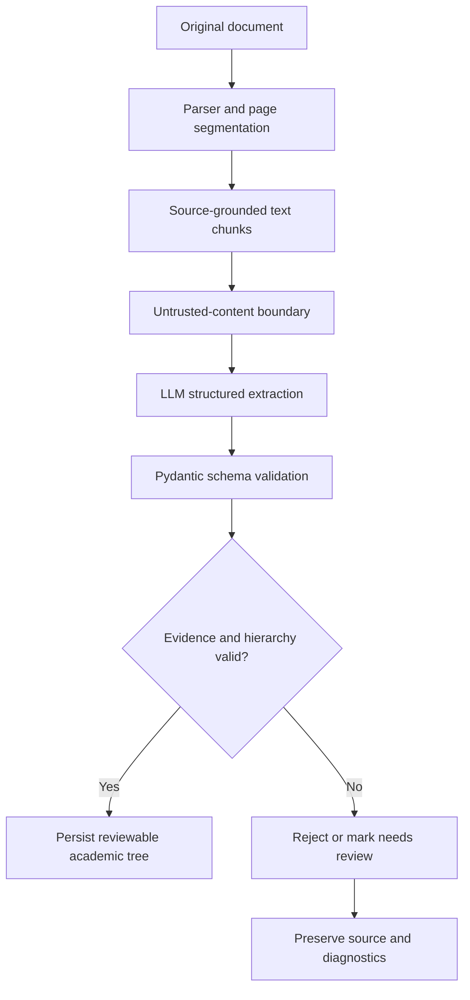
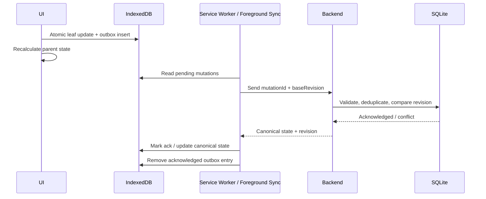
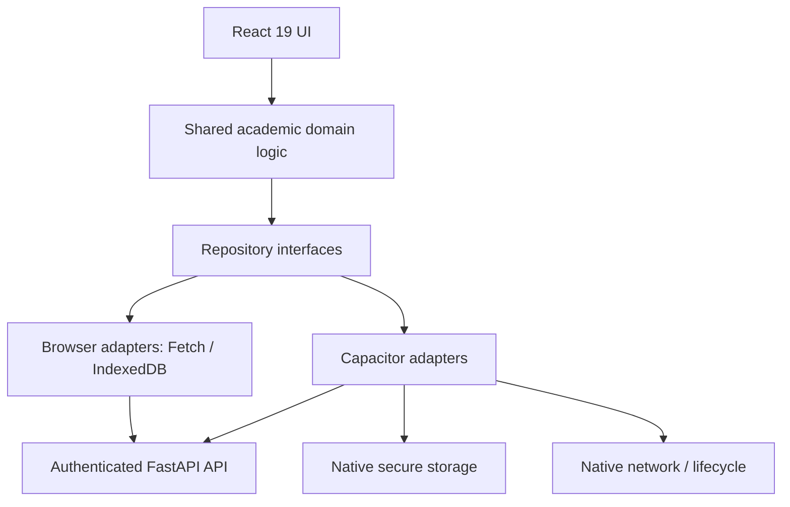

# 8_HARDWARE_MOBILE.md

> **Document status:** Engineering specification  
> **Project:** Hierarchical Syllabus Checklist & Progress Tracker  
> **Architecture:** Local-first, Windows-primary, cross-platform extensible  
> **Evidence policy:** Supplied project context is treated as an unverified baseline. Proposed designs are not claims of implementation.  
> **Primary priorities:** Resource safety, academic data integrity, offline reliability, secure synchronization, and predictable process lifecycle.

## 1. Hardware Requirements & Performance Tier Matrix

### 1.1 Architecture and compatibility principles

The application has four execution domains:

1. **Desktop application:** Windows frontend and local FastAPI backend.
2. **Document processing:** PDF, DOCX, legacy DOC conversion, and optional complex-document processing.
3. **AI extraction:** Local Ollama inference or an explicitly configured cloud provider.
4. **Mobile client:** PWA or Capacitor client using local persistence and a configured synchronization endpoint.

The mobile client must not require a local Ollama service. Heavy extraction remains a desktop/backend responsibility unless a separate mobile inference feature is designed, measured, and approved.

Core checklist operations must remain usable without an LLM, GPU, or internet connection.

### 1.2 Hardware compatibility matrix

These are recommended deployment profiles, not measured benchmarks or guarantees.

| Tier | CPU | RAM | GPU / VRAM | Storage | Intended workload |
|---|---|---:|---|---|---|
| Minimum | Modern 4-core CPU | 8 GB | Integrated / CPU-only | SSD, 10 GB free baseline | Basic parsing, checklist, lightweight extraction |
| Recommended | 6-core or better | 16 GB | Optional NVIDIA GPU, 4–8 GB VRAM | SSD, 20 GB+ free | Full desktop workflow, moderate local inference |
| Advanced | 8-core or better | 32 GB+ | NVIDIA GPU, 8–24 GB VRAM | NVMe SSD, 50 GB+ free | Larger models, complex documents, controlled parallel workloads |
| Mobile | Modern ARM64 mobile processor | 4 GB minimum; 6–8 GB preferred | Integrated mobile GPU | Device-managed storage | Checklist, progress, notes, offline operations |

GPU VRAM is not interchangeable with system RAM. Model memory requirements depend on artifact quantization, context length, runtime overhead, GPU offload, and concurrent workloads. Disk budgeting must include model downloads, source documents, temporary conversions, local databases, and backups.

### 1.3 Minimum tier

**Recommended profile:** 8 GB RAM, modern quad-core CPU, SSD, integrated graphics.

- Default to `pypdf` for digital PDFs and `python-docx` for DOCX.
- Use LibreOffice conversion for DOC only when installed and explicitly requested by the workflow.
- Keep Docling disabled by default.
- Do not preload local models at application startup.
- Prefer `qwen2.5:3b` only after a memory preflight; otherwise use cloud inference if configured and consented to, or mark extraction as requiring review.
- Limit heavy processing to one job when memory pressure is elevated.
- Keep checklist, notes, and progress functions independent of inference availability.

The minimum tier is not expected to run all optional subsystems concurrently.

### 1.4 Recommended tier

**Recommended profile:** 16 GB RAM, 6-core CPU, SSD, optional NVIDIA GPU with 4–8 GB VRAM.

- Use parser-first ingestion.
- Consider `qwen2.5:3b` as a conservative local model.
- Test `qwen2.5:7b` or `llama3.1:8b` only with suitable quantization and memory headroom.
- Permit controlled Docling fallback, never unbounded concurrent execution.
- Keep browser development, backend processing, and inference concurrency independently configurable.

A 4 GB VRAM GPU does not imply that a 7B/8B model will fit entirely in VRAM. CPU offload can increase system RAM use and latency.

### 1.5 Advanced tier

**Recommended profile:** 32–64 GB RAM, 8-core or better CPU, NVIDIA GPU with 8–24 GB VRAM, NVMe SSD.

This tier may support larger context windows, larger model artifacts, more complex documents, and additional concurrency. Capacity must be established by representative measurements, not GPU model names alone. Configure hard limits for simultaneous model requests and document jobs.

### 1.6 Mobile tier

The mobile client is a lightweight academic workspace. It should support hierarchy browsing, leaf completion, derived parent progress, notes, bookmarks, offline persistence, and later synchronization.

It should not automatically run Docling, convert DOC files, start desktop Ollama, or download multi-gigabyte models. Mobile storage is subject to browser/WebView quotas and operating-system eviction.

### 1.7 Resource-aware execution policy

| Condition | Required response |
|---|---|
| Low available RAM / high commit pressure | Reduce heavy-job concurrency; defer optional AI |
| Low disk space | Reject new processing before staging large files; preserve existing data |
| Ollama unavailable | Continue non-AI workflow; expose recoverable extraction status |
| GPU unavailable | Use configured CPU fallback only after memory preflight |
| Network unavailable | Preserve local checklist operations and pending mutations |
| Docling failure | Retain original source and report failure; do not silently substitute invented content |
| Job timeout/cancellation | Terminate owned child processes, close handles, clean only job-owned temporary files |
| IndexedDB quota failure | Preserve server/local authoritative data; surface export/recovery guidance |

---

## 2. Windows 11 OS Hardening & Resource Guardrails

### 2.1 WinError 1450: root-cause model

WinError 1450 (`ERROR_NO_SYSTEM_RESOURCES`) indicates that the system could not complete an operation because required system resources were unavailable. It is not synonymous with “RAM is full” and must not be attributed exclusively to paged-pool exhaustion.

Potential contributors in this workload include:

- High process commit or private memory.
- Paged-pool or nonpaged-pool pressure.
- Excessive process/thread creation.
- File-handle or kernel-object exhaustion.
- Too many simultaneous document conversions.
- PyTorch/Docling model allocations and native-library overhead.
- Duplicate Uvicorn reload supervisors or recursive watchers.
- Orphaned LibreOffice/Ollama/subprocess instances.
- Large temporary files or filesystem pressure.
- Antivirus scanning and file-lock contention.

#### Windows memory/resource terms

| Term | Meaning | Diagnostic relevance |
|---|---|---|
| Virtual address space | Process address-space reservation and mappings | Large reservation does not equal physical RAM use |
| Private bytes / commit | Private committed memory charged to system commit | Useful for detecting growing process commitments |
| Working set | Pages currently resident in physical RAM for a process | Can fluctuate as Windows trims memory |
| System commit charge/limit | Committed memory backed by RAM/pagefile capacity | High usage can prevent new allocations |
| Paged pool | Kernel memory that may be paged out | Kernel resource pressure indicator |
| Nonpaged pool | Kernel memory that must remain resident | Growth can indicate drivers/kernel allocations |
| Handles | References to kernel objects such as files and events | A steadily increasing count can indicate leaks |
| Threads | Execution contexts owned by processes | Unbounded thread creation increases resource pressure |

**Diagnostic principle:** collect a time series for the application process, child processes, system commit, pools, handles, and threads. A single memory snapshot is insufficient to establish a leak.

### 2.2 Mandatory resource protections

#### 2.2.1 Fast-path parsing

**Required default architecture**

- Use `pypdf` as the default PDF text parser.
- Use `python-docx` for DOCX.
- Avoid importing PyTorch in the ordinary parser path.
- Parse digital text before considering OCR/layout-heavy processing.
- Keep parsing and AI extraction as separate stages.
- Use a bounded temporary directory per job.
- Record page-level provenance during extraction.

A target such as approximately 20 ms for a small/simple PDF may be used as an optimization hypothesis only. It is not a service-level guarantee and must be measured on named hardware and representative fixtures.

Scanned PDFs with no usable text layer must be detected explicitly. Do not treat an empty text extraction as proof that a document has no syllabus content.

#### 2.2.2 Docling fallback

**Proposed default:** `ENABLE_DOCLING_FALLBACK=False`.

This variable is proposed and must not be assumed to exist until implemented and documented in the actual configuration layer.

When enabled:

1. Check free disk space and memory pressure.
2. Enqueue the document in a bounded heavy-processing queue.
3. Acquire a dedicated semaphore slot.
4. Apply a wall-clock timeout and cancellation token.
5. Run in an isolated worker process where practical.
6. Track child PIDs and process ownership.
7. Capture a sanitized failure category and job correlation ID.
8. Release model references and terminate owned child processes.
9. Preserve the original file and intermediate evidence needed for review.

Never allow a request storm to start unlimited Docling/PyTorch jobs. Do not terminate unrelated Python processes to recover resources.

#### 2.2.3 Uvicorn reload behavior

Development-only example:

```powershell
uvicorn <verified_asgi_import> --reload --reload-dir backend/app
```

`<verified_asgi_import>` is a placeholder, not a claim that a particular module exists. Resolve it from the repository before use.

Requirements:

- Restrict reload watching to the application source directory.
- Exclude virtual environments, uploads, model caches, generated exports, and databases.
- Never use reload mode in production.
- Ensure only one reload supervisor is active for a development instance.
- Do not implement a second recursive watcher that duplicates Uvicorn reload behavior.
- Avoid watching directories whose files are modified by the application itself.

If the actual source tree differs, adapt the watch directory rather than creating the example path blindly.

#### 2.2.4 Concurrency limits

**Proposed baseline:** heavy document-processing concurrency of two jobs, represented by an `asyncio.Semaphore(2)` in the owning process. This is a starting policy, not a proven safe value for every tier.

```python
import asyncio

DOCUMENT_PROCESSING_LIMIT = 2  # Proposed configurable default.
document_slots = asyncio.Semaphore(DOCUMENT_PROCESSING_LIMIT)

async def run_document_job(job):
    async with document_slots:
        return await job()
```

Production requirements:

- Read the limit from validated configuration.
- Consider a value of one on low-memory machines.
- Distinguish heavy document concurrency from lightweight API request concurrency.
- Use a bounded queue; reject or defer excess jobs with an actionable response.
- Apply per-job timeout and cancellation.
- Ensure cancellation reaches subprocesses, not only the awaiting coroutine.
- Avoid holding a semaphore slot while waiting indefinitely for user input.
- Record queue depth, wait duration, active jobs, and failure counts.

An in-process semaphore does not coordinate multiple Uvicorn worker processes. If multiple workers are configured, use a shared job queue/lock or keep heavy processing in a single dedicated worker.

#### 2.2.5 Windows Job Objects and process lifecycle

**Proposed location:** `scripts/launcher.py` (proposed until repository inspection confirms this path).

A Windows Job Object can group child processes and apply lifecycle/resource policies. `JOB_OBJECT_LIMIT_KILL_ON_JOB_CLOSE` requests termination of processes associated with the job when the last handle to the job object closes.

Implementation requirements:

1. Create the Job Object before spawning owned child processes.
2. Configure limits before assigning children.
3. Assign only processes created and owned by the launcher.
4. Keep a valid Job Object handle for the intended lifetime.
5. On orderly shutdown, signal graceful termination first.
6. Close the Job Object handle only when the launcher intends the owned job tree to end.
7. Handle assignment failures explicitly.
8. Do not silently continue under the assumption that child cleanup is guaranteed if assignment failed.

Important caveats:

- Processes may be created suspended and assigned before they execute to reduce the race window.
- A child already associated with an incompatible job may not be assignable under all Windows versions/configurations.
- Breakaway flags and nested-job behavior must be deliberately designed.
- A process that must outlive the launcher must not be placed in a kill-on-close job.
- Never attach unrelated user processes or a shared Ollama service to the launcher’s kill-on-close job unless the launcher truly owns its lifecycle.

If Job Object setup fails, use explicit PID/process-handle tracking and bounded graceful shutdown as a documented degraded mode. Do not claim equivalent guarantees.

### 2.3 Memory budgeting

Budgets must be measured and configurable. The table below defines ownership and policy rather than fixed consumption guarantees.

| Workload | Budget policy | Guardrail |
|---|---|---|
| pypdf fast-path | Small per-job budget; record peak process memory | Parse sequentially for large files |
| DOCX parsing | Bound archive expansion and extracted text size | Reject pathological archives |
| LibreOffice conversion | One conversion process per slot | Timeout, isolated profile, owned-process cleanup |
| Docling | Dedicated heavy budget and queue | Disabled by default; low concurrency |
| Ollama | Separate model/runtime budget | Context and parallelism caps; unload under pressure |
| SQLite | Small bounded connection pool | Short transactions; bounded busy timeout |
| Vite dev server | Development-only budget | Do not run in production |
| Background workers | Per-job and total concurrency budgets | Bounded queue and cancellation |

#### 2.3.1 Memory-pressure policy

Use a platform abstraction for memory telemetry. On Windows, distinguish available physical memory, system commit headroom, process private bytes, and pool metrics. Do not rely only on `psutil.virtual_memory().percent`.

Suggested states:

- **NORMAL:** standard configured workload.
- **CONSTRAINED:** reduce new heavy jobs; avoid model preload.
- **CRITICAL:** pause optional inference/Docling; allow safe completion or cancellation of active work.
- **RECOVERY:** require a stable resource window before resuming deferred jobs.

Thresholds must be configurable and calibrated on supported hardware. Avoid oscillation by using hysteresis and minimum dwell periods.

#### 2.3.2 CPU, disk, and handle protections

- Apply bounded worker counts; avoid CPU oversubscription between inference and document processing.
- Check free disk before staging, conversion, export, and backup.
- Reserve space for database writes and recovery operations.
- Track open file handles per job where practical.
- Use context managers for files, SQLite connections, and subprocess pipes.
- Delete only temporary files whose ownership is established by the job manifest.
- Use a cleanup grace period and avoid deleting files used by active jobs.
- Keep user source documents separate from temporary processing artifacts.

### 2.4 Windows 11 compatibility

Support Windows 11 Home and Pro at the application layer, subject to dependencies and native tooling.

#### Python environments

- Use a project-local virtual environment.
- Pin and document dependency versions.
- Do not invoke a global Python interpreter accidentally.
- Validate Python architecture and version at startup.
- Keep model files and user data outside the virtual environment.

#### Windows Defender

Do not recommend disabling Defender or real-time protection as a routine performance workaround. If scanning causes measurable contention, document a narrow, user-approved exclusion only for a dedicated non-executable cache directory after a security review. Never exclude the project root, downloads, or arbitrary user directories.

#### Paths and permissions

- Use Unicode-safe path handling.
- Quote paths containing spaces in process arguments.
- Prefer `pathlib.Path` and argument arrays over shell command concatenation.
- Test long paths and nested directory behavior.
- Do not require administrator privileges for ordinary checklist operations.
- Store mutable user data in an appropriate per-user data directory.
- Separate installation binaries from writable data and logs.

#### Portable versus installed deployment

| Concern | Portable | Installed |
|---|---|---|
| App binaries | User-selected folder | Installer-managed location |
| Mutable data | Explicit user data folder | Per-user application data |
| Updates | User-managed | Installer/updater-managed |
| Permissions | Must avoid protected folders | Standard-user operation preferred |
| Backups | User responsibility unless built in | Documented backup location |

### 2.5 Windows error troubleshooting matrix

| Error | Common interpretation | Safe first response |
|---|---|---|
| WinError 1450 | System resource allocation failure | Stop new heavy jobs; inspect commit, pools, handles, threads, child processes |
| WinError 32 | Sharing violation / file in use | Identify owner; wait or close owned handle; do not force-delete active file |
| WinError 5 | Access denied | Check path ACL, ownership, protected location, and process identity |
| WinError 145 | Directory not empty | Inspect contents and ownership; do not recursively delete unknown data |
| Stale temporary files | Interrupted job cleanup | Match job manifest and active process ownership before cleanup |
| Stuck LibreOffice | Conversion subprocess/profile lock | Terminate only the process tree created for that job |
| Orphaned Uvicorn | Duplicate or failed shutdown | Identify parent/child ownership and port listener before termination |

---

## 3. Local LLM Inference Optimization (Ollama)

### 3.1 Model selection matrix

Model tags are mutable distribution labels and do not fully specify quantization or memory use. Verify the exact pulled artifact and runtime metadata on the target machine.

| Model family/tag supplied | Relative suitability | Main caution |
|---|---|---|
| `qwen2.5:3b` | Low-resource candidate | Still requires memory for context and runtime |
| `qwen2.5:7b` | Balanced candidate | May exceed comfortable 4 GB VRAM capacity |
| `llama3.1:8b` | Higher-capacity candidate | RAM/VRAM and context requirements can be substantial |
| `Qwen3-8B:latest` | Advanced candidate | Confirm exact Ollama tag and artifact availability; do not assume tag syntax or quantization |

#### Tier recommendations

| Hardware | Suggested strategy |
|---|---|
| 8 GB CPU-only | Prefer parser-only extraction or a small quantized model after preflight; cloud provider only with explicit configuration/consent |
| 16 GB RAM | 3B model is conservative; test 7B/8B quantized artifacts with modest context |
| 4 GB VRAM | Expect partial or CPU offload; avoid assuming full GPU residency |
| 8 GB VRAM | Test 7B quantized artifacts with reduced context and low parallelism |
| 12–24 GB VRAM | Larger 7B/8B configurations and longer contexts may be feasible after measurement |

No model should be selected solely by parameter count. Measure peak system RAM, VRAM, load time, warm inference time, and extraction validity using representative syllabi.

### 3.2 Inference configuration

The supplied baseline is:

```yaml
num_ctx: 16384
temperature: 0.0
```

This is a proposed baseline, not proof that the current project uses these values. A 16,384-token context can materially increase memory use and may be unsuitable for low-RAM machines.

#### Proposed context profiles

| Profile | Context starting point | Temperature | Parallel requests |
|---|---:|---:|---:|
| Low-resource | 2,048–4,096 | 0.0 | 1 |
| Balanced | 4,096–8,192 | 0.0 | 1 |
| High-resource | 8,192–16,384 | 0.0 | 1–2 after measurement |

Context values are tuning starting points, not guarantees. Configure `num_predict` to the maximum expected structured response size and reject truncated/incomplete output. Do not compensate for insufficient context by silently dropping source evidence.

Other controls:

- **Model loading:** load only when extraction is requested or when an explicit warm-up policy allows it.
- **Keep-alive:** use a short, configurable idle retention on constrained machines; longer retention only when memory headroom permits.
- **Parallelism:** default to one model generation at a time on low-resource hardware.
- **Timeout:** set separate connection, model-load, and generation timeouts.
- **Retries:** retry only transient failures; do not endlessly retry malformed deterministic output.
- **JSON mode/schema:** use structured output constraints when supported, then validate with Pydantic.
- **Validation:** reject unknown hierarchy levels, missing provenance, invalid IDs, and unsupported leaf claims.
- **Repair:** allow at most a bounded repair attempt using the same source evidence; otherwise require review.

### 3.3 Structured extraction pipeline



The model is an extractor, not an authority. Imported text must be treated as untrusted data. Prompt instructions contained in syllabi, web pages, or embedded metadata must never override system/developer extraction policy.

Temperature zero does not guarantee deterministic output across model versions, runtimes, or hardware. Validation and provenance are the actual integrity controls.

### 3.4 CPU, CUDA, and platform fallback

- CPU-only Ollama inference is a supported fallback only if memory and latency are acceptable.
- NVIDIA acceleration depends on supported GPU, driver, runtime, and Ollama build.
- GPU offloading can reduce CPU work but may still require system RAM for model layers, context, and runtime.
- If GPU allocation fails, do not automatically launch multiple CPU model copies.
- Metal is relevant to macOS deployments; it is not native Windows GPU acceleration.
- On unsupported GPUs, use CPU-only mode or a configured cloud provider; never claim CUDA availability from the presence of an NVIDIA device alone.

### 3.5 Cold-start optimization

Track separately:

1. Ollama service connection.
2. Model availability/pull state.
3. Model load duration.
4. First-token latency.
5. Generation duration.
6. Validation duration.
7. Total job duration.

Warm-up should be opt-in or policy-driven. A warm-up request must not run automatically on battery-constrained or memory-constrained systems. Idle unloading should be configurable and must not interrupt an active job.

Expose progress stages to the UI: queued, parsing, preparing model, extracting, validating, awaiting review, completed, or failed. Avoid reporting a generic “AI processing” spinner for the entire operation.

---

## 4. PWA & Offline-First Synchronization

> **Status:** Proposed architecture unless verified in the repository.

### 4.1 PWA architecture

The React 19 + Vite frontend may be packaged as a Progressive Web App using a Web App Manifest and Service Worker.

Required components:

- Manifest with product name, icons, theme/background colors, start URL, and display mode.
- Service Worker for application-shell and static-asset caching.
- Versioned asset cache names tied to build identity.
- Offline fallback route/screen.
- Explicit update lifecycle.
- API network policy separated from static asset caching.

#### Cache policy

| Resource | Strategy |
|---|---|
| Hashed JS/CSS assets | Cache-first; immutable content hashes |
| App shell | Precache or stale-while-revalidate |
| Public static icons/fonts | Cache-first with versioning |
| Authenticated API responses | Network-first or no-store according to sensitivity; never blanket-cache |
| Student notes/progress | IndexedDB application storage, not generic HTTP cache |
| Document uploads | Explicit user-controlled storage and quota policy |

Do not cache authenticated responses indiscriminately. Avoid storing bearer tokens in Service Worker caches. Clear obsolete caches only after successful activation and only for caches owned by this application.

#### Service Worker update lifecycle

1. New worker downloads while the existing worker remains active.
2. Application detects update availability.
3. User is informed if immediate activation could interrupt an operation.
4. Pending local writes are committed to IndexedDB before reload.
5. New worker activates.
6. Old version caches are retired safely.
7. Client reloads or transitions through a controlled update.

### 4.2 Proposed IndexedDB schema

Use versioned IndexedDB migrations. The schema below is illustrative and must be reconciled with the server's canonical schema before implementation.

| Object store | Key | Purpose |
|---|---|---|
| `documents` | `documentId` | Document metadata and provenance |
| `academicNodes` | `nodeId` | Five-tier hierarchy nodes |
| `leafProgress` | `leafId` | Tier-5 completion state only |
| `notes` | `noteId` | Per-topic Markdown notes |
| `resources` | `resourceId` | Bookmarked links and metadata |
| `offlineOutbox` | `mutationId` | Pending idempotent mutations |
| `syncMetadata` | `key` | Cursor, server revision, schema version |
| `conflicts` | `conflictId` | Mutations requiring explicit resolution |

Parent completion state and percentage are derived from eligible leaf states. Do not persist parent completion as a second independent truth.

#### Proposed TypeScript contracts

```typescript
type SyncStatus = "pending" | "in_flight" | "acknowledged" | "failed" | "conflict";

interface OfflineMutation<TPayload = unknown> {
  mutationId: string;
  entityId: string;
  entityType: "leaf_progress" | "note" | "resource";
  operation: "upsert" | "delete";
  payload: TPayload;
  createdAt: string;       // ISO-8601 UTC timestamp
  retryCount: number;
  status: SyncStatus;
  lastError?: string;
  baseRevision?: number;
}

interface LeafProgressRecord {
  leafId: string;
  completed: boolean;
  revision: number;
  updatedAt: string;
}

interface SyncMetadata {
  key: string;
  lastServerCursor?: string;
  schemaVersion: number;
  lastSuccessfulSyncAt?: string;
}
```

Validate data at runtime when crossing IndexedDB/API boundaries. TypeScript interfaces alone do not validate persisted or remote data.

### 4.3 Offline mutation and synchronization protocol

#### Mutation creation

When a student toggles a leaf:

1. Validate that the target is a Tier-5 leaf.
2. Create a unique mutation ID.
3. Write the new local leaf state and outbox record in one IndexedDB transaction.
4. Recalculate parent states locally from eligible leaves.
5. Update the UI.
6. Attempt foreground sync when online and authenticated.

If the IndexedDB transaction fails, do not show the operation as durably saved. Show a recoverable error and retain the prior UI state.

#### Synchronization sequence



#### Idempotency

- The client supplies a stable `mutationId` for each logical operation.
- The server stores processed mutation IDs with the outcome.
- Repeated requests with the same ID must return the original outcome rather than applying the operation twice.
- Idempotency records must be scoped to the authenticated user/tenant and retained for a documented period.
- Reusing one mutation ID with a different payload must be rejected.

#### Conflict policy

Use server-authoritative revision checks:

- Each leaf record has a monotonically increasing revision or equivalent server version.
- Client mutation includes the revision it was based on.
- If the server revision matches, apply the mutation and increment revision.
- If it does not match, return a conflict with the current canonical state.
- The client stores the conflict and presents a resolution workflow where necessary.
- Do not silently overwrite a newer server state.

A last-write-wins policy is acceptable only if explicitly selected and defined using a trusted server timestamp, deterministic tie-breaker, and clear user-facing semantics. Client clocks alone are not authoritative.

Notes may require a different conflict strategy (for example, retain both versions or require manual merge). Do not apply a boolean leaf-progress policy to Markdown notes.

#### Historical progress and enrollment

Elective deactivation must not delete leaf progress. Enrollment state controls visibility/active participation, not the existence of historical completion records. Reactivation must restore the previously stored state.

#### Parent progress

Parent checked/indeterminate/unchecked state and percentages are recomputed from the synchronized leaf records. Never synchronize parent percentages as independently mutable state.

### 4.4 Background Sync and storage limitations

Background Sync is not universally available and must not be required for correctness.

- iOS Safari and installed web apps have platform-specific scheduling and lifecycle restrictions.
- A Service Worker may be terminated between events.
- Browser storage can be evicted under pressure.
- IndexedDB quotas vary by browser, device, and origin.
- Private browsing modes may impose stricter storage behavior.
- App termination can interrupt in-flight work.

Therefore:

- Sync on app foreground, successful authentication, network restoration, and explicit user action.
- Use Background Sync only as an enhancement.
- Keep a visible pending-sync indicator.
- Provide export/recovery options for important local work.
- Never delete pending mutations merely because retry count is high.
- Provide a user-controlled conflict and retry screen.

### 4.5 Offline data protection

Define retention and encryption requirements based on the threat model. Browser storage is not automatically encrypted against a compromised device or same-origin script execution. Avoid persisting access tokens in localStorage. Prefer short-lived credentials and platform-appropriate secure storage for native builds. Minimize cached personal academic content on shared devices.

---

## 5. Capacitor Native Mobile Packaging

> **Status:** Proposed architecture. Do not assume `android/` or `ios/` folders already exist.

### 5.1 Shared application architecture

The target architecture reuses the React/Vite application while isolating platform-specific behavior behind adapters.



Keep academic rules—five-tier hierarchy, leaf-only completion, and derived parent state—in shared domain logic. Do not duplicate business rules in Android/iOS code.

Proposed platform abstraction examples:

- `StorageRepository`
- `SyncTransport`
- `SecureCredentialStore`
- `AppLifecycleAdapter`
- `NetworkStatusAdapter`

These are conceptual interfaces, not verified source files.

### 5.2 Android packaging

Requirements:

- Android Studio and a supported Android SDK.
- Capacitor Android platform package compatible with the chosen Capacitor major version.
- JDK version compatible with the Android Gradle Plugin.
- Debug and release signing separated.
- Minimum Android API level selected as an explicit product decision.
- Runtime permissions requested only when a feature needs them.
- Status bar, navigation bar, keyboard resize, and safe-area behavior tested on physical devices.

Build lifecycle:

1. Produce a production Vite build.
2. Verify the configured web output directory.
3. Synchronize Capacitor assets.
4. Open/build the Android project.
5. Run emulator and physical-device smoke tests.
6. Sign release APK/AAB using protected signing material.
7. Verify package ID, version, permissions, and endpoint configuration.
8. Archive release artifacts and checksums.

Do not commit keystores, signing passwords, or release credentials.

### 5.3 iOS packaging

iOS packaging requires macOS and Xcode for native build, signing, simulator, and physical-device deployment.

Requirements:

- Compatible Xcode and iOS SDK.
- Apple developer signing/provisioning as required by distribution.
- Bundle identifier and version policy.
- App Transport Security configuration.
- HTTPS API endpoints with valid certificates.
- Safe-area and keyboard testing.
- Privacy manifest and permission disclosures where applicable.
- Physical-device verification before release.

A Windows-only development machine cannot perform the complete native iOS build/signing workflow. A macOS build environment is required.

### 5.4 API connectivity modes

Support three configurable modes:

1. **Local Windows backend:** mobile device reaches a backend on the same trusted network.
2. **Deployed HTTPS backend:** mobile client connects to a secured deployment.
3. **Future sync service:** authenticated service with stable API contracts and revision semantics.

Configuration should be environment-specific. Do not hardcode private IP addresses or assume the laptop retains the same address.

#### Local network security

- Bind the backend to a LAN interface only when explicitly needed.
- Use host firewall rules restricted to the trusted private network and required port.
- Do not expose an unauthenticated development server to the public internet.
- Treat local network discovery as untrusted input.
- Account for Wi-Fi client isolation, VPN routing, subnet changes, and captive portals.
- Require authentication and authorization even on a home network.
- Use HTTPS for production and remote access; local development certificates must be handled explicitly.
- Do not disable certificate validation to “make mobile work.”

#### Endpoint configuration

Provide an environment-specific endpoint setting through the build/runtime configuration layer. Validate scheme, host, and path. Production builds should reject insecure remote HTTP endpoints except for a narrowly documented local-development mode.

### 5.5 Responsive and mobile UI compatibility

Required viewport targets:

| Target | Width | Height |
|---|---:|---:|
| Small mobile | 360 | 800 |
| Standard mobile | 390 | 844 |
| Tablet portrait | 768 | 1024 |
| Tablet landscape | 1024 | 768 |
| Desktop | 1440 | 900 |

Design requirements:

- Replace desktop sidebar with an accessible mobile navigation pattern.
- Preserve the five-tier academic hierarchy; use progressive disclosure rather than flattening.
- Keep primary actions reachable without horizontal scrolling.
- Use touch targets meeting WCAG 2.2 AA target-size guidance or documented exceptions.
- Use bottom sheets/action menus where appropriate.
- Ensure dialogs fit the visual viewport when the keyboard is open.
- Apply safe-area insets on notched devices.
- Keep nested academic-tree scrolling predictable.
- Prevent notes drawers and modals from obscuring their own controls.
- Support portrait and landscape layouts.
- Do not rely on hover-only actions.

### 5.6 Mobile release pipeline

**Proposed release checklist**

- [ ] Confirm target environment and API endpoint.
- [ ] Confirm application version and runtime compatibility policy.
- [ ] Produce frontend production build.
- [ ] Review generated asset size and source maps policy.
- [ ] Synchronize Capacitor.
- [ ] Build Android debug and release variants.
- [ ] Build iOS using macOS/Xcode.
- [ ] Verify signing and provisioning.
- [ ] Verify authentication and certificate validation.
- [ ] Verify offline launch and pending mutation persistence.
- [ ] Verify synchronization and conflict recovery.
- [ ] Verify no secret is embedded in the client bundle.
- [ ] Run authorized smoke tests on emulator and physical devices.
- [ ] Archive artifacts, checksums, release notes, and build provenance.
- [ ] Document rollback and minimum compatible server version.

---

## 6. Configuration Contract and Operational Defaults

The following names are **proposed configuration keys**, not verified existing environment variables. Before implementation, map them to the project's actual settings mechanism and avoid duplicate sources of truth.

| Proposed key | Purpose | Proposed default | Allowed values / notes | Restart |
|---|---|---|---|---|
| `ENABLE_DOCLING_FALLBACK` | Enable complex parser fallback | `false` | Boolean; heavy resource impact | Yes |
| `DOCUMENT_PROCESSING_LIMIT` | Heavy document concurrency | `2` | Positive integer; lower on 8 GB systems | Worker reload |
| `DOCUMENT_JOB_TIMEOUT_SECONDS` | Per-job timeout | Deployment-tuned | Positive integer | Usually yes |
| `OLLAMA_BASE_URL` | Ollama endpoint | Local service URL | Validated URL; do not expose publicly | No/connection refresh |
| `OLLAMA_MODEL` | Selected model tag | User/config selected | Must exist in local runtime | No, but model reload |
| `OLLAMA_NUM_CTX` | Context window | Profile-dependent | Positive bounded integer | Model reload |
| `OLLAMA_NUM_PREDICT` | Maximum generated tokens | Schema-dependent | Positive bounded integer | Request/model dependent |
| `OLLAMA_KEEP_ALIVE` | Idle model retention | Short on constrained devices | Runtime-supported duration | No |
| `OLLAMA_MAX_PARALLEL` | Concurrent generations | `1` | Positive small integer | Runtime dependent |
| `PWA_CACHE_VERSION` | Static cache identity | Build-derived | Immutable per release | Client update |
| `SYNC_BATCH_SIZE` | Mutations per request | Small bounded batch | Positive bounded integer | No |
| `SYNC_RETRY_LIMIT` | Retry policy threshold | Bounded | Must not imply deletion | No |
| `API_BASE_URL` | Backend endpoint | Environment-specific | HTTPS except explicit local dev | Client restart/rebuild |
| `MAX_UPLOAD_BYTES` | Upload limit | Deployment-tuned | Positive integer | Backend restart |
| `MAX_ARCHIVE_EXPANSION_BYTES` | Archive expansion limit | Deployment-tuned | Positive integer | Backend restart |

For every setting, expose the effective value in a safe diagnostics view while omitting secrets. Validate configuration at startup and fail clearly on invalid values.

## 7. Operational Acceptance Criteria

A release is not hardware/mobile-ready until:

1. Basic checklist operations work with Ollama stopped.
2. Low-resource mode prevents uncontrolled heavy processing.
3. Docling is opt-in and concurrency-bounded.
4. Owned child processes are cleaned up on normal and abnormal shutdown.
5. SQLite and source documents survive failed processing.
6. Mobile offline changes are durably queued before being shown as saved.
7. Duplicate sync requests are idempotent.
8. Revision conflicts do not silently overwrite newer state.
9. Parent progress is derived from Tier-5 leaves.
10. PWA caching excludes sensitive authenticated responses by default.
11. Capacitor builds use environment-specific endpoints and protected signing material.
12. Mobile layouts preserve all five academic tiers and remain operable with the keyboard open.

**Cross-reference:** See `9_TESTING_DEBUG.md` for resource regression measurements, Job Object lifecycle tests, PWA/Capacitor verification, synchronization conflict tests, and recovery procedures.
